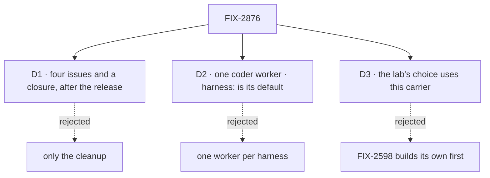

# FIX-2876 · Decisions

[Spec](SPEC.md) · **Decisions**

The calls above any single issue, and what each locks in for the four children and the closure.
D2 and D3 answer the questions FIX-2878 and FIX-2879 put to the owner, as recommendations. D3
also reaches into a sibling epic, FIX-2616, and names two of its issues as readers of the carrier.
Five calls the owner and the engineering manager already made are in
[Decided in review](#decided-in-review); the cards and rules below carry them.

## The tree

## D1 · One way to pick a coder is worth four issues and a closure, after the release

| | |
|---|---|
| **Instead of** | Only the cleanup (FIX-2877): one flow and one default, with the pick still in message text |
| **Because** | A picked model never reaches a coding task today, and switching coder throws the task away. The cleanup merges knobs but leaves both. Eleven places pick a coder ([SPEC](SPEC.md#whats-already-here-and-the-debt)); goal 4 asks us to close that, not shrink it |
| **Locks in** | Run settings are fields of the coder flow's declared task input; later settings join that schema. The input is `codingTaskInput { harness?, model?, feature?, project? }`: `harnessFeature` and `input.project` move into it and the namespacing goes. A task input is declared and checked by [FIX-2894](https://linear.app/fixpoint-labs/issue/FIX-2894) ([ER-9](#who-owns-what)), which blocks FIX-2878. Owner's call, [Q-A and Q-B](#decided-in-review) |

**What would change my mind:** evidence that nobody switches coder or model per task. Then one
default per app is enough, FIX-2878 and FIX-2879 go, and FIX-2877 ships alone (FIX-2894 stands
on its own as typed task input).

It comes down to the task: without run settings, the harness stays fixed per worker and the model never arrives.

## D2 · Teammates keeps one coder worker; a worker's `harness:` is only its default

| | |
|---|---|
| **Instead of** | One coding worker per harness (`teammates.claude-code`, `.codex`, `.cursor`), as today |
| **Because** | Once a task names its harness, the three workers differ by one line, and switching coder means cancelling and refiling to another. With one worker, it is a field on the task or a follow-up, in the same session |
| **Locks in** | The task card and run report show the harness and model the run used, read from the run ([ER-2](#who-owns-what)). A worker that must not change coder declares its harness locked, and a request naming another is refused by name ([ER-11](#who-owns-what)); Teammates' one coder is not locked. FIX-2879 collapses the workers, since that is when the pick reaches the task without text. FIX-2877 only removes the fallback copies. The lab's own worker ids stay FIX-2598's |

**What would change my mind:** people choosing a coder by its roster row rather than on the
request. Then the per-harness rows stay as presets, still overridable by a task.

It comes down to switching: one worker turns cancel-and-refile into a field on the task.

## D3 · The Claude Code-style lab's choice travels through this epic's carrier; FIX-2598 waits for FIX-2879's package half

| | |
|---|---|
| **Instead of** | FIX-2598 settles where the lab's pick lives, as [FIX-2616 ER-2](../FIX-2616/DECISIONS.md#who-owns-what) leaves it, and builds that first |
| **Because** | FIX-2879 builds a carrier in the workforce kit for Teammates. Two carriers built in parallel end with one rewritten onto the other. FIX-2616 ER-2 expected this: "a package change is a child that blocks it" |
| **Locks in** | FIX-2598 waits only for FIX-2879's **package half**: the `codeWith` session field and the server stamp at filing, not its Teammates worker collapse ([D2](#d2)). FIX-2879 splits along that line, a planned split the spec-set author makes; the package half blocks FIX-2598 in Linear (FIX-2878 is implied through it). The carrier has two readers in FIX-2616. **FIX-2598** writes the person's harness and model through it, and removes the lab's `Coder:` line in the same PR as the lab's eight per-harness workers, so the lab never has the line gone while the workers remain. **FIX-2599** reconciles plan mode: the lab's `claude-code-plan` harness id becomes a plan-mode run setting, a field of `codingTaskInput`, never a second store. What plan mode a harness offers stays FIX-2597's ([FIX-2616 ER-1](../FIX-2616/DECISIONS.md#who-owns-what)). A PR on FIX-2616 records that ER-2's placement is answered here. It opens with this epic's approval and merges before any child's implementation starts, so FIX-2598's readers never meet two ownership stories |

**What would change my mind:** the lab needing its model picker before this epic's release
window. Then FIX-2598 goes first with the smallest carrier it can, and FIX-2879 adopts it.

It comes down to carriers: building both in parallel ends with one of them rewritten.

## Who owns what

Every rule has one owner. A *uses* cell is a place a child must not decide the rule again.

| # | Rule every child obeys | Owner | Checked at |
|---|---|---|---|
| ER-1 | One coding worker flow: the harness kit's `coder`. No app in this repo forks it; Shift Manager's `coder.mts` goes. What an app needs is an option or a slot on that flow | FIX-2877 | FIX-2878's and FIX-2879's spec review; closure leg c |
| ER-2 | One order, written once in the coder flow: the task's run settings (`harness` and `model` in `codingTaskInput`), then the worker's config, then the kit default, then (for a model) the harness's own default. **Every route the coder flow has resolves through it**: the task's work, a steer, a delivered message and the door. None routes by the session's worker alone, as `harnessOf` and `byHarness` in `coder-flow.ts` do today. A harness is checked against the filled harnesses; a refused harness fails the task at once, names what is allowed, and never runs on something else. A named model runs only when that harness's `models()` returned `status: "models"` and the whole selection, Cursor's id and params included, is a listed entry. Otherwise the model is refused by name and the run uses the harness default; no catalog, a failed catalog and an unlisted param are all refusals. What ran, and any refusal, is read from the run, never from the pick | FIX-2878 | FIX-2879's spec review; closure legs a, b, c and d, with b's steer, message and door cases each asserting the harness, the model and the refusal, and d's failed catalog and unlisted param |
| ER-3 | Each app sets its default coder in one place, the kit's `defaultHarness`. Prompts and clients read it and keep no copy | FIX-2877 | FIX-2879's spec review; closure sweep |
| ER-4 | `harness` names the harness a coding run uses, by `id`, on a worker or in a task's run settings. No other setting is called `harness` | FIX-2877 | Each child's spec review |
| ER-5 | The person's pick travels as structured turn state, never as message text: the harness kit's `codeWith`, a field of workforce's `sessionFields` keyed slot in its `written: "turn"` mode, sent as the respond action's optional `fields`. Each turn writes its pick, and the pick stays on the session for turns no user started. The server stamps it into the task's run settings at filing ([ER-10](#who-owns-what)). The one instruction about it comes from the harness kit's capability, not from each `WORKER.md`. FIX-2879 removes Teammates' `Coding harness:` line. The Claude Code-style lab's `Coder:` line is FIX-2598's ([FIX-2616 ER-2](../FIX-2616/DECISIONS.md#who-owns-what)), removed in the same PR as the lab's per-harness workers ([D3](#d3)) | FIX-2879 | Closure legs a and b |
| ER-6 | The scripted harness reports the model it was handed, so the closure runs without a signed-in vendor | FIX-2878 | Closure, every leg |
| ER-7 | Consumed issues keep their parents: FIX-2598 under FIX-2616, FIX-2627 under FIX-2618. FIX-2583, FIX-1990 and FIX-2874 are `relates-to` only | The coordinator | Each refresh |
| ER-8 | A resumed harness session belongs to the harness now dispatched. When the coder changes on a follow-up, the run starts a fresh session on the new harness, or refuses loudly; it never resumes one vendor's session in another. FIX-2878's spec picks which. **The match is by the harness's `id`** ([ER-4](#who-owns-what)'s name), recorded with the session it names, **never by the handle's `source`**: two harnesses can report one source (`claude-code` and `claude-code-plan` both report `claude-code/sdk`; every scripted harness reports `harness-manager/stub`). **Every resume path checks it**: the manager's next attempt and the door's talk. Today `manager.ts` records `source` and checks nothing, leaving the check to "the issue that introduces per-task harness choice"; `session-door.ts` resumes the recorded session unchecked | FIX-2878 | FIX-2879's spec review; closure leg b, under its `source` control |
| ER-9 | A task's input is what its flow's `work` entry declares. `createTask` and `updateTask` check it at filing, the entry checks it again at claim, and `listDelegates` shows it. A flow that declares none takes an open record. No reader parses task input on its own | FIX-2894 | FIX-2878's spec review; closure leg d |
| ER-10 | Harness and model on a task are written by the server from the authenticated turn and always overwrite what the filer sent. Tool args, `input` and `metadata` cannot set them; a filing naming a different harness is refused or overwritten, never honoured (BP-031). With no turn pick, the task carries none and the order falls to the worker | FIX-2878 | FIX-2879's spec review; closure leg d: tool args name `claude-code` while the turn's pick is plan mode, or absent, and the run is in plan mode |
| ER-11 | A worker can declare its harness locked. A request naming a different harness, a task's run setting or a turn's pick, is refused by name, never silently ignored | FIX-2878 | FIX-2879's spec review; closure leg d: a worker locked to plan mode refuses an edit-capable pick |

**Public names.** No name the set fixes is one [`glossary.mjs`](../../../docs/contributing/glossary.mjs)
retires. FIX-2894's PR adds a *Task input* entry if it is public. FIX-2878's PR adds the *Run settings* entry (the `harness` and `model` fields of a coding task's input), names the lock, and amends *Harness* ("a worker's `harness:`
line names one by `id`") to say a task's run settings name one too. FIX-2879's PR amends the
`sessionFields` entry for the `written: "turn"` mode and `codeWith`, if they are public.

## Coordination seams

| Seam | Between | Rule |
|---|---|---|
| `harness-manager/src/kit/coder-flow.ts` | FIX-2877 (Shift Manager's options), FIX-2878 (the order), FIX-2583 outside (PR policy options) | The second to merge rebases. FIX-2878 never edits `coder.mts`; Shift Manager gets run settings by moving, not by a copy |
| Lead's `WORKER.md`, `labs/teammates/src/lib/harness.ts`, `Composer.tsx` | FIX-2877 and FIX-2879 | FIX-2877 first (a Linear block); FIX-2879 deletes what FIX-2877 left pointing at the one default |
| The filing tool (`createTask`, `updateTask`) and `workerTaskEntry` | FIX-2894, FIX-2878 and FIX-2879 | FIX-2894 lands the declared input and both checks first. FIX-2878 declares `codingTaskInput` and makes a filer's harness and model never count ([ER-10](#who-owns-what)). FIX-2879 stamps them on the server from the turn and adds no second field |
| The harness kit's capability in `workforce.slots.uses` | FIX-2877 and FIX-2879 | One capability; FIX-2879's instruction sits beside `READINESS_GUIDANCE` |
| The carrier's readers outside the set | FIX-2879's package half, FIX-2598 and FIX-2599 | The package half lands first; FIX-2598 and FIX-2599 read the same run settings and add no second store ([D3](#d3)) |

## Decided, not asked

- **FIX-2877 blocks FIX-2879** (written 2026-11-22). They share three files, and FIX-2879's last
  fallback is FIX-2877's one default.
- **The conversation's pick is the last pick a user's turn carried**, written by the server into
  the session by the turn's own action: `codeWith`, sent as the respond action's optional `fields`
  and parsed against the kit's declaration ([Q-C](#decided-in-review)). No user-writable session
  field is added, in line with FIX-2618 ER-4. A turn no user started reads it; with none, the task
  carries no run settings and the order falls to the worker, then the kit.
- **No teammate default layer.** FIX-2877 removes the unread agent-flow `harness` setting, so the
  layer FIX-2879's issue offered as an option does not exist.
- **Shift Manager's split of feature work from answers** becomes an option on the shared flow
  (FIX-2877's spec shapes it). If the flow cannot take it as config, FIX-2877 comments up here:
  that is [FIX-2627 D1](../../issues/FIX-2627/DECISIONS.md#d1)'s *what would change my mind*.
- **Plan mode is the next run setting**, and FIX-2599 owns the reconciliation ([D3](#d3)). It joins
  `codingTaskInput` as one more field, never a second carrier.

## Decided in review

Answers to what this epic asked, recorded as given on 2026-11-23 so no child reopens them.

- **Q-A · Where run settings live.** Owner's call ([PR comment](https://github.com/fixpoint-labs/flow-state-dev/pull/5571#issuecomment-7088539088), confirmed in session): fields of the coder flow's declared typed task input, and later settings join that schema. `harnessFeature` and `input.project` move into `codingTaskInput { harness?, model?, feature?, project? }` and the namespacing goes. Carried by [D1](#d1) and the [Adds table](SPEC.md#whats-already-here-and-the-debt). ER-5 stays, sharpened by Q-D.
- **Q-B · FIX-2894, a new prerequisite child.** Owner's call: typed task input, a flow's `work` entry declaring what its tasks take, checked at filing and at claim, shown by `listDelegates`. It blocks FIX-2878 and the closure (both written in Linear). Carried by [ER-9](#who-owns-what) and the set table.
- **Q-C · FIX-2879's carrier.** Owner's call: workforce's `sessionFields` made a keyed slot with a `written: "turn"` mode, not a new session-schema slot. The harness kit fills `codeWith`, the respond action takes optional `fields`, and each turn writes its pick, which stays on the session for turns no user started. Carried by [ER-5](#who-owns-what).
- **Q-D · Security** ([Cursor review](https://github.com/fixpoint-labs/flow-state-dev/pull/5571#pullrequestreview-6015370853), BP-031). The engineering manager's call: harness and model are written by the server from the authenticated turn and always overwrite what the filer sent; a named model runs only from a catalog that answered, with the whole selection listed, or is refused and the harness default runs. FIX-2879's server stamp is no longer cuttable. Carried by [ER-2](#who-owns-what), [ER-10](#who-owns-what) and closure leg d. ER-10 sits with FIX-2878, which declares the fields, so no merge leaves a filer's harness counting before FIX-2879's stamp lands.
- **Q-E · A worker's coder can be locked.** Owner's call: yes. A worker declares its harness fixed, and a request naming another, a task's run setting or a turn's pick, is refused by name, not silently ignored. Carried by [ER-11](#who-owns-what), [D2](#d2) and closure leg d.

## What the end-state POC showed

None built. Every hop on the path already exists in some form. Kitchen Sink's harness mode
threads a per-run model into all three harness agents today (`HarnessSessionFeeds.model`), and
`harnessFeature` is a namespaced task-input key harness-manager already reads. A POC would show
the shapes FIX-2878's and FIX-2879's specs own, not whether the division holds.

## Analysis

2026-11-22 · watermark 2026-11-22 (the epic filed). **Independent analysis**: an analyst separate
from the author ran `analysis` and `reuse-review` on the drafted set at `fa4d39a3`, against the
code on `main` `3bdcd2817`. It replaces the authoring pass that ran inline; that pass's findings
stand beneath it.

**Verdict: right approach, with changes.** Each resolution is the engineering manager's call,
checked against ER-1 to ER-7 and [FIX-2616's rules](../FIX-2616/DECISIONS.md#who-owns-what).
None conflicts; 3 and 4 line this set up with FIX-2616 ER-2.

1. **Steer, message and door route by the worker.** `harnessOf` and `byHarness` in
   `harness-manager/src/kit/coder-flow.ts` resolve from the session's worker on every route.
   Folded: [ER-2](#who-owns-what) covers every route, FIX-2878's.
2. **Resuming in another vendor.** The check that a resumed session belongs to the harness now
   dispatched is named in `manager.ts` and owned by no one. Folded: [ER-8](#who-owns-what),
   FIX-2878's; closure leg b tests a changed coder.
3. **The lab between merges.** FIX-2879 removing the lab's `Coder:` line while FIX-2598 owns the
   lab's eight per-harness workers would leave the line gone and the workers standing. Folded: the
   removal moves to FIX-2598 ([D3](#d3), [ER-5](#who-owns-what), *Not done if*).
4. **Plan mode, two shapes.** The lab carries it as a harness id (`claude-code-plan`); this set
   records it as a run setting. Folded: FIX-2599 owns the reconciliation onto the same carrier ([D3](#d3)).
5. **D3 is wider than it needs.** FIX-2598 needs only FIX-2879's package half. Folded: D3
   narrowed, FIX-2599 named as a reader, FIX-2879's split recorded as planned for the spec-set author.
6. **Prior art.** The OpenAI Agents SDK's `RunConfig.model` sets the model for a whole run, over
   each agent's own. It agrees with ER-2. Recorded only.

**Reuse on the new Adds (2026-11-23), inline.** The fold added three Adds items; each checked
against `main` by the author, since no sub-agent could be dispatched: the declared input
**extends** `workerTaskEntry` and `listDelegates`; `codingTaskInput` **extends** `harnessFeature`
and `input.project`; the lock **extends** the worker's `harness:` line. None is new.

**Process gap · open:** adhd not run: no sub-agent dispatch available. Neither the author nor the
analyst could dispatch the alternative-shapes pass, so the other-shapes objective rests on the
shapes below.

**The authoring pass, which the analyst kept.** *Reuse:* every Adds item is **extend**; three
drafted as new are folded into the [Adds table](SPEC.md#whats-already-here-and-the-debt).
*Prior art:* LangGraph's per-invocation `configurable`
([docs](https://langchain-ai.github.io/langgraph/how-tos/configuration/)) and Mastra's
`RuntimeContext` ([docs](https://mastra.ai/docs/agents/runtime-context)) resolve request, then
default, never from message text. *Other shapes:* subtract FIX-2879 (the text carrier stays) and
divide by app (the package change lands twice), both rejected. *New factors:* 35 commits since the
issues' trace (`bb1c097904`); the cited lines hold. *Necessity:* FIX-2879 is the cut candidate,
kept. *Ergonomics:* `harness` sits on task, worker and kit, which one order answers; a model's
shape is the harness's own (Cursor's `{ id, params }`), which FIX-2878's spec makes readable.
*Concerns:* FIX-2877 is not pure cleanup (Shift Manager's split of feature work from answers), and
FIX-2627 kept Shift Manager's flow on purpose; both folded. The lab's carrier built twice became D3.

**Routed:** the three children carry no Kind label (Feature or Improvement); for the coordinator.

## How it got here

- **Drafted (Nov 22)** — three children as filed, and the closure FIX-2883. The children's two
  open questions became D2 and D3 and a *decided* line. FIX-2877 now blocks FIX-2879.
- **Independent analysis (Nov 22)** — ER-2 covers every route; ER-8 added; the lab's `Coder:` line
  moved to FIX-2598; D3 narrowed to FIX-2879's package half, with FIX-2599 owning plan mode.
- **Review round 1 (Nov 22, Codex)** — the closure now drives a delivered message and the door,
  not only a steer, so ER-2's "every route" is checked. ER-8 matches a resumed session by harness
  `id` on both resume paths, never by `source`, and the closure gains a control that a `source`
  check must fail.
- **Owner answers and review round 2 (Nov 23)** — run settings became fields of the coder flow's
  typed task input; FIX-2894 joined as a prerequisite; FIX-2879's carrier is `sessionFields` in a
  `written: "turn"` mode; ER-10 (server-written harness and model), ER-11 (the lock) and the model
  catalog rule in ER-2 came from the security review; closure leg d tests them, and leg a a
  reload. The FIX-2616 ER-2 amendment now merges before any child's implementation.

**Open: none** for the owner. One process gap is open: [adhd not run](#analysis).
