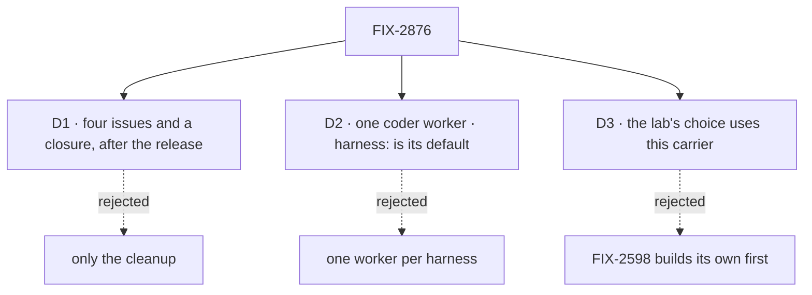

# FIX-2876 · Decisions

[Spec](SPEC.md) · **Decisions**

The calls above any single issue, and what each locks in for the four children and the closure.
D2 and D3 answer the questions FIX-2878 and FIX-2879 put to the owner, as recommendations. D3
also reaches into a sibling epic, FIX-2616, and names two of its issues as readers of the carrier.
Five calls the owner and the engineering manager already made, and the engineering manager's
corrections after them, are in [Decided in review](#decided-in-review); the cards and rules below
carry them.

## The tree

## D1 · One way to pick a coder is worth four issues and a closure, after the release

| | |
|---|---|
| **Instead of** | Only the cleanup (FIX-2877): one flow and one default, with the pick still in message text |
| **Because** | A picked model never reaches a coding task today, and switching coder means cancelling and refiling to another worker. The cleanup merges knobs but leaves both. Eleven places pick a coder ([SPEC](SPEC.md#whats-already-here-and-the-debt)); goal 4 asks us to close that, not shrink it |
| **Locks in** | Run settings are fields of the coder flow's declared task input; later settings join that schema. The input is `codingTaskInput { harness?, model?, plan?, feature?, project? }`: `harnessFeature` and `input.project` move into it and the namespacing goes; `plan` is the plan run setting, server-owned from the start ([ER-10](#who-owns-what)). A task input is declared and checked by [FIX-2894](https://linear.app/fixpoint-labs/issue/FIX-2894) ([ER-9](#who-owns-what)), which blocks FIX-2878. Owner's call, [Q-A and Q-B](#decided-in-review) |

**What would change my mind:** evidence that nobody switches coder or model per task. Then one
default per app is enough, FIX-2878 and FIX-2879 go, and FIX-2877 ships alone (FIX-2894 stands
on its own as typed task input).

It comes down to the task: without run settings, the harness stays fixed per worker and the model never arrives.

## D2 · Teammates keeps one coder worker; a worker's `harness:` is only its default

| | |
|---|---|
| **Instead of** | One coding worker per harness (`teammates.claude-code`, `.codex`, `.cursor`), as today |
| **Because** | Once a task names its harness, the three workers differ by one line, and switching coder means cancelling and refiling to another worker. With one worker, the next request names the coder and goes to the same worker. A run in flight keeps the coder it started with ([ER-2](#who-owns-what)), and a new coder is a new task with a fresh session ([ER-8](#who-owns-what)) |
| **Locks in** | The task card and run report show the harness and model the run used, read from the run ([ER-2](#who-owns-what)). A worker that must not change coder declares its harness, and its plan setting, locked, and a request naming another is refused by name ([ER-11](#who-owns-what)); Teammates' one coder is not locked. FIX-2879 collapses the workers, since that is when the pick reaches the task without text. FIX-2877 only removes the fallback copies. The lab's own worker ids stay FIX-2598's |

**What would change my mind:** people choosing a coder by its roster row rather than on the
request. Then the per-harness rows stay as presets, still overridable by a task.

It comes down to switching: one worker turns refiling to another worker into a pick on the next request.

## D3 · The Claude Code-style lab's choice travels through this epic's carrier; FIX-2598 waits for FIX-2879's package half

| | |
|---|---|
| **Instead of** | FIX-2598 settles where the lab's pick lives, as [FIX-2616 ER-2](../FIX-2616/DECISIONS.md#who-owns-what) leaves it, and builds that first |
| **Because** | FIX-2879 builds a carrier in the workforce kit for Teammates. Two carriers built in parallel end with one rewritten onto the other. FIX-2616 ER-2 expected this: "a package change is a child that blocks it" |
| **Locks in** | FIX-2598 waits only for FIX-2879's **package half**: the `codeWith` session field and the harness kit's filler reading it at filing, not its Teammates worker collapse ([D2](#d2)). FIX-2879 splits along that line, a planned split the spec-set author makes; the package half blocks FIX-2598 in Linear (FIX-2878 is implied through it). The carrier has two readers in FIX-2616. **FIX-2598** writes the person's harness and model through it, and removes the lab's `Coder:` line in the same PR as the lab's eight per-harness workers, so the lab never has the line gone while the workers remain. **FIX-2599** reconciles plan mode: the lab's `claude-code-plan` harness id becomes the plan run setting, the `plan` field this set adds to `codingTaskInput` server-owned ([ER-10](#who-owns-what)), never a second store. FIX-2599 moves plan mode off the harness id only once this set includes that field; until then `claude-code-plan` stays a harness id. What plan mode a harness offers stays FIX-2597's ([FIX-2616 ER-1](../FIX-2616/DECISIONS.md#who-owns-what)). A PR on FIX-2616 records that ER-2's placement is answered here. It opens with this epic's approval and merges before any child's implementation starts, so FIX-2598's readers never meet two ownership stories |

**What would change my mind:** the lab needing its model picker before this epic's release
window. Then FIX-2598 goes first with the smallest carrier it can, and FIX-2879 adopts it.

It comes down to carriers: building both in parallel ends with one of them rewritten.

## Who owns what

Every rule has one owner. A *uses* cell is a place a child must not decide the rule again.

| # | Rule every child obeys | Owner | Checked at |
|---|---|---|---|
| ER-1 | One coding worker flow: the harness kit's `coder`. No app in this repo forks it; Shift Manager's `coder.mts` goes. What an app needs is an option or a slot on that flow | FIX-2877 | FIX-2878's and FIX-2879's spec review; closure leg c |
| ER-2 | One order, written once in the coder flow. **A harness:** the task's run settings (`harness` in `codingTaskInput`), then the worker's config, then the kit default. **A model:** the task's `model`, then the harness value's own default (for example `cursorHarness({ model })`); there is no worker-config model and no kit-default model. **Plan:** the task's `plan`; with none, a run is a plan run only if its harness id is one (until FIX-2599, `claude-code-plan`). **Until FIX-2599, `plan` never loosens the harness id's boundary**: a resolved `plan: true` on a harness that is not a plan harness fails the claim by name, and a plan harness with `plan` false or null still runs, and is frozen, as a plan run. **The order runs once per run, at the first claim**, and the resolved harness id, model and plan setting are frozen on the run record (`run-record.ts`) as one triple, beside `sessionId`, as nullable fields with default null (BP-030). **The frozen model is the effective one**, the harness's own default included, read from the harness's `defaultModel` (a small `Harness` addition, FIX-2878's); it is never a null that falls through to whatever the harness option says later. So a retry and an inherited child filing run the frozen model even if the app later changes `cursorHarness({ model })`. Only a fresh work claim runs the order. **Every other route the coder flow has reads that frozen triple**: a steer, a delivered message, the door and a resume. None reads the session's current `codeWith`, and none routes by the session's worker alone, as `harnessOf` and `byHarness` in `coder-flow.ts` do today. After the first claim, neither `updateTask` nor a steer changes harness, model or plan; a different coder is a new task or a new run. A harness is checked against the filled harnesses; a refused harness fails the task at once, names what is allowed, and never runs on something else. A named model runs only when that harness's `models()` returned `status: "models"` and the whole selection, Cursor's id and params included, is a listed entry. Otherwise the model is refused by name and the run uses the harness default; no catalog, a failed catalog and an unlisted param are all refusals. What ran, and any refusal, is read from the run, never from the pick | FIX-2878 | FIX-2879's spec review; closure legs a, b, c and d, with b's steer, message, door and resume cases each asserting the frozen harness, model and plan setting after a later pick, b's retry after the harness default changed between attempts, which keeps the frozen model, and d's failed catalog, unlisted param and plan/harness mismatch (`plan: true` on `claude-code` fails the claim by name; `claude-code-plan` with `plan: false` runs in plan mode) |
| ER-3 | Each app sets its default coder in one place, the kit's `defaultHarness`. Prompts and clients read it and keep no copy | FIX-2877 | FIX-2879's spec review; closure sweep |
| ER-4 | `harness` names the harness a coding run uses, by `id`, on a worker or in a task's run settings. No other setting is called `harness` | FIX-2877 | Each child's spec review |
| ER-5 | The person's pick travels as structured turn state, never as message text: the harness kit's `codeWith`, a field of workforce's `sessionFields` keyed slot in its `written: "turn"` mode, sent as the respond action's optional `fields`. Each turn writes its pick, and the pick stays on the session for turns no user started. The harness kit's filler writes it into the task's run settings at filing ([ER-10](#who-owns-what)); a task session's carried copy is never read for run settings. The one instruction about it comes from the harness kit's capability, not from each `WORKER.md`. FIX-2879 removes Teammates' `Coding harness:` line. The Claude Code-style lab's `Coder:` line is FIX-2598's ([FIX-2616 ER-2](../FIX-2616/DECISIONS.md#who-owns-what)), removed in the same PR as the lab's per-harness workers ([D3](#d3)) | FIX-2879 | Closure legs a and b |
| ER-6 | The scripted harness reports the model it was handed, so the closure runs without a signed-in vendor | FIX-2878 | Closure, every leg |
| ER-7 | Consumed issues keep their parents: FIX-2598 under FIX-2616, FIX-2627 under FIX-2618. FIX-2583, FIX-1990 and FIX-2874 are `relates-to` only | The coordinator | Each refresh |
| ER-8 | A resumed harness session belongs to the harness now dispatched. **The door takes no new pick**: the coder flow's `respond`, which is `harnessSessionDoor`, takes no `fields`, so a door talk always runs on the task's frozen coder ([ER-2](#who-owns-what)). A follow-up naming another coder is a new task, filed from the conversation's turn, and that task starts a fresh session on its own harness. Where a resume path still meets a session recorded under another harness (a fresh work claim that resolved differently), the run starts a fresh session on the new harness, or refuses loudly; it never resumes one vendor's session in another. FIX-2878's spec picks which. **The match is by the harness `id` and the plan setting frozen on the run record, both of them** ([ER-4](#who-owns-what)'s name and [ER-2](#who-owns-what)'s triple), beside the session it names, **never by the harness id alone and never by the handle's `source`**: a plan session on `claude-code` is never resumed as an edit session on `claude-code`, and two harnesses can report one source (`claude-code` and `claude-code-plan` both report `claude-code/sdk`; every scripted harness reports `harness-manager/stub`). **Every resume path checks it**: the manager's next attempt and the door's talk. Today `manager.ts` records `source` and checks nothing, leaving the check to "the issue that introduces per-task harness choice"; `session-door.ts` resumes the recorded session unchecked | FIX-2878 | FIX-2879's spec review; closure leg b, under its `source` control and its harness-id-only control: a plan session is not resumed as an edit session on the same `claude-code` |
| ER-9 | A task's input is what its flow's `work` entry declares. `createTask` and `updateTask` check it at filing, the entry checks it again at claim, and `listDelegates` shows it. A flow that declares none takes an open record. No reader parses task input on its own. **The declaration can mark fields server-owned** and supplies the function that fills them: the task-input counterpart of `serverOwned` on session state, one concept. On every filing the board drops what the filer sent for each server-owned field and calls the flow's filler, before the parse; `updateTask` drops them and keeps the stored values. The board knows no field name and takes no host option for it: it asks the assignee's flow. **The project requirement is part of the same declaration**, checked in the same filing check, in the order `assertProjectFor` uses today; `needsProject` goes from the hire's `WorkerFlowEntry` and from the board's options, with no alias (BP-034). It is build-time config, so no stored task changes, and the claim parses only the schema | FIX-2894 | FIX-2878's spec review; closure leg d |
| ER-10 | **A run setting that widens what a run may do is always server-owned.** Today those are `harness` and the plan run setting (`plan`), and any later run setting that changes a run's permissions joins them. **`model` is server-owned too, under the filer-trust rule** (BP-031): it widens cost and capability, not permissions, but a filer's tool args are no more trusted for it. All three are written by the server and always overwrite what the filer sent. Tool args, `input` and `metadata` cannot set them; a filing naming a different harness, or clearing or flipping `plan`, is refused or overwritten, never honoured (BP-031). **From a person's turn**, the server writes the turn's pick; with none, the task carries none and the order falls to the worker, then the kit. **From a filing no person started** (a task session, or another turn that runs inside a coding run), the server writes the filing run's frozen pick ([ER-2](#who-owns-what)), derived from the filing session's own active run record and never from tool args. Such a filing never falls back to the kit default, and never widens the pick: it keeps it. **The mechanism is generic** ([ER-9](#who-owns-what)): `codingTaskInput` marks `harness`, `model` and `plan` server-owned, and the harness kit's filler, declared on the coder flow's `work` entry, fills them only from the authenticated turn's `codeWith` or the filing run's frozen pick; `updateTask` keeps the stored values. Workforce drops and fills without knowing any of the names. **The assignee is not stamped**: the filler fills only the server-owned run settings, and a model-written assignee is held at claim by [ER-11](#who-owns-what) | FIX-2878 | FIX-2879's spec review; closure leg d: tool args name `claude-code` while the turn's pick is plan mode, or absent, and the run is in plan mode; a filer who clears or flips `plan`, on filing or on `updateTask`, still runs in plan mode. Closure leg b: a task filed from a worker's run carries that run's frozen pick |
| ER-11 | A worker can declare a lock: **its fixed values for any server-owned run setting it declares** ([ER-10](#who-owns-what)), today its harness and its plan setting, not only its harness id. **The lock is checked at claim against the frozen triple** ([ER-2](#who-owns-what)): a pick or a filing whose triple differs on a locked field, a task's run setting, a turn's pick or a pick a background filing inherited, is refused by name, never silently ignored. A worker locked to plan mode refuses an edit pick even when both use `claude-code`. **The check runs at claim, in the coder flow, for every worker that claims a coding task**, whoever filed it and whichever worker it names: an unlocked worker runs the task's server-written triple ([ER-2](#who-owns-what)'s order), and a locked one whose locked fields differ refuses by name. So a task never runs on a coder or plan setting other than its stamped one, whoever claims it, and a model-written assignee can't move it to a more permissive worker; this is why the assignee needs no stamp ([ER-10](#who-owns-what)). FIX-2878's spec may also refuse at filing. The door takes no pick ([ER-8](#who-owns-what)), so there is nothing for the lock to refuse there | FIX-2878 | FIX-2879's spec review; closure leg d: a worker locked to plan mode refuses an edit pick by name at claim even when both use `claude-code`, and a filing whose model-written assignee names a worker locked to a harness other than the turn's pick is refused at claim |
| ER-12 | After a plan-mode run (today the `claude-code-plan` harness id; after FIX-2599, the plan run setting), harness-manager fails the run loudly if **the run's own worktree** is dirty, or the run created or moved a ref or branch. **The postcheck is scoped to the run itself**: a common-dir or ref change another concurrent task made never fails it. A plan run that wrote is a failed run, never a quiet success. Read-only enforcement inside each vendor is FIX-2599's ([recorded for it](#analysis)) | FIX-2878 | Closure leg d: a scripted plan-mode run that writes a file in its worktree, or creates or moves a ref or branch, fails by name; a plan run during which another task creates a branch still passes |

**Public names.** No name the set fixes is one [`glossary.mjs`](../../../docs/contributing/glossary.mjs)
retires. FIX-2894's PR adds a *Task input* entry if it is public; its server-owned fields take
the name session state already has (`serverOwned`), not a second term. The glossary has no entry
for either today. FIX-2878's PR adds the *Run settings* entry (the `harness`, `model` and `plan` fields of a coding task's input), names the lock, and amends *Harness* ("a worker's `harness:`
line names one by `id`") to say a task's run settings name one too. FIX-2879's PR amends the
`sessionFields` entry for the `written: "turn"` mode and `codeWith`, if they are public.

## Coordination seams

| Seam | Between | Rule |
|---|---|---|
| `harness-manager/src/kit/coder-flow.ts` | FIX-2877 (Shift Manager's options), FIX-2878 (the order), FIX-2583 outside (PR policy options) | The second to merge rebases. FIX-2878 never edits `coder.mts`; Shift Manager gets run settings by moving, not by a copy |
| Lead's `WORKER.md`, `labs/teammates/src/lib/harness.ts`, `Composer.tsx` | FIX-2877 and FIX-2879 | FIX-2877 first (a Linear block); FIX-2879 deletes what FIX-2877 left pointing at the one default |
| The filing tool (`createTask`, `updateTask`) and `workerTaskEntry` | FIX-2894, FIX-2878 and FIX-2879 | FIX-2894 lands the declared input, server-owned fields and both checks first. FIX-2878 declares `codingTaskInput`, marks harness, model and plan server-owned and supplies the filler ([ER-10](#who-owns-what)). FIX-2879 adds the turn's `codeWith` to that filler and adds no second field |
| Server-owned task-input fields and their filler | FIX-2894 (the mechanism), FIX-2878 (the harness kit's filler), FIX-2879 (the turn's `codeWith` it reads) | Declared on the assignee flow's `work` entry, beside its input schema and its project requirement, never as a host option on `createTask`: the board asks the assignee's flow, drops what the filer sent for each server-owned field, and calls the flow's filler before the parse, knowing no field name. The harness kit's filler reads the turn's `codeWith`, or the filing run's frozen pick from `run-record.ts`. `needsProject` and `assertProjectFor` fold into that one filing check, and `needsProject` goes with no alias (BP-034). FIX-2894's spec names the declaration |
| `harness-manager/src/run-record.ts` | FIX-2878 (the frozen harness id and model, and the filler that reads them) | FIX-2878 adds the three fields (harness id, model, plan), nullable with default null (BP-030), and writes them only when a fresh work claim runs the order; no steer, message, door or `updateTask` writes them |
| The harness kit's capability in `workforce.slots.uses` | FIX-2877 and FIX-2879 | One capability; FIX-2879's instruction sits beside `READINESS_GUIDANCE` |
| The carrier's readers outside the set | FIX-2879's package half, FIX-2598 and FIX-2599 | The package half lands first; FIX-2598 and FIX-2599 read the same run settings and add no second store ([D3](#d3)) |

## Decided, not asked

- **FIX-2877 blocks FIX-2879** (written 2026-11-22). They share three files, and FIX-2879's last
  fallback is FIX-2877's one default.
- **The conversation's pick is the last pick a user's turn carried**, written by the server into
  the session by the turn's own action: `codeWith`, sent as the respond action's optional `fields`
  and parsed against the kit's declaration ([Q-C](#decided-in-review)). No user-writable session
  field is added, in line with FIX-2618 ER-4. A conversation turn no user started reads it; with
  none, the task carries no run settings and the order falls to the worker, then the kit. A filing
  made inside a coding run carries that run's frozen pick instead, never the task session's carried
  copy (`carriedSessionFields`), which can be stale ([ER-10](#who-owns-what)).
- **No teammate default layer.** FIX-2877 removes the unread agent-flow `harness` setting, so the
  layer FIX-2879's issue offered as an option does not exist.
- **Shift Manager's split of feature work from answers** becomes an option on the shared flow
  (FIX-2877's spec shapes it). If the flow cannot take it as config, FIX-2877 comments up here:
  that is [FIX-2627 D1](../../issues/FIX-2627/DECISIONS.md#d1)'s *what would change my mind*.
- **Plan mode is a run setting, server-owned from the start**, and FIX-2599 owns the reconciliation
  ([D3](#d3)). This set adds `plan` to `codingTaskInput` and `codeWith`, server-owned
  ([ER-10](#who-owns-what)), never a second carrier; FIX-2599 moves plan mode off the
  `claude-code-plan` id onto it. What the alternatives pass found for
  it is [recorded for FIX-2599](#analysis), not built here; this set builds only the postcheck
  ([ER-12](#who-owns-what)).
- **Shift Manager gets no *Code with* picker.** FIX-2877 adds no app behaviour, so a Shift Manager
  task runs on its worker's harness or the kit's `defaultHarness`; closure leg c tests exactly that.

## Decided in review

Answers to what this epic asked, recorded as given on 2026-11-23 so no child reopens them.

- **Q-A · Where run settings live.** Owner's call ([PR comment](https://github.com/fixpoint-labs/flow-state-dev/pull/5571#issuecomment-7088539088), confirmed in session): fields of the coder flow's declared typed task input, and later settings join that schema. `harnessFeature` and `input.project` move into `codingTaskInput { harness?, model?, plan?, feature?, project? }` and the namespacing goes (`plan?` added by the [plan amendment](#decided-in-review)). Carried by [D1](#d1) and the [Adds table](SPEC.md#whats-already-here-and-the-debt). ER-5 stays, sharpened by Q-D.
- **Q-B · FIX-2894, a new prerequisite child.** Owner's call: typed task input, a flow's `work` entry declaring what its tasks take, checked at filing and at claim, shown by `listDelegates`. It blocks FIX-2878 and the closure (both written in Linear). Carried by [ER-9](#who-owns-what) and the set table.
- **Q-C · FIX-2879's carrier.** Owner's call: workforce's `sessionFields` made a keyed slot with a `written: "turn"` mode, not a new session-schema slot. The harness kit fills `codeWith`, the respond action takes optional `fields`, and each turn writes its pick, which stays on the session for turns no user started. Carried by [ER-5](#who-owns-what).
- **Q-D · Security** ([Cursor review](https://github.com/fixpoint-labs/flow-state-dev/pull/5571#pullrequestreview-6015370853), BP-031). The engineering manager's call: harness and model are written by the server from the authenticated turn and always overwrite what the filer sent; a named model runs only from a catalog that answered, with the whole selection listed, or is refused and the harness default runs. FIX-2879's server stamp is no longer cuttable. Carried by [ER-2](#who-owns-what), [ER-10](#who-owns-what) and closure leg d. ER-10 sits with FIX-2878, which declares the fields, so no merge leaves a filer's harness counting before FIX-2879's stamp lands. Amended: `plan` is server-owned too, by the same rule ([below](#decided-in-review)).
- **Q-E · A worker's coder can be locked.** Owner's call: yes. A worker declares its harness fixed, and a request naming another, a task's run setting or a turn's pick, is refused by name, not silently ignored. Carried by [ER-11](#who-owns-what), [D2](#d2) and closure leg d.

Corrections the engineering manager made on 2026-11-23, from the [alternatives pass](#analysis) and
from writing [sketch.md](sketch.md). They are corrections to defects, not a new design round; each
was checked against ER-1 to ER-11, Q-A to Q-E and [FIX-2616's rules](../FIX-2616/DECISIONS.md#who-owns-what).

- **Freeze per run.** The order runs at the first claim and the pick is frozen on the run record (a triple since the plan amendment); every other route reads it. Carried by [ER-2](#who-owns-what) and [ER-8](#who-owns-what); FIX-2878's. It keeps FIX-2616 D1's "per run" literally.
- **Background filings inherit.** A filing no person started carries the filing run's frozen pick, from the server's run record, never the kit default and never wider. Carried by [ER-10](#who-owns-what); it replaces the "falls to the worker, then the kit" line for those filings and the task session's stale copy. The proposed "narrow to the target worker's lock" is not carried: a lock that differs from the inherited pick is refused by name ([ER-11](#who-owns-what), Q-E).
- **The assignee is not stamped.** First added as a correction, then dropped on the architect review below: ER-11's claim check holds the threat. Carried by [ER-10](#who-owns-what) and [ER-11](#who-owns-what).
- **Plan runs are post-checked.** Carried by [ER-12](#who-owns-what), FIX-2878's.
- **The door takes no new pick.** A new coder from the conversation is a new task. Carried by [ER-8](#who-owns-what) and [ER-11](#who-owns-what).
- **The model order is the task, then the harness value's default.** No worker or kit model. Carried by [ER-2](#who-owns-what).
- **Shift Manager gets no picker; leg c tests its default.** Carried by [What stays as it is](SPEC.md#what-stays-as-it-is) and closure leg c.
- **The fill seam is named**: server-owned fields on the flow's declared input, filled by the flow's own filler, FIX-2894's mechanism and FIX-2878's harness filler. It replaced a host-supplied stamper on `createTask` on the architect review below. Carried by [Coordination seams](#coordination-seams).

The [architect review of sketch.md](https://github.com/fixpoint-labs/flow-state-dev/pull/5571#issuecomment-7103865868), on 2026-11-23, adopted as the engineering manager's call and checked against ER-1 to ER-12, Q-A to Q-E and [FIX-2616's rules](../FIX-2616/DECISIONS.md#who-owns-what), with no conflict: server-owned fields are generic, the task-input counterpart of `serverOwned` ([ER-9](#who-owns-what)); they and the project requirement are declared on the assignee flow's `work` entry, not as board options, and `needsProject` goes; assignee stamping is dropped, because ER-11's claim check runs for every worker ([ER-10](#who-owns-what), [ER-11](#who-owns-what)).

**Amendment, 2026-11-23: plan is server-owned** ([Cursor security review](https://github.com/fixpoint-labs/flow-state-dev/pull/5603#pullrequestreview-6023766753) on [#5603](https://github.com/fixpoint-labs/flow-state-dev/pull/5603), High, BP-031). FIX-2599 moves plan mode off the `claude-code-plan` harness id onto a run setting. ER-10 server-owned only `harness` and `model`, so a filer's plan field would have stuck: a prompt-injected model could clear or flip it and turn a plan run into a `claude-code` edit run (`acceptEdits`, Bash). ER-11 compares harness ids and ER-12 sees only a dirty tree, refs and the git dir, so neither caught it. Folded, on a follow-up PR from `main` that needs the owner's renewed approval: [ER-10](#who-owns-what) now says a run setting that widens what a run may do is always server-owned, and names `plan` with `harness` and `model`; `codingTaskInput` and `codeWith` gain `plan`, filled only from the authenticated turn or the filing run's frozen pick, with `updateTask` keeping the stored value; [ER-2](#who-owns-what)'s frozen pair is a frozen triple; closure leg d asserts that a filer who clears or flips `plan` still runs in plan mode; and FIX-2599 moves plan mode off the harness id only once this set includes the field ([D3](#d3), [recorded for it](#analysis)). Checked against ER-1 to ER-12 and Q-A to Q-E: it extends Q-D's rule to a third field and conflicts with none. **On the same PR, the rule reaches the lock, resume and the interim.** [ER-11](#who-owns-what)'s lock is a worker's fixed values for any server-owned field it declares, checked at claim against the frozen triple, so a worker locked to plan mode refuses an edit pick on the same `claude-code`. [ER-8](#who-owns-what)'s resume matches the frozen harness id and plan setting, never the id alone, so a plan session is never resumed as an edit one. And until FIX-2599, [ER-2](#who-owns-what) fails a claim whose `plan: true` lands on a harness that is not a plan harness, and `plan` false never loosens a plan harness ([Gitar review](https://github.com/fixpoint-labs/flow-state-dev/pull/5605#discussion_r4667547984), left open for the owner). Closure legs b and d assert each. All three follow from the same BP-031 rule.

**On the same PR, two gaps found on [FIX-2878's spec](https://github.com/fixpoint-labs/flow-state-dev/pull/5604) (Greptile) and fixed at the epic.** [ER-2](#who-owns-what) freezes the effective model, the harness default included, so a retry or an inherited child filing never picks up a later change to `cursorHarness({ model })`; a harness exposes its `defaultModel`, a small `Harness` addition FIX-2878 owns; closure leg b changes the default between attempts and the retry keeps the frozen model. [ER-12](#who-owns-what)'s plan postcheck is scoped to the run's own worktree and the refs and branches it created or moved, so another task's branch never fails a plan run; closure leg d checks it. Scoping was chosen over an isolated read-only repository per plan run: it keeps one checkout model and needs no new store. Reuse, re-run on the moved Adds by the author against `main`: the lock **extends** the worker's `harness:` line to the harness and plan setting; `defaultModel` **extends** `Harness` in `harness-manager/src/harness.ts`, which has no default field today (`cursorHarness({ model })` reaches only its agent); the scoped postcheck **extends** `runChangedFiles`. None is new. The original merge of this spec, [#5571](https://github.com/fixpoint-labs/flow-state-dev/pull/5571), stands as approved; this amendment is reviewed on its own.

## What the end-state POC showed

None built. Every hop on the path already exists in some form. Kitchen Sink's harness mode
threads a per-run model into all three harness agents today (`HarnessSessionFeeds.model`), and
`harnessFeature` is a namespaced task-input key harness-manager already reads. A POC would show
the shapes FIX-2878's and FIX-2879's specs own, not whether the division holds.

## Analysis

2026-11-22 · watermark 2026-11-22 (the epic filed). **Independent analysis**: an analyst separate
from the author ran `analysis` and `reuse-review` on the drafted set at `fa4d39a3`, against the
code on `main` `3bdcd2817`. It replaces the authoring pass that ran inline; that pass's findings
stand beneath it.

**Verdict: right approach, with changes.** Each resolution is the engineering manager's call,
checked against ER-1 to ER-7 and [FIX-2616's rules](../FIX-2616/DECISIONS.md#who-owns-what).
None conflicts; 3 and 4 line this set up with FIX-2616 ER-2.

1. **Steer, message and door route by the worker.** `harnessOf` and `byHarness` in
   `harness-manager/src/kit/coder-flow.ts` resolve from the session's worker on every route.
   Folded: [ER-2](#who-owns-what) covers every route, FIX-2878's.
2. **Resuming in another vendor.** The check that a resumed session belongs to the harness now
   dispatched is named in `manager.ts` and owned by no one. Folded: [ER-8](#who-owns-what),
   FIX-2878's; closure leg b tests a changed coder.
3. **The lab between merges.** FIX-2879 removing the lab's `Coder:` line while FIX-2598 owns the
   lab's eight per-harness workers would leave the line gone and the workers standing. Folded: the
   removal moves to FIX-2598 ([D3](#d3), [ER-5](#who-owns-what), *Not done if*).
4. **Plan mode, two shapes.** The lab carries it as a harness id (`claude-code-plan`); this set
   records it as a run setting. Folded: FIX-2599 owns the reconciliation onto the same carrier ([D3](#d3)).
5. **D3 is wider than it needs.** FIX-2598 needs only FIX-2879's package half. Folded: D3
   narrowed, FIX-2599 named as a reader, FIX-2879's split recorded as planned for the spec-set author.
6. **Prior art.** The OpenAI Agents SDK's `RunConfig.model` sets the model for a whole run, over
   each agent's own. It agrees with ER-2. Recorded only.
7. **One plan shape.** The boolean `plan` on `codingTaskInput` and the run record is what FIX-2599's recorded `mode: plan|edit` becomes: one shape, not a second one. Recorded for FIX-2599 (plan amendment, 2026-11-23).

**Reuse on the new Adds (2026-11-23), inline.** The fold added three Adds items; each checked
against `main` by the author, since no sub-agent could be dispatched: the declared input
**extends** `workerTaskEntry` and `listDelegates`; `codingTaskInput` **extends** `harnessFeature`
and `input.project`; the lock **extends** the worker's `harness:` line. None is new.

**Alternatives pass (`adhd`), 2026-11-23**, on head `04ecd124`, run for the other-shapes objective.
A cross-model-family judge was not available, so one model family generated and judged. Its
survivors, as the engineering manager resolved them:

- **Folded:** freeze per run ([ER-2](#who-owns-what)); background filings inherit the filing run's
  frozen pick ([ER-10](#who-owns-what)); the assignee stamped or validated with them
  (later dropped, [Decided in review](#decided-in-review)); the plan-run postcheck ([ER-12](#who-owns-what)). All FIX-2878's.
- **Recorded for FIX-2599, not built here:** FIX-2599 moves plan mode off the harness id only once
  this set includes the server-owned `plan` field ([ER-10](#who-owns-what)); until then
  `claude-code-plan` stays a harness id, and that id is the permission boundary. Plan as
  `mode: plan|edit`, where the most restrictive pick wins. Per-vendor read-only sandboxes: Codex `sandboxMode: read-only`, Cursor
  `sandboxOptions`, Claude Code `permissionMode: plan`. Stripping push and PR credentials and
  network egress from plan runs. A `settle-claim` POC to see which vendors actually block writes.
- **Considered and dropped:** *the coder as the claimant's identity*, a worker per harness. It
  splits one pick across two carriers, because the model stays a field; it adds a parametric
  roster; and it revives the FIX-2390 per-harness workers FIX-2598 deletes. It contradicts
  [D1](#d1) and [D2](#d2). *Workspace-only plan enforcement*, as a replacement for the above:
  there is no single enforcement point, and it does not cover the network.

**Reuse on the corrections' Adds (2026-11-23), inline**, checked against `main` by the author,
with no sub-agent to dispatch: the frozen pair **extends** `run-record.ts`'s row, whose fields are
already nullable with default null; the postcheck **extends** `runChangedFiles` in `coder-flow.ts`,
which already reads a dirty tree and the tree against the base; the stamper **extends**
`createTask`'s host hooks beside `needsProject`; the assignee check **extends** the board's
workstream rule for a row's assignee. None is new. Both were since replaced on the architect
review: server-owned fields **extend** `serverOwned` on session state onto task input, and the
assignee check is dropped.

**The authoring pass, which the analyst kept.** *Reuse:* every Adds item is **extend**; three
drafted as new are folded into the [Adds table](SPEC.md#whats-already-here-and-the-debt).
*Prior art:* LangGraph's per-invocation `configurable`
([docs](https://langchain-ai.github.io/langgraph/how-tos/configuration/)) and Mastra's
`RuntimeContext` ([docs](https://mastra.ai/docs/agents/runtime-context)) resolve request, then
default, never from message text. *Other shapes:* subtract FIX-2879 (the text carrier stays) and
divide by app (the package change lands twice), both rejected. *New factors:* 35 commits since the
issues' trace (`bb1c097904`); the cited lines hold. *Necessity:* FIX-2879 is the cut candidate,
kept. *Ergonomics:* `harness` sits on task, worker and kit, which one order answers; a model's
shape is the harness's own (Cursor's `{ id, params }`), which FIX-2878's spec makes readable.
*Concerns:* FIX-2877 is not pure cleanup (Shift Manager's split of feature work from answers), and
FIX-2627 kept Shift Manager's flow on purpose; both folded. The lab's carrier built twice became D3.

**Routed:** the three children carry no Kind label (Feature or Improvement); for the coordinator.

## How it got here

- **Drafted (Nov 22)** — three children as filed, and the closure FIX-2883. The children's two
  open questions became D2 and D3 and a *decided* line. FIX-2877 now blocks FIX-2879.
- **Independent analysis (Nov 22)** — ER-2 covers every route; ER-8 added; the lab's `Coder:` line
  moved to FIX-2598; D3 narrowed to FIX-2879's package half, with FIX-2599 owning plan mode.
- **Review round 1 (Nov 22, Codex)** — the closure now drives a delivered message and the door,
  not only a steer, so ER-2's "every route" is checked. ER-8 matches a resumed session by harness
  `id` on both resume paths, never by `source`, and the closure gains a control that a `source`
  check must fail.
- **Owner answers and review round 2 (Nov 23)** — run settings became fields of the coder flow's
  typed task input; FIX-2894 joined as a prerequisite; FIX-2879's carrier is `sessionFields` in a
  `written: "turn"` mode; ER-10 (server-written harness and model), ER-11 (the lock) and the model
  catalog rule in ER-2 came from the security review; closure leg d tests them, and leg a a
  reload. The FIX-2616 ER-2 amendment now merges before any child's implementation.
- **Corrections (Nov 23)** — the alternatives pass ran. Its survivors and the sketch's
  contradictions became the engineering manager's corrections: the pick frozen per run, background
  filings inheriting it, the assignee stamped, plan runs post-checked (ER-12), the door taking no
  pick, the model order without worker or kit layers, leg c on Shift Manager's default, and the
  stamper seam. D2's argument now rests on the next request, not on the task in flight. Not a
  design round.
- **Architect review of the sketch (Nov 23)** — server-owned fields made generic on the flow's
  declared input (ER-9), with the harness kit as their first filler (ER-10); `needsProject` folded
  into the one filing check and removed; the assignee stamp dropped, its threat held by ER-11's
  claim check for every worker. Not a design round.
- **Amendment after merge (Nov 23)** — from the security review on #5603: `plan` joins `harness`
  and `model` as server-owned (ER-10), the frozen pair becomes a triple (ER-2), and closure leg d
  tests a cleared or flipped plan field. A material change, on its own PR, for the owner's renewed
  approval.

**Open: none** for the owner beyond approving that amendment.
