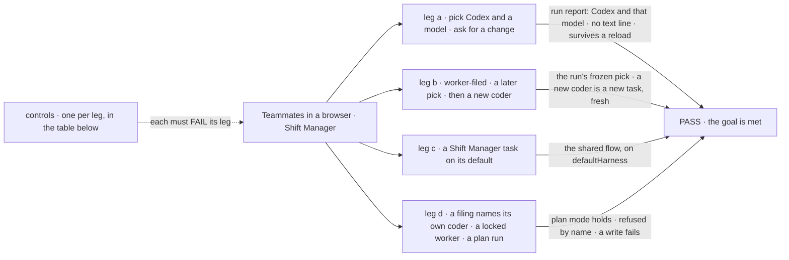
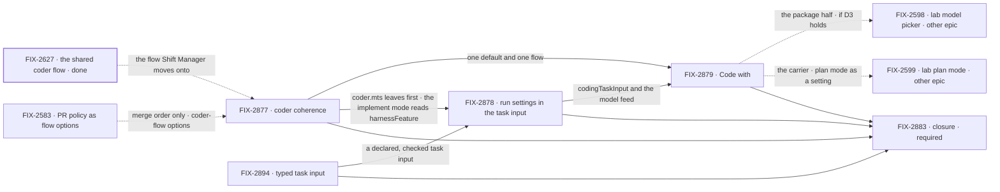

# FIX-2876 · Coder selection: one coding flow, run settings on the task, and "Code with"

**Spec** · [Decisions](DECISIONS.md)

## Four teams, before and after

| A team that… | Today | After this epic |
|---|---|---|
| **asks a teammate for a code change** | Picks *Code with*, which travels as a `Coding harness:` line in the message and is lost on reload. The model is whatever the harness value was built with | The pick is structured state that survives a reload and reaches the task. The run reports the harness and model it used |
| **switches coder** | Cancels the task and files a new one to another worker | Names the harness and model on the next request, to the same coder worker. A run in flight keeps the coder it started with; a new coder is a new task |
| **sets an app's default coder** | Teammates has four knobs that agree only by convention. Shift Manager has an env var, its own coding flow and two harness lists | Sets one value: the harness kit's `defaultHarness` |
| **builds an app on the harness kit** | Copies the coding flow to change how a harness is picked, as Shift Manager did. `harness` is a binding on one worker kind and a UI hint on another. A task's input is typed nowhere | Gets one flow with one documented resolution order, and a task input the flow declares and filing checks. `harness` means one thing, and a worker can lock it |

**Why now.** Two changes are about to land on top of the duplication.
[FIX-2598](https://linear.app/fixpoint-labs/issue/FIX-2598) would add a third way to carry a
pick (the Claude Code-style lab's model picker), and
[FIX-2583](https://linear.app/fixpoint-labs/issue/FIX-2583) moves pull-request policy into the
coding flow, which today means two flows. The epic is parked until the current release ships.
Nothing is implemented without the owner's go.

## The goal, and how we'll know it's met

**Whoever asks for a code change names the coder and model once, and the run uses exactly
that, through one coding flow and one resolution order.**

| Is it the right goal? | |
|---|---|
| **The real need** | A pick that reaches the run. Today a picked model never reaches a coding task, and switching coder means cancelling and refiling to another worker. It serves goal 4 of `docs/objectives.md`, keep the foundation honest: eleven places pick a coder today ([below](#whats-already-here-and-the-debt)) |
| **Smaller, and rejected** | "One default-coder knob" (FIX-2877 alone). The knobs merge, but the pick still travels as text and the model is still fixed when the harness value is built |
| **Bigger, and not this epic's** | A model choice for harness *sessions* (Kitchen Sink's harness mode keeps its own) · the lab's picker UI ([FIX-2598](https://linear.app/fixpoint-labs/issue/FIX-2598)) · run settings beyond harness, model and plan, and moving plan mode off the harness id ([FIX-2599](https://linear.app/fixpoint-labs/issue/FIX-2599)) · PR policy as flow options (FIX-2583) |
| **Not done if** | The closure check has not run · an app keeps its own coding flow or a second default · a `Coding harness:` line survives · the lab's `Coder:` line is gone while its per-harness workers remain (FIX-2598 removes both together) · a steer, message, door or resume reads anything but the run's frozen harness, model and plan setting · a later pick changes a run in flight · a changed coder resumes another vendor's session · a refused harness runs on something else · a refused model runs, or falls to the default without saying so · a filer's tool args, `input` or `metadata` set the harness, the model or the plan setting · a filing inside or below a coding run falls to a default or widens its pick · a filing from another linked session reads anything but the root conversation's current pick, or runs when no root resolves · a no-pick filing outside a coding run runs on anything but the default run settings · a coding task runs on a coder other than the one the server wrote, whichever worker claims it · a retry or an inherited filing runs a model other than the frozen one · a locked worker runs another harness or plan setting · a plan session resumes as an edit session · a `plan: true` claim runs on a harness that is not a plan harness · a plan run that wrote passes, or one fails on another task's change · a task's input goes unchecked at filing or claim · a task runs in a mode the app did not register, without its mode's required inputs, in another mode than it asked for, or with a `doneWhen` or workspace it named · the report reads the pick, not the run · a closure bug is open |

Leg b is the one the smaller goal skips: a task a worker files must keep its run's pick, a pick
made later must not change a run in flight, and a new coder is a new task that never resumes the
old vendor's session. Leg d is the security leg: a filing cannot choose its own coder, whichever worker it names,
a locked worker cannot be talked out of its harness, and a plan run that wrote fails.
Under each control its leg must fail, which is what makes a PASS mean something.

| How we verify | |
|---|---|
| **Goal check** | The closure issue, [FIX-2883](https://linear.app/fixpoint-labs/issue/FIX-2883), on one `main` commit after every other child merges. Teammates in the browser; Shift Manager through its coder goals |
| **Signal** | **a:** the stored message has no `Coding harness:` text, the task's run settings name Codex and the model, and the run report says the same. After a reload, a second request with no new pick carries the same harness and model, on the stored task and in the run report. **b:** a task filed from a worker's run carries that run's frozen harness, model and plan setting, not the kit default and not the task session's carried copy; one filed from a delegate's session after a later pick carries the root conversation's current pick ([ER-10](DECISIONS.md#who-owns-what)); a retry keeps the frozen `review` mode too, and a child filing takes its own worker's ([ER-2](DECISIONS.md#who-owns-what)). After a new pick in the conversation, a steer, a delivered message, a door talk and a resume on a task already claimed each still run on its frozen harness, model and plan setting ([ER-2](DECISIONS.md#who-owns-what)). A retry after the app changed the harness's default model between attempts runs the frozen model. A follow-up naming another coder is a new task, filed from the conversation's turn, which starts a fresh session on that coder; the door takes no pick, and neither path resumes the old session; a plan session is never resumed as an edit session on the same `claude-code` ([ER-8](DECISIONS.md#who-owns-what)). After the app's `defaultMode` changes, a retry and a steer of a claimed `implement` task still run `implement`, read from the frozen run settings ([ER-2](DECISIONS.md#who-owns-what)); a run started under the legacy `phase` topic key finishes under it ([ER-1](DECISIONS.md#who-owns-what)). **c:** `coder.mts` is gone, and a Shift Manager task runs through the shared coder flow on its worker's harness, or the kit's `defaultHarness` when the worker names none. Shift Manager has no picker. **d:** a filing whose tool args name `claude-code` while the turn's pick is plan mode, or absent, runs in plan mode ([ER-10](DECISIONS.md#who-owns-what)), as does a filing or an `updateTask` that clears or flips the plan field while the turn's pick is plan mode, and a filing whose model-written assignee names a worker locked to an edit-capable harness is refused by name at claim ([ER-11](DECISIONS.md#who-owns-what)). A model named while the harness's catalog failed, and a Cursor param the catalog did not list, are each refused by name and run on the harness default ([ER-2](DECISIONS.md#who-owns-what)). A claim whose `plan` is true on `claude-code` fails by name, and `claude-code-plan` with `plan: false` runs in plan mode ([ER-2](DECISIONS.md#who-owns-what)). A worker locked to plan mode refuses an edit pick by name at claim, even when both use `claude-code` ([ER-11](DECISIONS.md#who-owns-what)). A plan-mode run that writes a file in its worktree, or creates or moves a ref or branch, fails by name; one during which another task creates a branch passes ([ER-12](DECISIONS.md#who-owns-what)). An input that does not fit the coder flow's schema is refused at filing ([ER-9](DECISIONS.md#who-owns-what)), as are an unknown `mode` (`"review"`, and a prototype key such as `"constructor"`), an `implement` filing with no `issue`, and a mode a worker's lock does not allow ([ER-11](DECISIONS.md#who-owns-what)); a task naming `doneWhen` or `workspace` is stored without them and runs on the mode's own; a legacy `harnessFeature` row runs in the mode its old phase maps to, and a legacy `{ issue: "ENG-142", phase: "review" }` is refused by name, opening no checkout. A filing whose session has no resolvable root conversation is refused by name, and a no-pick filing whose model-written assignee names an unlocked worker runs on `defaultHarness` and its default model ([ER-10](DECISIONS.md#who-owns-what)) |
| **Input** | The scripted harnesses, which report the model they were handed ([ER-6](DECISIONS.md#who-owns-what)), so no signed-in vendor is needed; for leg b's new coder, two scripted harnesses under different ids, which report one `source`; a held-out prompt; a model read from the harness's list at run time; for leg b's retry, a scripted harness whose default model changes between attempts; for leg d, a scripted harness whose catalog fails, a scripted plan-mode harness that writes, and a second task that creates a branch while a plan run is active |
| **Anti-game** | Read the run's own report, the run record and the stored task. Never the picker, Lead's reply or a stubbed board call |
| **Control that must fail** | A coder flow that reads only the worker's `harness:`: legs a and b, b through its steer, message and door. A route that reads the session's current `codeWith` or the app's current `defaultMode` over the frozen run settings: leg b's later pick and changed default. A resume check that compares the handle's `source`: leg b's new coder; one that compares the harness id alone: leg b's plan session. A frozen model of null that falls to the harness option: leg b's retry. A filler that reads the task session's carried copy, or falls to the kit: leg b's worker-filed and delegate-filed tasks. A filler that writes nothing on a no-pick filing, so the named worker's `harness:` runs: leg d. A host that keeps its own coder flow (`.without(workforce.slots.workerFlows, "coder")`): leg c. A filing tool that keeps the filer's harness, model or plan setting, a lock checked only on the worker the turn meant, a model check that skips a failed catalog, a lock that is ignored or compares only the harness id, a `plan` that is ignored on a non-plan harness, a skipped plan postcheck and one that reads the shared common dir: leg d. Today's `main`: all four |

## What's in the box

Everything in the box is framework: an app sets one default and draws a picker. The fence keeps
the report honest, because a run that ignored the pick, or fell back from a refused model, must
be visible ([ER-2](DECISIONS.md#who-owns-what)).

**See it in code:** [sketch.md](sketch.md) follows one request through the set, in illustrative TypeScript on today's APIs.

**Docs:** one sentence in the harness kit's docs says where a coding task's harness and model
come from. FIX-2878 publishes it with the order and the lock; FIX-2894 adds what a task's input
is and where a model reads it (`listDelegates`); FIX-2879 adds *Code with*. Each writes a
changeset; the pages follow at release.

## The set · as of 2026-11-23

The reviewed snapshot; live state is in Linear.

| Issue | What it delivers | Why the set needs it | Status |
|---|---|---|---|
| [FIX-2877](https://linear.app/fixpoint-labs/issue/FIX-2877) | Shift Manager on the shared `coder` flow; one default-coder value per app; one meaning for `harness`. No new app behaviour; the shared flow gains, as options, what Shift Manager's copy does that it doesn't (its split of feature work from answers), as the kit's `modes` option: a name maps to `{ instructions, doneWhen, workspace }`, with a `default` mode an app may override and a `defaultMode` for a task that names none, and `PhaseSpec` renamed `ModeSpec`. With no pick, outside a coding run, the server writes the assignee, the default's worker, as an interim FIX-2878 retires | Without it, run settings are built twice or Shift Manager never gets them | Backlog · parked |
| [FIX-2894](https://linear.app/fixpoint-labs/issue/FIX-2894) | Typed task input: a flow's `work` entry declares what its tasks take; `createTask` and `updateTask` check it at filing, the entry checks it again at claim, and `listDelegates` shows it. The declaration can mark fields server-owned, with the flow's filler for them, and carries the project requirement, so `needsProject` goes | Run settings are fields of that input ([D1](DECISIONS.md#d1)), so the input needs a type before FIX-2878 can add them | Backlog · parked |
| [FIX-2878](https://linear.app/fixpoint-labs/issue/FIX-2878) | `codingTaskInput { harness?, model?, plan?, mode?, issue?, project? }`, the coder flow's declared input, with `input.project` moved into it and `mode` and `issue` replacing `harnessFeature` (a stored legacy marker is read as the mode its old phase maps to); `mode` checked at filing against the app's registered modes and the mode's required inputs, lockable, frozen at first claim and never inherited; the order (a harness: task, worker, kit default; a model: task, then the harness's own; plan: the task's) run at a task's first claim and frozen on the run record as one triple, with the worker's `review` mode and the task's `mode` (together, the frozen run settings), for every other route and attempt; harness, model and plan marked server-owned and written by the harness kit's filler, never the filer, by ER-10's six-step order; a model checked against a catalog that answered; a worker's harness lock; a changed coder starts a fresh session; a plan-run postcheck; a model feed into every harness | The substance: the only way a model reaches a coding run | Backlog · blocked by FIX-2894 and FIX-2877 |
| [FIX-2879](https://linear.app/fixpoint-labs/issue/FIX-2879) | *Code with* through workforce's `sessionFields`, made a keyed slot with a `written: "turn"` mode: the harness kit fills `codeWith`, the respond action takes optional `fields`, and the pick stays on the session for turns no user started, is not carried at hand-over, and is read from the root conversation by a linked session; the harness kit's filler (FIX-2878's) writes it into the task at filing; one shared instruction. A planned split for the spec-set author: the package half (the session field, and the filler reading it), which the lab waits on ([D3](DECISIONS.md#d3)), and the Teammates half (the worker collapse) | Removes Teammates' text protocol (the lab's `Coder:` is FIX-2598's); it is the only way a person's pick reaches a task ([ER-10](DECISIONS.md#who-owns-what)) | Backlog · blocked by FIX-2877 and FIX-2878 |
| [FIX-2883](https://linear.app/fixpoint-labs/issue/FIX-2883) · closure · **required** | The QA run on one `main` commit | Finds what falls between the others | Backlog · blocked by the four above |

All four take the spec route; none is a bug. Their specs come later as one spec-set PR. Four
issues and a closure. FIX-2879 was the cut candidate while a lead could type a harness into a
task. It no longer is: a filer cannot set one ([ER-10](DECISIONS.md#who-owns-what)), so without
FIX-2879's `codeWith` a person's pick never reaches the task.

## How the issues flow into each other

An edge is what one issue hands the next. A dashed edge touches an issue outside the set, which
keeps its parent; the heavy border is done. FIX-2877 and FIX-2894 start in parallel once the
release ships; FIX-2878 waits for FIX-2894 and FIX-2877 (Shift Manager's `coder.mts` imports `harnessFeatureOf`, and FIX-2877's `implement` mode is selected by `harnessFeature`, which FIX-2878 replaces with `mode` and `issue`), and FIX-2879 for FIX-2877 and FIX-2878. The edge to
FIX-2598 is written in Linear only if [D3](DECISIONS.md#d3) is approved, from FIX-2879's package
half once the spec set splits it. FIX-2599 only reads the carrier; no block is written.

## What stays as it is

- **Harness sessions.** Kitchen Sink's harness mode keeps the session's own model pick
  (`HarnessSessionFeeds.model`). A session is not a task.
- **The Claude Code-style lab's picker** is [FIX-2616](https://linear.app/fixpoint-labs/issue/FIX-2616)'s
  (FIX-2598). This set gives it a carrier; it builds no lab UI. The lab's `Coder:` line and its
  eight per-harness workers go together in FIX-2598, and plan mode's `claude-code-plan` id becomes
  the server-owned `plan` run setting in FIX-2599, once this set adds it; until then it stays a
  harness id ([D3](DECISIONS.md#d3)).
- **Shift Manager's picker.** A *Code with* picker in Shift Manager is out of scope: FIX-2877 adds
  no app behaviour, so its tasks run on the worker's or the kit's `defaultHarness`.
- **PR policy** is FIX-2583's; **worker messages** are FIX-1990's; **the kit system** is FIX-2874's.
- **The escape hatch** in [FIX-2627 D1](../../issues/FIX-2627/DECISIONS.md#d1): an app whose rule
  the config lacks can still write its own flow from harness-manager's blocks.

## What's already here, and the debt

| Already here | What the set does with it |
|---|---|
| [FIX-2627 → What stays as it is](../../issues/FIX-2627/SPEC.md#what-stays-as-it-is): "Shift Manager's coding worker flow … stays its own", and its *Leaves* row | **Superseded** by [ER-1](DECISIONS.md#who-owns-what). Shift Manager moves; FIX-2627 D1's escape hatch stays for other apps |
| [FIX-2616 D1 and ER-2](../FIX-2616/DECISIONS.md#d1): the pick is the person's, per run; where it lives is FIX-2598's call | **Builds on** D1. ER-2's open placement is **answered here**, if [D3](DECISIONS.md#d3) is approved, by a follow-up PR on FIX-2616 |
| FIX-2152 ER-9 and FIX-2157 D5: a harness is chosen per worker in config, already amended by FIX-2616 D1 | **Kept** as the worker's default, the middle of the order |
| Shift Manager's named harnesses (FIX-2486), `DEVFORCE_LAB_HARNESS`, `harnessValues` | **Replaced** by the kit's `harnesses` slot and `defaultHarness`; the env var may feed that one value |
| Model lists (`Harness.models`, FIX-2458) | **Builds on.** The order checks a model against them |

**How much of the goal-4 gap this closes.** Eleven places pick a coder on `main` `3bdcd2817`:
the kit flow's `worker.config.harness ?? defaultHarness`; Shift Manager's `coder.mts`, env var
and second list; Teammates' `TEAMMATES_HARNESS`, Lead's `teammates.cursor` fallback,
`LEAD_FALLBACK_HARNESS` and the unread per-teammate setting; the two text lines; the model fixed
at build. After the set, one order and one default per app: all of it for coding tasks, but the lab's
`Coder:` line, which FIX-2598 removes on this carrier. Harness sessions keep their own pick, by design.

| Adds | Existing piece considered | Why it doesn't fit / how composed |
|---|---|---|
| A declared input on a flow's `work` entry, checked at filing and claim (FIX-2894) | Task `input`, typed `unknown` and parsed late by each reader (`harnessTaskInputSchema` at attempt start) · `listDelegates`' `takes` | **Extends** `workerTaskEntry` with an `input` schema and `listDelegates` with it; a flow that declares none takes an open record, as today |
| Run settings as fields of the coder flow's input (FIX-2878) | The namespaced `harnessFeature` key (FIX-2282) · `input.project` · free-form `metadata` | **Extends** the first two into one schema, `codingTaskInput { harness?, model?, plan?, mode?, issue?, project? }` (`codingTaskInputSchema` in code); `mode` and `issue` replace the marker, a stored legacy one read as the mode its old phase maps to (BP-030), and the namespacing goes. `mode` is filer-written, checked at filing ([ER-9](DECISIONS.md#who-owns-what)). `harness`, `model` and `plan` are server-written ([ER-10](DECISIONS.md#who-owns-what)); `plan?`, here and on `codeWith`, is inert until FIX-2599, and `claude-code-plan` stays the boundary |
| A lock on a worker's server-owned run settings (FIX-2878) | The worker's `harness:` line (FIX-2152 ER-9) | **Extends** that line with a lock on the harness and plan setting; FIX-2878's spec names it |
| A task's frozen harness id, model and plan setting, its worker's `review` mode and its `mode` (FIX-2878) | `run-record.ts`'s row, which holds `sessionId` | **Extends** the row with five fields, nullable with default null (BP-030), like every field on it. Only the three run settings are inherited by a child filing |
| A plan-run postcheck (FIX-2878) | `runChangedFiles` in `coder-flow.ts`, which reads a dirty tree and the tree against the base | **Extends** it with the refs and branches the run created or moved, scoped to its own worktree, and fails a plan run instead of running checks |
| A harness's default model (FIX-2878) | `cursorHarness({ model })`'s option, which only its agent reads | **Extends** `Harness` (`harness-manager/src/harness.ts`) with `defaultModel`, so a claim freezes the effective model |
| Server-owned fields on a declared task input, with the flow's filler (FIX-2894); the harness kit's filler (FIX-2878) | `serverOwned` on session state (`withSessionFields`, the engine's `session-birth.ts`) · the hire's and the board's `needsProject` hook | **Extends** `serverOwned` from session state to task input: one concept. The board drops a filer's value for each server-owned field and calls the assignee flow's filler, knowing no field name. `needsProject` folds into the same filing check and goes, with no alias (BP-034) |
| A model feed in `HarnessFeeds` (FIX-2878) | `HarnessSessionFeeds.model` and each agent's `model` resolver | **Extends** the same name and resolver onto the task path, widened to the harness's own model value |
| Shift Manager's needs as `coder` options (FIX-2877) | `coderWorkerFlow`'s options, `codingPhase` and `PhaseSpec` | **Extends**, as FIX-2627 D1 locks in: the kit's `modes` option, each mode `{ instructions, doneWhen, workspace }` (`PhaseSpec`'s `buildPrompt` and `isDone`, renamed in `ModeSpec`; `codingPhase` becomes `codingMode`), today's single phase the `default` mode, and `defaultMode` ([ER-1](DECISIONS.md#who-owns-what)) |
| Turn state on the default agent flow (FIX-2879) | The kit's `sessionFields` (server-written, inherited at hand-over) · agent-flow `settings` (never read) | **Extends** `sessionFields` into a keyed slot with a `written: "turn"` mode, not a new session-schema slot. The harness kit fills `codeWith`; the respond action takes optional `fields`; each turn writes its pick, and it stays for turns no user started |
| One shared filing instruction (FIX-2879) | `READINESS_GUIDANCE` in the harness kit's capability | **Extends**: the same capability |

| The debt | |
|---|---|
| **Removes** | `coder.mts` (438 lines) and Shift Manager's second list · three of Teammates' four knobs · Teammates' `Coding harness:` protocol and the prompt rules that parse it · the unread agent-flow `harness` setting · two of Teammates' three coding workers, if [D2](DECISIONS.md#d2) holds · the `harnessFeature` namespace and the late per-reader parses of task input · the `needsProject` hook, folded into the one input check |
| **Adds** | A declared input on a flow's `work` entry, `codingTaskInput`, the kit's `modes` option (renaming `PhaseSpec`), a lock on a worker's server-owned run settings, a model feed on `HarnessFeeds`, a `defaultModel` on `Harness`, a `written: "turn"` mode on `sessionFields`, and server-owned fields with a filler on a declared task input. All published, permanent by design. Internal: the frozen run settings and `review` mode on the run record and the plan-run postcheck |
| **Leaves** | Harness sessions' own model pick. The lab's per-harness coder workers and its `Coder:` line, which FIX-2598 removes together |

**Net: down.** Two apps shed a flow, three knobs and a text protocol; the packages gain eight
extensions of pieces they already have, and every reader stops parsing task input on its own.

## Sign off

**[The goal](#the-goal-and-how-well-know-its-met), at that size:** four legs, a task a worker
files and a filing that names its own coder included. If wrong: a picker that works until a
worker's run files the next task.

**[The set's debt](#whats-already-here-and-the-debt), net down.** If wrong: run-settings fields
nobody uses, because no one switches coder per task.

1. **[D1](DECISIONS.md#d1) · One way to pick a coder is worth four issues and a closure, after the
   release; run settings are fields of the coder flow's declared task input.** If wrong: an epic
   for a choice people make once per app.
2. **[D2](DECISIONS.md#d2) · Teammates keeps one coder worker; `harness:` is its default unless
   the worker locks it.** If wrong: people who read the roster to see which coder runs find one row.
3. **[D3](DECISIONS.md#d3) · The Claude Code-style lab's choice travels through this epic's
   carrier, so FIX-2598 waits for FIX-2879's package half.** FIX-2598 drops the lab's `Coder:` line
   with its workers; FIX-2599 makes plan mode a run setting. If wrong: the lab's model picker waits
   a release for nothing.

**Open: none.** D2 and D3 answer the questions FIX-2878 and FIX-2879 put to the owner, as
recommendations to sign. Five calls are already made and recorded in
[Decided in review](DECISIONS.md#decided-in-review): where run settings live, FIX-2894, FIX-2879's
carrier, the security rule (ER-10) and the worker lock (ER-11). The engineering manager's
corrections after them are recorded there too: the pick frozen per run, background filings
inheriting it, and the plan-run postcheck (ER-12). The architect review then made server-owned fields
generic on the flow's declared input and dropped the assignee stamp, which the children's specs later restored as an interim for no-pick filings outside a coding run; it is recorded there too.
**Amended after merge:** a security review made `plan` server-owned beside `harness` and `model`
(ER-10), so a filer cannot clear it to turn a plan run into an edit run. With it, the lock covers plan (ER-11), resume matches plan (ER-8), a `plan: true` on a non-plan harness fails (ER-2), the frozen model is the effective one (ER-2), and the plan postcheck sees only its own run (ER-12); recorded in [Decided in
review](DECISIONS.md#decided-in-review), for the owner's renewed approval. **On the same amendment, the three child specs reconciled**, so no follow-up epic PR is needed: a filing's pick resolves server-side in six steps, a linked session reading the root conversation's current `codeWith`, which is no longer carried (ER-10, ER-5); a no-pick filing outside a coding run gets the default's worker as its assignee from the server, an interim FIX-2878's filler retires by writing the default run settings, after which the model's assignee picks the role under the lock; one inside or below a coding run keeps the model's, bounded by the frozen settings and the lock (ER-10, ER-11); the first claim also freezes the worker's `review` mode, never inherited (ER-2); `plan?` sits on both carriers, inert until FIX-2599; and FIX-2878 waits for FIX-2877 too.
**Amended again: modes** (owner, 2026-11-23, [Decided in review](DECISIONS.md#decided-in-review)). The kit's
`phases` become `modes`, a name to `{ instructions, doneWhen, workspace }` with an overridable
`default` (ER-1); a task picks one with `codingTaskInput.mode`, which with `issue` replaces the
feature marker (D1); `mode` is filer-written but checked at filing against the registered modes
and their required inputs (ER-9), lockable (ER-11), frozen at first claim and never inherited
(ER-2); `doneWhen` and `workspace` are never task fields (ER-10). For the owner's renewed approval.

Epic · 4 issues and a closure · Framework simplification & cleanup · goal 4 of `docs/objectives.md`, keep the foundation honest
