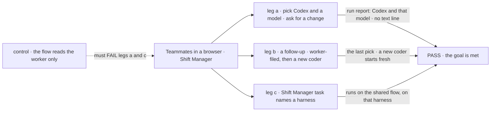
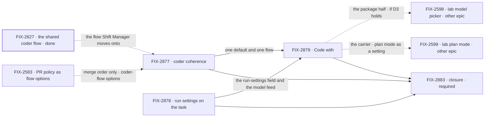

# FIX-2876 · Coder selection: one coding flow, run settings on the task, and "Code with"

**Spec** · [Decisions](DECISIONS.md)

## Four teams, before and after

| A team that… | Today | After this epic |
|---|---|---|
| **asks a teammate for a code change** | Picks *Code with*, which travels as a `Coding harness:` line in the message and is lost on reload. The model is whatever the harness value was built with | The pick is structured state that survives a reload and reaches the task. The run reports the harness and model it used |
| **switches coder on work in flight** | Cancels the task and files a new one to another worker | Names the harness and model on a follow-up or a new task, for the same coder worker |
| **sets an app's default coder** | Teammates has four knobs that agree only by convention. Shift Manager has an env var, its own coding flow and two harness lists | Sets one value: the harness kit's `defaultHarness` |
| **builds an app on the harness kit** | Copies the coding flow to change how a harness is picked, as Shift Manager did. `harness` is a binding on one worker kind and a UI hint on another | Gets one flow with one documented resolution order. `harness` means one thing |

**Why now.** Two changes are about to land on top of the duplication.
[FIX-2598](https://linear.app/fixpoint-labs/issue/FIX-2598) would add a third way to carry a
pick (the Claude Code-style lab's model picker), and
[FIX-2583](https://linear.app/fixpoint-labs/issue/FIX-2583) moves pull-request policy into the
coding flow, which today means two flows. The epic is parked until the current release ships.
Nothing is implemented without the owner's go.

## The goal, and how we'll know it's met

**Whoever asks for a code change names the coder and model once, and the run uses exactly
that, through one coding flow and one resolution order.**

| Is it the right goal? | |
|---|---|
| **The real need** | A pick that reaches the run. Today a picked model never reaches a coding task, and switching coder throws the task away. It serves goal 4 of `docs/objectives.md`, keep the foundation honest: eleven places pick a coder today ([below](#whats-already-here-and-the-debt)) |
| **Smaller, and rejected** | "One default-coder knob" (FIX-2877 alone). The knobs merge, but the pick still travels as text and the model is still fixed when the harness value is built |
| **Bigger, and not this epic's** | A model choice for harness *sessions* (Kitchen Sink's harness mode keeps its own) · the lab's picker UI ([FIX-2598](https://linear.app/fixpoint-labs/issue/FIX-2598)) · run settings beyond harness and model · PR policy as flow options (FIX-2583) |
| **Not done if** | The closure check has not run · an app keeps its own coding flow or a second default · a `Coding harness:` line survives · the lab's `Coder:` line is gone while its per-harness workers remain (FIX-2598 removes both together) · a steer, message or door routes by the worker alone · a changed coder resumes another vendor's session · a refused harness or model runs on something else · the report reads the pick, not the run · a closure bug is open |

Leg b is the one the smaller goal skips: a turn no user started must keep the person's pick, and
a follow-up that changes coder must not resume the old vendor's session.
Under the control, legs a and c must fail, which is what makes their PASS mean something.

| How we verify | |
|---|---|
| **Goal check** | The closure issue, [FIX-2883](https://linear.app/fixpoint-labs/issue/FIX-2883), on one `main` commit after every other child merges. Teammates in the browser; Shift Manager through its coder goals |
| **Signal** | **a:** the stored message has no `Coding harness:` text, the task's run settings name Codex and the model, and the run report says the same. **b:** the next task carries the conversation's last pick, and a steer on it runs on that harness; a follow-up naming another coder starts a fresh session on it or is refused loudly ([ER-8](DECISIONS.md#who-owns-what)), never resumes the old one. **c:** `coder.mts` is gone, and the run uses the task's harness, not the worker's |
| **Input** | The scripted harnesses, which report the model they were handed ([ER-6](DECISIONS.md#who-owns-what)), so no signed-in vendor is needed; a held-out prompt; a model read from the harness's list at run time |
| **Anti-game** | Read the run's own report and the stored task. Never the picker, Lead's reply or a stubbed board call |
| **Control that must fail** | A coder flow that reads only the worker's `harness:`: legs a and c. Today's `main`: all three |

## What's in the box

Everything in the box is framework: an app sets one default and draws a picker. The fence keeps
the report honest, because a run that ignored the pick must be visible
([ER-2](DECISIONS.md#who-owns-what)).

**Docs:** one sentence in the harness kit's docs says where a coding task's harness and model
come from. FIX-2878 publishes it with the order; FIX-2879 adds *Code with*. Each writes a
changeset; the pages follow at release.

## The set · as of 2026-11-22

The reviewed snapshot; live state is in Linear.

| Issue | What it delivers | Why the set needs it | Status |
|---|---|---|---|
| [FIX-2877](https://linear.app/fixpoint-labs/issue/FIX-2877) | Shift Manager on the shared `coder` flow; one default-coder value per app; one meaning for `harness`. No new app behaviour; the shared flow gains, as options, what Shift Manager's copy does that it doesn't (its split of feature work from answers) | Without it, run settings are built twice or Shift Manager never gets them | Backlog · parked |
| [FIX-2878](https://linear.app/fixpoint-labs/issue/FIX-2878) | Run settings (harness, model) on a coding task; the order task, worker, kit default, on every route the coder flow has; a changed coder starts a fresh session; a model feed into every harness | The substance: the only way a model reaches a coding run | Backlog · parked |
| [FIX-2879](https://linear.app/fixpoint-labs/issue/FIX-2879) | *Code with* as structured turn state with the conversation's last pick; the filing tool writes it into the task; one shared instruction. A planned split for the spec-set author: the package half (turn state, filing), which the lab waits on ([D3](DECISIONS.md#d3)), and the Teammates half (the worker collapse) | Removes Teammates' text protocol (the lab's `Coder:` is FIX-2598's); the pick reaches the task without the model retyping it | Backlog · blocked by FIX-2877 and FIX-2878 |
| [FIX-2883](https://linear.app/fixpoint-labs/issue/FIX-2883) · closure · **required** | The QA run on one `main` commit | Finds what falls between the others | Backlog · blocked by the three above |

All three take the spec route; none is a bug. Their specs come later as one spec-set PR. Three
issues and a closure. Whether three is two: FIX-2879 is the one to cut, since a lead can already
type a harness into a task once FIX-2878 lands. It stays, because the text line is the parallel
carrier this epic exists to remove.

## How the issues flow into each other

An edge is what one issue hands the next. A dashed edge touches an issue outside the set, which
keeps its parent; the heavy border is done. FIX-2877 and FIX-2878 start in parallel once the
release ships; FIX-2879 waits for both. The edge to FIX-2598 is written in Linear only if
[D3](DECISIONS.md#d3) is approved, from FIX-2879's package half once the spec set splits it.
FIX-2599 only reads the carrier; no block is written.

## What stays as it is

- **Harness sessions.** Kitchen Sink's harness mode keeps the session's own model pick
  (`HarnessSessionFeeds.model`). A session is not a task.
- **The Claude Code-style lab's picker** is [FIX-2616](https://linear.app/fixpoint-labs/issue/FIX-2616)'s
  (FIX-2598). This set gives it a carrier; it builds no lab UI. The lab's `Coder:` line and its
  eight per-harness workers go together in FIX-2598, and plan mode's `claude-code-plan` id becomes
  a run setting in FIX-2599 ([D3](DECISIONS.md#d3)).
- **PR policy** is FIX-2583's; **worker messages** are FIX-1990's; **the kit system** is FIX-2874's.
- **The escape hatch** in [FIX-2627 D1](../../issues/FIX-2627/DECISIONS.md#d1): an app whose rule
  the config lacks can still write its own flow from harness-manager's blocks.

## What's already here, and the debt

| Already here | What the set does with it |
|---|---|
| [FIX-2627 → What stays as it is](../../issues/FIX-2627/SPEC.md#what-stays-as-it-is): "Shift Manager's coding worker flow … stays its own", and its *Leaves* row | **Superseded** by [ER-1](DECISIONS.md#who-owns-what). Shift Manager moves; FIX-2627 D1's escape hatch stays for other apps |
| [FIX-2616 D1 and ER-2](../FIX-2616/DECISIONS.md#d1): the pick is the person's, per run; where it lives is FIX-2598's call | **Builds on** D1. ER-2's open placement is **answered here**, if [D3](DECISIONS.md#d3) is approved, by a follow-up PR on FIX-2616 |
| FIX-2152 ER-9 and FIX-2157 D5: a harness is chosen per worker in config, already amended by FIX-2616 D1 | **Kept** as the worker's default, the middle of the order |
| Shift Manager's named harnesses (FIX-2486), `DEVFORCE_LAB_HARNESS`, `harnessValues` | **Replaced** by the kit's `harnesses` slot and `defaultHarness`; the env var may feed that one value |
| Model lists (`Harness.models`, FIX-2458) | **Builds on.** The order checks a model against them |

**How much of the goal-4 gap this closes.** Eleven places pick a coder on `main` `3bdcd2817`:
the kit flow's `worker.config.harness ?? defaultHarness`; Shift Manager's `coder.mts`, env var
and second list; Teammates' `TEAMMATES_HARNESS`, Lead's `teammates.cursor` fallback,
`LEAD_FALLBACK_HARNESS` and the unread per-teammate setting; the two text lines; the model fixed
at build. After the set, one order and one default per app: all of it for coding tasks, but the lab's
`Coder:` line, which FIX-2598 removes on this carrier. Harness sessions keep their own pick, by design.

| Adds | Existing piece considered | Why it doesn't fit / how composed |
|---|---|---|
| Run settings on a coding task (FIX-2878) | The namespaced `harnessFeature` key on task `input` (FIX-2282) · the filing settings `updateTask` refuses · free-form `metadata` | **Extends** one of the first two; FIX-2878's spec picks. Never a free-form field a model invents |
| A model feed in `HarnessFeeds` (FIX-2878) | `HarnessSessionFeeds.model` and each agent's `model` resolver | **Extends** the same name and resolver onto the task path, widened to the harness's own model value |
| Shift Manager's needs as `coder` options (FIX-2877) | `coderWorkerFlow`'s options and `codingPhase` | **Extends**, as FIX-2627 D1 locks in |
| Turn state on the default agent flow (FIX-2879) | The kit's `sessionFields` (server-written, inherited at hand-over) · agent-flow `settings` (never read) | **Extends** the `sessionFields` declaration with a per-turn counterpart; the last pick is a server-written session field |
| One shared filing instruction (FIX-2879) | `READINESS_GUIDANCE` in the harness kit's capability | **Extends**: the same capability |

| The debt | |
|---|---|
| **Removes** | `coder.mts` (438 lines) and Shift Manager's second list · three of Teammates' four knobs · Teammates' `Coding harness:` protocol and the prompt rules that parse it · the unread agent-flow `harness` setting · two of Teammates' three coding workers, if [D2](DECISIONS.md#d2) holds |
| **Adds** | A run-settings field on coding tasks, a model feed on `HarnessFeeds`, and a turn-state declaration on the workforce kit. All published, permanent by design |
| **Leaves** | Harness sessions' own model pick. The lab's per-harness coder workers and its `Coder:` line, which FIX-2598 removes together |

**Net: down.** Two apps shed a flow, three knobs and a text protocol; the packages gain three
extensions of pieces they already have.

## Sign off

**[The goal](#the-goal-and-how-well-know-its-met), at that size:** three legs, a turn no user
started included. If wrong: a picker that works until a worker's message files the next task.

**[The set's debt](#whats-already-here-and-the-debt), net down.** If wrong: a published
run-settings field nobody uses, because no one switches coder per task.

1. **[D1](DECISIONS.md#d1) · One way to pick a coder is worth three issues and a closure, after the
   release.** If wrong: an epic for a choice people make once per app.
2. **[D2](DECISIONS.md#d2) · Teammates keeps one coder worker; `harness:` is its default.** If
   wrong: people who read the roster to see which coder runs find one row.
3. **[D3](DECISIONS.md#d3) · The Claude Code-style lab's choice travels through this epic's
   carrier, so FIX-2598 waits for FIX-2879's package half.** FIX-2598 drops the lab's `Coder:` line
   with its workers; FIX-2599 makes plan mode a run setting. If wrong: the lab's model picker waits
   a release for nothing.

**Open: none.** D2 and D3 answer the questions FIX-2878 and FIX-2879 put to the owner, as
recommendations to sign.

Epic · 3 issues and a closure · Framework simplification & cleanup · goal 4 of `docs/objectives.md`, keep the foundation honest
