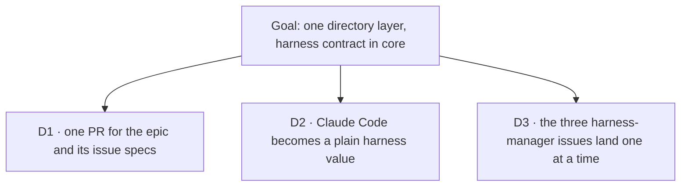

# FIX-2927 · Decisions

[Spec](SPEC.md) · **Decisions**

## The tree

## D1 · The epic spec and its five issue specs go up in one PR

**The call.** This PR carries `specs/epics/FIX-2927/` and the specs for FIX-2934, FIX-2933,
FIX-2928, FIX-2935 and FIX-2930. One approval, one merge, then implementation.

**Why.** The Linear issues already carry the evidence, the direction and the acceptance. Each
issue spec is short and only settles what the issue left open. A separate spec-set PR after the
epic merges would add a second gate and a second review cycle for documents this size, and the
session works through one branch at a time.

**If wrong:** a reviewer who wants to approve the objective but not one issue's direction has to
hold the whole PR. The fix is to drop that issue's spec into its own PR.

## D2 · Claude Code becomes a plain harness value, like Codex and Cursor

**The call.** FIX-2928 replaces the `claudeCode()` kit with a `claudeCodeHarness()` value an app
puts in the harness kit's `harnesses` slot, the same way it fills Codex and Cursor. The two
collections the kit installs today (`claudeCodeWorkRecorderResources`,
`claudeCodeWorkspaceResources`) are declared on the agent block, so including the block installs
them.

**Why.** `claudeCode()` requires the `harnesses` kit factory, and a kit can only fill slots of
kits it requires. So while it is a kit, `@flow-state-dev/claude-code` must depend on
harness-manager, and FIX-2928's acceptance cannot pass. Three vendors with three plain values is
one mechanism. Declaring resources on the block is the framework's rule for making a block
portable (CLAUDE.md → "Resources are declared on blocks").

**Rejected.** Moving the `claudeCode()` kit into harness-manager makes the manager depend on a
vendor. Keeping it, with a type-only import, leaves the runtime dependency.

**If wrong:** the collections are not reachable where today's dedicated `claude-code` flow serves
them. The FIX-2928 implementer checks that first and stops with a report if a block-declared
resource cannot replace the kit's flow.

## D3 · FIX-2934, FIX-2933 and FIX-2928 land one at a time, in that order

**The call.** All three change `harness-manager/src/workspace.ts` or `manager.ts`. They merge
in order: the small export change first, then the host-only input, then the type move.
FIX-2935 and FIX-2930 wait on outside PRs (#5696 and #5682) and then follow.

**If wrong:** some wall-clock time lost to serial merges. Parallel branches would trade that for
rebase conflicts in a 5,280-line file.

## Who owns what

| Rule | Owner |
|---|---|
| **ER-1** `@flow-state-dev/workspace` has one export (`.`). Nothing is published as "internal" | FIX-2934 |
| **ER-2** A local repository becomes a `WorkspaceHost` through one helper. The manager takes a host and nothing else | FIX-2933 |
| **ER-3** The `Harness` value and its feeds are core types. A vendor package depends on core and workspace, never on harness-manager | FIX-2928 |
| **ER-4** A scope's folder path is computed by one function in workspace. No package keeps its own path encoder | FIX-2935 |
| **ER-5** A run's commits and diff are read by one module in workspace | FIX-2930 |
| **ER-6** No aliases, no re-exports from the old home, no compatibility shims. A moved export's old path goes (BP-034) | every child |

## Coordination seams

- **FIX-2928 ↔ FIX-2929.** Read-only access lands on the `Harness` type FIX-2928 moves. FIX-2928
  does not add the field; FIX-2929 is held for Jake and must land before FIX-2878 part 4 (#5694).
- **FIX-2933 ↔ FIX-2935.** FIX-2933 narrows `checkoutPathFor`'s input when `WorkspaceConfig` goes.
  FIX-2935 moves its path rule onto the shared folder rule. Neither changes the other's half.
- **FIX-2930 ↔ FIX-2861.** The turn-diff reader FIX-2861 fixes (#5682) moves in FIX-2930, after
  that PR merges, so the fix is not rebased under the move.
- **FIX-2935 ↔ FIX-2818.** #5696 changes `createBashBlocks`' default. FIX-2935 builds on it.

## Decided, not asked

- `refreshLock` goes public beside `acquireLock` and `releaseLock`, which are already public
  (FIX-2934 D1).
- Each child that changes a published package's surface records it in a changeset; none edits
  user docs (CLAUDE.md → "User docs are written at release").

## What the end-state POC showed

Skipped: each child is a move or a merge of existing code, and the closure's static checks are
the end state.
