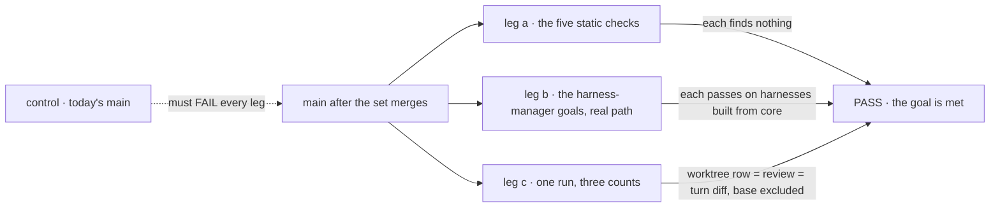
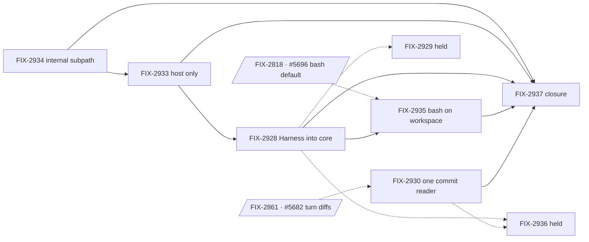

# FIX-2927 · Workspaces become the directory layer for harnesses and tools

**Spec** · [Decisions](DECISIONS.md)

## Four teams, before and after

| A team that… | Today | After this epic |
|---|---|---|
| **builds its own harness** | Imports `Harness` from harness-manager, so it pulls in the whole manager, workforce and orchestration to get one type. Reaches into `@flow-state-dev/workspace/internal` for a private temp folder | Imports the harness type and its feeds from `@flow-state-dev/core/harness`, and folders, locks and temp roots from `@flow-state-dev/workspace`'s one export |
| **points the manager at a local repository** | Picks between `WorkspaceConfig` and `WorkspaceHost`, or copies a five-field `localWorkspaceHost({…})` setup that exists in five places | Calls one helper that returns a `WorkspaceHost`. The manager takes only a host |
| **gives an agent bash over a scope** | Gets a folder under `.fsdev/workspaces/{scope}/{id}` from rules that live only in the bash module, beside a second set of path rules in harness-manager | Gets the same folder from one rule in the workspace package, which the harness manager's checkout paths also use |
| **reads what a run changed** | Sees one commit count on the worktrees list and another on the review card for a run that merged its moved-on base | Sees one count everywhere, from one reader in the workspace package |

**Why now.** We are about to build our own harness and to settle containment
([FIX-2440](https://linear.app/fixpoint-labs/issue/FIX-2440)). Both need one place a directory
comes from. Each copy we leave becomes a copy the next harness inherits.

## The goal, and how we'll know it's met

**Anything that works with a folder (a vendor harness, a harness we write, the bash tools, a
host) gets that folder, its lock, its scratch space and its git reads from
`@flow-state-dev/workspace`, and its harness contract from `@flow-state-dev/core`, with one
mechanism for each and no copies.**

| Is it the right goal? | |
|---|---|
| **The real need** | A harness that does not drag in the manager, and one answer to "where is this scope's folder" and "what did this run change". It serves goal 4 of `docs/objectives.md`, keep the foundation honest |
| **Smaller, and rejected** | Moving the `Harness` type only (FIX-2928 alone). The vendor packages lose their manager dependency, but the bash tools and the manager still disagree on folders, and the commit counts still disagree |
| **Bigger, and not this epic's yet** | Containment attached to the workspace ([FIX-2440](https://linear.app/fixpoint-labs/issue/FIX-2440)) · a task-run layer outside the manager ([FIX-2936](https://linear.app/fixpoint-labs/issue/FIX-2936)) · where GitHub lives ([FIX-2931](https://linear.app/fixpoint-labs/issue/FIX-2931)) · plan mode as read-only access ([FIX-2929](https://linear.app/fixpoint-labs/issue/FIX-2929)). All four are children, held for Jake |
| **Not done if** | The closure check has not run · `@flow-state-dev/workspace/internal` exists · `WorkspaceConfig` exists · a vendor package depends on harness-manager · two feed types exist · a scope folder's path is built outside the workspace package (source only; tests and comments may still name the path) · `harness-manager/src/commits.ts` exists · a closure bug is open |

| How we verify | |
|---|---|
| **Goal check** | The closure issue, [FIX-2937](https://linear.app/fixpoint-labs/issue/FIX-2937), on one `main` commit after every active child merges |
| **Signal** | **a:** `rg 'workspace/internal'`, `rg WorkspaceConfig`, `rg '@flow-state-dev/harness-manager' packages/{claude-code,codex,cursor}`, `rg '\.fsdev.*workspaces' packages/*/src -g '!packages/workspace/**' -g '!*.test.ts'` with comment lines dropped (`rg -v '^\s*(//|\*)'` on the matches), and `ls packages/harness-manager/src/commits.ts` each find nothing. **b:** `goals/harness-manager/*` and `goals/workspace/worktrees-resource` pass through `fsdev run`. **c:** a run that merges a moved-on base shows the same commit count in `fsdev worktrees`, the review detail and the turn diff, and the count leaves out the base's commits |
| **Anti-game** | The checks run on the merged tree, not on a child's branch. Leg c reads the three surfaces a person reads, not the reader's return value |
| **Control that must fail** | Today's `main`: leg a finds every pattern; leg c shows the merged-in base commits on the worktree row |

## What's in the box

| In the box | Composed in by an app | Not built here |
|---|---|---|
| One workspace export · `refreshLock` and `privateTempRoot` public · one local-repo host helper · the `Harness` type and one feed type in core · one folder-for-a-scope rule · one projection session helper · one commit and diff reader | Which harnesses an app fills · its sandbox adapter · its workspace root | Containment on the workspace · a task-run layer · a GitHub module · read-only access on the harness type |

## The set · as of 2026-11-25

Live state is in [Linear](https://linear.app/fixpoint-labs/issue/FIX-2927) and on each PR.

| Issue | What it does | Route |
|---|---|---|
| [FIX-2934](https://linear.app/fixpoint-labs/issue/FIX-2934) | Retire `@flow-state-dev/workspace/internal`; its two helpers go public on the root export | spec |
| [FIX-2933](https://linear.app/fixpoint-labs/issue/FIX-2933) | The manager takes a `WorkspaceHost` only; one local-repo helper replaces the copied setup | spec |
| [FIX-2928](https://linear.app/fixpoint-labs/issue/FIX-2928) | `Harness` and one `HarnessFeeds` move into core; vendor packages drop harness-manager | spec |
| [FIX-2935](https://linear.app/fixpoint-labs/issue/FIX-2935) | Bash tools and the manager share one folder rule and one projection session helper | spec |
| [FIX-2930](https://linear.app/fixpoint-labs/issue/FIX-2930) | One commit and diff reader in workspace | spec |
| [FIX-2937](https://linear.app/fixpoint-labs/issue/FIX-2937) | Closure: the static checks, the harness-manager goals, and one run's three counts | **closure · required** |
| FIX-2929 · FIX-2931 · FIX-2936 · FIX-2440 | Read-only access · GitHub's home · task-run layer · containment | **held for Jake** |

FIX-2932 duplicates FIX-2931 and is not part of the set.

## How the issues flow into each other

The solid order is the merge order. FIX-2934, FIX-2933 and FIX-2928 touch the same
harness-manager files, so they land one at a time rather than in parallel. FIX-2935 waits for
the bash default change in #5696. FIX-2930 waits for #5682.

## What stays as it is

- The projection (`Place`, `createProjection`, `createHostPlace`) and `localWorkspaceHost`: they
  are already the layer, and this epic moves things onto them.
- The sandbox adapters (`Sandbox`, just-bash, local, moat, vercel, upstash). How they attach to a
  workspace is FIX-2440.
- `HarnessBlock` and `HarnessResolver` in core. The harness value joins them.
- `land` and pull-request reads in `localWorkspaceHost` ([FIX-2583](https://linear.app/fixpoint-labs/issue/FIX-2583)).

## What's already here, and the debt

**Builds on:** `packages/workspace` (projection, `localWorkspaceHost`, `acquireLock`,
`scopeComponents`, `principalFromContext`), `@flow-state-dev/core/harness` (`HarnessBlock`,
`HarnessResolver`, the feed hook types), the bash module's `projection-setup.ts`.

**Adds:** two public functions that already exist (`refreshLock`, `privateTempRoot`), one
local-repo host helper (built on `localWorkspaceHost`), one folder-for-a-scope function (built
on `scopeComponents`), one projection session helper (lifted from `projection-setup.ts`), one
git read module (moved from harness-manager). Nothing new is a second mechanism: each one
replaces copies.

**The set's debt: net down.** It removes one subpath, one config type and its sniffing, four
copies of a host setup, two path encoders, two projection wirings, one copied type, one feed
type and one commit counter. It adds the helper and the two moved modules.

**Docs:** user docs follow at release through each child's changeset. FIX-2928 carries the
shared story (a harness is a core value; the workspace package is where its folder comes from).

## Sign off

**The goal, at that size:** every folder concern in one package, the harness contract in core.
If wrong: our own harness starts on the manager and inherits every copy.

**The set's debt: net down.** If wrong: the helper becomes one more spelling beside the copies,
which the closure's static checks exist to catch.

The cross-cutting calls are in [DECISIONS.md](DECISIONS.md): D1 (one PR for the epic and its
issue specs), D2 (Claude Code becomes a plain harness value), D3 (the harness-manager issues
land one at a time).
