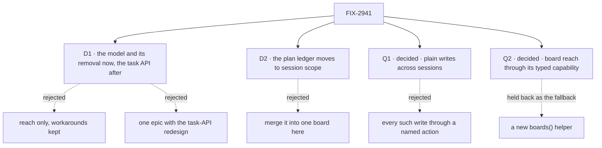

# FIX-2941 · Decisions

[Spec](SPEC.md) · **Decisions**

The calls above any single issue, and what each locks in for the seven children and the closure.
The model itself was agreed with the owner in
[the concept doc](../../../docs/internal/design/scopes-and-sessions.md) and is recorded under
[Decided by the owner](#decided-by-the-owner-recorded-so-no-child-reopens-them), not reopened. D1
and D2 are this epic's own calls. Q1 and Q2 were the owner's and are decided.

## The tree

## D1 · The scope model and its workaround removal now, in seven issues and a closure; the task-API redesign after

| | |
|---|---|
| **Instead of** | Reach only (FIX-2942, FIX-2943, FIX-2945), leaving lineage and partitions in place · or one epic that also redesigns the task API |
| **Because** | Reach beside the workarounds is a second way to do every cross-session job ([compose existing pieces](../../../docs/contributing/orchestration.md#compose-existing-pieces)). Deleting them is what proves the model holds. The task-API redesign is bigger, still undecided, and needs this model under it; folding it in couples a decided change to an undecided one |
| **Locks in** | The board keeps the delegation and plan stores until the follow-on epic. FIX-2946 changes where the boards live, not what a task is. A child that finds itself redesigning a task's lifecycle has left the epic and comments up |

**What would change my mind:** the task-API epic's direction landing first and moving the
conversation board somewhere this epic doesn't. Then FIX-2946 waits for it.

It comes down to the second way: reach-only leaves lineage and partitions standing beside it.

## D2 · The plan ledger moves to session scope with the conversation board; merging the two into one board waits

| | |
|---|---|
| **Instead of** | Merge the plan and delegation stores into one per-session board here · or leave the plan ledger on user scope with its partition |
| **Because** | `partition.ts` can only go once no ledger uses `partitionBy`, and the plan ledger does (`workforce/src/conversation-board/plan.ts`). Moving it is the same change as the board's. Merging the two is the task-API redesign: the rules that exist because of two stores (`plan.ts` alone is 526 lines) are that epic's |
| **Locks in** | FIX-2946 moves both ledgers and keeps both shapes. Plan rows move once now, and may move again when the follow-on epic merges the stores |

**What would change my mind:** the follow-on epic deciding to drop the plan store outright. Then
moving it first is wasted, and FIX-2946 leaves it to that epic, with `partition.ts` kept for it.

It comes down to deleting partitions: a ledger left partitioned keeps `partition.ts` alive.

## Q1 · Decided · Does a write from another session have to go through a named action?

**Decided by the owner, 2026-11-26: plain writes by default.** A write into another session's
copy is a plain write, recorded by the writing request and heard by the owning session (ER-2). A
definition may still offer a named action where its own history matters; a board's settle stays
one. FIX-2942 and FIX-2946 specify against this. The analysis below is kept as it was put to the
owner.

**In plain terms.** When coder's session settles a task on the launch chat's board, the write is
recorded in coder's session history. The question is whether the launch chat's own history must
also show "the CSV task session settled this". That needs the write to go through a named action
of the board, such as its settle, which records itself in the owning session too.

**The options.** *Plain writes:* any write works, as a local one does; a definition may offer
actions where its history matters, and a board's settle does. *Actions only:* a write from
another session must go through one of the definition's named actions.

**The trade-off.** Plain writes keep one way to write and are already recorded by the writing
request. Every definition works across sessions with no extra code. Actions only make the owning
session's history complete on its own, at the cost of every definition that is written across
sessions declaring actions for it.

**My recommendation: plain writes by default**, with the board's settle as an action because a
board's history is read by people.

**What would change my mind:** a support or audit need to answer "who changed this conversation's
data" from that conversation alone.

**What being wrong costs.** Moderate. Adding actions later is additive, but writes made before
then don't appear in the owning session's history, and that can't be backfilled.

It comes down to cost per definition: actions-only makes each shared definition declare its writes.

## Q2 · Decided · Is a board reached through its own typed handle, or through a new `boards()` helper?

**Decided by the owner, 2026-11-26: the capability first.** `ctx.cap.<name>.at({ session })` and
`.acrossSessions()` are built in FIX-2946; no `boards()` helper is built. `boards()` stays the
fallback, added only when a real caller has to pick a board by name at run time (a generic admin
or devtool screen), which the capability can't serve because it is keyed by a name in the code.
The analysis below is kept as it was put to the owner.

**In plain terms.** Today a block uses a board through the board's capability:
`ctx.cap.work.createTask(...)`, typed by the board's name and its task input
(`TaskBoardHandle.capability`, `orchestration/src/task-board/index.ts`). A worker now has to reach
the board its task sits on, which is another session's copy. You chose earlier to add
`boards(ctx, name, { session })`, a thin wrapper over `ctx.resources.at({ session })`. That
choice was made without the existing capability beside it; the analysis found it.

**The options.** *Extend the capability:* `ctx.cap.work.at({ session })` reaches another
session's copy, and `ctx.cap.work.acrossSessions()` reads across them. No `boards()` helper.
*Add `boards()`:* a helper beside the capability, taking the board's name as a string. Either
way, reaching another session stays a general resource feature, `ctx.resources.at({ session })`,
which any definition uses. The question is only the board's own door.

**The trade-off.** Extending keeps one way to use a board, typed as it is today, at the cost of
two more methods on the capability, which has to work for each board backing. `boards()` leaves
the capability alone and reads like any other resource reach, at the cost of a second door to
the same board beside `ctx.cap.<name>`, with the name passed as a string.

**My recommendation: extend the capability**, and add no `boards()` helper.

**What would change my mind:** a real caller that must reach a board its flow doesn't install
as a capability. Then a helper that takes the name earns its place.

**What being wrong costs.** Low now, more later. Both are thin over the same reach, so switching
before release is a rename across FIX-2946's and FIX-2947's call sites. After release, the
retired shape is a breaking change, since a moved public name keeps no alias (BP-034).

It comes down to the number of doors: `boards()` is a second way to use a board that already has one.

## Decided by the owner, recorded so no child reopens them

Agreed in [the concept doc](../../../docs/internal/design/scopes-and-sessions.md#decisions) and
the owner's discussion before this spec. Each became a rule below.

- **Scopes are copies; the owner (user, org, tenant) is the only boundary;** a miss reads as
  missing. ER-1.
- **Within one owner, a block reads and writes another session's copy** with
  `ctx.resources.at({ session })`; the definition's checks run, and the owning session hears the
  write. ER-1 to ER-3.
- **Reach by name from another flow is opt-in;** the rest keep flow isolation. Definitions are
  declared on blocks, the registry is their union, a clash refuses start, names are typed. ER-4,
  ER-5. The owner's direction named a `shared` flag, with boards always shared; the spec set found
  that every reach comes from a flow whose blocks declare the definition, so a flow opts in by
  declaring it and the flag waits, under the condition the set's Adds row set
  ([FIX-2943 D1](../../issues/FIX-2943/DECISIONS.md#d1)).
- **Board reach is a thin layer over that reach**, with no second definer. The owner first chose
  `boards(ctx, name, { session })`, then, with the typed board capability beside it, decided
  [Q2](#q2) for the capability, with `boards()` as the fallback. ER-9.
- **Lineage and copies into child state go,** except values fixed at filing, which ride on the
  task row. The task names its own board (`ctx.task.session`), because a workstream's lead
  session works tasks routed from several conversations. ER-9, ER-10.
- **Screens see across sessions only through a user-scope view** calling one read: one SQL query
  joined to sessions on the full owner, one change topic per definition per owner, filesystem
  parity. ER-7, ER-8. Today's topic (FIX-2750) spans the user's orgs; FIX-2945 narrows it to one
  owner, since a session key on it would tell one org the other's session ids. A lookup that is no view, such as a task's session
  from its id, uses the same read, filtered by the id (ER-7).
- **Every varying key segment is filterable without a scan;** no encoded prefixes. ER-6.

## Carried to the children, each with its default

The concept doc's other open questions are engineering calls with a default. Each child's spec
settles its own and says so; a child that wants a different answer comments up.

| Question | Default | Settled in |
|---|---|---|
| Turns started by writes from other sessions | Coalesce per session, as a board's notices do; the spec checks fan-out before building | FIX-2942 ([ER-2](#who-owns-what)) |
| Writes from a turn woken by untrusted content (fenced, [FIX-2689](https://linear.app/fixpoint-labs/issue/FIX-2689)) | No writes into other sessions by default | FIX-2942 |
| What "owner" means for the system principal (`{ userId: "system" }`, `core/src/types/schedules.ts`) and for the gateway fallback a schedule runs as when it names none | Neither is an owner reach applies to: a schedule on either sees only its own sessions ([ER-1](#who-owns-what)). A schedule that names a real person, org and tenant reaches within that owner | FIX-2942 ([ER-1](#who-owns-what)) |
| The task tools when one worker can file on two boards | Find the real cases first; no `board` argument until one exists | FIX-2946 |
| Cost of the read across sessions | Paged from the start, on `userSuspensions`' paging contract (the cursor is the last store row, not the last shown). A hard gate in FIX-2945's spec: measure session and row counts on a seeded store against a stated threshold before accepting the join without a kept index. FIX-2946's lookup by task id filters at the store by the row's key, which is the task id once partitions go, so the primary key answers it; it never loads every copy and discards | FIX-2945 |
| Paging when ER-1's admission drops rows after the query (an own-resolver verdict can't run in SQL) | No default: the spec says how a page and its cursor work, and a short page never ends the listing early | FIX-2945 |
| The change topic's shape | Extend FIX-2750's topic, whose narrowing by partition already shipped; the partition key becomes a session key ([ER-8](#who-owns-what)). Narrowed to one owner, not today's per-user topic that spans orgs ([ER-8](#who-owns-what)) | FIX-2945 |
| Which session-keyed per-user records move, and where | Decided one by one: per session, or per user keyed by subject | FIX-2948 |
| Tenants inside per-user data | Not in this epic | — |

## Who owns what

Every rule has one owner. Read a row to see where it is decided and where it is only used.

| # | Rule every child obeys | Owner | Checked at |
|---|---|---|---|
| ER-1 | **The routes' owner rule, extended.** A named session, a cross-session write and the read across sessions are admitted by the functions HTTP routes use today, extended to a block's caller, not by a new owner check: the tenant and `isOrgAttributed`, then `admitListedSession` / `ownResolverVerdict` (an instance with its own caller resolver decides; a write session is never listed), and `ownsRecord` with the instance's `ownerPin`. A block never reaches a session a browser can't. On the block side these take the run's resolved principal, never re-read HTTP credentials (a runner's envelope carries none, `transports/runner.ts`): the host rule is the owner compare of `principalOwnsRequest`; a target whose flow has its own caller resolver answers as missing to a block of another flow, since that resolver can't be re-run without the target's credentials, and admits a block of its own flow on the run's resolved caller. A miss reads as missing, on every verb. The system principal (`{ userId: "system" }`) and a principal filled from a schedule's gateway fallback are not an owner reach applies to: each such schedule's sessions answer as missing to every other. Refusal tests for another user, org and tenant, a no-org session, an own-resolver refusal, two schedules on the gateway principal, and a block reaching an ordinary host-resolver target and a custom-resolver target, from its own flow and another, in-process and behind a runner | FIX-2942 | FIX-2945's spec review; the closure's leg b |
| ER-2 | A write from another session runs the definition's checks and notifies the owning session as a local write would, through the change bus and, for a task's ending, the task notice to its filer. No new delivery path. Starting a turn is the definition's call, and turns started this way coalesce per session | FIX-2942 | FIX-2946's spec review; the closure's leg a |
| ER-3 | An operation over a whole copy (list, count, claim the next task, hear its changes) acts on one copy: your own or the one named. Nothing sweeps every session by accident; a read across sessions is deliberate, through ER-7's read | FIX-2942 | FIX-2946's spec review |
| ER-4 | Reach from another flow is opt-in: a flow reaches a definition, in any of the owner's sessions, only when its blocks declare it. No `shared` flag until a caller must reach a definition it can't declare. Flow isolation is unchanged | FIX-2943 | FIX-2946's and FIX-2948's spec review |
| ER-5 | One registered shape per name, declared on blocks; a clash refuses start. No second place to register | FIX-2943 | Each child's spec review |
| ER-6 | Every varying key segment is filterable by the SQL stores without a scan; no prefix read by `LEFT` or `substr` | FIX-2944 | The closure's leg c |
| ER-7 | Code sees across sessions only through the one read across sessions, which is one SQL query, paged, with filesystem parity: a screen through a user-scope view, and a lookup that is no view (a task's session from its id) through the same read, filtered by that id | FIX-2945 | FIX-2946's spec review; the closure's leg a |
| ER-8 | That read records the change topic: FIX-2750's topic, extended so its partition key is a session key and narrowed to one owner (user, org and tenant), on the change bus. Every write to any session's copy publishes on it. A session id or task id never rides a topic wider than one owner | FIX-2945 | The closure's leg a and its control |
| ER-9 | A board in another session is reached through its capability, `ctx.cap.<name>.at({ session })` and `.acrossSessions()`, a thin layer over `ctx.resources.at({ session })` offered only by boards with a per-session copy ([Q2](#q2)); no `boards()` helper until a caller needs a board by runtime name; and a task's board through `ctx.task.session`. `defineTaskCollection` stays the one board definer | FIX-2946 | FIX-2947's spec review |
| ER-10 | A child is given its work; values fixed at filing ride on the task row; nothing else is copied into child state, and no lineage survives | FIX-2947 | The closure's leg c |
| ER-11 | Per-user data is keyed by what it is about, never by a session's id or a value derived from one | FIX-2948 | The closure's gap sweep |
| ER-12 | A child that moves a persisted record keeps existing records readable (BP-030), and a child that removes a term retires it in `docs/contributing/glossary.mjs` in the same PR | Each child | Each child's PR; the closure's gap sweep |
| ER-13 | Consumed and related issues keep their parents: FIX-2532, FIX-2777 and its epic FIX-2683, FIX-2563, FIX-1207, FIX-2065, FIX-1283, FIX-1090, FIX-1132, FIX-1108, FIX-2689, FIX-1580 | The coordinator | Each refresh |

## Coordination seams

| Seam | Between | Rule |
|---|---|---|
| Resource resolution in `engine/src/context/createExecutionContext.ts` | FIX-2942, FIX-2943, FIX-2947 | FIX-2942 merges first; FIX-2943 builds its lookup on that resolver; FIX-2947 deletes the lineage branch last |
| The owner rule in SQL | FIX-2942 and FIX-2945 | FIX-2945's join applies the parts of ER-1's rule SQL can (tenant, org, user) and runs the rest per row after the query, as a route's listing does. One conformance test asserts both refuse the same cases |
| Store key layout and prefix reads | FIX-2944, FIX-2945, FIX-2948 | FIX-2944 merges first. FIX-2948 changes no key layout before it does |
| The one-time mover of stored rows | FIX-2946 (board and plan rows), FIX-2947 (rows with no depth or top), FIX-2948 (subscriptions, cursors, skills index entries) | FIX-2946 builds the mover; its removal is [FIX-2950](https://linear.app/fixpoint-labs/issue/FIX-2950); FIX-2947 and FIX-2948 add their rows to it, not a second mover |
| The write notice | FIX-2942 (the owning session hears it) and FIX-2945 (the change topic) | One publish on write serves both; neither adds a second |
| `workforce/src/conversation-board/` | FIX-2946 (ledger, plan, board above) and FIX-2947 (filing session, routed sessions, chains, `handedProjectOf`) | FIX-2946 merges first; FIX-2947 rebases |
| Shift Manager's board read | FIX-2946 and [FIX-2683](https://linear.app/fixpoint-labs/issue/FIX-2683) (outside; FIX-2777, #5526, deletes `reads.ts`) | FIX-2777 merges first. FIX-2946 moves the kit view's board read and rebuilds nothing in `reads.ts` |
| `workforce/src/workers/session-fields.ts` | FIX-2947 and #5711 (outside, typed session fields) | #5711 lands first; FIX-2947 deletes what it typed rather than retyping it |
| Glossary entries | FIX-2942 coins; FIX-2946, FIX-2947, FIX-2948 retire. FIX-2943 coins nothing: no "shared definition" term ships | Each edits only its own terms. "Change topic" is the View entry's phrase; it is not the internal-event Topic |

## The existing issues

| Issue | State | How it's handled |
|---|---|---|
| FIX-1090, FIX-1108 · lineage rows left on delete; a shared resource deleted under a running workstream | Open | Related to FIX-2947. Obsolete once every per-session row sits under its own session's key. FIX-2947 closes each with that reason |
| FIX-1132 · production session creation untested | In flight, #5688 (Linear still says Backlog; noted, not changed) | Related to FIX-2947. Its `testFlow` fix stands on its own route; only its lineage-mint half goes with lineage |
| FIX-1283 · write claims don't arbitrate lineage-shared collections | Open | Related to FIX-2942. Its question survives in a new form, two sessions writing one copy, and FIX-2942's spec answers it under ER-2 |
| FIX-2563, FIX-1207 · the start-up clash check | Open | Related to FIX-2943, whose spec says whether its refusal closes them |
| FIX-2065 · user data across orgs | Open | Related to FIX-2942. It concerns per-user data, not session copies, so ER-1 doesn't block it |
| FIX-2689 · untrusted turns and secret confinement (epic) | Open | Related to FIX-2942, whose spec keeps a fenced turn from writing into other sessions by default |
| FIX-1580 · typed `ctx.resources` | Open | Related to FIX-2943 (ER-5): typed names over the registry are the same surface |
| FIX-2733, FIX-1068, FIX-1084 | Done | History: the lineage feature this epic retires, and its last fix |

None is re-parented: each has its own route, and the three obsolete ones need no work of their own.

## What the end-state POC showed

None built. The concept doc's walkthrough ("How it flows") already composes the end state on
paper with two cold reads, and the closure run is the end-to-end check.

## Analysis

**2026-11-25 · forward pass by a separate analyst agent, read-only, on head `cf812d9f2d` ·
watermark 2026-11-25 (the epic's creation; no earlier wrap analysis in the project). Verdict:
right approach, with changes.** It replaces the author's own first pass, which had no sub-agent
and is kept in [How it got here](#how-it-got-here). `adhd` ran as one divergent pass in that
analyst's single context, not as separate sub-agents per frame. A separate-sub-agent `adhd` run
may follow from the coordinator; if it does, it is recorded as its own entry here.

1. **Reuse.** Six folds. ER-1 extends the routes' admission functions (`admitListedSession`,
   `ownResolverVerdict`, `isOrgAttributed`, `ownsRecord` with `ownerPin`) instead of adding an
   owner check narrower than the routes'. The change topic extends FIX-2750's user topic and its
   HMAC-keyed partitions (`engine/src/push/partition-key.ts`), which already narrow per
   partition (ER-8). Board reach duplicated the typed board capability (`ctx.cap.<name>`),
   raised as [Q2](#q2). Values fixed at filing extend FIX-2894's typed task input. The `shared`
   flag is new and may wait if boards are its only consumer. The first pass's folds stand: the
   change bus ([`change-bus`](../../../docs/mechanisms/mechanisms.yaml)) and the task notice
   carry a cross-session write's notice (ER-2), and the registry extends the start-up clash check.
2. **Prior art.** [Temporal](https://docs.temporal.io/encyclopedia/workflow-message-passing) lets
   one workflow change another only through named signals and updates, which the receiver's
   history records; its reason is replay, ours would be audit (Q1). [LangGraph's store](https://langchain-ai.github.io/langgraph/concepts/persistence/#memory-store)
   keeps cross-thread data under namespace tuples searched by prefix, the encoded-prefix shape
   ER-6 retires. [Mastra](https://mastra.ai/docs/memory/working-memory) shares memory across a
   user's threads by keying it on the user, which is rule 11.
3. **Other shapes.** The strongest other division is still a tracer: move the conversation board
   end to end first on a minimal reach, then generalize. It shows Shift Manager sooner but builds
   FIX-2943 and FIX-2945 twice. Next-variant test: the next cross-session feature (a consult
   reading another conversation, FIX-2314) copies nothing.
4. **New factors.** The task-id lookup (`taskSessionOf`, `findTaskPartitions`, called from
   `workforce/src/messages/`) had no owning child; FIX-2946 owns it, and ER-3 and ER-7 allow a
   deliberate read across sessions filtered by id. FIX-2689 (untrusted turns) and FIX-1580
   (typed `ctx.resources`) join ER-13. FIX-1132 is Backlog in Linear while #5688 is open;
   noted, not changed.
5. **Necessity.** Right size. FIX-2948 is the cut candidate, with a collapse trigger.
6. **Ergonomics.** The common case is `ctx.resources.at({ session })` plus the board's own door,
   whose shape is Q2. One surprise the set adds: `ctx.sessions` and `ctx.resources.at({ session })`
   both name another session. Recorded for FIX-2942's spec, which says in the accessor's docs
   what each is for.
7. **Concerns.** Today's change topic spans the user's orgs, which the owner's "per owner"
   contradicts; FIX-2945 settles it, and defines paging after a per-row admission. FIX-2942
   defines the owner for the system principal and the gateway fallback, and keeps a fenced turn
   from writing into other sessions by default. The concept doc (#5765) names `defineBoard`,
   which the set doesn't add; the docs line says so. Moving existing board rows to session scope
   is the riskiest step; ER-12 holds it.

## How it got here

- **Drafted (Nov 25)** from the agreed concept doc. Seven children and the closure; the plan
  ledger moves here and its merge waits (D2); Q1 carried to the owner.
- **First analysis (Nov 25)**, in the author's context with no sub-agent, folded three reuse
  verdicts (change bus, task notice, clash check) and the Shift Manager and session-fields seams.
- **Forward analysis (Nov 25)**, by a separate agent: ER-1 now extends the routes' functions;
  ER-8 extends FIX-2750's topic; FIX-2946 owns the task-id lookup, which ER-3 and ER-7 allow;
  board reach reopened as Q2; two defaults recorded for FIX-2942; ER-13 gained FIX-2689 and
  FIX-1580.
- **Spec set (Nov 26)**, amending the epic: ER-4 drops the `shared` flag until a caller needs it
  (found by FIX-2943); the one mover gets a seam, and FIX-2946 hands it to FIX-2948 (found by
  FIX-2946 and FIX-2948); FIX-2948's collapse trigger did not fire.
- **Set review round 1 (Nov 26)**, amending the epic: FIX-2947 counts breadth through a declared
  `top` index, so FIX-2532 becomes an input of FIX-2947 too; the mover's removal is filed as
  [FIX-2950](https://linear.app/fixpoint-labs/issue/FIX-2950).

**Open: none.** Decided 2026-11-26 by the owner: [Q1](#q1), plain writes by default with a board's settle kept as an action; [Q2](#q2), the capability first, `boards()` as the fallback.
