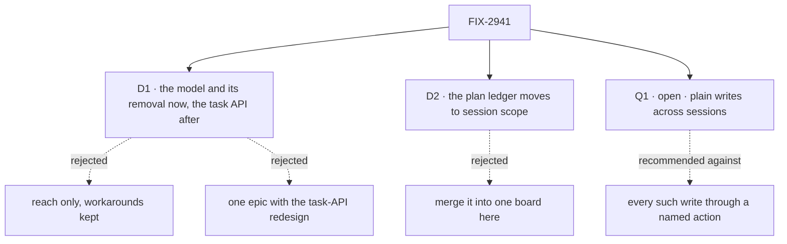

# FIX-2941 · Decisions

[Spec](SPEC.md) · **Decisions**

The calls above any single issue, and what each locks in for the seven children and the closure.
The model itself was agreed with the owner in
[the concept doc](../../../docs/internal/design/scopes-and-sessions.md) and is recorded under
[Decided by the owner](#decided-by-the-owner-recorded-so-no-child-reopens-them), not reopened. D1
and D2 are this epic's own calls. Q1 is open and the owner's.

## The tree

## D1 · The scope model and its workaround removal now, in seven issues and a closure; the task-API redesign after

| | |
|---|---|
| **Instead of** | Reach only (FIX-2942, FIX-2943, FIX-2945), leaving lineage and partitions in place · or one epic that also redesigns the task API |
| **Because** | Reach beside the workarounds is a second way to do every cross-session job ([compose existing pieces](../../../docs/contributing/orchestration.md#compose-existing-pieces)). Deleting them is what proves the model holds. The task-API redesign is bigger, still undecided, and needs this model under it; folding it in couples a decided change to an undecided one |
| **Locks in** | The board keeps the delegation and plan stores until the follow-on epic. FIX-2946 changes where the boards live, not what a task is. A child that finds itself redesigning a task's lifecycle has left the epic and comments up |

**What would change my mind:** the task-API epic's direction landing first and moving the
conversation board somewhere this epic doesn't. Then FIX-2946 waits for it.

It comes down to the second way: reach-only leaves lineage and partitions standing beside it.

## D2 · The plan ledger moves to session scope with the conversation board; merging the two into one board waits

| | |
|---|---|
| **Instead of** | Merge the plan and delegation stores into one per-session board here · or leave the plan ledger on user scope with its partition |
| **Because** | `partition.ts` can only go once no ledger uses `partitionBy`, and the plan ledger does (`workforce/src/conversation-board/plan.ts`). Moving it is the same change as the board's. Merging the two is the task-API redesign: the rules that exist because of two stores (`plan.ts` alone is 526 lines) are that epic's |
| **Locks in** | FIX-2946 moves both ledgers and keeps both shapes. Plan rows move once now, and may move again when the follow-on epic merges the stores |

**What would change my mind:** the follow-on epic deciding to drop the plan store outright. Then
moving it first is wasted, and FIX-2946 leaves it to that epic, with `partition.ts` kept for it.

It comes down to deleting partitions: a ledger left partitioned keeps `partition.ts` alive.

## Q1 · Open · Does a write from another session have to go through a named action?

**In plain terms.** When coder's session settles a task on the launch chat's board, the write is
recorded in coder's session history. The question is whether the launch chat's own history must
also show "the CSV task session settled this". That needs the write to go through a named action
of the board, such as its settle, which records itself in the owning session too.

**The options.** *Plain writes:* any write works, as a local one does; a definition may offer
actions where its history matters, and a board's settle does. *Actions only:* a write from
another session must go through one of the definition's named actions.

**The trade-off.** Plain writes keep one way to write and are already recorded by the writing
request. Every definition works across sessions with no extra code. Actions only make the owning
session's history complete on its own, at the cost of every definition that is written across
sessions declaring actions for it.

**My recommendation: plain writes by default**, with the board's settle as an action because a
board's history is read by people.

**What would change my mind:** a support or audit need to answer "who changed this conversation's
data" from that conversation alone.

**What being wrong costs.** Moderate. Adding actions later is additive, but writes made before
then don't appear in the owning session's history, and that can't be backfilled.

It comes down to cost per definition: actions-only makes each shared definition declare its writes.

## Decided by the owner, recorded so no child reopens them

Agreed in [the concept doc](../../../docs/internal/design/scopes-and-sessions.md#decisions) and
the owner's discussion before this spec. Each became a rule below.

- **Scopes are copies; the owner (user, org, tenant) is the only boundary;** a miss reads as
  missing. ER-1.
- **Within one owner, a block reads and writes another session's copy** with
  `ctx.resources.at({ session })`; the definition's checks run, and the owning session hears the
  write. ER-1 to ER-3.
- **Reach by name from any flow is opt-in through shared definitions;** boards are always shared,
  the rest keep flow isolation. Definitions are declared on blocks, the registry is their union,
  a clash refuses start, names are typed. ER-4, ER-5.
- **`boards(ctx, name, { session })` is a thin wrapper** over that reach. ER-9.
- **Lineage and copies into child state go,** except values fixed at filing, which ride on the
  task row. The task names its own board (`ctx.task.session`), because a workstream's lead
  session works tasks routed from several conversations. ER-9, ER-10.
- **Screens see across sessions only through a user-scope view** calling one read: one SQL query
  joined to sessions on the full owner, one change topic per definition per owner, filesystem
  parity. ER-7, ER-8.
- **Every varying key segment is filterable without a scan;** no encoded prefixes. ER-6.

## Carried to the children, each with its default

The concept doc's other open questions are engineering calls with a default. Each child's spec
settles its own and says so; a child that wants a different answer comments up.

| Question | Default | Settled in |
|---|---|---|
| Turns started by writes from other sessions | Coalesce per session, as a board's notices do; the spec checks fan-out before building | FIX-2942 ([ER-2](#who-owns-what)) |
| The task tools when one worker can file on two boards | Find the real cases first; no `board` argument until one exists | FIX-2946 |
| Cost of the read across sessions | Paged from the start; measure session count and row count on a seeded store before settling indexes | FIX-2945 |
| The change topic's shape | One per definition per owner ([ER-8](#who-owns-what)); narrower per filter only if measured as too noisy, as an epic amendment | FIX-2945 |
| Which session-keyed per-user records move, and where | Decided one by one: per session, or per user keyed by subject | FIX-2948 |
| Tenants inside per-user data | Not in this epic | — |

## Who owns what

Every rule has one owner. Read a row to see where it is decided and where it is only used.

| # | Rule every child obeys | Owner | Checked at |
|---|---|---|---|
| ER-1 | **One owner predicate.** A named session, a cross-session write and the read across sessions all check user, org and tenant against the stored session record, null-safely, through one function. A miss reads as missing, on every verb. Refusal tests for all three cases | FIX-2942 | FIX-2945's spec review; the closure's leg b |
| ER-2 | A write from another session runs the definition's checks and notifies the owning session as a local write would, through the change bus and, for a task's ending, the task notice to its filer. No new delivery path. Starting a turn is the definition's call, and turns started this way coalesce per session | FIX-2942 | FIX-2946's spec review; the closure's leg a |
| ER-3 | An operation over a whole copy (list, count, claim the next task, hear its changes) acts on one copy: your own or the one named. Nothing sweeps every session by accident | FIX-2942 | FIX-2946's spec review |
| ER-4 | Reach by name from another flow is opt-in (`shared`); a board is always shared; everything else keeps flow isolation | FIX-2943 | FIX-2946's and FIX-2948's spec review |
| ER-5 | One registered shape per name, declared on blocks; a clash refuses start. No second place to register | FIX-2943 | Each child's spec review |
| ER-6 | Every varying key segment is filterable by the SQL stores without a scan; no prefix read by `LEFT` or `substr` | FIX-2944 | The closure's leg c |
| ER-7 | A screen sees across sessions only through a user-scope view calling the one read across sessions, which is one SQL query, paged, with filesystem parity | FIX-2945 | FIX-2946's spec review; the closure's leg a |
| ER-8 | That read records one change topic per definition per owner, on the change bus, and every write to any session's copy publishes on it | FIX-2945 | The closure's leg a and its control |
| ER-9 | A board is reached through `boards(ctx, name, { session })` over `ctx.resources.at`, and a task through `ctx.task.session`. `defineTaskCollection` stays the one board definer | FIX-2946 | FIX-2947's spec review |
| ER-10 | A child is given its work; values fixed at filing ride on the task row; nothing else is copied into child state, and no lineage survives | FIX-2947 | The closure's leg c |
| ER-11 | Per-user data is keyed by what it is about, never by a session's id or a value derived from one | FIX-2948 | The closure's gap sweep |
| ER-12 | A child that moves a persisted record keeps existing records readable (BP-030), and a child that removes a term retires it in `docs/contributing/glossary.mjs` in the same PR | Each child | Each child's PR; the closure's gap sweep |
| ER-13 | Consumed and related issues keep their parents: FIX-2532, FIX-2777 and its epic FIX-2683, FIX-2563, FIX-1207, FIX-2065, FIX-1283, FIX-1090, FIX-1132, FIX-1108 | The coordinator | Each refresh |

## Coordination seams

| Seam | Between | Rule |
|---|---|---|
| Resource resolution in `engine/src/context/createExecutionContext.ts` | FIX-2942, FIX-2943, FIX-2947 | FIX-2942 merges first; FIX-2943 builds its lookup on that resolver; FIX-2947 deletes the lineage branch last |
| The owner predicate in SQL | FIX-2942 and FIX-2945 | FIX-2945's join uses ER-1's predicate. One conformance test asserts both refuse the same three cases |
| Store key layout and prefix reads | FIX-2944, FIX-2945, FIX-2948 | FIX-2944 merges first. FIX-2948 changes no key layout before it does |
| The write notice | FIX-2942 (the owning session hears it) and FIX-2945 (the change topic) | One publish on write serves both; neither adds a second |
| `workforce/src/conversation-board/` | FIX-2946 (ledger, plan, board above) and FIX-2947 (filing session, routed sessions, chains, `handedProjectOf`) | FIX-2946 merges first; FIX-2947 rebases |
| Shift Manager's board read | FIX-2946 and [FIX-2683](https://linear.app/fixpoint-labs/issue/FIX-2683) (outside; FIX-2777, #5526, deletes `reads.ts`) | FIX-2777 merges first. FIX-2946 moves the kit view's board read and rebuilds nothing in `reads.ts` |
| `workforce/src/workers/session-fields.ts` | FIX-2947 and #5711 (outside, typed session fields) | #5711 lands first; FIX-2947 deletes what it typed rather than retyping it |
| Glossary entries | FIX-2942 and FIX-2943 coin; FIX-2946, FIX-2947, FIX-2948 retire | Each edits only its own terms. "Change topic" is the View entry's phrase; it is not the internal-event Topic |

## The existing issues

| Issue | State | How it's handled |
|---|---|---|
| FIX-1090, FIX-1108 · lineage rows left on delete; a shared resource deleted under a running workstream | Open | Related to FIX-2947. Obsolete once every per-session row sits under its own session's key. FIX-2947 closes each with that reason |
| FIX-1132 · production session creation untested | In flight, #5688 | Related to FIX-2947. Its `testFlow` fix stands on its own route; only its lineage-mint half goes with lineage |
| FIX-1283 · write claims don't arbitrate lineage-shared collections | Open | Related to FIX-2942. Its question survives in a new form, two sessions writing one copy, and FIX-2942's spec answers it under ER-2 |
| FIX-2563, FIX-1207 · the start-up clash check | Open | Related to FIX-2943, whose spec says whether its refusal closes them |
| FIX-2065 · user data across orgs | Open | Related to FIX-2942. It concerns per-user data, not session copies, so ER-1 doesn't block it |
| FIX-2733, FIX-1068, FIX-1084 | Done | History: the lineage feature this epic retires, and its last fix |

None is re-parented: each has its own route, and the three obsolete ones need no work of their own.

## What the end-state POC showed

None built. The concept doc's walkthrough ("How it flows") already composes the end state on
paper with two cold reads, and the closure run is the end-to-end check.

## Analysis

**2026-11-25 · watermark 2026-11-25 (the epic's creation; no earlier wrap analysis in the project).
Verdict: right approach, with changes.** Run in the author's context, not by a fresh analyst, and
without `adhd`'s eight frames: this dispatch had no sub-agent tool. A fresh pass is owed before the
gate.

1. **Reuse.** Three folds. The change topic extends the change bus ([`change-bus`](../../../docs/mechanisms/mechanisms.yaml)), and
   a cross-session write's notice is the bus plus the task notice (`task-notice`), not a new path
   (ER-2, ER-8). The registry extends the start-up clash check, and names the manifest registry
   as a different job. The rest of the Adds were already extend verdicts.
2. **Prior art.** [Temporal](https://docs.temporal.io/encyclopedia/workflow-message-passing) lets
   one workflow change another only through named signals and updates, which the receiver's
   history records; its reason is replay, ours would be audit (Q1). [LangGraph's store](https://langchain-ai.github.io/langgraph/concepts/persistence/#memory-store)
   keeps cross-thread data under namespace tuples searched by prefix, the encoded-prefix shape
   ER-6 retires. [Mastra](https://mastra.ai/docs/memory/working-memory) shares memory across a
   user's threads by keying it on the user, which is rule 11.
3. **Other shapes.** The strongest other division is a tracer: move the conversation board end to
   end first on a minimal reach, then generalize. It shows Shift Manager sooner but builds
   FIX-2943 and FIX-2945 twice. Next-variant test: the next cross-session feature (a consult
   reading another conversation, FIX-2314) copies nothing.
4. **New factors.** 31 issues and 11 open PRs read. FIX-2683 and FIX-2777 (Shift Manager's
   `reads.ts` goes) and #5711 (typed session fields) became seams; #5688 put FIX-1132 in flight.
5. **Necessity.** Right size. FIX-2948 is the cut candidate, with a collapse trigger.
6. **Ergonomics.** The common case is three lines: `ctx.resources.at({ session })`,
   `boards(ctx, name, { session: ctx.task.session })`, `boards.acrossSessions(ctx, name)`. One
   surprise the set adds: `ctx.sessions` and `ctx.resources.at({ session })` both name another
   session. Recorded for FIX-2942's spec, which says in the accessor's docs what each is for.
7. **Concerns.** The concept doc is not on `main` yet (#5765), so this set's links to it resolve
   only once it merges. Moving existing board rows to session scope is the riskiest step; ER-12
   holds it.

## How it got here

- **Drafted (Nov 25)** from the agreed concept doc. Seven children and the closure; the plan
  ledger moves here and its merge waits (D2); Q1 carried to the owner.
- **Analysis (Nov 25)** folded three reuse verdicts (change bus, task notice, clash check) and the
  Shift Manager and session-fields seams.

**Open: [Q1](#q1).**
