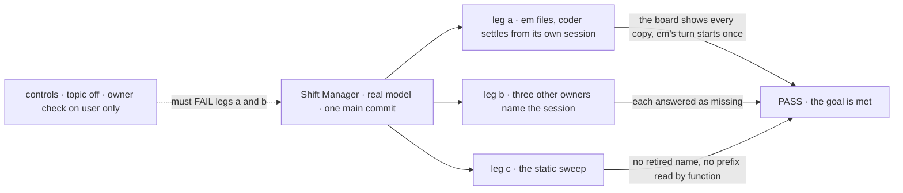
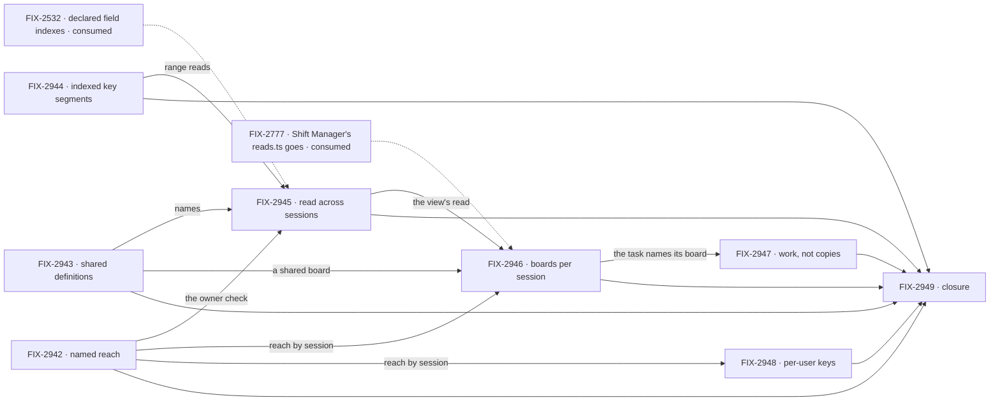

# FIX-2941 · Sessions reach each other: scopes as copies, the owner as the boundary

**Spec** · [Decisions](DECISIONS.md)

## Five teams, before and after

| A team that… | Today | After this epic |
|---|---|---|
| **hands work from one flow to another** | Moves the data to user scope and splits it per conversation, or stamps the parent's values into each child | Names the session that holds the data and reads or writes its copy |
| **builds a screen across sessions** | Shift Manager reads the task store through whichever session declares it, then regroups | Asks one user-scope view: one query, and it hears sessions made after it opened |
| **hosts more than one org or tenant** | Blocks follow lineage rules; HTTP routes follow the owner rule | One owner rule for both, with a refusal test per case |
| **runs on Postgres or SQLite** | Every prefix read scans the scope | Every varying key segment is read through an index |
| **learns task boards** | Learns lineage, partitions, filing sessions, the board above, routed sessions, task chains | Learns that a board has a copy per session, reached by naming the session |

**Why now.** The task-API redesign is next and would otherwise build on these workarounds. Each
new feature that needs another session's data still builds its own: the coding run record moved
to user scope after a new session read `run: null` for a finished job. The model is agreed in
[the concept doc](../../../docs/internal/design/scopes-and-sessions.md) (on
[#5765](https://github.com/fixpoint-labs/flow-state-dev/pull/5765) until it merges); this epic
turns it into work and does not reopen it.

## The goal, and how we'll know it's met

**Within one owner, any block reaches any session's copy of a resource by naming the session, and
any screen sees across sessions through one view and one query. The workarounds that stood in for
that are gone.**

| Is it the right goal? | |
|---|---|
| **The real need** | One rule for who may look, and one way to reach across sessions, so the workarounds can go. It serves the kill line in `docs/objectives.md` (the composition model) and goal 4, with Shift Manager as the real consumer. It moves the lead measure by one goal at most |
| **Smaller, and rejected** | "A block can name another session" (FIX-2942, maybe with FIX-2943 and FIX-2945). Reach ships, but lineage and partitions stay beside it: two ways to do every cross-session job ([D1](DECISIONS.md#d1)) |
| **Bigger, and not this epic's** | The task-API redesign: one board instead of the delegation and plan stores, lifecycles, verdict templates, one person-wait tool. A follow-on epic. Tenants inside per-user data |
| **Not done if** | The closure check has not run · a retired name is in package source · a prefix read uses `LEFT` or `substr` · a refusal test is missing · Shift Manager reads the board through a session · a closure bug is open |

Each leg has a control that breaks what it checks. A control that passes means its leg proves
nothing.

| How we verify | |
|---|---|
| **Goal check** | The closure issue, [FIX-2949](https://linear.app/fixpoint-labs/issue/FIX-2949), on one `main` commit after every other child merges |
| **Signal** | **a:** em files a task in one conversation; coder settles it from its own session; em's next turn starts once; the board shows it and a sub-task filed in a session created after the board opened. **b:** another user, the same user in another org, and under another tenant each name that conversation for a read, a write and the read across sessions, and each is answered as missing. Two schedules on the gateway principal can't name each other's sessions, and a client of the same user in another org receives no session or task id on its topic. **c:** the retired names and `LEFT(`/`substr(` prefix reads are absent from `packages/*/src` |
| **Anti-game** | Assert on what Shift Manager shows and on HTTP answers, not on a child's return values. Leg b runs through a real flow's block |
| **Control that must fail** | Change topic off: leg a's late sub-task never appears. Owner check on user only: leg b's other-org case reads the session. Today's `main`: leg c finds every name |

## What's in the box

![What's in the box. In the box: a block reaches another session's copy by naming it, under one owner check; shared definitions reachable by name; one read across an owner's sessions with one change topic; task boards and the plan ledger as per-session copies; children given their work, with values fixed at filing on the task row; per-user records keyed by subject; indexed key segments. A fence: the owner (user, org, tenant) is the only access boundary, and a miss reads as missing. Composed in by the app: which definitions it marks shared, and its views. Deleted by the set: lineage, partitions, copies at birth, the board-above helper, the routed-session and chain records, each view's own cross-session path, prefix reads by function. Not built: the task-API redesign, tenants in per-user data, a kept per-user index, a second board definer](figures/end-state.svg)

The box is what an app gets by naming things. The fence is [ER-1](DECISIONS.md#who-owns-what);
the right column is what the set deletes.

**Docs:** the shared story is "a scope is how many copies exist; the owner decides who may look;
name a session to reach its copy". [FIX-2942](https://linear.app/fixpoint-labs/issue/FIX-2942)'s
changeset carries it, and its PR updates `docs/architecture/state-and-scopes.md`. Each child
records its own surface in its changeset. The set keeps today's names: `defineTaskCollection`
stays the one board definer, and there is no `defineBoard`. The concept doc's examples use
`defineBoard`; it is amended to match on #5765, which is the owner's call.

## The set · as of 2026-11-25

Live state is in [Linear](https://linear.app/fixpoint-labs/issue/FIX-2941). Every child takes the
spec route, in one spec-set PR.

| Issue | What it delivers | Status |
|---|---|---|
| [FIX-2942](https://linear.app/fixpoint-labs/issue/FIX-2942) | `ctx.resources.at({ session })`: read and write another session's copy, under the owner check | Ready to spec |
| [FIX-2943](https://linear.app/fixpoint-labs/issue/FIX-2943) | Shared definitions, registered by name; the rest keep flow isolation | Ready to spec |
| [FIX-2944](https://linear.app/fixpoint-labs/issue/FIX-2944) | Range reads over indexed key segments in both SQL stores | Ready to spec |
| [FIX-2945](https://linear.app/fixpoint-labs/issue/FIX-2945) | One read across an owner's sessions: one query, one change topic | Ready to spec |
| [FIX-2946](https://linear.app/fixpoint-labs/issue/FIX-2946) | The conversation board and plan ledger as per-session copies; partitions go; three screens read one view, and the task-id lookup reads across sessions by id | Ready to spec |
| [FIX-2947](https://linear.app/fixpoint-labs/issue/FIX-2947) | Children get their work: lineage, child-state copies, routed-session and chain records go | Ready to spec |
| [FIX-2948](https://linear.app/fixpoint-labs/issue/FIX-2948) | Per-user records keyed by a session value move to session scope or to their subject | Ready to spec |
| [FIX-2949](https://linear.app/fixpoint-labs/issue/FIX-2949) | The QA run on one `main` commit | **closure · required** · blocked by all seven |

0 done · 8 to spec. FIX-2948 is the one I'd cut: two of the six records the concept doc counts go
with FIX-2947. Its collapse trigger: if its spec finds the rest already keyed by subject, it
closes with a note and no code. FIX-2944 and FIX-2945 can't go: without them every per-session
read scans, and each screen keeps its own path across sessions.

## How the issues flow into each other

An edge is what one issue hands the next; a dashed input is consumed, not owned. FIX-2942,
FIX-2943 and FIX-2944 start together. FIX-2946 is the long pole and waits for FIX-2777; FIX-2947
follows it.

## What stays as it is

- **Flow isolation** for every definition not marked shared.
- **The sessions handle** (`ctx.sessions`), for what isn't a resource; another session's state
  stays readable-fields-only.
- **Per-row owners inside an org copy**, and **the coding run record** (per user, keyed by subject).
- **Tenants inside per-user data**, and [FIX-2065](https://linear.app/fixpoint-labs/issue/FIX-2065)
  (user data across orgs). Both concern per-user data, not session copies.

## What's already here, and the debt

| Already here | What the set does with it |
|---|---|
| HTTP routes admit a session through several functions, not one owner check: `admitListedSession` and `ownResolverVerdict` (`engine/src/routes/instance-caller.ts`: an instance with its own caller resolver decides, and a write session is never listed), `isOrgAttributed` (`engine/src/context/org-attribution.ts`: a session with no org is left out), and `ownsRecord` with the instance's `ownerPin` (`engine/src/context/record-owner.ts`, applied in `context/create-request-host.ts`) | **Extended.** A block is admitted by these same functions ([ER-1](DECISIONS.md#who-owns-what)), so it never reaches a session a browser can't |
| The owner rule and the one-query `userSuspensions` read (`engine/src/context/request-sessions.ts`) | **Builds on.** FIX-2945's join has its shape and predicate |
| Views that record what each run read ([FIX-2623](../../issues/FIX-2623/DECISIONS.md)) | **Builds on** for the change topic |
| Board-insert notices on one user topic, each partition sent as an HMAC key ([FIX-2750](https://linear.app/fixpoint-labs/issue/FIX-2750), Done: `engine/src/push/partition-key.ts`, `ViewHearing.partitions`). The topic spans the user's orgs | **Extended** by FIX-2945 into the change topic ([ER-8](DECISIONS.md#who-owns-what)) |
| Finding a task's session from its id alone: `taskSessionOf` and `findTaskPartitions`, called from `workforce/src/messages/message-target.ts`, `queue.ts` and `consult.ts`. None of them is a view | **Superseded** by FIX-2946: a deliberate read across sessions filtered by the id ([ER-3, ER-7](DECISIONS.md#who-owns-what)) |
| Typed task input ([FIX-2894](../../issues/FIX-2894/SPEC.md)): a flow's `work` entry declares what its tasks take | **Extended** by FIX-2947 for values fixed at filing |
| Declared field indexes ([FIX-2532](https://linear.app/fixpoint-labs/issue/FIX-2532), in review) | **Consumed** by FIX-2945 |
| The parent-row read and settle on the request host (`core/src/types/request-host.ts`) | **Superseded** by FIX-2946's reach through the task |
| Lineage sharing (FIX-1068), partitions and the `byTaskId` index | **Superseded** by FIX-2947 and FIX-2946 |
| Shift Manager reading through kit views ([FIX-2683](https://linear.app/fixpoint-labs/issue/FIX-2683), in development); [FIX-2777](https://linear.app/fixpoint-labs/issue/FIX-2777) deletes `reads.ts` and its carrier read | **Consumed.** FIX-2946 moves the board read those views make onto the read across sessions, after FIX-2777 merges |

| Adds | Existing piece considered | How composed |
|---|---|---|
| `ctx.resources.at({ session })` · FIX-2942 | The sessions handle; the parent-row read | Extends the resource accessor. The handle reaches no resources and stays for what isn't one |
| `shared` and the registry · FIX-2943 | The resource-address path (`engine/src/resources/scope-address.ts`: `declarationsOf` finds definitions across flows under `flowIsolation`, `resolveAddress` checks they agree, `admitAddress` applies every declarer's resolver and owner pin); `defineFlow`'s merge of block resources; the start-up clash check; the manifest registry (`createManifestRegistry`) | Extends the resource-address path, the one cross-flow lookup and admission: `shared` widens `declarationsOf`, and a shared name keeps `admitAddress`'s rule that every declarer's resolver and owner pin admits the caller. Also extends the clash check (`validateScope` in `engine/src/registry/flow-registry.ts`): the union the merge computes, taken across flows. The manifest registry stays unchanged. It is a model's discovery door, a different job; FIX-2943 says how the two relate and adds no second public "registry" noun beside it. The `shared` flag itself is new: if FIX-2943's spec finds no consumer but boards, it waits and boards are reached by their own rule |
| `acrossSessions` · FIX-2945 | `userSuspensions`; views | Extends the store's read with an owner join; no kept index |
| The change topic · FIX-2945 | FIX-2750's user topic with HMAC-keyed partitions; the change bus (`change-bus`: a scope's topic, optionally one resource) | Extends the FIX-2750 topic: its partition key becomes a session key, published on the bus's one write path. FIX-2946 retires the old partition key with partitions. The topic narrows to one owner (user, org and tenant), so no session id reaches another org |
| Board reach by session, `ctx.task.session` · FIX-2946 | The board's typed capability (`TaskBoardHandle.capability`, `ctx.cap.<name>`); `defineTaskCollection`'s handle; the board-above helper | Extends the capability ([Q2](DECISIONS.md#q2), decided): `ctx.cap.work.at({ session })` and `.acrossSessions()` over `ctx.resources.at`, on boards with a per-session copy. FIX-2946's spec says whether a factory-backed board offers them. No `boards()` helper unless a caller needs a board by runtime name. No second definer ([ER-9](DECISIONS.md#who-owns-what)); `ctx.task.session` replaces the helper |
| Values fixed at filing · FIX-2947 | FIX-2894's typed task input | Extends it: the fixed values are fields of the declared input on the task row, not a second record |

**The set's debt: net down.** It removes about 1,500 to 1,800 lines of package source
([the gaps estimate](../../../docs/internal/design/scopes-and-sessions-gaps.md#what-else-this-simplifies-and-how-much-it-removes)),
the tests that only prove a workaround, eight retired terms and three options. It adds a few
hundred lines in the engine and the SQL stores. It leaves the plan and delegation boards as two
stores ([D2](DECISIONS.md#d2)) and tenants inside per-user data.

## Sign off

**[The goal](#the-goal-and-how-well-know-its-met), at that size:** reach and removal together. If
wrong: reach ships beside the workarounds, and the task-API epic builds on both.

**[The set's debt](#whats-already-here-and-the-debt), net down.** If wrong: the join is slow for
an owner with many sessions, and a kept per-user index comes back.

1. **[D1](DECISIONS.md#d1) · The scope model and its workaround removal now; the task-API
   redesign after.** If wrong: two epics touch the conversation board back to back.
2. **[D2](DECISIONS.md#d2) · The plan ledger moves to session scope here; merging it into one
   board waits.** If wrong: plan rows move twice.

**Open: [Q1](DECISIONS.md#q1)**, whether a write from another session must go through a named
action. It gates FIX-2942's and FIX-2946's specs. [Q2](DECISIONS.md#q2) is decided: a board is
reached through its typed capability, with a `boards()` helper as the fallback.

Epic · 8 issues · Framework simplification & cleanup · the kill line and goal 4
