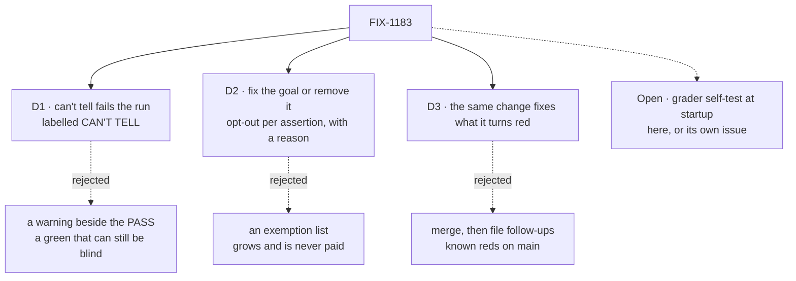

# FIX-1183 · Decisions

[Spec](SPEC.md) · **Decisions**

What was considered, what was chosen, why, and what each choice locks in. D1 to D3 are Jake's
direction (2026-10-15), recorded as decided. One fork is open.

## The tree

Solid edges are what you're signing. Dashed edges lost, and the label says why. The dotted
node is the open fork.

## D1 · A goal that read no evidence for an assertion reports CAN'T TELL, fails the run, and is labelled apart from FAIL

| | |
|---|---|
| **Instead of** | A warning printed beside a PASS |
| **Because** | Jake: *can't tell* fails the run. A warning leaves a green that can still be blind, which is the state the issue exists to end. A separate word keeps "the system is broken" and "the check is blind" apart in every log |
| **Locks in** | Every verdict log, the sweep summary and anyone reading them learn a third word. A goal that is green today and blind goes red the day this lands, until it is fixed |

It comes down to what a green sweep means: with a warning, green can still be blind.

## D2 · A goal that can't tell is fixed so it can, or removed; the only opt-out is a single assertion whose empty result is the claim, with the reason printed in the evidence

| | |
|---|---|
| **Instead of** | A list of goals exempted from the rule |
| **Because** | Jake: *"if a goal can't be written to 'tell', then it's not a good goal."* An exemption list is a second rule beside the first, and nothing pays it down. Some assertions are rightly about absence (no leak, no stray); for those the floor belongs on the population read, and the empty result on the filtered one is the claim |
| **Locks in** | No goal is exempt, ever. Six goals are removed now ([inventory](SPEC.md#the-inventory)); Jake can veto any one. Every `emptyIs` reason is visible in the PASS line, where a reviewer can challenge it |

It comes down to whether the bar holds: an exemption list grows and is never paid down.

## D3 · The change that brings the rule in fixes every goal it turns red, the goal or the bug under it; a bug fix lands first as its own issue and PR

| | |
|---|---|
| **Instead of** | Merge the rule, then file follow-ups for the reds |
| **Because** | Jake's direction. A known red on `main` teaches everyone that red means nothing, which undoes D1. Whoever turned a goal red has the context to fix it |
| **Locks in** | The rule's PR cannot merge while a goal it turned red is red. A red caused by a product bug blocks the rule until that bug's own PR lands. Static reading found none, so the risk is a goal that turns red only at run time |

It comes down to the sweep after merge: follow-ups leave known reds on `main`.

## Decided, not asked

- **One shared word: `CAN'T TELL`.** Printed as `CAN'T TELL —` with one bullet per assertion,
  like `FAIL —`. Its exit code is its own (not 0, not 1), so `goal:all` tells it apart without
  parsing output, which it deliberately doesn't do.
- **FAIL outranks CAN'T TELL.** A run with both prints both and exits as FAIL: a real failure
  is the more useful first fact.
- **The convergence point is `runGoal`.** Every goal already ends there; the helper is the
  second argument it hands the body, so a goal can't record a can't-tell that isn't reported.
  `fail()` mid-flight stays FAIL.
- **The floor sits on the population read, not the filtered result.** `tell.over` takes the
  list the assertion reads. For an absence claim the population is floored and the filtered
  list is `emptyIs`.
- **PASS evidence gains a `read:` clause** listing what each `tell.over` read and how many, so
  the evidence names only what was read.
- **The static check flags only the suppression shape** (`if (x.length > 0 && …)` /
  `!== 0` / `>= 1` leading to a failure), runs in CI beside the vocabulary sweep, and carries a
  planted control. It does not try to judge every `every`: the scan's other shapes are too
  noisy to gate on.
- **Run-time can't-tell needs the helper adopted.** The static inventory is the sweep for
  existing goals; the helper and the check carry the rule forward.
- **"Fix an underlying bug" was a live category, and came up empty.** The method could not have
  found a bug that only shows at run time; [D3](#d3) covers that case.

## Considered and dropped

| Alternative | Why not |
|---|---|
| A lint alone, no helper | Catches one syntax. A renamed field read through a loop, or a `continue` past a missing row, is the same bug in another shape |
| Make `Array.prototype.every` throw on `[]` inside goals | Global, surprising, and most `every` calls in goals are over fixture lists that can't be empty |
| Migrate every goal's hand-rolled floor to the helper now | Their verdicts are already right (FAIL on empty). Churn with no change in what any run reports |
| Run the whole sweep before writing the inventory | No checkout had dependencies, and a run today cannot show a can't-tell that no helper reports. Static reading of every flagged site is the honest method; the scan is retained so it can be rerun |

## Open

### Does every grader also prove, at startup, that it rejects its broken world?

Jake's comment on the issue (2026-08-18) asked for this: extract each grader as a pure function
and run it against the world it must reject before any dispatch, stopping hard if it accepts
it. It catches what the can't-tell rule cannot: a check that sits in a branch no run reaches,
or a broken world the system can't produce.

- **In plain terms.** Today's direction makes a blind run say so. The self-test would also catch
  a check that is never blind at run time because it never runs, or that would wave through a
  broken state no run can reach.
- **The trade-off.** Doing it here means reshaping about 120 graders before the rule ships.
  Leaving it out ships the rule now and leaves that narrower blind spot until a follow-up.
- **My recommendation: file it as its own issue.** The zero-evidence class is the one that
  recurred, and the rule closes it in one PR. The unreachable-world class is real (PR #1332
  caught one) but needs a per-goal refactor that this direction didn't ask for.
- **What would change my mind:** another blind pass of the unreachable kind after this lands, or
  your sense that the August comment is the requirement rather than the idea.
- **If wrong:** a grader that would accept a broken world nobody can produce stays green until
  the follow-up lands. Cheap to reverse: the follow-up builds on this helper.

It comes down to what this issue ships: one helper now, or 120 graders reshaped first.

## How it got here

- **Draft** — framed as a verdict the runner can't express; a `tell.over` floor in
  `goals/lib` reported through `runGoal` and `goal:all`, plus a static check for the
  `length > 0 &&` shape; an inventory of all 126 goals read statically (5 fix, 6 prune, 115
  keep); Jake's direction recorded as D1 to D3, the August self-test comment left open.

## Notes for the implementer

Read while building the inventory; inputs, not instructions.

- The suppression shape occurs at `pentest-lab/a-seat-answers-from-its-own-document/run.mts:181`,
  `shift-manager/it-draws-v2s-look/screens-inbox-tasks-roster.mts:350` and
  `shift-manager/it-groups-workstreams-under-their-projects/run.mts:920`. Each is already
  covered by an earlier failure; rewrite them when the check lands. `it-groups…:734` is a
  polling loop, and `workforce-conventions/code-comes-from-files-alone` uses `> 1` (sameness
  needs two): the check must not flag either.
- Read but not settled: `shift-manager/one-person-runs-a-labs-projects-and-people/legs/a.mts:88`
  walks `boot.rows` with no floor in that file, and `it-draws-v2s-look`'s roster-group loop
  relies on the look table's counts. Look again before calling them sound.
- `conductor/implement-phase-opens-a-pr/goal.md` has no verdict log section at all.
- The scan is `specs/issues/FIX-1183/poc/vacuity-scan/scan.mjs`; `inventory.json` beside it is
  the per-goal record with its reason.

## Notes from review

- "A sparse schema (default `keep` + empty reason, persist only prune/fix overrides and flagged goals with non-generic reasons) would preserve totality checks in `scan.mjs` with far less churn." — cursor ([thread](https://github.com/fixpoint-labs/flow-state-dev/pull/3502#discussion_r4303382584))
- "Four near-duplicate SVG `<style>` blocks — ~130 lines of duplicated CSS; shared fragment or one stylesheet would be simpler if figures stay required." — cursor ([review](https://github.com/fixpoint-labs/flow-state-dev/pull/3502#pullrequestreview-5558660617))
- "Two mermaid flows show the same empty-filter bug. Fine for a gate read, but trimming one layer would shrink the diff without losing decisions." — cursor ([review](https://github.com/fixpoint-labs/flow-state-dev/pull/3502#pullrequestreview-5558660617))

These are inputs, not instructions. Adopt, adapt, or discard them.

**Open: one** — [above](#open).
