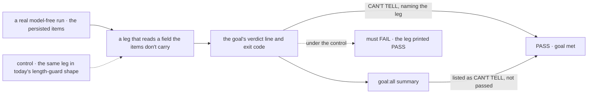
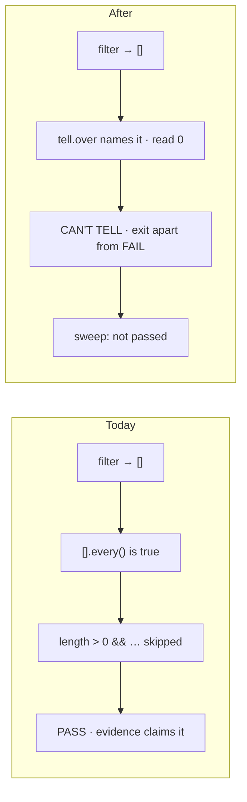

# FIX-1183 · A goal check that can't see says so

**Spec** · [Decisions](DECISIONS.md)

| Someone who… | Today | After |
|---|---|---|
| **reads a green goal sweep** | Can't know whether each PASS looked at anything. Five recorded blind passes in one epic (LAB-68) looked the same as real ones | Every PASS read evidence. A goal that read none says **CAN'T TELL**, and the sweep counts it as not passed |
| **writes a goal whose field was renamed** | The filtered list comes back empty, `[].every()` is true, a `length > 0` guard swallows the miss, and the evidence string still claims the property | The run stops on **CAN'T TELL — ordering · persisted items' seq: read 0**, naming the assertion that saw nothing |
| **writes a goal where nothing is the right answer** ("no session leaks") | Same code as a blind check; a reader can't tell them apart | Marks that one assertion as *empty is the claim*, with the reason, and the reason prints in the PASS evidence |
| **looks for a goal to rerun** | 126 goals, six of which prove nothing another check doesn't, one of which has never had a runner | 120 goals, each able to tell; the six are gone, named in the README's *Retired* list |
| **reads a verdict log a year later** | PASS, FAIL, and per-goal words (`NOT RUN`, `BLOCKED`) invented by three goals | PASS, FAIL, **CAN'T TELL**, and the same per-goal words, untouched |

Jake set the direction (2026-10-15): *can't tell* fails the run, labelled apart from a real
failure. *"If a goal can't be written to 'tell', then it's not a good goal"*: fix it or remove
it. Prune what's unnecessary. The change that brings the rule in fixes every goal it turns red.

## The goal, and how we'll know it's met

**A goal that cannot see what it claims to measure reports that it can't tell, never PASS, and
every goal left in `goals/` can tell.**

| Is it the right goal? | |
|---|---|
| **The real need** | A green goal run is information again: green means *looked and saw* ([FIX-1183](https://linear.app/fixpoint-labs/issue/FIX-1183); Jake, above) |
| **Smaller, and rejected** | "Add the helper." Ships the tool and leaves 126 goals as they are, so the five blind goals found below stay green and blind |
| **Bigger, and not this issue's** | Graders that prove at startup they reject their broken world, and tools that stop watching but report a result (the CI waiter). See [Open](DECISIONS.md#open) and *What stays* |
| **Not done if** | The helper exists but a blind goal still prints PASS · the sweep shows CAN'T TELL as PASS or as an unlabelled FAIL · a goal found blind here is exempted instead of fixed · the evidence still names a property no assertion read |



The check reads what the run printed and how the sweep counted it, not the helper's own state.

| How we verify | |
|---|---|
| **Goal check** | `goals/goal-verdict/says-when-it-cannot-tell/` · model `n/a` · run by the implementer at completion · verdict in the implementation PR |
| **Signal** | The blind leg prints `CAN'T TELL` with its assertion's name and exits with the can't-tell code; `pnpm goal:all goal-verdict` lists it as CAN'T TELL and exits non-zero. A sibling leg on the same run that reads a real field prints PASS |
| **Input** | The items a model-free suspension run persists. Any field they lack must go CAN'T TELL; any field they carry must PASS |
| **Anti-game** | Don't assert on the helper's return value or on a hand-built empty array. Both pass while a real run's evidence string still lies |
| **Control that must fail** | `GOAL_CONTROL=length-guard`: the blind leg written as `values.length > 0 && !ok`. It prints PASS, so the check FAILs on *the blind leg says CAN'T TELL*. The PR shows that FAIL first |

A second, model-free proof: the new static check over `goals/` exits 0 on the branch and 1
with a planted `length > 0 &&` guard.

## What changes



Same empty list, two endings. Today it lands on PASS; after, it lands on a verdict that names
what was not read.

**What a goal author writes:**

```diff
- await runGoal(async (failures) => {
-   const seqs = items.map((i) => i.seq).filter((v) => typeof v === "number");
-   if (seqs.length > 0 && !nonDecreasing(seqs)) failures.push("ordering: not non-decreasing");
+ await runGoal(async (failures, tell) => {
+   const seqs = tell.over("ordering · persisted items' seq", items.map((i) => i.seq).filter(isNumber));
+   if (!nonDecreasing(seqs)) failures.push("ordering: not non-decreasing");
    return { failures, evidence: "sequence non-decreasing" };
  });
+ // PASS — sequence non-decreasing · read: 41 persisted items' seq
+ // CAN'T TELL —
+ //   - ordering · persisted items' seq: read 0
+
+ // Where nothing is the right answer, say so, once, with the reason:
+ const leaks = tell.over("leaks · other users' sessions", found, { emptyIs: "the claim: no session leaks" });
```

**Docs:** update `goals/README.md` (*Script techniques* #5, *Proving a check can fail*, the
`verdict` row, *Running*, and the *Retired* list) and `goals/_template/`. No `apps/docs` page:
`goals/` is internal.

## The inventory

All 126 goals, read statically, not run: no checkout here had dependencies, and today's runs
can't show a can't-tell the helper doesn't exist to report. A scan for four shapes (the
`length > 0 &&` guard, an unfloored `every`, a `continue` past a missing subject, a grading
loop over observed data with no floor) flagged 132 sites in 53 goals; each was read. The scan
and the per-goal table re-derive with
`node specs/issues/FIX-1183/poc/vacuity-scan/scan.mjs --sites`; `--control` plants a blind
goal and must FAIL on it as a flagged site with no reason. That script is audit evidence, not the
guard: the shipped CI check looks only for the `suppress` shape, and the `every`, `skip` and
`loop` shapes are spec-time heuristics that must not be ported.

| Action | Goals |
|---|---|
| **Keep** | 115 (4 have never recorded a verdict and need a first run with credentials) |
| **Fix the goal** | 5 |
| **Fix an underlying bug** | 0 found. A fixed goal that goes red at run time names its bug then ([D3](DECISIONS.md#d3)) |
| **Prune** | 6 |

**Fix the goal** — each passes today while grading nothing in one leg:

- `design-system/skins-reused-components-from-one-token-set` — colour, font and corner checks
  loop over what the browser sampled; zero samples passes.
- `workforce-privacy/two-users-share-a-project-and-nothing-else` — leg b4 skips a task whose
  row is missing, and skips the timing check when an end time is missing.
- `flow-instances/settings-travel-with-the-copy` — leg c: "no listing entry carries config"
  passes on an empty listing.
- `task-board/hands-a-row-to-a-worker-in-its-own-session` — check 2 skips a row with no
  `ranIn`.
- `devtool-workforce-visibility/the-checklist-rows` — step 4 compares two counts; zero and zero
  passes.

**Prune** — Jake can veto any one; a vetoed goal moves to *fix* or *keep*:

| Goal | Why it adds nothing |
|---|---|
| `plan-and-execute/carries-original-data-to-workers` | No runner, ever. It has never told anything |
| `chat-agent/answers-a-factual-question` | Grades whether the model knows a capital. Every kitchen-sink goal that runs a turn already proves the framework half |
| `suspension/resumes-and-completes-after-approval` | Its whole signal is leg (b) of `suspension/resumes-after-a-cold-restart`, which adds the restart |
| `workforce-conventions/files-alone-produce-the-roster` | A loader call graded on returned data; the workforce package's loader specs prove it in CI |
| `workforce-conventions/documents-come-from-files-alone` | The same, for `resources/` |
| `capability-config/resolver-reaches-generator` | Build-time only. Its assertions move into `packages/core`'s vitest, where CI runs them |

## How it ships

1. **The rule** — the helper and the CAN'T TELL verdict in `goals/lib`, the sweep's column, the
   static check in CI, the goal check above, the five goal fixes, the three lint-shape rewrites
   ([notes](DECISIONS.md#notes-for-the-implementer)), README and template.
2. **The prune** — after Jake's veto window: delete the six, move capability-config's
   assertions into core's vitest, add *Retired* lines.
3. **Any underlying bug** a fix exposes — its own Linear issue and PR, landed before PR 1
   ([D3](DECISIONS.md#d3)). None is known today.

**Where the guard lives.** The production guard follows FIX-1796's retired-terms guard, not
eslint or ast-grep: a script in `goals/scripts/` beside `check-run-goal-verdict`, vitest fixtures
that prove it flags the `suppress` shape and leaves the two named non-cases alone
([notes](DECISIONS.md#notes-for-the-implementer)), and two CI steps beside the vocabulary
sweep, the check on the tree and the check under `--control` refusing its plant. CI runs that
guard, the goal check above and `goal:all`'s new verdict; the vacuity scan and `inventory.json`
stay in this spec as evidence and are never wired into CI.

## What stays as it is

- How goals run (`pnpm tsx`, `goal:all`), PASS and FAIL, `fail()`, the throw-is-FAIL rule.
- The three goals' own step verdicts (`NOT RUN`, `BLOCKED`). They already count against the run.
- **Tools that stop watching but report a result**, such as the CI waiter that printed
  `STILL PENDING` after its poll window ran out. Same defect, outside `goals/`; a follow-up,
  not filed here.

## What's already here, and the debt

| Already here | What this does with it |
|---|---|
| `runGoal` / `pass` / `fail` in `goals/lib/verdict.mts`, guarded by `check:run-goal-verdict` | **Extends**: a third verdict and the `tell` argument. Existing bodies keep compiling |
| `goal:all` (`goals/scripts/run-all.mts`): PASS, FAIL, TIMEOUT by exit code | **Extends**: CAN'T TELL as its own verdict, not passed |
| Hand-rolled floors (`context-supply`'s `briefsAgree`, *"so that group goes ungraded"*, *"nothing to grade"*) | **Leaves alone**. They already FAIL the empty case; adopting the helper is optional |
| Per-goal step verdicts (`workforce-privacy`'s `NOT RUN`, `one-person-runs`' `BLOCKED`) | **Leaves alone**. Same idea, already not-passed |
| Static guards in CI (`vocabulary` sweep) and in `goals/scripts` (`validate-control-shape`) | **Builds on**: the new check sits beside them |
| Anything else that says *I couldn't look* | **None** in `goals/lib`. Searched `INCONCLUSIVE`, `NOT RUN`, `can't tell`, `ungraded` across `goals/` |

| The debt | |
|---|---|
| **Removes** | Six goals; the three `length > 0 &&` guards |
| **Adds** | A third verdict word and exit code. Permanent by design |
| **Leaves** | Three goal-local verdict vocabularies, not merged into the shared one. No issue: each already fails the run |

**Net: down.** Six goals and three guard shapes go; one verdict word comes in.

## Sign off

**[The goal](#the-goal-and-how-well-know-its-met), at that size:** blind runs say so, and every
remaining goal can tell. If wrong: we ship a helper nobody had to use, or hold the issue for
grader self-tests it never promised.

**[The debt](#whats-already-here-and-the-debt), net down:** six goals and three guards go, one
verdict word comes in. If wrong: a third word every reader of a log must learn.

1. **[D1](DECISIONS.md#d1) · Can't tell fails the run, labelled CAN'T TELL, apart from FAIL.**
   If wrong: runs that were green go red for a reason people learn to ignore.
2. **[D2](DECISIONS.md#d2) · A goal that can't tell is fixed or removed; the only opt-out is one
   assertion whose empty result is the claim, with the reason printed.** If wrong: a goal we
   needed is deleted.
3. **[D3](DECISIONS.md#d3) · The change that brings the rule fixes what it turns red.** If
   wrong: the rule waits on a bug fix nobody scoped.

**Open: one** — [grader self-tests at startup](DECISIONS.md#open): here, or their own issue. D1
to D3 are Jake's direction; the open fork is the one to weigh.

Feature · `goals` (private) + CI · medium (one library, one script, one CI step, 5 goals fixed, 6 removed) · no epic
