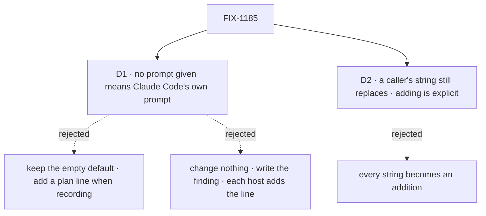

# FIX-1185 · Decisions

[Spec](SPEC.md) · **Decisions** · [Rules](BUSINESS-RULES.md) · [Plan](PLAN.md) · [Docs](DOCS.md)

What was considered, what was chosen, and what each choice locks in. Two decisions are the
sign-off surface. They sit under the epic's [D2](../../epics/FIX-1907/DECISIONS.md#d2) (one
contract, harness differences live in the block's options) and
[D3](../../epics/FIX-1907/DECISIONS.md#d3) (each harness writes its own plan; FIX-1185 makes
Claude Code's fill).

## The tree

Solid edges are what you're signing. Dashed edges lost, and the label says why.

## D1 · With no prompt given, a run starts from Claude Code's own prompt, not the SDK's empty one

| | |
|---|---|
| **Instead of** | Keeping the empty default and having `recordWork` add one line telling the agent to use its to-do tools · or changing nothing and documenting the finding, so each host adds the line itself |
| **Because** | The premise of a harness block is the same agent under our orchestration (tenet 1, the epic's goal). The CLI and the SDK run the same binary; the measured difference is that the CLI starts from Claude Code's prompt and our block starts from nothing ([POC](#settled)). A plan line fixes one surface the blank prompt loses and leaves the rest. A recorder that injects its own instruction would record a plan we asked for, then call it the agent's own. Documenting it leaves the gap in the package, which [ER-11](../../epics/FIX-1907/BUSINESS-RULES.md#what-no-child-may-do) forbids patching downstream |
| **Locks in** | Every host that omits the prompt changes behaviour on upgrade: Kitchen Sink, the coding-skill lab, the conductor lab, the workspace capability, and any app built on the block. Each run carries a larger prompt and follows Claude Code's own conventions. Our default now moves when Anthropic changes Claude Code's prompt |

It comes down to whose plan it is: a line we inject records our instruction, not the agent's account.

**What would change my mind:** the goal check showing Claude Code's own prompt still yields no
plan rows. Then the blank prompt was not the whole cause, and the plan line is the fallback, said
in the docs as an instruction we add.

**Outcome (Oct 12, after implementation): this fired.** With Claude Code's own prompt, the
default model kept no plan on 3 of 3 runs. The empty prompt did not either, so the control
separated nothing ([Settled](#settled)). D1 still ships, for a narrower reason: CLI parity,
with no promise that the agent plans. The fallback named above, a plan line the block adds when
recording, is **not** adopted here. The measurement shows it needs the tools switched on too,
and it records a plan we asked for. Whether to add it is a separate call for the epic. It is
not part of this amendment.

## D2 · A caller's own string still replaces that prompt; adding to it is a separate, explicit form

| | |
|---|---|
| **Instead of** | Treating every string as an addition to Claude Code's prompt |
| **Because** | The option is documented as forwarded to the SDK, and in the SDK a string replaces. Turning it into an addition silently changes every host that wrote a full prompt to narrow the agent on purpose. The SDK already has the addition form (`preset` with `append`); forwarding it costs one type, not a new option (Step 3.5 question 7: a parameter on the existing entry) |
| **Locks in** | Two spellings to teach. A host that wrote one line of role text, and meant it as an addition, keeps an empty plan record until it moves to the added form. In this repo that is Shift Manager's harness and one devforce goal |

It comes down to the host that wrote a full prompt on purpose: an addition would grow it unasked.

**What would change my mind:** finding that every known caller's string was one line of role
text meant to sit on top. Then replacement protects nobody and the addition is the better default.

## Decided, not asked

- **An empty string means today's blank start.** It is the escape hatch, and it is the goal
  check's control. The SDK already reads `""` that way.
- **The option forwards the SDK's own prompt shape**, the way `sandbox` forwards its settings.
  No FSD spelling of `preset`.
- **No warning when a string replaces the prompt with recording on.** A caller may want a plain
  run; the docs say what it gives up, and the plan record's own emptiness is the signal.
- **The capability takes the same option.** It forwards the agent's options today.

## Considered and dropped

| Alternative | Why not |
|---|---|
| Drive one goal run through the CLI to exercise the plan half once (the issue's second option) | Proves the recorder on a path Kitchen Sink and every host don't use. The epic needs the SDK path to fill |
| Put the plan line in each host's job prompt | Shown to work, but every host copies a line that only exists to undo our default |
| Add `TaskCreate` and `TaskUpdate` to `allowedTools`, or raise `maxTurns` | Measured: no change on 8 runs |
| A `planGuidance: true` option | A new option for one line the default prompt already carries |

## Settled

- **The two drivers differ at prompt assembly, before the model sees anything** — **CONFIRMED**,
  model-free. Driving the real SDK `query()` with a stubbed agent process, the first message
  it sends carries `systemPrompt: [""]` when none is given, the same as `""`. With the
  `claude_code` preset it sends no custom prompt and only the appended text, so the agent
  process keeps Claude Code's own. A planted fault (the omitted arm sent as the preset) turns
  the check red. Run: `pnpm tsx specs/issues/FIX-1185/poc/what-the-sdk-sends/run.mts`.
- **An instruction to use the tools restores the calls on the SDK path** — **CONFIRMED** once,
  0 → 9 calls and 3 plan rows read back from state
  ([the Aug 19 measurement](https://linear.app/fixpoint-labs/issue/FIX-1185)). One run, not a
  paired control; the goal check repeats it under the control. **Re-measured Oct 12** on the
  current default model: it holds only when the tools are also named in `allowedTools` and the
  instruction is in the job. 4 rows, 1 completed, 1 run.
- **Claude Code switches its to-do tools off by default on newer models** (Codex P1 on
  [#3166](https://github.com/fixpoint-labs/flow-state-dev/pull/3166)) — **CONFIRMED**. In the
  binary bundled with Agent SDK 0.3.234, `TaskCreate`/`TaskUpdate` are offered on Opus 4.8 and
  later, Sonnet 5, Fable 5 and Mythos 5 only when named in `tools` or `allowedTools`, or when
  `CLAUDE_CODE_ENABLE_TODO_TOOLS` is set. On real runs (`claude-sonnet-5`, Claude Code's
  default) the run's `system/init` did not list them, with the preset (3 runs) and with `""`
  (2 runs). Headless `claude -p` on the same binary and job did not list them either, so the
  issue's "the CLI plans, the SDK doesn't" does not reproduce on this model.
- **Offering the tools is not enough for the agent to plan unasked** — **CONFIRMED** on 4 runs.
  With the tools named in `allowedTools`: 0 rows on 3 runs with the preset alone, and 0 rows on
  1 run that added a `systemPrompt` `append` telling it to use them. Verdict log:
  `goals/claude-code-harness/it-keeps-its-own-plan/goal.md`.

## How it got here

- **Draft** — framed as a prompt-assembly gap, not a driver gap; the block's default moves to
  Claude Code's own prompt and forwards the SDK's addition form; one PR in the package, proved by
  a real-model goal check reading the plan record from state.
- **Amended after merge (Oct 12, cross-spec check)**: BR-12 quotes FIX-1915's panel text, "no
  plan recorded for this turn". This spec has no Evolution document, so the line is here.
- **Amended after implementation (Oct 12)**: the goal check failed on the current default model.
  The goal is narrowed to CLI parity plus a recorder proved on a real run. BR-10 and BR-11 are
  rewritten to match, D1 records its outcome, and the Codex P1 from #3166 is settled as
  confirmed. The docs no longer promise that the agent plans on its own.

**Open: none.**
