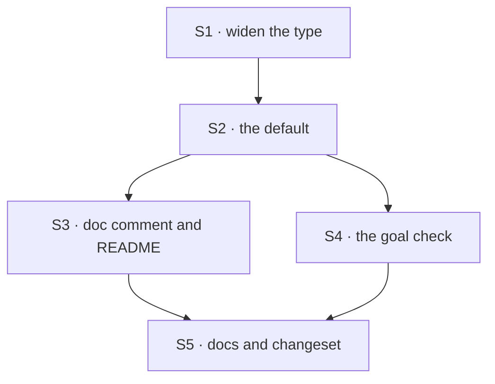

# FIX-1185 · Plan

[Spec](SPEC.md) · [Decisions](DECISIONS.md) · [Rules](BUSINESS-RULES.md) · **Plan** · [Docs](DOCS.md)

Written for the implementing agent. IDs cross-reference [BUSINESS-RULES.md](BUSINESS-RULES.md)
(BR-n) and [DECISIONS.md](DECISIONS.md) (D-n). `diagnose` for the cause (already settled, see
the POC line), then `tdd` for the default. One PR.

## Surfaces

| ID | Package · role | Change | Rules |
|---|---|---|---|
| S1 | `claude-code` · the agent options type and the SDK query-options type | `systemPrompt` takes the SDK's own union (string, string array, the `claude_code` preset with optional `append`), forwarded verbatim (D2) | BR-2 BR-4 BR-5 |
| S2 | `claude-code` · where the block builds the SDK query options | `undefined` becomes the preset with nothing appended (D1). Every other value, `""` included, passes through untouched | BR-1 BR-3 BR-7 BR-8 BR-9 |
| S3 | `claude-code` · the option's doc comment, the README's options section | Say what omitting, a string, `""` and the preset each give, and that a string drops the to-do guidance | BR-2 BR-3 |
| S4 | `goals/claude-code-harness/it-keeps-its-own-plan/` | **New** goal: `goal.md`, `run.mts`, two held-out job fixtures, a default arm and a planning arm, `GOAL_CONTROL=empty-prompt` and `no-record` | BR-10 BR-11 |
| S5 | Docs | Publish [DOCS.md](DOCS.md) · one `minor` changeset for `@flow-state-dev/claude-code` (a default changes for every host) | — |

Nothing is removed.

## Sequence



## Checks

| ID | Runs after | Passes when |
|---|---|---|
| V1 | S1 | Type test: each SDK prompt shape is accepted by the block and the capability; a non-prompt object is a type error |
| V2 | S2 | Agent spec: the options the stubbed SDK receives carry the preset when none is given (BR-1); the string, `""`, the preset and an array pass through byte-identical (BR-2 to BR-5). Red first: on today's `main` the BR-1 case fails |
| V3 | S2 | The second path (BP-035): the same assertions on a detached resumed run, an in-session run, `recordWork` off, and through the capability (BR-6 to BR-9) |
| VG | S4 | [The goal](SPEC.md#the-goal-and-how-well-know-its-met), as amended: `pnpm tsx goals/claude-code-harness/it-keeps-its-own-plan/run.mts` PASSES on a real model, with `GOAL_CONTROL=empty-prompt` failing `prompt:preset` and `GOAL_CONTROL=no-record` failing `plan:rows` |
| V4 | S3 S5 | `pnpm --filter @flow-state-dev/claude-code test` and `typecheck` green; the docs build |

D1's check is V2's BR-1 case plus VG; D2's is V2's BR-2 case.

## Pinned names

| Where | Name | Why pinned |
|---|---|---|
| Goal folder | `goals/claude-code-harness/it-keeps-its-own-plan/` | The epic's closure cites it |
| Control | `GOAL_CONTROL=empty-prompt` | `SPEC.md` and the closure name it |

The option keeps its name, `systemPrompt`. Everything else is yours to name.

## Guardrails

| Rule | Because |
|---|---|
| The default is decided in one place, where the query options are built | The capability and every resolver path reach the SDK through it. A second place is how one path keeps the blank prompt (tenet 5) |
| Forward the SDK's shape; never translate or validate it | The package forwards `sandbox` the same way. A copy of the SDK's union drifts the day the SDK adds a field |
| The recorder is not touched | D1 rests on the plan being the agent's own. Any instruction the recorder adds would make the record ours |
| The goal check reads the plan record from state, through the resource route | The issue's verification asks for rows read back from state. A count of tool calls in the stream passes while the record stays empty |
| The goal's fixture jobs name no tool and do not mention planning; only the planning arm adds the request, in code | The default arm reports whether the agent plans unasked, and that report means nothing if the job asks |
| `""` stays the blank start, and the control uses it | A host that wants today's behaviour needs one spelling, and the control must be exactly today's behaviour |

## Docs

Reconcile [DOCS.md](DOCS.md) against the shipped option and VG's verdict, then publish it with
S5. The README section (S3) and the docs page say the same thing in their own register.

## Sketch · pseudocode, illustrative

```
where the block builds the SDK's query options:
    prompt ← the host's systemPrompt
    if prompt is absent:                       ← the whole fix (D1)
        prompt ← Claude Code's own (the preset), nothing appended
    forward prompt unchanged                   (D2: a string still replaces; "" still blank)
```

**POC:** `poc/what-the-sdk-sends/` inside this spec. Model-free: it drives the real SDK `query()`
with a stubbed agent process and prints the first message the SDK sends. It showed the premise
holds: no prompt and `""` both send `systemPrompt: [""]`; the preset sends no custom prompt, so
the agent process keeps Claude Code's own. A planted fault turned it red. It does not show that
Claude Code's prompt makes the agent plan; VG does that on a real model.

## At implement time

- FIX-1915 may have moved the plan record's shape into `@flow-state-dev/core` first. Rebase on
  it; neither PR changes the other's half ([epic seam](../../epics/FIX-1907/PLAN.md#coordination-seams-to-watch)).
- Check the SDK version the workspace resolves. If its default for an absent prompt is no longer
  empty, S2 is a no-op: say so, keep S1, S3 and S4.
- The goal needs a host where Claude Code is signed in. A cloud session can't run it; hand it to
  a local host and record where it ran.

## Follow-ups

- **Shift Manager's harness and the devforce goal pass a one-line string**, so under D2 their
  plan record stays empty. Moving them to the added form is their owners' call. Flagged to the
  epic coordinator; not filed here.
- **A run asserted that a sub-agent wrote a file it wrote itself** (same Aug 19 run). A separate
  problem, noted on the issue, not filed.
