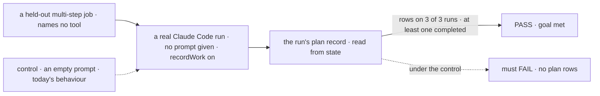

# FIX-1185 · A coding agent driven through the in-process SDK never invokes its plan tools; the CLI does

**Spec** · [Decisions](DECISIONS.md) · [Rules](BUSINESS-RULES.md) · [Plan](PLAN.md) · [Docs](DOCS.md)

## Who feels it, before and after

| Someone who… | Today | After |
|---|---|---|
| **runs Claude Code from a flow and gives it no prompt of its own** | The agent starts from a blank system prompt. It keeps no to-do list and writes its plan as prose at the end | The agent starts from Claude Code's own prompt, the one the `claude` CLI uses, and keeps its to-do list as it works |
| **reads a run's plan record** (Kitchen Sink's plan panel, [FIX-1915](https://linear.app/fixpoint-labs/issue/FIX-1915)) | Empty on every real run, 0 of 8 | Rows that move from pending to completed while the run works |
| **adds a line of instructions to the agent** | Can only replace the whole prompt, so the line is all the agent gets | Can add the line to Claude Code's prompt, or replace it as today |
| **has written a full prompt on purpose** | Gets that prompt | Gets that prompt, unchanged. The docs say what it gives up |
| **wants today's blank start back** | n/a | Passes an empty string |

The `claude` CLI starts every run from Claude Code's own prompt, which tells the agent to track
its work with its to-do tools. The SDK uses that prompt only when asked, and the block never
asks, so the SDK sends an empty one ([POC](DECISIONS.md#settled)). One added sentence naming the
tools took the calls from 0 to 9 ([Aug 19](https://linear.app/fixpoint-labs/issue/FIX-1185)):
the surface was lost to prompt assembly, not to the driver.

## The goal, and how we'll know it's met

**A Claude Code run started from a flow, with no prompt of its own and a job that never mentions
planning, keeps its own to-do list, and that list can be read back from the run's state.**

| Is it the right goal? | |
|---|---|
| **The real need** | "The agent's own account of what it planned to do is present via the CLI and absent via the SDK" ([the issue](https://linear.app/fixpoint-labs/issue/FIX-1185)). The epic needs Claude Code's plan panel to fill ([ER-7](../../epics/FIX-1907/BUSINESS-RULES.md#what-a-team-gets-and-what-it-doesnt), [D3](../../epics/FIX-1907/DECISIONS.md#d3)) |
| **Smaller, and rejected** | "A run whose job prompt says *use TaskCreate* fills the record." Already shown once. It proves the recorder, not that the agent plans on its own, and every host would have to copy the line |
| **Bigger, and not this issue's** | The plan panel and the record's move into core ([FIX-1915](https://linear.app/fixpoint-labs/issue/FIX-1915)). Other CLI behaviour the blank prompt may lose is named in the docs, not measured here |
| **Not done if** | The check passes only with a job that names the tools · rows are counted from the stream, not read from state · it passed on a scripted model · the control did not fail |



The check reads rows from the run's state, not the agent's closing message. The dashed path is
the same run with the blank prompt that ships today, and it must fail.

| How we verify | |
|---|---|
| **Goal check** | `goals/claude-code-harness/it-keeps-its-own-plan/` · Claude Code's default model on a signed-in local host · run by the implementer at completion · verdict in the implementation PR |
| **Signal** | On each of 3 runs, the plan record holds at least two rows, and at least one reaches `completed` |
| **Input** | A held-out job of three or more steps whose prompt names no tool and says nothing about planning. A different job of that shape must pass too |
| **Anti-game** | Never put a tool name or "plan" in the job. Never count `tool_use` items or read the closing message. Never pass a prompt string in the PASS arm |
| **Control that must fail** | `GOAL_CONTROL=empty-prompt` (`systemPrompt: ""`), and today's `main`. Both must FAIL on *at least two plan rows*, on 2 of 2 runs, and the PR shows it before the PASS |

## What changes


Only the left box moves: what the block asks the SDK for when the caller gave nothing.

**A host that wants the agent to keep its plan writes nothing:**

```diff
  claudeCodeAgent({ detached: true, recordWork: true, cwd, resume, onSession });
+ // The run now starts from Claude Code's own prompt. No option needed.
```

**A host that adds its own instructions:**

```diff
  claudeCodeAgent({
-   systemPrompt: "Do what your brief says, then commit your work with git.",
+   systemPrompt: { type: "preset", preset: "claude_code", append: "Do what your brief says, then commit your work with git." },
  });
```

## What stays as it is

- **The recorder.** It already writes the plan from the agent's to-do tools. It gets input.
- **A caller's own string.** Still replaces Claude Code's prompt ([D2](DECISIONS.md#d2)).
- **`allowedTools` and `maxTurns`.** Both were ruled out by measurement.
- **The harness contract** (`resume`, `onSession`, the handle). [ER-13](../../epics/FIX-1907/BUSINESS-RULES.md#what-no-child-may-do).
- **Callers outside the package.** Shift Manager's harness passes a string. Moving it is its owners' call (see [Plan → Follow-ups](PLAN.md#follow-ups)).

## Sign off

**[The goal](#the-goal-and-how-well-know-its-met), at that size:** the agent plans on its own,
proved from state on a real model. If wrong: we ship a recorder that fills only when a host
remembers to prompt for it.

1. **[D1](DECISIONS.md#d1) · With no prompt given, a run starts from Claude Code's own prompt, not
   the SDK's empty one.** If wrong: every host that omits the prompt gets a larger, different
   agent, and our runs change whenever Claude Code's prompt does.
2. **[D2](DECISIONS.md#d2) · A caller's own string still replaces that prompt; adding to it is a
   separate, explicit form.** If wrong: hosts that wrote one line of role text keep an empty plan
   until they move to the added form.

**Open: none.** D1 is the one to weigh. Reasoning and what lost: [DECISIONS.md](DECISIONS.md).
The cases: [BUSINESS-RULES.md](BUSINESS-RULES.md).

Fix · `@flow-state-dev/claude-code` · small · 1 PR · epic [FIX-1907](../../epics/FIX-1907/SPEC.md)
