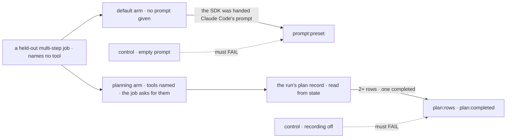

# FIX-1185 · A coding agent driven through the in-process SDK never invokes its plan tools; the CLI does

**Spec** · [Decisions](DECISIONS.md) · [Rules](BUSINESS-RULES.md) · [Plan](PLAN.md) · [Docs](DOCS.md)

## Who feels it, before and after

| Someone who… | Today | After |
|---|---|---|
| **runs Claude Code from a flow and gives it no prompt of its own** | The agent starts from a blank system prompt | The agent starts from Claude Code's own prompt, the one the `claude` CLI uses |
| **reads a run's plan record** (Kitchen Sink's plan panel, [FIX-1915](https://linear.app/fixpoint-labs/issue/FIX-1915)) | Empty on every real run, 0 of 8 | Rows when the agent keeps a to-do list. On today's default model it usually doesn't, so the panel usually says "no plan recorded for this turn" ([amended](#amended-after-implementation)) |
| **adds a line of instructions to the agent** | Can only replace the whole prompt, so the line is all the agent gets | Can add the line to Claude Code's prompt, or replace it as today |
| **has written a full prompt on purpose** | Gets that prompt | Gets that prompt, unchanged. The docs say what it gives up |
| **wants today's blank start back** | n/a | Passes an empty string |

The `claude` CLI starts every run from Claude Code's own prompt, which tells the agent to track
its work with its to-do tools. The SDK uses that prompt only when asked, and the block never
asks, so the SDK sends an empty one ([POC](DECISIONS.md#settled)). One added sentence naming the
tools took the calls from 0 to 9 ([Aug 19](https://linear.app/fixpoint-labs/issue/FIX-1185)):
the surface was lost to prompt assembly, not to the driver.

<a name="amended-after-implementation"></a>
> **Amended after implementation (Oct 12).** The original goal was "the agent plans on its own".
> On Claude Code's current default model that goal failed: 0 of 3 runs, with the control failing
> the same way. Two reasons. Claude Code switches off its to-do tools by default on newer
> models, and the CLI's headless mode does too. With the tools switched on, the agent still
> used them only when the job asked it to. D1 still ships, as CLI parity. The goal below is
> narrowed to what a run can honestly prove. Evidence is in [Decisions → Settled](DECISIONS.md#settled).

## The goal, and how we'll know it's met

**A Claude Code run started from a flow with no prompt of its own starts from Claude Code's own
prompt, the way the CLI does. When the agent keeps a to-do list, that list can be read back
from the run's state.**

| Is it the right goal? | |
|---|---|
| **The real need** | "The agent's own account of what it planned to do is present via the CLI and absent via the SDK" ([the issue](https://linear.app/fixpoint-labs/issue/FIX-1185)). The epic needs Claude Code's plan panel to fill ([ER-7](../../epics/FIX-1907/BUSINESS-RULES.md#what-a-team-gets-and-what-it-doesnt), [D3](../../epics/FIX-1907/DECISIONS.md#d3)) |
| **Smaller, and rejected** | "A run whose job prompt says *use TaskCreate* fills the record", on its own. It proves the recorder but says nothing about the default. It is now the goal's second arm, beside the default check |
| **Bigger, and dropped after measurement** | "The agent plans on its own." Measured false on today's default model ([Settled](DECISIONS.md#settled)). Getting there takes an instruction the block owns, and D1 rejected that. Re-opening it is a new decision |
| **Bigger, and not this issue's** | The plan panel and the record's move into core ([FIX-1915](https://linear.app/fixpoint-labs/issue/FIX-1915)). Other CLI behaviour the blank prompt may lose is named in the docs, not measured here |
| **Not done if** | The prompt check reads the block's options rather than what the SDK was handed · rows are counted from the stream, not read from state · it passed on a scripted model · either control did not fail |



The prompt leg reads what the real SDK was handed. The plan legs read rows from the run's
state, never from the stream or the closing message.

| How we verify | |
|---|---|
| **Goal check** | `goals/claude-code-harness/it-keeps-its-own-plan/` (the name is pinned; the claim is the narrowed one above) · Claude Code's default model · run by the implementer at completion · verdict in the implementation PR |
| **Signal** | Default arm, each job: the SDK was handed `{ type: "preset", preset: "claude_code" }`. Planning arm, each job: at least two plan rows, one `completed`. Whether the default arm planned unasked is printed and not graded |
| **Input** | Two held-out jobs of three or more steps. The job text names no tool and says nothing about planning. The planning arm adds one fixed sentence asking for the tools |
| **Anti-game** | Never grade the default arm on plan rows. Never count `tool_use` items or read the closing message. The planning arm's request is in the goal's code, not the fixture |
| **Controls that must fail** | `GOAL_CONTROL=empty-prompt` fails `prompt:preset`; `GOAL_CONTROL=no-record` fails `plan:rows` |

## What changes


Only the left box moves: what the block asks the SDK for when the caller gave nothing. The figure predates the [amendment](#amended-after-implementation): the record fills only when the agent keeps a to-do list, which on today's default model it usually doesn't.

**A host that wants the run to start the way the CLI does writes nothing:**

```diff
  claudeCodeAgent({ detached: true, recordWork: true, cwd, resume, onSession });
+ // The run now starts from Claude Code's own prompt. No option needed.
```

**A host that adds its own instructions:**

```diff
  claudeCodeAgent({
-   systemPrompt: "Do what your brief says, then commit your work with git.",
+   systemPrompt: { type: "preset", preset: "claude_code", append: "Do what your brief says, then commit your work with git." },
  });
```

## What stays as it is

- **The recorder.** It already writes the plan from the agent's to-do tools, when the agent uses them.
- **A caller's own string.** Still replaces Claude Code's prompt ([D2](DECISIONS.md#d2)).
- **`allowedTools` and `maxTurns`.** Both were ruled out by measurement.
- **The harness contract** (`resume`, `onSession`, the handle). [ER-13](../../epics/FIX-1907/BUSINESS-RULES.md#what-no-child-may-do).
- **Callers outside the package.** Shift Manager's harness passes a string. Moving it is its owners' call (see [Plan → Follow-ups](PLAN.md#follow-ups)).

## Sign off

**[The goal](#the-goal-and-how-well-know-its-met), at its narrowed size:** CLI parity for the
default prompt, and a recorder proved on a real model. If wrong: Kitchen Sink's Claude Code plan
panel stays at "no plan recorded for this turn" unless a host asks the agent to plan. Whether
the block should ask on the host's behalf is a separate decision (see
[D1](DECISIONS.md#d1)).

1. **[D1](DECISIONS.md#d1) · With no prompt given, a run starts from Claude Code's own prompt, not
   the SDK's empty one.** If wrong: every host that omits the prompt gets a larger, different
   agent, and our runs change whenever Claude Code's prompt does.
2. **[D2](DECISIONS.md#d2) · A caller's own string still replaces that prompt; adding to it is a
   separate, explicit form.** If wrong: hosts that wrote one line of role text keep an empty plan
   until they move to the added form.

**Open: none.** D1 is the one to weigh. Reasoning and what lost: [DECISIONS.md](DECISIONS.md).
The cases: [BUSINESS-RULES.md](BUSINESS-RULES.md).

Fix · `@flow-state-dev/claude-code` · small · 1 PR · epic [FIX-1907](../../epics/FIX-1907/SPEC.md)
