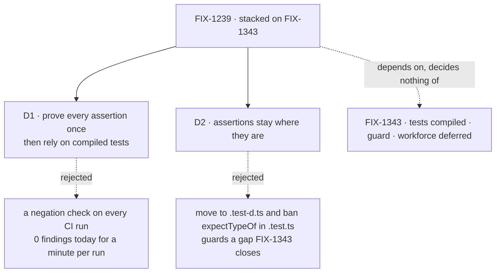

# FIX-1239 · Decisions

[Spec](SPEC.md) · **Decisions**

What was considered, what was chosen, why, and what each choice locks in. Two decisions are the sign-off surface. Everything else here is context for them.

## The tree

Solid edges are what you're signing. Dashed edges lost, and the label says why. The dotted edge is the dependency: if FIX-1343's direction changes, this tree is redrawn.

## D1 · Prove every assertion once, in the implementation PR, and rely on compiled tests after; no standing negation check in CI

| | |
|---|---|
| **Instead of** | Running the census's negation check on every CI run, so typecheck fails when any assertion stops being able to fail |
| **Because** | All 164 assertions that today's typecheck compiles can fail; all 10 broken ones sit in the 50 nothing compiles. The defect is *not compiled*, and FIX-1343's guard closes it for good. A standing check would add about a minute to every CI run, and a script to keep in step with TypeScript, to catch one class with 0 members today: assertions about `any`. That is the risk any loose runtime matcher carries, and we don't mutation-test runtime tests either (tenet 3, earn every addition) |
| **Locks in** | A later assertion about `any` passes until a reviewer catches it. That one-minute cost per run is why the census is not promoted to CI. Its counts are settled in [`poc/type-assertion-census/SETTLED.md`](poc/type-assertion-census/SETTLED.md) and are authoritative; the script models #3433's program in memory and may drift from what merges, so no one re-runs it as a gate |

It comes down to what a standing check would catch today: nothing that FIX-1343's guard misses.

**What would change my mind:** one compiled assertion found that cannot fail. Then the census becomes a guard in root typecheck, scoped to the files that hold assertions.

## D2 · Assertions stay where they are; no move to `.test-d.ts` and no rule against `expectTypeOf` in a `.test.ts`

| | |
|---|---|
| **Instead of** | The issue's suggested shape: move each type-only assertion into a sibling `.test-d.ts`, add test-d wiring to `memory`, and reject `expectTypeOf` and `assertType` inside `*.test.ts` with a lint or CI guard |
| **Because** | Every part of that shape works around `.test.ts` not being compiled. After FIX-1343 it is, with the same compiler options as `src`. The move would split six test files from the runtime tests they sit beside, and the rule would forbid a pattern that then works. `memory` already has its test-d wiring (FIX-1223) |
| **Locks in** | Three places a type assertion can live: inline in a `.test.ts`, in a `.test-d.ts`, and in a `src/**/*.type-test.ts`. The `src` ones keep shipping in five packages' published `dist` until [FIX-2018](https://linear.app/fixpoint-labs/issue/FIX-2018) moves them |

It comes down to whether test files compile: after FIX-1343 they do, so the move guards nothing.

## Decided, not asked

- **`tsc` is the only gate**, as #3433 decided; vitest's typecheck mode stays off. Plain `tsc` fails every matcher in use ([Settled](#settled)).
- **The 10 broken sites are FIX-1343's to clear**: each is a type error in a test file, under #3433's [triage rule](https://github.com/fixpoint-labs/flow-state-dev/blob/4f0ed338f4ceae54eebc13aaa4fa8116690ceb22/specs/issues/FIX-1343/DECISIONS.md#L68): never re-pointed; a stale claim is updated with its reason, a source bug is filed and held. The stacked implementation PR lists each with the claim it made and how that claim now stands, so a false assertion re-pointed at whatever the compiler reports cannot pass unseen. They are `core/test/prefetch-mode.test.ts:56,62,66` (they assert sync reads that FIX-700 made async), `core/test/projected-resource-collection.test.ts:125,148`, and five directives one line off their error: `core/test/resource-collection.test.ts:88` and four multi-line `.mjs` imports in `core/test/*-check.test.ts`.
- **The convergence point is FIX-1343's guard plus TypeScript's unused-directive error (TS2578).** Every type assertion is in a compiled program, and a directive that stops suppressing anything fails on its own.
- **`@ts-expect-error` needs nothing new.** All 128 carry a reason. Five only silence a missing `.mjs` declaration (TS7016); they are not assertions, and the census counts them apart.
- **The seven false comments are corrected:** three in `core/src/types/tests/`, two in `orchestration/src/**/tests/`, one in `orchestration/test/collection/task-caps.test.ts`, and the header of `orchestration/test/types.type-test.ts`, which credits a vitest typecheck mode nobody enabled.
- **`toMatchTypeOf` stays** at its 3 sites: deprecated since expect-type 1.2, live under `tsc`.
- **The workforce site** (`workforce/test/codegen.test.ts:419`) waits for [FIX-2016](https://linear.app/fixpoint-labs/issue/FIX-2016), FIX-1343's workforce follow-up. Workforce's other 11 sites (10 in `.test-d.ts`, 1 in `src/worker-capabilities.ts`) are compiled and live. Until FIX-2016 the goal and the completion claim exclude it; this issue does not wait for FIX-2016.
- **Branch** `fix/FIX-1239-type-assertions`, stacked on the last branch of #3433's implementation stack, cut after both specs merge. **No changeset.**

## Considered and dropped

| Alternative | Why not |
|---|---|
| Vitest's typecheck mode for type assertions | #3433 dropped it as a gate; this spec keeps that. Plain `tsc` already fails a wrong `expectTypeOf` |
| Pin the expected error code on each `@ts-expect-error`, checked by a script | Catches a directive suppressing the wrong error. No case found: a machine with no defect behind it |
| Require a reason on `@ts-expect-error` through ESLint's `ban-ts-comment` | All 128 already have one. A one-line addition to FIX-1417's config if that changes |
| Fold this proof into FIX-1343's implementation PR and close FIX-1239 | Changes #3433's scope, which this spec must not do. Raise it at #3433 if wanted |
| Move the `src` type-test files back to `test/` here | Real debt (they ship in `dist`), but it does not change whether an assertion can fail. A named follow-up |

## Settled

- **A wrong assertion in a test file is green on today's `main`.** **CONFIRMED**: `expectTypeOf<string>().toEqualTypeOf<number>()` planted in `packages/core/test/` gave `pnpm typecheck` exit 0 and vitest 1 passed.
- **`expectTypeOf` fails under plain `tsc`.** **CONFIRMED** by `poc/type-assertion-census/`: all 21 sites, across `toEqualTypeOf`, `toMatchTypeOf`, `toHaveProperty` and `.not`, error when negated or already error because their claim is false.
- **Every compiled assertion can fail; every broken one is uncompiled.** **CONFIRMED**: 164 compiled, 164 live. Of the 50 uncompiled: 5 failing, 5 dead, 40 live in the program #3433 proposes.
- **The census tells live from failing, vacuous, dead and uncompiled.** **CONFIRMED** by `--plant` on core: 9 of 9, with a live alias planted for each pinned constraint (`true`, `false`, `never`). Its first version called an assertion about `any` live, because negation errors there too; so an `any` subject counts as vacuous.
- **The issue's file list is out of date.** `external-resource-collection.test.ts` is gone, and the sweep missed `resource-collection-async-shape.test.ts` (6 hand-rolled assertions), `orchestration/test/types.type-test.ts`, and 23 directives in uncompiled tests.

## How it got here

- **Draft** — scoped to what #3433 leaves: proof that each type assertion can fail, measured first by a census that negates all 214 and asks the compiler; the measurement showed the defect is entirely *not compiled*, so the spec proves once and adds no standing machinery.
- **Review** — the goal check rests on `pnpm typecheck`, the 10 sites listed with their verdicts, and settled census counts, because a reviewer showed that re-running the census at implementation contradicted D1. A later review found the census missed helpers pinned to `false` and `never` (17 sites, all compiled and live, none wrong), replaced the generated snapshot with the authored [`SETTLED.md`](poc/type-assertion-census/SETTLED.md), and narrowed the goal: the workforce site is deferred to FIX-2016, not covered.

**Open: none.**
