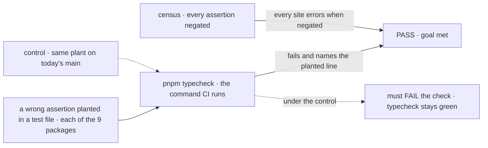
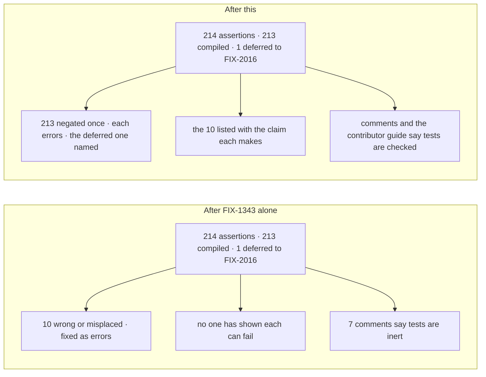

# FIX-1239 · Type-level assertions in *.test.ts are never typechecked and cannot fail

**Spec** · [Decisions](DECISIONS.md)

## Five people, before and after

| Someone who… | Today | After FIX-1343 and this |
|---|---|---|
| **sabotages a type assertion to check it** (how FIX-1230 found this) | Stays green: a planted `expectTypeOf<string>().toEqualTypeOf<number>()` passes `pnpm typecheck` and vitest | Typecheck fails on the planted line, in CI and locally. In workforce's ordinary tests, once FIX-2016 lands |
| **trusts an existing type assertion** | 1 in 4 was never compiled. 10 of those are wrong: 5 claim a type the code no longer has, 5 `@ts-expect-error` lines sit one line off the error they meant | Every assertion but one has been shown to fail when its claim is wrong; the proof is in the implementation PR. The one is in workforce's ordinary tests, named as deferred to FIX-2016 |
| **reads a comment saying `test/` is inert, or that vitest checks a file's types** | Seven files say so; one was never true | The comments say tests are compiled by `pnpm typecheck` |
| **writes a new type assertion** | Must know to put it under `src/` or in a `.test-d.ts`, or it does nothing | Writes it in the test it belongs to; the contributor guide says how to prove it once. In workforce, a `.test.ts` is checked once FIX-2016 lands |
| **asserts something about a value typed `any`** | Passes whatever it names | Unchanged: no machine catches it. There are 0 today ([D1](DECISIONS.md#d1)) |

Measured on `main` at `4f2e13ed` by this spec's census, which negates every assertion and asks the compiler: **214 type-level assertions in 9 packages.** The 164 that today's typecheck compiles can all fail. Every defect is in the 50 it never opens, in 26 test files, and all 21 `expectTypeOf` sites are among them.

**This depends on [FIX-1343](https://github.com/fixpoint-labs/flow-state-dev/pull/3433)'s direction, not yet approved.** #3433 makes test files compile; this spec proves the assertions in them can fail, and decides nothing #3433 decides. If #3433's direction changes, this spec is re-drafted ([D2](DECISIONS.md#d2) flips first).

## The goal, and how we'll know it's met

**When a type-level assertion in a test that #3433's program compiles is wrong, `pnpm typecheck`, and therefore CI, fails on that line, and every assertion that exists today in such a test has been shown to.** That is every package's tests except workforce's ordinary `.test.ts` files, which #3433 defers; they are covered when [FIX-2016](https://linear.app/fixpoint-labs/issue/FIX-2016) lands, and their one assertion (`workforce/test/codegen.test.ts:419`) is listed as deferred, not covered. This issue does not wait for FIX-2016.

| Is it the right goal? | |
|---|---|
| **The real need** | *"Type-level assertions … provide no guarantee … verify each moved assertion can fail … rather than trusting the move."* (the issue) |
| **Smaller, and rejected** | "The files compile." FIX-1343 delivers that. Compiled is not able to fail: 10 of the 50 sites compile into errors that someone must resolve against what each assertion meant |
| **Bigger, and not this issue's** | Mutation-testing runtime tests. A real linter (FIX-1417). Type assertions outside `packages/` (FIX-945 owns `goals/`); the census found none |
| **Not done if** | Typecheck is green because a wrong assertion was deleted or re-pointed at whatever the compiler reports, with no line saying what it claimed · a site in a file no program opens goes unreported · the workforce site is dropped, or counted as covered, instead of named as deferred |

The check reads what the compiler reports for a wrong claim, not whether a file is in a config. On today's `main` it fails, as it must.

| How we verify | |
|---|---|
| **Goal check** | No `goals/` harness: this is repository tooling. The implementer runs `pnpm typecheck` and the plant on the stacked branch at completion; the verdict goes in the implementation PR |
| **Signal** | (1) On the stacked branch, `pnpm typecheck` passes with #3433's program in place, and the implementation PR lists the 10 formerly wrong sites, each with its original claim and verdict under #3433's triage rule: a stale test gets its claim updated with the reason; a source bug is filed and held with a named `@ts-expect-error`. (2) A wrong `expectTypeOf` planted in a `.test.ts` of each of the 8 packages #3433 wires makes `pnpm typecheck` exit non-zero and name that line. In workforce, whose ordinary tests #3433 defers, the plant goes in a `.test-d.ts`, which its typecheck already compiles; the `.test.ts` plant there is named as deferred until [FIX-2016](https://linear.app/fixpoint-labs/issue/FIX-2016), the workforce follow-up. A full census re-run is optional; the spec-era counts are settled in [`poc/type-assertion-census/SETTLED.md`](poc/type-assertion-census/SETTLED.md) |
| **Input** | The 10 sites in [DECISIONS.md](DECISIONS.md#decided-not-asked) and one planted wrong `expectTypeOf` per package. Another wrong claim, such as a `@ts-expect-error` above a clean line, must fail the same way |
| **Anti-game** | Don't count by grep or config `include` lines. A site removed to reach 0 is listed with its claim and where that claim is still asserted |
| **Control that must fail** | Today's `main`. Observed: the plant in `packages/core/test/` gave `pnpm typecheck` exit 0 and vitest 1 passed, failing signal (2). [`SETTLED.md`](poc/type-assertion-census/SETTLED.md) records 50 uncompiled and 10 broken there, failing signal (1) |

## What changes

FIX-1343 opens the files. This proves, once and on the record, that what is in them can fail, and removes comments that teach a workaround for a closed gap.

Nothing a person types against the framework changes, so there is no diff.

**Docs:** update `docs/contributing/development-setup.md` → *Testing* with one paragraph: type assertions go in any test file, `pnpm typecheck` checks them, and a new one is proved by negating it once. No `apps/docs` impact: contributor tooling.

## What stays as it is

- Everything #3433 decides: the test config, the guard, the deferral list, `scripts/typecheck.mjs`, vitest without typecheck mode.
- Where each assertion lives ([D2](DECISIONS.md#d2)), and the six `tsconfig.test-d.json` files.

## What's already here, and the debt

| Already here | What this does with it |
|---|---|
| [#3433](https://github.com/fixpoint-labs/flow-state-dev/pull/3433) (FIX-1343, in review): tests compiled, a guard, workforce deferred | **Builds on; depends on.** Its program is what fails a wrong assertion. Its implementation (D1) clears the 10 broken sites, each a type error in a test file, under its triage rule. FIX-1239 stacks on the top of #3433's implementation and cannot pass before it |
| #3433 → *Considered and dropped*: vitest's typecheck mode | **Kept.** `tsc` is the only gate; it fails a wrong `expectTypeOf` unaided ([Settled](DECISIONS.md#settled)) |
| `.test-d.ts` files with their configs, six packages ([FIX-1223](https://linear.app/fixpoint-labs/issue/FIX-1223)) | **Leaves alone.** 48 sites, all live. Memory already has its config; the issue is out of date there |
| 30 `*.type-test.ts` files under `src/` in five packages (115 sites), put there because `test/` was not compiled | **Leaves alone; corrects their comments.** All live. They also build into `dist` and ship in those packages' tarballs |
| Anything else that proves an assertion can fail | **None.** Searched `package.json` scripts, `scripts/`, vitest configs, `.agents/`. Proof has been by hand, as in FIX-1230 |
| Prior designs | **None.** No retained spec covers type assertions |

**Code this relies on.** #3433's test program: the [`tsconfig.test.json` shape](https://github.com/fixpoint-labs/flow-state-dev/blob/4f0ed338f4ceae54eebc13aaa4fa8116690ceb22/specs/issues/FIX-1343/SPEC.md#L78-L83), run by `scripts/typecheck.mjs` after `tsconfig.json` ([convergence point](https://github.com/fixpoint-labs/flow-state-dev/blob/4f0ed338f4ceae54eebc13aaa4fa8116690ceb22/specs/issues/FIX-1343/DECISIONS.md#L70)). #3433's guard: [`scripts/validate-test-typecheck.mjs`](https://github.com/fixpoint-labs/flow-state-dev/blob/4f0ed338f4ceae54eebc13aaa4fa8116690ceb22/specs/issues/FIX-1343/DECISIONS.md#L74), chained into root `typecheck`, with the `DEFERRED` list at the top of that file ([D3](https://github.com/fixpoint-labs/flow-state-dev/blob/4f0ed338f4ceae54eebc13aaa4fa8116690ceb22/specs/issues/FIX-1343/DECISIONS.md#L52-L59)). Its triage rule for false assertions: [never re-pointed](https://github.com/fixpoint-labs/flow-state-dev/blob/4f0ed338f4ceae54eebc13aaa4fa8116690ceb22/specs/issues/FIX-1343/DECISIONS.md#L68). Today's typecheck: [`scripts/typecheck.mjs`](https://github.com/fixpoint-labs/flow-state-dev/blob/9c201d9fe7aa5c74a1ad3091889779275f7be19f/scripts/typecheck.mjs#L49), the top-level `spawnSync` of `tsc -p tsconfig.json`. The census classifier: [`findSites()`](https://github.com/fixpoint-labs/flow-state-dev/blob/d19d36d096c83440798142a50bc6e88eb9b83509/specs/issues/FIX-1239/poc/type-assertion-census/census.mjs#L92) finds the sites and their negations, [`todayConfigs()`](https://github.com/fixpoint-labs/flow-state-dev/blob/d19d36d096c83440798142a50bc6e88eb9b83509/specs/issues/FIX-1239/poc/type-assertion-census/census.mjs#L184) and [`afterConfig()`](https://github.com/fixpoint-labs/flow-state-dev/blob/d19d36d096c83440798142a50bc6e88eb9b83509/specs/issues/FIX-1239/poc/type-assertion-census/census.mjs#L193) build the two programs, [`check()`](https://github.com/fixpoint-labs/flow-state-dev/blob/d19d36d096c83440798142a50bc6e88eb9b83509/specs/issues/FIX-1239/poc/type-assertion-census/census.mjs#L206) runs them, and the verdicts are set in [`census()`](https://github.com/fixpoint-labs/flow-state-dev/blob/d19d36d096c83440798142a50bc6e88eb9b83509/specs/issues/FIX-1239/poc/type-assertion-census/census.mjs#L304-L329).

| The debt | |
|---|---|
| **Removes** | Seven comments that state a false rule |
| **Adds** | Nothing permanent. The census and its settled counts ([`SETTLED.md`](poc/type-assertion-census/SETTLED.md)) stay in `poc/` as evidence, not a maintained tool ([D1](DECISIONS.md#d1)). `SETTLED.md` is the spec-era measurement; ongoing enforcement is `tsc` in `pnpm typecheck`, nothing else |
| **Leaves** | The 30 `src` type-test files ship in published `dist`; moving them to `test/` is [FIX-2018](https://linear.app/fixpoint-labs/issue/FIX-2018). Three homes for type tests ([D2](DECISIONS.md#d2)). Assertions about `any` ([D1](DECISIONS.md#d1)). The workforce site, until [FIX-2016](https://linear.app/fixpoint-labs/issue/FIX-2016), FIX-1343's workforce follow-up |

**Net: down.** Seven false comments go and 213 assertions are proved, with the deferred workforce one named; nothing is added that someone must keep in step.

## Sign off

**[The goal](#the-goal-and-how-well-know-its-met), at that size:** every assertion in a compiled test fails when wrong, and every existing one has been shown to; workforce's ordinary tests follow with FIX-2016. If wrong: we call assertions safe because they compile, and the next false one is found the way FIX-1230 found this.

**[The debt](#whats-already-here-and-the-debt), net down:** seven false comments removed, nothing permanent added. If wrong: published packages keep shipping test files with no owner to move them.

1. **[D1](DECISIONS.md#d1) · Prove every assertion once, in the implementation PR, then rely on compiled tests. No standing negation check in CI.** If wrong: a later assertion about `any` passes until a reviewer notices. **The one to weigh.**
2. **[D2](DECISIONS.md#d2) · Assertions stay where they are. No move to `.test-d.ts`, no rule against `expectTypeOf` in a `.test.ts`.** If wrong: should FIX-1343 land without compiling tests, `.test.ts` assertions stay inert until this is re-drafted.

**Open: none.** The reasoning, what lost, and what each locks in: [DECISIONS.md](DECISIONS.md).

Improvement · repository tooling · core, orchestration, `docs/contributing` · small (7 comments, one paragraph, one recorded proof) · stacked on FIX-1343 · no epic
