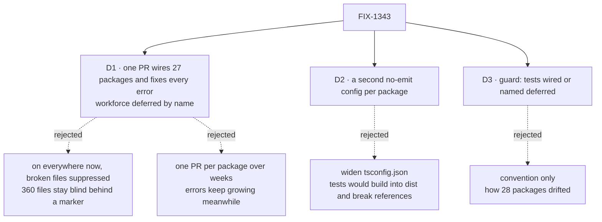

# FIX-1343 · Decisions

[Spec](SPEC.md) · **Decisions**

What was considered, what was chosen, why, and what each choice locks in. Three decisions are the sign-off surface. Everything else here is context for them.

## The tree

Solid edges are what you're signing. Dashed edges lost, and the label says why.

## D1 · One implementation PR wires the 27 remaining packages and fixes every error, except workforce, which is deferred by name

| | |
|---|---|
| **Instead of** | Turning the check on everywhere now with each broken test file marked `// @ts-nocheck`, or one PR per package over the following weeks |
| **Because** | The guarantee has to hold the day it merges, in every package it claims. `@ts-nocheck` on 360 files makes them exactly as blind as today, behind a marker that reads like coverage. Per-package PRs leave the others drifting while they wait: workforce went from 2 to 132 errors in the weeks since this issue was filed. The fixes are mostly mechanical (a mock that needs a cast or a missing field), so one reviewer can read them grouped by package. Workforce is the exception because #3304 and #3387 are rewriting 11 of its test files right now; fixing them here would conflict with both |
| **Locks in** | One large review, about 1,375 fixes across 24 packages, which nobody can merge in pieces. Workforce stays unchecked until its follow-up lands, and the deferral list is how everyone can see that |

![D1, how to switch the check on. Chosen: one PR, all errors fixed, workforce deferred by name. Instead of: on everywhere now with broken files suppressed. It comes down to the day it merges: the chosen option means green CI covers every wired test file, while suppression leaves 360 files blind behind a marker. The price is one large review, against a small one. Locks in: one big review, workforce unchecked until its follow-up. Flips if: the review is too large to read, then split by package on the same branch](figures/d1-rollout.svg)

It comes down to the day it merges: suppression leaves 360 files blind behind a marker that looks like coverage.

**What would change my mind:** a reviewer who says 1,375 fixes in one PR can't be read. Then the same branch carries one commit per package and the PR is still one, or it becomes a short stack in package order. The guard and the deferral list do not change.

## D2 · Tests are checked by a second, no-emit config per package (`tsconfig.test.json`), not by widening `tsconfig.json`

| | |
|---|---|
| **Instead of** | Adding `test/**/*` to each package's `tsconfig.json`, as `ui` does |
| **Because** | `tsconfig.json` is the build config: `tsc -p tsconfig.json` writes `dist`, and every dependent package holds a project reference to it. Widening it would build tests into `dist`, or, with `noEmit`, break every reference to the package. `ui` can do it only because nothing builds or references it with `tsc`. A second config extends the first, so tests are checked with the same compiler options as `src`, and nothing that builds changes |
| **Locks in** | One more file per package, under a name contributors will copy: `tsconfig.test.json`. Editors only read `tsconfig.json`, so an editor can show a test file as clean while CI fails it |

![D2, where the test check lives. Chosen: a second no-emit config per package. Instead of: widening the build config. It comes down to builds and references: the chosen option changes nothing that builds, while widening puts tests into dist or breaks every reference to the package. The price is the editor: it reads only tsconfig.json, so it can show less than CI. Both check tests with the same options as src. Locks in: a second file per package named tsconfig.test.json. Flips if: the repo moves to solution-style configs](figures/d2-where.svg)

It comes down to builds and references: widening the build config breaks every package that depends on this one.

## D3 · Root typecheck fails when a package has test files and no test check, unless it is on a named deferral list with its issue

| | |
|---|---|
| **Instead of** | Relying on the package skeleton and review to keep new packages wired |
| **Because** | The current state is what convention produced: 28 packages copied `include: ["src/**/*"]` from a neighbour and nobody noticed for months. A check that a package can drop out of silently is the failure this issue is about, one level up |
| **Locks in** | A short list file that names each deferred package and the issue that brings it back. Adding to it is visible in review, and every package added later starts wired or fails CI |

It comes down to a package made by copying a config: without the guard it drops out silently, as 28 already did.

## Decided, not asked

- **A test error is fixed in the test.** Where a fix would mean changing a `src` type, stop: that is a source bug the test found, and it gets its own issue, not a quiet type change here.
- **Deliberate partial mocks say so** with `as unknown as T` or a typed helper, one place per file where it repeats. A test that passes invalid input on purpose uses `// @ts-expect-error` with the reason. `@ts-nocheck` and `@ts-ignore` are not used to clear the census.
- **`scripts/typecheck.mjs` is the convergence point.** It runs `tsconfig.json`, then `tsconfig.test.json` when present. Packages with their own typecheck command (`ui`, `integration-tests`) already open their tests and are counted as wired by the guard.
- **The guard's notion of "has tests" is any tracked `*.ts`/`*.tsx` under `test/`, `tests/` or `__tests__/`, or named `*.test.*`/`*.spec.*`.** It is the census's classifier, which found no test-named file outside those places and `src/`.
- **The test config opens `.test-d.ts` too.** They hold 0 errors; the six `tsconfig.test-d.json` stay as they are.
- **Implementation branch:** `fix/FIX-1343-typecheck-tests`, from fresh `main` after this spec merges. FIX-1239 stacks on it.
- **No changeset.** No published package's shipped code or types change.

## Considered and dropped

| Alternative | Why not |
|---|---|
| Vitest's typecheck mode (`vitest --typecheck`) | Runs `tsc` under vitest, only for files matching its own glob, and only when tests run. Typecheck is where CI already gates types; a second gate in a second tool is two places to keep in step |
| A baseline file of known errors that may not grow | Keeps 1,375 errors as accepted state, and new errors in those files hide beside them. A ratchet is the right tool when fixing is expensive; here most fixes are a cast or a field |
| Solution-style `tsconfig.json` (references to a build config and a test config) | Gives editors the test program, but every dependent's reference would have to point at the build config instead. A repo-wide rewiring for an editor benefit; worth its own issue if editors become the complaint |
| Wire only the clean packages now (bullmq, contracts, next) | The smaller goal, rejected in [SPEC.md](SPEC.md#the-goal-and-how-well-know-its-met) |
| Include workforce and rebase over #3304 and #3387 | 132 fixes in 42 files, 11 of which those PRs are rewriting. Whichever lands second redoes its fixes |

## Settled

- **The test program adds no errors in `src` or in dependencies.** **CONFIRMED** by `poc/test-typecheck-census/`: across all 31 packages, every error it reports is in a test file. The `rootDir: "../.."` shape is what makes that true: with `rootDir: "."` a workforce run reported 520 containment errors from packages its tests import but its `src` does not reference.
- **The census sees a real error.** **CONFIRMED**: planting one type error in a test file moved contracts 0 → 1 and codex 1 → 2 (`--plant`). The premise held; nothing changed.
- **harness-manager can be included.** **CONFIRMED**: none of #3387, #3304, #3351, #3156 or #2420 touches `packages/harness-manager`. Its 24 errors are in scope. #3304 and #3351 touch test files in claude-code, codex, cursor and shift-manager; shift-manager is already wired, and the other three hold 38 errors in 5 files, which the implementer rebases over.

## How it got here

- **Draft** — framed as a missing guarantee rather than a config typo; measured every package with a census that runs the real shape after `pnpm packages:build`; chose a second no-emit config per package beside the build config, one PR with workforce deferred, and a guard so the gap cannot reopen quietly.
