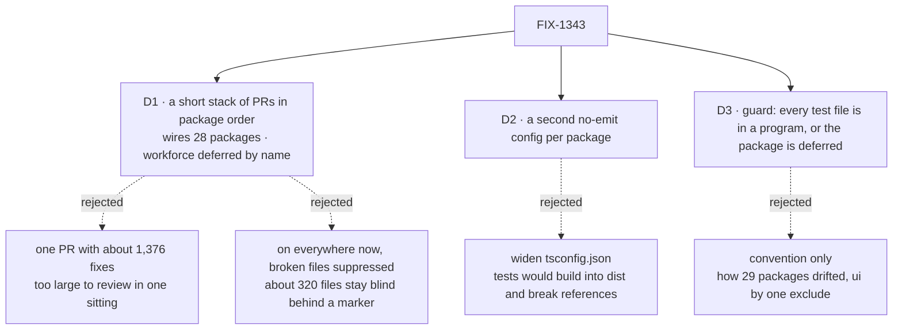

# FIX-1343 · Decisions

[Spec](SPEC.md) · **Decisions**

What was considered, what was chosen, why, and what each choice locks in. Three decisions are the sign-off surface. Everything else here is context for them.

## The tree

Solid edges are what you're signing. Dashed edges lost, and the label says why.

## D1 · A short stack of PRs in package order wires the 28 remaining packages and fixes every error; workforce is deferred by name

| | |
|---|---|
| **Instead of** | One PR with about 1,376 fixes, one commit per package. Further back: turning the check on now with each broken file marked `// @ts-nocheck` |
| **Because** | Review is the bottleneck, not the mechanism. A handful of PRs, each a few packages in dependency order, can each be read in one sitting; one PR of 1,376 fixes can't. Drift between steps is already covered: **the first PR lands the mechanism and the guard, with every package not yet wired named in `DEFERRED`.** From then on a new package or a new test directory can't drop out, and each later PR wires its packages and removes their entries; the guard fails an entry left behind ([D3](#d3)). Suppression was never the answer: `@ts-nocheck` on 319 files makes them as blind as today, behind a marker that reads like coverage. Workforce stays out because #3304 and #3387 are rewriting 11 of its test files; [FIX-2016](https://linear.app/fixpoint-labs/issue/FIX-2016/typecheck-workforces-test-files-deferred-from-fix-1343) wires it after they land |
| **Locks in** | The guarantee arrives package by package over the stack, not on one day. Until the last PR merges, `DEFERRED` names the packages still unchecked, so the gap is visible in one place. Several PRs merge in order |

![D1, how to switch the check on. Chosen: a short stack of PRs in package order. Instead of: one PR with about 1,376 fixes. It comes down to review size: each step can be read in one sitting, while one PR cannot. The price is timing: the guarantee arrives step by step, with unwired packages named in DEFERRED. Drift between steps is a tie: the guard fails a new gap either way. Locks in: several PRs merged in order, the gap visible in DEFERRED until the last. Flips if: the fixes prove trivial enough to read in one sitting](figures/d1-rollout.svg)

It comes down to review size: one PR of 1,376 fixes can't be read in one sitting, and a stack step can.

**The stack, as the default plan.** PR 1 is the mechanism: [`scripts/typecheck.mjs`](https://github.com/fixpoint-labs/flow-state-dev/blob/9c201d9fe7aa5c74a1ad3091889779275f7be19f/scripts/typecheck.mjs#L49) runs `tsconfig.test.json` when present, the guard `scripts/validate-test-typecheck.mjs` joins [root `typecheck`](https://github.com/fixpoint-labs/flow-state-dev/blob/9c201d9fe7aa5c74a1ad3091889779275f7be19f/package.json#L10), and `DEFERRED` lists every package not yet wired; it also wires `core`. Its branch is `fix/FIX-1343-typecheck-tests`; FIX-1239 stacks on the last branch of this stack. Each later PR wires a few packages in dependency order and removes their `DEFERRED` entries. The last leaves only workforce, whose entry cites [FIX-2016](https://linear.app/fixpoint-labs/issue/FIX-2016/typecheck-workforces-test-files-deferred-from-fix-1343). The grouping is the implementer's.

**What would change my mind:** a first PR whose fixes turn out trivial enough to read in one sitting across many packages. Then fewer, larger steps; never suppression.

## D2 · Tests are checked by a second, no-emit config per package (`tsconfig.test.json`), not by widening `tsconfig.json`

| | |
|---|---|
| **Instead of** | Adding `test/**/*` to each package's `tsconfig.json`, as `ui` does |
| **Because** | `tsconfig.json` is the build config: `tsc -p tsconfig.json` writes `dist`, and every dependent package holds a project reference to it. Widening it would build tests into `dist`, or, with `noEmit`, break every reference to the package. `ui` can do it only because nothing builds or references it with `tsc`. A second config extends the first, so tests are checked with the same compiler options as `src`, and nothing that builds changes |
| **Locks in** | One more file per package, under a name contributors will copy: `tsconfig.test.json`. Editors only read `tsconfig.json`, so an editor can show a test file as clean while CI fails it |

![D2, where the test check lives. Chosen: a second no-emit config per package. Instead of: widening the build config. It comes down to builds and references: the chosen option changes nothing that builds, while widening puts tests into dist or breaks every reference to the package. The price is the editor: it reads only tsconfig.json, so it can show less than CI. Both check tests with the same options as src. Locks in: a second file per package named tsconfig.test.json. Flips if: the repo moves to solution-style configs](figures/d2-where.svg)

It comes down to builds and references: widening the build config breaks every package that depends on this one.

## D3 · Root typecheck fails when any test file of a package is outside every program its typecheck compiles, unless the package is deferred by name with its issue

| | |
|---|---|
| **Instead of** | Relying on the package skeleton and review to keep new packages wired |
| **Because** | The current state is what convention produced: 22 packages copied `include: ["src/**/*"]` from a neighbour and open no test at all, six more open only their `.test-d.ts` files, and ui excluded four of its own tests with one line, and nobody noticed for months. A gap can be a whole package or one directory, so the guard checks **files, not configs**: for each package it resolves the file list of every program the `typecheck` script compiles (`tsconfig.json`, `tsconfig.test.json`, a chained `tsc -p tsconfig.test-d.json`) and fails on any test file outside their union. A package wired but partly covered fails the same way as one not wired. **It also fails a stale deferral:** a package in `DEFERRED` whose programs already cover all its tests is wired, so typecheck now compiles those tests and the entry has to go |
| **Locks in** | A `DEFERRED` list in `scripts/validate-test-typecheck.mjs`, each entry naming a package and the issue that brings it back. Adding to it is visible in review, removing it is forced once the package is wired, and every package or test directory added later is covered or fails CI |

![D3, how to keep every test file covered. Chosen: a guard on the files each package's programs resolve, with a named deferral. Instead of: convention and review. It comes down to a test left out by a config, a whole package or one exclude line: the guard fails it by file, while convention lets it drop out silently, as 22 packages did whole and ui did in part. The price is one script that reads configs and never runs tsc, and a deferral entry. Locks in: a deferral entry with an issue each. Flips if: package skeletons become generated rather than copied](figures/d3-guard.svg)

It comes down to a package made by copying a config: without the guard it drops out silently, as 22 did whole and ui did in part.

## Decided, not asked

- **A test error is fixed in the test.** Where a fix would mean changing a `src` type, stop: that is a source bug the test found, and it gets its own issue, not a quiet type change here.
- **A type assertion that fails because its claim is false is triaged, never re-pointed.** When compiled, an `expectTypeOf`, an `Expect<…>` alias or a `@ts-expect-error` that errors because what it claims is untrue is not changed to whatever type the compiler now reports. Either the test is stale (update the claim and say why in the commit) or the source is wrong (file it, keep the claim, and hold the site with a `// @ts-expect-error` naming that issue, so typecheck stays green and the marker fails once the source is fixed). FIX-1239's census ([#3439](https://github.com/fixpoint-labs/flow-state-dev/pull/3439)) found 10 such sites in core: false assertions at `prefetch-mode.test.ts:56,62,66` (reads claimed sync after FIX-700 made them async) and `projected-resource-collection.test.ts:125,148`, the likeliest real source bug; a misplaced `@ts-expect-error` at `resource-collection.test.ts:88` and in four multi-line `.mjs` imports in `*-check.test.ts`. The implementation PR lists each of the 10 with its original claim and the verdict. What FIX-1239 decides about those assertions stays FIX-1239's.
- **Deliberate partial mocks say so** with `as unknown as T` or a typed helper, one place per file where it repeats. A test that passes invalid input on purpose uses `// @ts-expect-error` with the reason. `@ts-nocheck` and `@ts-ignore` are not used to clear the errors.
- **[`scripts/typecheck.mjs`](https://github.com/fixpoint-labs/flow-state-dev/blob/9c201d9fe7aa5c74a1ad3091889779275f7be19f/scripts/typecheck.mjs#L49) is the convergence point.** It runs `tsconfig.json`, then `tsconfig.test.json` when present. Packages with their own typecheck command (`integration-tests`, `ui`) are checked by the guard on the same terms: what their programs resolve.
- **The guard reads configs; it never runs `tsc`.** It uses the repo's `typescript` dependency (`ts.readConfigFile` and `ts.parseJsonConfigFileContent`) to get each program's `fileNames`, so it costs milliseconds and follows `extends`, `include` and `exclude` exactly as `tsc` does. The programs are read off each package's `typecheck` script, every `&&` segment.
- **The guard's notion of a test file is any tracked `*.ts`/`*.tsx`/`*.mts` under `test/`, `tests/` or `__tests__/`, or named `*.test.*`/`*.spec.*`/`*.test-d.*`.** It is the census's classifier, which found no test-named file outside those places and `src/`.
- **ui's test config mirrors its vitest aliases.** `@/components/ui/*` and `@/lib/utils` map to `.storybook/shadcn`, as `vitest.config.ts` does. Without the mapping, the render tests pull in registry components whose imports only an app resolves.
- **The guard is `scripts/validate-test-typecheck.mjs`, chained into [root `typecheck`](https://github.com/fixpoint-labs/flow-state-dev/blob/9c201d9fe7aa5c74a1ad3091889779275f7be19f/package.json#L10) beside the other `validate-*.mjs` guards.** `DEFERRED` is a named list at the top of that file, one entry per package with its issue link, in [`scripts/validate-publish-set.mjs`](https://github.com/fixpoint-labs/flow-state-dev/blob/9c201d9fe7aa5c74a1ad3091889779275f7be19f/scripts/validate-publish-set.mjs#L39-L50)'s shape: the list, an exported helper that the CLI and a small test in `packages/core/test/` both call. The stack starts it long and shrinks it to one entry: `workforce`, citing [FIX-2016](https://linear.app/fixpoint-labs/issue/FIX-2016/typecheck-workforces-test-files-deferred-from-fix-1343).
- **The test config opens `.test-d.ts` too.** They hold 0 errors; the six `tsconfig.test-d.json` stay as they are, and count as coverage.
- **The census is frozen evidence.** `poc/test-typecheck-census/census.mjs` is not re-run at implementation and never joins CI. `pnpm typecheck` is the ongoing check.
- **Implementation branch:** `fix/FIX-1343-typecheck-tests` is the stack's first PR, from fresh `main` after this spec merges. Later steps branch from the step before. FIX-1239 stacks on the last branch of this stack, since it needs every package wired ([#3439](https://github.com/fixpoint-labs/flow-state-dev/pull/3439) owns its stacking point).
- **No changeset.** No published package's shipped code or types change.

## Considered and dropped

| Alternative | Why not |
|---|---|
| Vitest's typecheck mode (`vitest --typecheck`) | Runs `tsc` under vitest, only for files matching its own glob, and only when tests run, not on the `turbo run typecheck` path CI already gates on. A second gate in a second tool is two places to keep in step |
| A baseline file of known errors that may not grow | Keeps about 1,376 errors as accepted state, and new errors in those files hide beside them. A ratchet is the right tool when fixing is expensive; here most fixes are a cast or a field |
| Solution-style `tsconfig.json` (references to a build config and a test config) | Gives editors the test program, but every dependent's reference would have to point at the build config instead. A repo-wide rewiring for an editor benefit; worth its own issue if editors become the complaint |
| A guard that checks only that `tsconfig.test.json` exists | Passes ui today, with four tests excluded. Existence is not coverage |
| Wire only the clean packages now (bullmq, contracts, next) | The smaller goal, rejected in [SPEC.md](SPEC.md#the-goal-and-how-well-know-its-met) |
| One PR with every fix, one commit per package | Delivers the guarantee on one day, but about 1,376 fixes in one review is more than one sitting. The stack keeps the same guard from step one, so the only thing the single PR buys is timing |
| Turn on everywhere now with broken files marked `@ts-nocheck` | About 320 files stay as blind as today behind a marker that reads like coverage |
| Include workforce and rebase over #3304 and #3387 | 132 fixes in 42 files, 11 of which those PRs are rewriting. Whichever lands second redoes its fixes |

## Settled

- **The test program adds no errors in dependencies, and none in `src` once a package's own aliases are honoured.** **CONFIRMED** by `poc/test-typecheck-census/`: in 30 of 31 packages every error it reports is in a test file. The `rootDir: "../.."` shape is what makes that true: with `rootDir: "."` a workforce run reported 520 containment errors from packages its tests import but its `src` does not reference. The exception is ui, where opening `test/render/**` reports 8 errors in registry components, all unresolved `@/` imports. With vitest's aliases mirrored, those 8 go and ui's render tests hold 1 real error.
- **The census sees a real error, including in a directory the config excluded.** **CONFIRMED** (`--plant`): one planted error moved contracts 0 → 1, core 292 → 293, and ui's `test/render/` 1 → 2. The premise held.
- **"Opened today" counts every program a package's typecheck compiles.** Core opens 10 of its 159 tests today (9 through `tsconfig.test-d.json`), workforce 5 of 119, claude-code 2 of 16, memory 1 of 21, codex 1 of 9, cursor 1 of 13, ui 15 of 19. 22 packages open none. Error counts are unchanged by this: the probe always opened the `.test-d.ts` files, and they hold 0 errors.
- **harness-manager can be included.** **CONFIRMED**: none of #3387, #3304, #3351, #3156 or #2420 touches `packages/harness-manager`. Its 24 errors are in scope. #3304 and #3351 touch test files in claude-code, codex, cursor and shift-manager; shift-manager is already covered, and the other three hold 38 errors in 5 files, which the implementer rebases over.

## How it got here

- **Draft** — framed as a missing guarantee rather than a config typo; measured every package with a census that runs the real shape after `pnpm packages:build`; chose a second no-emit config per package beside the build config, one PR with workforce deferred, and a guard so the gap cannot reopen quietly.
- **Review round 1** — Greptile and Codex found that ui excludes `test/render/**`, so a package can be wired and still partly blind. D3's guard moved from "a test check exists" to "every test file is in a resolved program", and ui's render tests joined the rollout. Codex found the census ignored chained programs; it now follows every program, which moved the "opened today" counts and none of the error counts.
- **Review round 2** — the Architect asked for the stack as D1's default, since the guard already stops drift between steps: one PR moved to *considered and dropped*. D3's guard gained the stale-deferral failure, and the guard's file and the `DEFERRED` list got names.

## Notes from review

- "/simplify: 'every' wired package for the planted-error check is heavier than the guarantee needs. One representative package (plus the guard regression when wiring is deleted) …" — cursor ([thread](https://github.com/fixpoint-labs/flow-state-dev/pull/3433#discussion_r4277262763)). Taken as: plants in engine and in ui's render tests, the one divergent shape found; per-package coverage is the guard's job.
- "Post-merge, `pnpm typecheck` (turbo) should be the ongoing census; this script is great as retained POC evidence on pinned `main` …" — cursor ([thread](https://github.com/fixpoint-labs/flow-state-dev/pull/3433#discussion_r4277262769))
- "Reuse nudge: model the deferral list on `scripts/validate-publish-set.mjs` (`NEVER_PUBLISH` + exported helper + a small vitest in `packages/core/test/`) …" — cursor ([thread](https://github.com/fixpoint-labs/flow-state-dev/pull/3433#discussion_r4277262784))
- "Hand-rolled JSONC is fine for a frozen POC; if any of this moves toward `scripts/`, prefer the repo's existing `typescript` dependency (`parseJsonConfigFileContent` / readConfigFile) …" — cursor ([thread](https://github.com/fixpoint-labs/flow-state-dev/pull/3433#discussion_r4277262797))
- "Perf note (accepted for POC): serial `spawnSync` `tsc` per package … Implementation guard should not …" — cursor ([thread](https://github.com/fixpoint-labs/flow-state-dev/pull/3433#discussion_r4277262802))

These are inputs, not instructions. Adopt, adapt, or discard; you owe no justification for discarding one.

**Open: none.**
