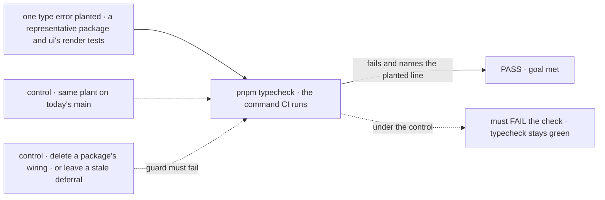
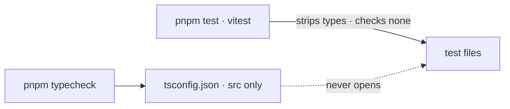
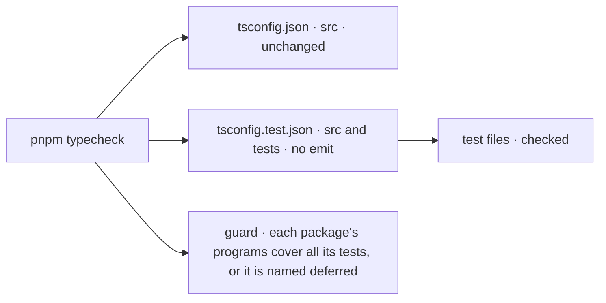

# FIX-1343 · Test files are excluded from typecheck in nearly every package — type drift in tests goes undetected

**Spec** · [Decisions](DECISIONS.md)

## Five people, before and after

| Someone who… | Today | After |
|---|---|---|
| **removes a field that a test still sets** | `pnpm typecheck` and CI stay green unless `src/` also used the field. The test keeps asserting a shape the type forbids | `pnpm typecheck` fails on the test line, in CI and locally |
| **writes a new test with a mock that doesn't fit its type** | Nothing notices. The mock drifts further each time the type changes | The mismatch fails typecheck the day it is written. A deliberate partial mock says so with a cast |
| **adds a new package by copying a neighbour's config** | Copies `include: ["src/**/*"]` and silently opts the new package's tests out | Typecheck fails until the package's tests are wired, or the package is named in `DEFERRED` with an issue ([D3](DECISIONS.md#d3)) |
| **works in `packages/workforce`** | Same blind spot, with 132 errors already in its tests | Unchanged for now: deferred by name with [FIX-2016](https://linear.app/fixpoint-labs/issue/FIX-2016/typecheck-workforces-test-files-deferred-from-fix-1343), because two open PRs (#3304, #3387) are rewriting its tests ([D1](DECISIONS.md#d1)) |
| **writes `expectTypeOf` inside a `*.test.ts`** | The assertion is decorative: nothing compiles it (FIX-1239) | It compiles, so a wrong type fails typecheck. Proving each one *can* fail stays FIX-1239's |
| **writes a render test in `packages/ui`** | `test/render/**` is excluded from ui's config, so its four tests are not compiled, though the rest of ui's tests are | Compiled like every other ui test: the test config maps the same `@/` stubs vitest already uses |

Measured on `main` at `4f2e13ed`, **29 of 31 packages** have tests that no program in their typecheck opens: 22 open none, and seven open only some, six through a `.test-d.ts` program (core 10 of 159, workforce 5 of 119, claude-code 2 of 16, memory 1 of 21, codex 1 of 9, cursor 1 of 13) and ui through an `exclude` (15 of 19). Only shift-manager and integration-tests are fully covered. Opened, the unchecked tests hold **1,508 type errors in 361 files**. That is about **1,376 to fix** in the 28 packages this change wires, plus **132 deferred** with workforce. Workforce alone went from the issue's 2 errors to 132 since it was filed. The drift is not static; it grows every week the check is off.

## The goal, and how we'll know it's met

**When a change makes any package's test code stop compiling against the types it uses, `pnpm typecheck`, and therefore CI, fails.**

| Is it the right goal? | |
|---|---|
| **The real need** | *"A package's typecheck (and therefore CI) opens its test files and fails when a test's use of a type stops compiling — the same guarantee `src/` already has."* (the issue's desired outcome) |
| **Smaller, and rejected** | Turn it on only where tests are already clean (bullmq, contracts, next) or only in `core`. Green CI would still mean nothing about types in 26 packages, and the issue's own case (workforce) stays blind |
| **Bigger, and not this issue's** | Test files in `apps/`, `examples/`, `labs/` and `goals/` (FIX-945 owns `goals/`). A real linter (FIX-1417). Proving each `expectTypeOf` can fail (FIX-1239) |
| **Not done if** | A package's errors are hidden rather than fixed: `@ts-nocheck`, a blanket `any`, or a test config that excludes the files that had errors · a package is skipped, **or only partly covered**, without being named on the deferral list · the wiring exists but CI's `pnpm typecheck` does not run it · workforce is deferred with no issue that brings it back |

Once this lands, **any new type error in a test fails CI.** There is no error budget and no baseline file: the 1,376 fixes are a one-time cleanup, not a ratchet's starting point.



The check reads what `pnpm typecheck` reports for a planted error, not whether a config file exists. On today's `main` the same plant passes typecheck, so the check fails there, as it must.

| How we verify | |
|---|---|
| **Goal check** | No `goals/` harness: this changes repository tooling, not runtime behaviour. The proof is the signals below, run by the implementer at completion, verdict in the implementation PR |
| **Signal** | (1) `pnpm typecheck` is green with every package wired: that *is* 0 test errors, on the path CI runs. (2) The D3 guard passes: for every package, the files its programs resolve cover every test file, or the package is deferred by name. (3) One planted error in a test file of a representative package (engine), and one in `packages/ui/test/render/`, each make `pnpm typecheck` exit non-zero and name the file. (4) The issue's own case: removing a field that only a test sets fails typecheck |
| **Input** | Any wired package and any test file must behave like the plants. Coverage is the guard's job, per package, so the plants need not repeat in every package: they prove `tsc` reports what the guard says is covered, on the common shape and on ui's divergent one (path aliases, a previous `exclude`) |
| **Anti-game** | Don't count config files or `include` lines: the guard compares resolved file lists. Don't plant in a file that `src/` also covers. A package that passes only because its errors are suppressed fails the "not done if" row |
| **Control that must fail** | Today's `main`: the same plants leave `pnpm typecheck` green, failing signal (3). Three guard regressions must each fail signal (2): deleting one package's test wiring; re-adding ui's `test/render/**` exclude; and **wiring workforce while its `DEFERRED` entry is still present** (a stale deferral). The implementation PR shows these before the PASS |

The census under `poc/test-typecheck-census/` is frozen evidence, measured once on pinned `main`. It is not re-run by the implementer and never runs in CI. After this lands, `pnpm typecheck` is the ongoing check.

## What changes

**Before**



**After**



The build config each package emits from stays as it is. Typecheck runs a second, no-emit program over the same sources plus the tests. A guard makes sure no package, and no test inside a package, is left out without saying so.

**What a package gains, as the implementer will type it** (this is the shape `ui` and `shift-manager` already prove; the exact options are the implementer's):

```diff
+ // packages/<name>/tsconfig.test.json
+ {
+   "extends": "./tsconfig.json",
+   "compilerOptions": { "composite": false, "rootDir": "../..", "noEmit": true },
+   "include": ["src/**/*", "test/**/*"]
+ }
```

`rootDir` widens because tests import packages that `src/` does not reference; with no emit it only gates containment. [`scripts/typecheck.mjs`](https://github.com/fixpoint-labs/flow-state-dev/blob/9c201d9fe7aa5c74a1ad3091889779275f7be19f/scripts/typecheck.mjs#L49), which every package's `typecheck` already runs, runs this file after `tsconfig.json`. The guard is `scripts/validate-test-typecheck.mjs`, chained into [root `typecheck`](https://github.com/fixpoint-labs/flow-state-dev/blob/9c201d9fe7aa5c74a1ad3091889779275f7be19f/package.json#L10), with the `DEFERRED` list at its top. Shapes diverge where a package already diverges: ui's test config drops the `test/render/**` exclude ([ui's `exclude`](https://github.com/fixpoint-labs/flow-state-dev/blob/9c201d9fe7aa5c74a1ad3091889779275f7be19f/packages/ui/tsconfig.json#L17)) and maps `@/components/ui/*` and `@/lib/utils` to the `.storybook/shadcn` stubs its `vitest.config.ts` uses. With that mapping, ui's render tests hold 1 error.

**Docs:** update `docs/contributing/development-setup.md` (what `pnpm typecheck` covers, the guard, and the `DEFERRED` list) and the package skeleton in `.agents/skills/add-store-adapter/SKILL.md` so a new package starts wired. No `apps/docs` impact: this is contributor tooling with no user-facing surface.

## What stays as it is

- Every package's `tsconfig.json`, its `build` script, its `dist` output, and every project reference other packages hold to it.
- `vitest` and every `test` script. Tests still run the same way; they are now also compiled.
- The six `tsconfig.test-d.json` files and their scripts (FIX-1223). The new program also opens `.test-d.ts` files; they hold 0 errors today. The guard counts these programs as coverage.
- `shift-manager` and `integration-tests`, which already typecheck all their tests through their own configs.

## What's already here, and the debt

| Already here | What this does with it |
|---|---|
| `ui` and `shift-manager` configs, which open `test/**/*` | **Builds on, and extends ui.** Proof the shape works against cross-package imports. `ui` puts tests in `tsconfig.json` because nothing references or builds it with `tsc`; most packages can't ([D2](DECISIONS.md#d2)). [ui's `exclude`](https://github.com/fixpoint-labs/flow-state-dev/blob/9c201d9fe7aa5c74a1ad3091889779275f7be19f/packages/ui/tsconfig.json#L17) of `test/render/**` is the one partial gap of that kind; this change closes it |
| `tsconfig.test-d.json` in core, claude-code, codex, cursor, memory, workforce ([FIX-1223](https://linear.app/fixpoint-labs/issue/FIX-1223), done) | **Leaves alone, and counts as coverage.** They open 19 `.test-d.ts` files (core 9, workforce 5, claude-code 2, codex, cursor and memory 1 each). The new program also opens them. Workforce's strict variant checks options this one doesn't |
| [`scripts/typecheck.mjs`](https://github.com/fixpoint-labs/flow-state-dev/blob/9c201d9fe7aa5c74a1ad3091889779275f7be19f/scripts/typecheck.mjs#L49), the one place each package's typecheck runs | **Extends.** Runs the test config when present |
| `scripts/validate-*.mjs` guards chained in [root `typecheck`](https://github.com/fixpoint-labs/flow-state-dev/blob/9c201d9fe7aa5c74a1ad3091889779275f7be19f/package.json#L10), and [`scripts/validate-publish-set.mjs`](https://github.com/fixpoint-labs/flow-state-dev/blob/9c201d9fe7aa5c74a1ad3091889779275f7be19f/scripts/validate-publish-set.mjs#L39-L50)'s `NEVER_PUBLISH` list with its test in `packages/core/test/` | **Builds on.** The new guard, `scripts/validate-test-typecheck.mjs`, is one more of them. Its `DEFERRED` list takes the `NEVER_PUBLISH` shape: a named list at the top of the file, an exported helper, a small test |
| Anything else that typechecks tests | **Only the `.test-d.ts` programs above.** Searched every `packages/*/package.json` script and every `tsconfig*.json`; `vitest` has no `typecheck` block in any config |
| FIX-1239 (decorative `expectTypeOf` in `*.test.ts`) | **Absorbs the root cause.** Those files become compiled. FIX-1239 keeps proving each assertion can fail, and its guard. It stacks on the last branch of this stack ([#3439](https://github.com/fixpoint-labs/flow-state-dev/pull/3439)) |
| Prior designs | **None.** No retained spec under `specs/` covers typecheck scope; FIX-1223 shipped without one |

| The debt | |
|---|---|
| **Removes** | About 1,376 type errors in the test files of 25 packages: drifted mocks and fixtures, each a test asserting a shape its type no longer allows. ui's `test/render/**` exclude |
| **Adds** | A second config file per package, `tsconfig.test.json` (permanent by design, [D2](DECISIONS.md#d2)). A `DEFERRED` list that the stack shrinks to one entry, workforce, paid by [FIX-2016](https://linear.app/fixpoint-labs/issue/FIX-2016/typecheck-workforces-test-files-deferred-from-fix-1343), which wires it once #3304 and #3387 land; the guard keeps the list from growing quietly and fails an entry left behind ([D3](DECISIONS.md#d3)). About 300 s more serial `tsc` time in CI, spread across turbo's parallel tasks; engine's run peaks near 1 GB. The guard itself runs no `tsc` |
| **Leaves** | The overlap between `tsconfig.test-d.json` and the new program, in six packages. Test files outside `packages/` (FIX-945 for `goals/`). Editors still treat test files as outside any project, so CI can catch an error the editor did not show ([D2](DECISIONS.md#d2)) |

**Net: down.** About 1,376 hidden errors go, and the same class can't come back unnoticed; one config file per package is added, and a `DEFERRED` list that ends the stack holding only workforce.

## Sign off

**[The goal](#the-goal-and-how-well-know-its-met), at that size:** every package's tests compile against their types, all of them, or the package is named as deferred. If wrong: we ship a check that covers the easy packages and call the repo safe.

**[The debt](#whats-already-here-and-the-debt), net down:** about 1,376 errors fixed; a test config per package added, and a `DEFERRED` list the stack shrinks to workforce. If wrong: workforce stays deferred and nobody comes back to it; [FIX-2016](https://linear.app/fixpoint-labs/issue/FIX-2016/typecheck-workforces-test-files-deferred-from-fix-1343) owns bringing it back.

**Workforce's deferral is owned by [FIX-2016](https://linear.app/fixpoint-labs/issue/FIX-2016/typecheck-workforces-test-files-deferred-from-fix-1343)** (typecheck workforce's tests, 132 errors in 42 files, after #3304 and #3387 land). Its `DEFERRED` entry cites it. If wrong: workforce's blind spot outlives the PRs that justified it.

1. **[D1](DECISIONS.md#d1) · A short stack of PRs in package order wires the 28 remaining packages and fixes every error; workforce is deferred by name.** If wrong: the guarantee takes several merges to arrive, or workforce's blind spot outlives the PRs that justified it. **The one to weigh.**
2. **[D2](DECISIONS.md#d2) · Tests are checked by a second, no-emit config per package, not by widening the build config.** If wrong: editors keep showing less than CI does.
3. **[D3](DECISIONS.md#d3) · Root typecheck fails when any test file of a package is outside every program its typecheck compiles, unless the package is deferred by name, and fails a deferral that has gone stale.** If wrong: one more guard script to keep current.

**Open: none.** The full reasoning, what lost, and what each locks in is in [DECISIONS.md](DECISIONS.md).

Improvement · repository tooling, every package under `packages/` · large by count (25 packages' tests edited, about 1,376 fixes), small by mechanism · related to epic FIX-1332, not under it
