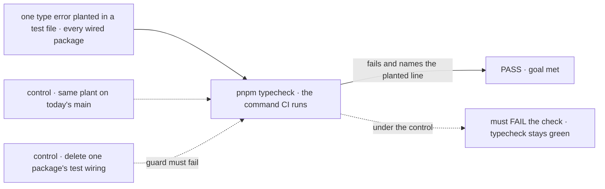
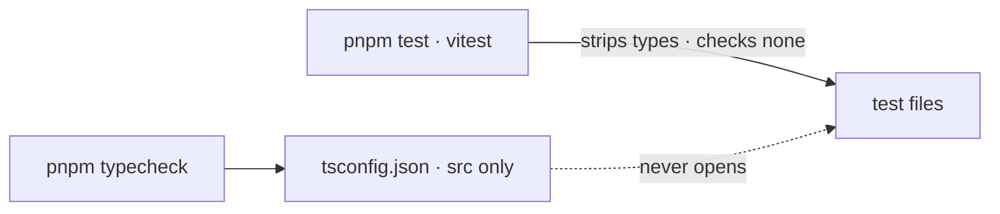
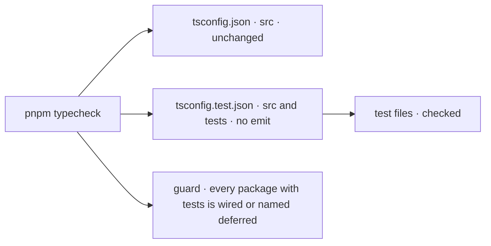

# FIX-1343 · Test files are excluded from typecheck in nearly every package — type drift in tests goes undetected

**Spec** · [Decisions](DECISIONS.md)

## Five people, before and after

| Someone who… | Today | After |
|---|---|---|
| **removes a field that a test still sets** | `pnpm typecheck` and CI stay green unless `src/` also used the field. The test keeps asserting a shape the type forbids | `pnpm typecheck` fails on the test line, in CI and locally |
| **writes a new test with a mock that doesn't fit its type** | Nothing notices. The mock drifts further each time the type changes | The mismatch fails typecheck the day it is written. A deliberate partial mock says so with a cast |
| **adds a new package by copying a neighbour's config** | Copies `include: ["src/**/*"]` and silently opts the new package's tests out | Typecheck fails until the package's tests are wired, or the package is named on the deferral list with an issue ([D3](DECISIONS.md#d3)) |
| **works in `packages/workforce`** | Same blind spot, with 132 errors already in its tests | Unchanged for now: deferred by name with an issue, because two open PRs (#3304, #3387) are rewriting its tests ([D1](DECISIONS.md#d1)) |
| **writes `expectTypeOf` inside a `*.test.ts`** | The assertion is decorative: nothing compiles it (FIX-1239) | It compiles, so a wrong type fails typecheck. Proving each one *can* fail stays FIX-1239's |

Measured on `main` at `4f2e13ed`, the package count matches the issue and the error count is far past its seed. **28 of 31 packages** have tests their typecheck does not open (core opens 1 of its 159). Opened, they hold **1,507 type errors in 360 test files**. Workforce alone went from the issue's 2 errors to 132 since it was filed. The drift is not static; it grows every week the check is off.

## The goal, and how we'll know it's met

**When a change makes any package's test code stop compiling against the types it uses, `pnpm typecheck`, and therefore CI, fails.**

| Is it the right goal? | |
|---|---|
| **The real need** | *"A package's typecheck (and therefore CI) opens its test files and fails when a test's use of a type stops compiling — the same guarantee `src/` already has."* (the issue's desired outcome) |
| **Smaller, and rejected** | Turn it on only where tests are already clean (bullmq, contracts, next) or only in `core`. Green CI would still mean nothing about types in 25 packages, and the issue's own case (workforce) stays blind |
| **Bigger, and not this issue's** | Test files in `apps/`, `examples/`, `labs/` and `goals/` (FIX-945 owns `goals/`). A real linter (FIX-1417). Proving each `expectTypeOf` can fail (FIX-1239) |
| **Not done if** | A package's errors are hidden rather than fixed: `@ts-nocheck`, a blanket `any`, or a test config that excludes the files that had errors · a package is skipped without being named on the deferral list · the wiring exists but CI's `pnpm typecheck` does not run it · workforce is deferred with no issue that brings it back |



The check reads what `pnpm typecheck` reports for a planted error, not whether a config file exists. On today's `main` the same plant passes typecheck, so the check fails there, as it must.

| How we verify | |
|---|---|
| **Goal check** | No `goals/` harness: this changes repository tooling, not runtime behaviour. The proof is the planted-error run below plus the census, run by the implementer at completion, verdict in the implementation PR |
| **Signal** | (1) The census reports **0 test-file errors** for every wired package. (2) A planted error in one test file per wired package makes `pnpm typecheck` exit non-zero and name that file. (3) The issue's own case: removing a field that only a test sets fails typecheck |
| **Input** | `node specs/issues/FIX-1343/poc/test-typecheck-census/census.mjs` after `pnpm packages:build`. Any other test file, or any other field, must behave the same |
| **Anti-game** | Don't count config files or `include` lines. Don't plant in a file that `src/` also covers. A package that passes only because its errors are suppressed fails the "not done if" row |
| **Control that must fail** | Today's `main`: the same plant leaves `pnpm typecheck` green, failing signal (2). And deleting one package's test wiring must fail the guard ([D3](DECISIONS.md#d3)). The implementation PR shows both before the PASS |

## What changes

**Before**



**After**



The build config each package emits from stays as it is. Typecheck runs a second, no-emit program over the same sources plus the tests, and a guard makes sure no package is left out without saying so.

**What a package gains, as the implementer will type it** (this is the shape `ui` and `shift-manager` already prove; the exact options are the implementer's):

```diff
+ // packages/<name>/tsconfig.test.json
+ {
+   "extends": "./tsconfig.json",
+   "compilerOptions": { "composite": false, "rootDir": "../..", "noEmit": true },
+   "include": ["src/**/*", "test/**/*"]
+ }
```

`rootDir` widens because tests import packages that `src/` does not reference; with no emit it only gates containment. `scripts/typecheck.mjs`, which every package's `typecheck` already runs, runs this file after `tsconfig.json`.

**Docs:** update `docs/contributing/development-setup.md` (what `pnpm typecheck` covers, and the deferral list) and the package skeleton in `.agents/skills/add-store-adapter/SKILL.md` so a new package starts wired. No `apps/docs` impact: this is contributor tooling with no user-facing surface.

## What stays as it is

- Every package's `tsconfig.json`, its `build` script, its `dist` output, and every project reference other packages hold to it.
- `vitest` and every `test` script. Tests still run the same way; they are now also compiled.
- The six `tsconfig.test-d.json` files and their scripts (FIX-1223). The new program also opens `.test-d.ts` files; they hold 0 errors today.
- `ui`, `shift-manager` and `integration-tests`, which already typecheck their tests through their own configs.

## What's already here, and the debt

| Already here | What this does with it |
|---|---|
| `ui` and `shift-manager` configs, which open `test/**/*` | **Builds on.** Proof the shape works against cross-package imports. `ui` puts tests in `tsconfig.json` because nothing references or builds it with `tsc`; most packages can't ([D2](DECISIONS.md#d2)) |
| `tsconfig.test-d.json` in core, claude-code, codex, cursor, memory, workforce ([FIX-1223](https://linear.app/fixpoint-labs/issue/FIX-1223), done) | **Leaves alone.** Overlaps: the new program also opens `.test-d.ts`. Workforce's strict variant checks options this one doesn't |
| `scripts/typecheck.mjs`, the one place each package's typecheck runs | **Extends.** Runs the test config when present |
| `scripts/validate-*.mjs` guards chained in root `pnpm typecheck` | **Builds on.** The deferral guard is one more of them |
| Anything else that typechecks tests | **None for the 28.** Searched every `packages/*/package.json` script and every `tsconfig*.json`; `vitest` has no `typecheck` block in any config |
| FIX-1239 (decorative `expectTypeOf` in `*.test.ts`) | **Absorbs the root cause.** Those files become compiled. FIX-1239 keeps proving each assertion can fail, and its guard. It stacks on this implementation branch, `fix/FIX-1343-typecheck-tests` |
| Prior designs | **None.** No retained spec under `specs/` covers typecheck scope; FIX-1223 shipped without one |

| The debt | |
|---|---|
| **Removes** | 1,375 type errors in the test files of 24 packages: drifted mocks and fixtures, each a test asserting a shape its type no longer allows |
| **Adds** | A second config file per package, `tsconfig.test.json` (permanent by design, [D2](DECISIONS.md#d2)). A deferral list holding workforce, paid by a follow-up issue to be filed (FIX-XXX · typecheck workforce tests); the guard keeps the list from growing quietly ([D3](DECISIONS.md#d3)). About 300 s more serial `tsc` time in CI, spread across turbo's parallel tasks; engine's run peaks near 1 GB |
| **Leaves** | The overlap between `tsconfig.test-d.json` and the new program, in six packages. Test files outside `packages/` (FIX-945 for `goals/`). Editors still treat test files as outside any project, so CI can catch an error the editor did not show ([D2](DECISIONS.md#d2)) |

**Net: down.** 1,375 hidden errors go, and the same class can't come back unnoticed; one config file per package and one short list are added.

## Sign off

**[The goal](#the-goal-and-how-well-know-its-met), at that size:** every package's tests compile against their types, or the package is named as deferred. If wrong: we ship a check that covers the easy packages and call the repo safe.

**[The debt](#whats-already-here-and-the-debt), net down:** 1,375 errors fixed; a test config per package and a one-entry deferral list added. If wrong: a list that collects packages nobody comes back to.

1. **[D1](DECISIONS.md#d1) · One implementation PR wires the 27 remaining packages and fixes every error, except workforce, deferred by name.** If wrong: a large review lands at once, or workforce's blind spot outlives the PRs that justified it. **The one to weigh.**
2. **[D2](DECISIONS.md#d2) · Tests are checked by a second, no-emit config per package, not by widening the build config.** If wrong: editors keep showing less than CI does.
3. **[D3](DECISIONS.md#d3) · Root typecheck fails when a package has tests and no test check, unless it is on a named deferral list.** If wrong: one more guard script to keep current.

**Open: none.** The full reasoning, what lost, and what each locks in is in [DECISIONS.md](DECISIONS.md).

Improvement · repository tooling, every package under `packages/` · large by count (24 packages' tests edited, about 1,375 fixes), small by mechanism · related to epic FIX-1332, not under it
