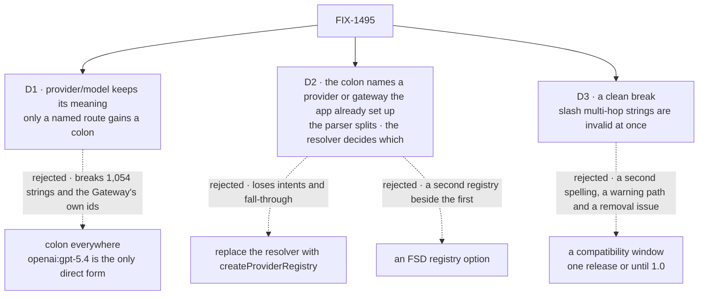

# FIX-1495 · Decisions

[Spec](SPEC.md) · **Decisions**

What was considered, what was chosen, why, and what each choice locks in. Three decisions are the
sign-off surface. Everything else here is context for them.

## The tree

Solid edges are what you're signing. Dashed edges lost, and the label says why.

## D1 · `provider/model` keeps its meaning; only a string that names a route gains a colon

| | |
|---|---|
| **Instead of** | Colon everywhere: `openai:gpt-5.4` as the only direct spelling, and `openai/gpt-5.4` a Gateway id only |
| **Because** | `openai/gpt-5.4` is already the Gateway's own id format, so it is AI SDK's grammar, not ours. It is also 1,054 of the 1,502 quoted model strings the census classifies in the repo. The colon is how AI SDK names *which provider serves* an id, so FSD uses it exactly there: `vercel:openai/gpt-5.4`, `openai:gpt-5.4`, `triage:native`. FIX-609's fall-through stays the meaning of the slash form (tenet 2: refine, don't add) |
| **Locks in** | Two public spellings that both mean "run this model": a slash id that FSD routes however it can, and a colon string that names the route and never falls through. Every reader learns the difference once, in the lane table |

It comes down to the strings already written: colon everywhere renames 1,054 of them and contradicts the Gateway.

**What would change my mind:** AI SDK deprecating bare slash ids outside the Gateway. Then the
slash form is a Gateway-only id, and a second rename follows.

## D2 · The colon names a provider or gateway the app already set up; the parser only splits, the resolver decides which; no new registry

| | |
|---|---|
| **Instead of** | Replacing `createModelResolver` with AI SDK's `createProviderRegistry`, or adding an FSD `registry` option beside `providers` |
| **Because** | A registry is a map from a name to a provider, split at the first `:`. `providers` and `gateways` already are that map, keyed by the same names. A thin adapter over AI SDK's lookup gets its grammar and its `evaluationModel` without losing intents, fall-through or lazy loading, which a full replace drops. The parser sees only the string, so it can't tell `vercel:` from `triage:`; only the resolver holds the maps, which is where today's gateway check already lives (tenet 5: one convergence point, with the knowledge it needs) |
| **Locks in** | The alias names are the keys of `providers` and `gateways`, plus the two built-in gateways (`vercel`, `openrouter`) and the three built-in providers. A name in both maps, or a `providers` key named like a built-in gateway, is refused when the resolver is built: no silent shadowing. The public parse result gains an `alias` kind, a type change for code that reads it. An app's own `createProviderRegistry` object is not accepted as is; its entries go into `providers` |

It comes down to what the resolver already does: a replace drops intents and fall-through, which AI SDK's registry has no place for.

**What would change my mind:** apps that already build a `createProviderRegistry` and want to
pass that object as is. Then a `registry` option that feeds the same lane is additive.

## D3 · A clean break: a slash multi-hop string is invalid as soon as this ships, with an error that names its new spelling

| | |
|---|---|
| **Instead of** | A compatibility window, one minor release or until 1.0, in which the old form is rewritten to the colon form and warns |
| **Because** | Jake's call on the open fork ([comment](https://github.com/fixpoint-labs/flow-state-dev/pull/3429#issuecomment-6180523745)): *"We should just update the codebase and not have any backward compatability support."* We are pre-1.0. A window costs a second spelling, a warning that has to reach production, and a removal issue someone has to run. The error that names the fix does the job of the warning (BP-030: reject a removed shape loudly) |
| **Locks in** | An app that upgrades must rename every slash multi-hop string before its first run. A string in config fails when the resolver is built; a string in a block or in stored data fails the first time it is resolved, which can be on a live request. A breaking `minor` changeset says so |

It comes down to the second spelling: a window keeps one alive, with a warning path and a removal to run later.

**What would change my mind:** an outside app that stores model strings in data it can't
migrate. Then a short window with a production warning is the safer promise.

## Decided, not asked

- **Two convergence points, each with what it needs.** The parser, config-free, decides the
  *lane*: a string is in the alias lane when its first `:` comes before its first `/`, or it has a
  `:` and no `/`. Everything after that colon is the model id, untouched:
  `openrouter:openai/gpt-oss-20b:free` is OpenRouter's `openai/gpt-oss-20b:free`, and
  `openai/gpt-oss:free` stays a slash id. One route classifier inside the resolver decides the
  *route* of an alias result against its maps, and every resolver path that branches on a parsed
  string goes through it: resolution, `resolveId`, intent and `defaultModel` validation, the env-var
  overrides, and the evaluation path.
- **The public parse result gains an `alias` kind** (`{ type: "alias", alias, modelId }`) in place of
  typing a colon string `gateway` or `direct`, which the parser can't know. What it costs callers,
  checked: in this repo, the evaluator's intent check (unaffected), the generator's model-array
  fallback, which reads `provider` and must take the resolver's classification instead, and the
  parser's own tests. Outside, `parseModelString` and `ParsedModelString` are exported from `core`
  and `engine`: TypeScript code that switches over `type` exhaustively stops compiling, and code
  that reads `provider` gets none for a colon string. Named in the changeset. Inside the resolver,
  provider preference and per-provider options read the classified route (`anthropic` in
  `vercel:anthropic/…`); `extractProviderName` stays a config-free best guess.
- **One name, one map.** Building the resolver refuses a name that is a key of both `providers`
  and `gateways`, and a `providers` key named `vercel` or `openrouter`, with an error naming the
  name and both places. Today the number of slash segments kept the two apart; the colon removes
  that, and a precedence order would shadow one entry silently. No config in the repo collides:
  searched every `providers:` and `gateways:` map, and only `openai`, `anthropic` and `vercel`
  appear, never in both.
- **A colon string is a pinned route.** `openai:gpt-5.4` with no OpenAI key fails, naming the
  missing key; it does not fall through to a gateway. That is what naming a route means.
- **A slash multi-hop string fails at the earliest point it can.** The parser, config-free,
  rejects three or more slash segments with an error naming `<first>:<rest>`
  (`vercel/anthropic/x` → `vercel:anthropic/x`). Config strings (`defaultModel`, intents,
  env-var overrides) are parsed when the resolver is built, so they fail at startup. A block's
  `model` and stored data are parsed lazily, so they fail when first resolved. No startup scan of
  those: stored data can't be scanned, and the guard covers source in this repo.
- **No warning path.** Nothing is deprecated, so nothing warns, in development or production. The
  error is the notice.
- **The built-in gateway alias stays `vercel`**, the name FSD already uses, not `gateway`.
- **Kitchen Sink's saved slash selection falls back to the default model and logs once.** It is
  persisted state, which BP-030 would dual-read; D3 rules that out, and an error would break a
  user's chat over a preference. Its catalog check already falls back for an unknown id, so this
  is that path plus one log line: a fallback, not a translation. No step reads an old id in the
  new spelling. Follows from D3; its tests pin it.
- **The guard's new rule exempts retained history.** `specs/` and `docs/internal/archive/` are
  dated records (BP-037); rewriting them would falsify them. The guard's header says its exclusion
  is files, never a tree, so the argument is written beside the entry. Its existing rules keep
  their surface. The dotted-Anthropic rule's fix text moves to the colon form.
- **Harness model ids are out of the grammar.** The `model` option on the Claude Code, Codex and
  Cursor blocks ([#3351](https://github.com/fixpoint-labs/flow-state-dev/pull/3351), FIX-1952)
  takes the harness's own ids (`gpt-5.6-sol`, `composer-2.5`) and never reaches this resolver.
  The guard's rule must not fire on them; #3351 adds no slash multi-hop string and touches none
  of this issue's files.

## Considered and dropped

| Alternative | Why not |
|---|---|
| Permanent dual grammar, no deprecation | The issue's own invent-kill: two spellings forever, and the guard can't teach one |
| Silent rewrite of slash ids to colon | Breaks Gateway ids that legitimately carry `/`, the issue's third invent-kill |
| A configurable separator (AI SDK allows one) | A knob nobody asked for. The point is matching AI SDK's default |
| Teach `createAiSdkModelResolver(registry)` as the answer | Already possible today, and it drops intents, fall-through and the evaluator path. A recipe, not alignment |
| A compatibility window: rewrite and warn for one minor release, or until 1.0 | Was the open fork, recommended at one release with a production warning. The owner chose a clean break ([D3](#d3)) |

## Settled

- **AI SDK's registry splits at the first `:` and carries `evaluationModel`** — **CONFIRMED** in
  the published `ai@7.0.133` (the version core pins): `createProviderRegistry(providers,
  { separator = ":" })`, and its `splitId` takes `id.indexOf(separator)`, so `/` and later `:` stay
  in the model id. Its type declares `evaluationModel(id)` on the registry and on `customProvider`.
- **The counts this spec rests on** — re-derived by `poc/model-string-census/census.mjs`, which
  scans the guard's own surface: 1,502 quoted strings whose first segment is a known gateway, provider or `intent`; 1,054 `provider/model`, 307
  `intent/…`, 138 slash multi-hop (131 to sweep, 7 in retained history), 3 bare gateway, none unclassified. Its control plants one
  slash multi-hop string and must count it (138 → 139); it did. It counts the slash-era grammar only; once the colon lane ships, the parser tests and the guard are what count colon strings.

## How it got here

- **Draft** — framed as matching AI SDK's grammar without a second registry; kept the slash form
  that is already the Gateway's id format, gave the colon to strings that name a route, and built
  it on the resolver's existing provider and gateway maps.
- **Review round 2** — D2 now splits the lane (the parser, which sees only the string) from the
  route (the resolver, which holds the maps), and refuses a name in both maps, because the parser
  can't tell `vercel:` from `triage:` and the two maps could shadow each other (architect
  [second look](https://github.com/fixpoint-labs/flow-state-dev/pull/3429#issuecomment-6180421454),
  Codex). The open fork became D3, a clean break, by Jake's [call](https://github.com/fixpoint-labs/flow-state-dev/pull/3429#issuecomment-6180523745).

**Open: none.**
