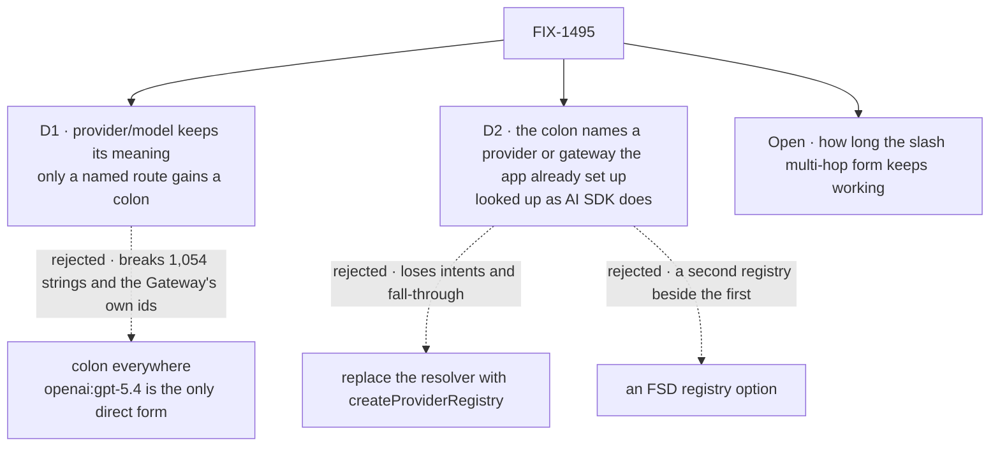

# FIX-1495 · Decisions

[Spec](SPEC.md) · **Decisions**

What was considered, what was chosen, why, and what each choice locks in. Two decisions and one
open fork are the sign-off surface. Everything else here is context for them.

## The tree

Solid edges are what you're signing. Dashed edges lost, and the label says why. The open fork is
asked in full under [Open](#open).

## D1 · `provider/model` keeps its meaning; only a string that names a route gains a colon

| | |
|---|---|
| **Instead of** | Colon everywhere: `openai:gpt-5.4` as the only direct spelling, and `openai/gpt-5.4` a Gateway id only |
| **Because** | `openai/gpt-5.4` is already the Gateway's own id format, so it is AI SDK's grammar, not ours. It is also 1,054 of the 1,502 quoted model strings the census classifies in the repo. The colon is how AI SDK names *which provider serves* an id, so FSD uses it exactly there: `vercel:openai/gpt-5.4`, `openai:gpt-5.4`, `triage:native`. FIX-609's fall-through stays the meaning of the slash form (tenet 2: refine, don't add) |
| **Locks in** | Two public spellings that both mean "run this model": a slash id that FSD routes however it can, and a colon string that names the route and never falls through. Every reader learns the difference once, in the compatibility table |

It comes down to the strings already written: colon everywhere renames 1,054 of them and contradicts the Gateway.

**What would change my mind:** AI SDK deprecating bare slash ids outside the Gateway. Then the
slash form is a Gateway-only id, and a second rename follows.

## D2 · The colon names a provider or gateway the app already set up, looked up the way an AI SDK registry looks up; no new registry

| | |
|---|---|
| **Instead of** | Replacing `createModelResolver` with AI SDK's `createProviderRegistry`, or adding an FSD `registry` option beside `providers` |
| **Because** | A registry is a map from a name to a provider, split at the first `:`. `providers` and `gateways` already are that map, keyed by the same names. A thin adapter over AI SDK's lookup gets its grammar and its `evaluationModel` without losing intents, fall-through or lazy loading, which a full replace drops. The architect's lean names this shape (tenet 4) |
| **Locks in** | The alias names are the keys of `providers` and `gateways`, plus the two built-in gateways (`vercel`, `openrouter`) and the three built-in providers. An app's own `createProviderRegistry` object is not accepted as is; its entries go into `providers` |

It comes down to what the resolver already does: a replace drops intents and fall-through, which AI SDK's registry has no place for.

**What would change my mind:** apps that already build a `createProviderRegistry` and want to
pass that object as is. Then a `registry` option that feeds the same lane is additive.

## Decided, not asked

- **One parser is the convergence point.** A string is in the alias lane when its first `:` comes
  before its first `/`, or it has a `:` and no `/`. Everything after that colon is the model id,
  untouched: `openrouter:openai/gpt-oss-20b:free` is OpenRouter's `openai/gpt-oss-20b:free`, and
  `openai/gpt-oss:free` stays a slash id. Every reader passes through it: the resolver, its
  `resolveId`, intent and `defaultModel` validation, the env-var overrides, the evaluator's intent
  check, the generator's model-array fallback, and `extractProviderName`.
- **The public parse result keeps its shape.** A colon string naming a gateway parses as a gateway
  string; one naming a provider parses as direct. Provider preference and per-provider options read
  the provider inside the id (`anthropic` in `vercel:anthropic/…`), as they read it today.
- **A colon string is a pinned route.** `openai:gpt-5.4` with no OpenAI key fails, naming the
  missing key; it does not fall through to a gateway. That is what naming a route means.
- **Legacy recognition is narrow.** Only three slash segments whose first is a known gateway
  (`vercel`, `openrouter`, or a key in `gateways`) is legacy, rewritten to `<gateway>:<rest>`
  with one development warning per string per process. Anything else keeps today's error.
- **The built-in gateway alias stays `vercel`**, the name FSD already uses, not `gateway`.
- **Kitchen Sink reads a saved slash id in its new spelling** before it checks the catalog, so a
  user's choice survives (BP-030). Its tests pin that.
- **The guard's new rule exempts retained history.** `specs/` and `docs/internal/archive/` are
  dated records (BP-037); rewriting them would falsify them. The guard's header says its exclusion
  is files, never a tree, so the argument is written beside the entry. Its existing rules keep
  their surface. The dotted-Anthropic rule's fix text moves to the colon form.
- **Harness model ids are out of the grammar.** The `model` option on the Claude Code, Codex and
  Cursor blocks ([#3351](https://github.com/fixpoint-labs/flow-state-dev/pull/3351), FIX-1952)
  takes the harness's own ids (`gpt-5.6-sol`, `composer-2.5`) and never reaches this resolver.
  The guard's rule must not fire on them; #3351 adds no slash multi-hop string and touches none
  of this issue's files.

## Considered and dropped

| Alternative | Why not |
|---|---|
| Permanent dual grammar, no deprecation | The issue's own invent-kill: two spellings forever, and the guard can't teach one |
| Silent rewrite of slash ids to colon | Breaks Gateway ids that legitimately carry `/`, the issue's third invent-kill |
| A configurable separator (AI SDK allows one) | A knob nobody asked for. The point is matching AI SDK's default |
| Teach `createAiSdkModelResolver(registry)` as the answer | Already possible today, and it drops intents, fall-through and the evaluator path. A recipe, not alignment |
| Cut the slash multi-hop form at once, pre-1.0 | Stored strings (session state, env vars, Kitchen Sink selections) fail on the first run after an upgrade. Asked under [Open](#open) |

## Open

### How long does the slash multi-hop form keep working: one minor release, or until 1.0?

**Plain terms.** Apps write gateway routes like `vercel/anthropic/claude-sonnet-5` today, in
config, in environment variables, and in saved user choices. After this change those still run,
and each prints a warning with the new spelling. The question is when they stop running.

**The trade-off.** One minor release keeps the promise short and the code small, and the removal
happens while few apps exist. It costs any app that skips a release a startup failure, with the
fix in the message. Until 1.0 costs nothing to upgraders, but the old form lives months longer,
and new code copied from old answers keeps arriving in it.

**My recommendation: one minor release.** We are pre-1.0, the failure is loud and names its fix,
and a short window is the only way the removal issue actually runs.

**What would change my mind:** an outside app that stores model strings in a database we can't
migrate for them. Then until 1.0, with the warning, is the safer promise.

**What being wrong costs:** low. Too short: one startup failure per stale string, fixed by a rename.
Too long: a few more months of a second spelling. Either way it is reversible.

It comes down to the second spelling: one release removes it while small; until 1.0 lets copied code keep it alive.

## Settled

- **AI SDK's registry splits at the first `:` and carries `evaluationModel`** — **CONFIRMED** in
  the published `ai@7.0.133` (the version core pins): `createProviderRegistry(providers,
  { separator = ":" })`, and its `splitId` takes `id.indexOf(separator)`, so `/` and later `:` stay
  in the model id. Its type declares `evaluationModel(id)` on the registry and on `customProvider`.
- **The counts this spec rests on** — re-derived by `poc/model-string-census/census.mjs`, which
  scans the guard's own surface: 1,502 quoted strings whose first segment is a known gateway, provider or `intent`; 1,054 `provider/model`, 307
  `intent/…`, 138 slash multi-hop (131 to sweep, 7 in retained history), 3 bare gateway, none unclassified. Its control plants one
  slash multi-hop string and must count it (138 → 139); it did.

## How it got here

- **Draft** — framed as matching AI SDK's grammar without a second registry; kept the slash form
  that is already the Gateway's id format, gave the colon to strings that name a route, and built
  it on the resolver's existing provider and gateway maps.

**Open: one.**
