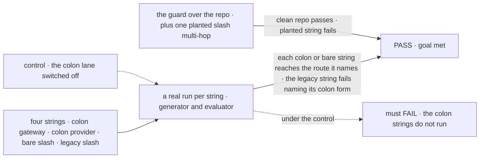
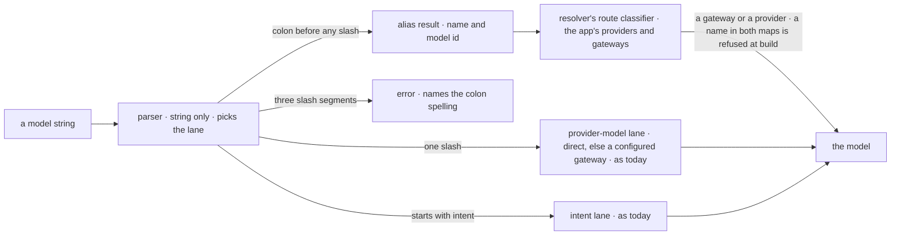

# FIX-1495 · Align model strings + provider registry with AI SDK (`provider:model`, not slash)

**Spec** · [Decisions](DECISIONS.md)

## Six people, before and after

| Someone who… | Today | After |
|---|---|---|
| **copies `openrouter:openai/gpt-5.6-luna` from the AI SDK docs** | Fails: FSD reads `openrouter:openai` as a provider name | Runs through OpenRouter, as AI SDK runs it |
| **writes `openai/gpt-5.4-mini`, the most common string we have** | Runs: direct with a key, else through a configured gateway | The same, with no warning. It is also the Gateway's own id format ([D1](DECISIONS.md#d1)) |
| **has `vercel/anthropic/claude-sonnet-5` in a config, an env var or a stored session** | Runs | Fails with an error naming `vercel:anthropic/claude-sonnet-5`. Config and env vars fail at startup; a string in a block or saved data fails when it is first resolved. No compatibility window ([D3](DECISIONS.md#d3)) |
| **saved a model choice in Kitchen Sink before the change** | n/a | Gets the default model; the app logs the old id once. The old id is not translated ([D3](DECISIONS.md#d3)) |
| **registers a custom provider and names `triage:native` for an evaluator** | Must write `triage/native`, which reads as a Gateway id | Writes `triage:native`, the same string `registry.evaluationModel` takes ([D2](DECISIONS.md#d2)) |
| **copies an example from the docs or Kitchen Sink** | Gets the slash multi-hop form | Gets the colon form. CI refuses a new slash multi-hop string |

Requested by Jake on 2026-09-21: *"normalize to Vercel's separator — e.g.
`openrouter:openai/gpt-5.6-luna` instead of `openrouter/openai/gpt-5.6-luna`. High priority
cleanup."*

## The goal, and how we'll know it's met

**An app author writes a model string the way AI SDK writes it, for a generator or an
evaluator; the repo teaches only that form; and a string in the old slash multi-hop form fails
with an error that names its new spelling.**

| Is it the right goal? | |
|---|---|
| **The real need** | One grammar with AI SDK, so an id copied from its docs or a registry works in FSD unchanged, without a second FSD-only registry ([FIX-1495](https://linear.app/fixpoint-labs/issue/FIX-1495), Jake's words above) |
| **Smaller, and rejected** | "The parser accepts a colon." Passes while the docs, Kitchen Sink and the guard still teach the slash form, so nobody switches, and the dual grammar the issue forbids becomes permanent |
| **Bigger, and not this issue's** | Re-designing intents ([FIX-516](https://linear.app/fixpoint-labs/issue/FIX-516), done) · cutting the model layer down ([FIX-852](https://linear.app/fixpoint-labs/issue/FIX-852)) · new id spelling rules ([FIX-1151](https://linear.app/fixpoint-labs/issue/FIX-1151)) |
| **Not done if** | A colon string resolves in a unit test but never reached a gateway · the evaluator path still needs the slash form · a saved Kitchen Sink choice crashes the chat instead of falling back · the docs still teach `gateway/provider/model` · the guard passes on a planted slash multi-hop string |



The check reads which route the call took and what the model returned, never what the parser
produced; under the control the colon strings must fail.

| How we verify | |
|---|---|
| **Goal check** | `goals/model-strings/registry-grammar/` · real Vercel AI Gateway and a direct OpenAI key, cheapest model · run by the implementer at completion · verdict in the implementation PR |
| **Signal** | For `vercel:openai/gpt-5.4-mini`, `openai:gpt-5.4-mini` and `openai/gpt-5.4-mini`: the generator returns text, and the run's model identity names the expected gateway (or none) and the id `openai/gpt-5.4-mini` or `gpt-5.4-mini`. `vercel/openai/gpt-5.4-mini` fails before any call, with an error containing `vercel:openai/gpt-5.4-mini`. `vercel:typesafe-ai/jev` returns an evaluator decision through the gateway, and `triage:native`, on a provider the check registers under `providers`, returns one through the provider lookup with no gateway in its identity. The guard exits 0 on the repo and non-zero with one planted `"vercel/openai/x"` |
| **Input** | `openai/gpt-5.4-mini` through the gateway. Any other gateway model must pass too, and so must a model id that carries its own `:` (`openrouter:openai/gpt-oss-20b:free`) |
| **Anti-game** | Don't assert on the parser's output or on a stubbed provider. Both pass while the request never reaches the gateway with the right id |
| **Control that must fail** | `GOAL_CONTROL=colon-off`: FAILS on *the colon strings return text*. Today's `main` FAILS the same way |

## What changes


Read down the after column: only the rows that name a route gain a colon. The two strings most
code uses are untouched.

**An app's config, after the change:**

```diff
  createModelResolver({
-   defaultModel: "vercel/anthropic/claude-sonnet-5",
+   defaultModel: "vercel:anthropic/claude-sonnet-5",
    intents: {
-     utility: ["vercel/google/gemini-3.1-flash-lite", "openai/gpt-5.4-nano"],
+     utility: ["vercel:google/gemini-3.1-flash-lite", "openai/gpt-5.4-nano"],
    },
+   providers: { triage: customProvider({ evaluationModels: { native: jev } }) },
  })

- evaluator({ model: "vercel/typesafe-ai/jev", … })
+ evaluator({ model: "vercel:typesafe-ai/jev", … })
+ evaluator({ model: "triage:native", … })
```

**Docs:** update `fundamentals/models.md` (the grammar table becomes the three-lane
lane table, plus a short *Rename your strings* section: the old form is an error, with no
deprecation period),
`getting-started/setting-up-models.md`, `advanced/custom-model-resolver.md`,
`configuration/environment.md`, `api/server.md`, `server/setup.md`, the Next.js guide, and
the core package README. No new page. A breaking `minor` changeset for `@flow-state-dev/core`:
the slash multi-hop form is removed, and the public parse result gains an `alias` kind.

## How a string reaches a model



The parser sees only the string, so it decides the lane and nothing more. The resolver, which
holds the app's maps, decides whether an alias is a gateway or a provider, and passes everything
after the first colon to it untouched, slashes included.

## What stays as it is

- **`provider/model` and `intent/<name>`**, and how each resolves, fall-through included.
- **Intent design**, provider preference, retries, lazy provider loading.
- **The Gateway's own ids**, which keep their slash: `typesafe-ai/jev`, `openai/gpt-5.4`.
- **Harness models** (Claude Code, Codex, Cursor). Those ids never reach this resolver.

## What's already here, and the debt

| Already here | What this does with it |
|---|---|
| **Whatever already parses a model string**: the core parser and its public result; the AI SDK resolver adapter, which takes any id and hands it to a function | **Extends** the closest, the core parser, with an `alias` result kind, a type change for its outside readers ([decided, not asked](DECISIONS.md#decided-not-asked)). Searched `parseModelString`, `split("/")`, `extractProviderName` across `packages/` and `apps/`: the generator, the evaluator check and the resolver read model strings through the parser; only the benchmark splits one itself, for a display name |
| `createModelResolver`'s `providers` and `gateways` maps | **Builds on.** Their keys become the alias lane's names. No new registry option ([D2](DECISIONS.md#d2)) |
| AI SDK's `createProviderRegistry`, which splits at the first `:` | **Builds on** its rule and lookup. Checked in `ai@7.0.133` ([settled](DECISIONS.md#settled)) |
| `scripts/validate-model-strings.mjs` | **Extends** with a rule against the slash multi-hop form |
| Kitchen Sink's model catalog and intent ladder (45 legacy strings) | **Replaces** them with the colon form. A saved slash id falls back to the default model and logs once |
| [FIX-609](https://linear.app/fixpoint-labs/issue/FIX-609): a bare `provider/model` falls through to a configured gateway | **Kept** ([D1](DECISIONS.md#d1)) |
| [FIX-1554 D2](../FIX-1554/DECISIONS.md#d2): `typesafe-ai/jev` always means the gateway | **Kept.** `typesafe-ai:jev-latest` reaches Jev's library only when the app registered it, which D2 calls additive |
| [FIX-1553 → PLAN](../../epics/FIX-1553/PLAN.md), [FIX-1556 → SPEC](../FIX-1556/SPEC.md): examples switch when this lands | **Kept.** Their pages are in the sweep |

| The debt | |
|---|---|
| **Removes** | The slash multi-hop grammar, `gateway/provider/model`, in the same release. The 131 such strings outside retained history, across code, configs, docs, goals and Kitchen Sink defaults, are rewritten to the colon form; the census lists them (`poc/model-string-census/ --sites`; 7 more sit in dated records and stay) |
| **Adds** | The colon lane and its route classifier, permanent by design. An `alias` kind on the public parse result, permanent by design. No compatibility shim, no warning path, no follow-up issue ([D3](DECISIONS.md#d3)) |
| **Leaves** | The model layer's size ([FIX-852](https://linear.app/fixpoint-labs/issue/FIX-852)). A comment in the fallback model that already says `provider:model-id` for a slash string; fixed in the sweep |

**Net: flat.** One lane comes in; one grammar goes out in the same release.

## Sign off

**[The goal](#the-goal-and-how-well-know-its-met), at that size:** AI SDK's grammar for
generators and evaluators, the sweep done, and an old string failing with its fix in the
message. If wrong: we ship a parser change nobody adopts, or a break nobody can diagnose.

**[The debt](#whats-already-here-and-the-debt), net flat:** one lane in, the slash multi-hop
grammar out, no shim. If wrong: an upgrading app with old strings in data finds them on a live
request.

1. **[D1](DECISIONS.md#d1) · `provider/model` keeps its meaning; only a string that names a
   route gains a colon.** If wrong: half the AI SDK grammar, and a second rename later.
   **The one to weigh.**
2. **[D2](DECISIONS.md#d2) · The colon names a provider or gateway the app already set up; the
   parser only splits, the resolver decides which; a name in both maps is refused; no new
   registry.** If wrong: an app with its own AI SDK registry object must copy its entries into
   the resolver, and code reading the public parse result meets a new kind.

3. **[D3](DECISIONS.md#d3) · A clean break: the slash multi-hop form is an error in the same
   release, by Jake's [call](https://github.com/fixpoint-labs/flow-state-dev/pull/3429#issuecomment-6180523745).** If wrong: an app with old strings in stored data fails on a
   live request until it renames them.

**Open: none.** Reasoning and what lost: [DECISIONS.md](DECISIONS.md).

Feature · `core` + `apps/kitchen-sink` + `apps/docs` + `scripts` · medium · no epic · project *Framework simplification & cleanup*
