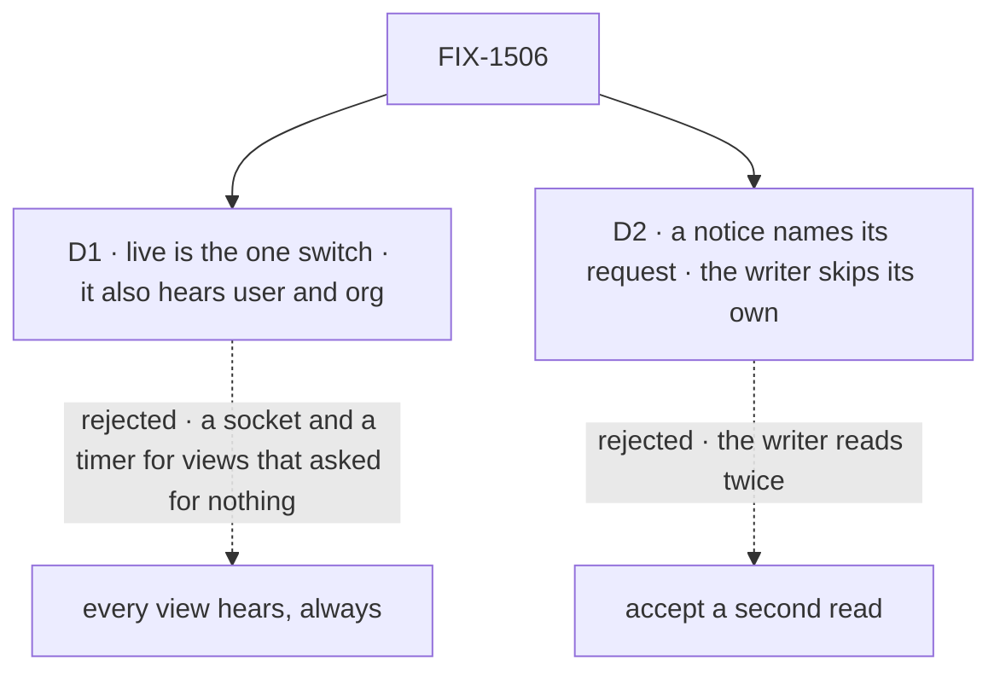

# FIX-1506 · Decisions

[Spec](SPEC.md) · **Decisions**

Two calls shape this issue; D1 is the one to weigh. The epic decided the channel (D1 to D6,
ER-1 to ER-7), FIX-2426 the bus and its topic shape, FIX-2428 the socket, the mint and
`client.subscribe`. The seams this issue raised with the bus are decided in FIX-2426 on `main`
(#4477): `origin` on the notice, a scope subscriber hearing its narrowed notices, the session
stream filtering by kind, and lineage-shared resources as a stated limit. Nothing here reopens
them.

## The tree

Solid edges are what you're signing. Dashed edges lost, and the label says why.

## D1 · `live` is the one switch: a live view also hears its user and org scopes, and a live roster or board hears its collection

| | |
|---|---|
| **Instead of** | Every session view always hearing its scopes, with no flag |
| **Because** | `live` already means "hear writers other than me" for one session. Widening it to the user and org scopes the same view reads keeps one promise behind one switch, and ER-5 asks for one obvious way per scope. Always on, every `useSession` would open a socket and mint a ticket on each connect, and on a host with no push read on a timer, whether or not anyone else writes. Most views have one writer, the person in front of them |
| **Locks in** | `live`'s meaning widens, in its docs. `Roster` and `BoardColumns` take `live` as `BoardList` does. A live view on a serverless host reads its state, and its resource hooks read, on `client.subscribe`'s timer (ER-5) |

It comes down to the view that asked for nothing: always on, it pays a socket, and a timer on serverless.

**What would change my mind:** most views we and app teams ship turn out to want other sessions'
changes. Then it is on by default, with `live: false` to opt out.

## D2 · A notice names the request that made it, and the view that sent that request skips it

| | |
|---|---|
| **Instead of** | Accepting a second read on the writer's view |
| **Because** | The epic's seam says the writer's tab reads once, not twice. That view already has the change from its own stream: a `state_change` it merges with no read, a `resource_change` that makes its hooks read once. The notice for the same write lands just after, and the coalesced read queues a second. A request id says who wrote, never what, so ER-1 holds. Skipping every notice while the writer streams would miss a second writer in that window. A notice with no origin (a resource route, a run no view sent) reaches every view |
| **Locks in** | `origin?: { requestId }` on `ChangeNotice`, decided in FIX-2426's one definition (#4477; epic ER-1 now says a notice *may* name its request). Any view that may read the scope learns which request changed it; a read by that id is checked as always. The safe failure is a duplicate read, never a missed one: a view that hasn't yet learned its own request id reads once more |

It comes down to the writer's reads: without the origin, every change costs its writer one more.

**What would change my mind:** a request id turning out to be sensitive to people who may see the
scope. Then the writer reads twice.

## Decided, not asked

- **The convergence points (tenet 5).** For runs, the two seams in the run's context:
  `makeResourceChangeHandler`, which every resource write, delete, content write and collection
  create passes after its commit, and `emitWrap`, which every session, user and org state write
  passes after its persist. For browsers, the resource routes, which publish the session topic
  through the same publish helper as the resource seam, not a parallel one. Request and block-instance state publish nothing: no screen watches them. Writers that publish
  nothing, documented: the first-access seeds of a user and org record, harness-manager's
  kept-turn upgrade, and test fixtures.
- **Not FIX-2426's `resolveStores` wrap.** The user, org and resource stores are keyed by a
  storage cell that mixes user, org and flow, and the delta verbs pass only the cell, so a store
  wrap would decode keys to learn whose scope changed. The run's context holds the user id, the
  org id and the resource path.
- **A publish never depends on a stream.** The resource handler exists whenever a bus does, and
  the state wrapper publishes when the response can't emit. Workers, schedules and BullMQ runs
  have no stream, and they are the writers another process most needs to hear.
- **Topics (ER-2).** The scope's topic with its tenant: the session id, or for user and org no id
  on the wire (FIX-2428 fills them). A resource change narrows it with `resource`, the same
  `resourcePath` the `resource_change` item carries, so one matcher (`pathAffectsCollection`)
  serves both sources. FIX-2426 decides who hears it: a subscriber to the scope's un-narrowed
  topic hears every notice narrowed under it, with the narrowed topic; a narrowed subscriber
  hears only its resource.
- **Kinds** `state` and `resource`, added at FIX-2426's one definition. The session stream
  filters by kind (FIX-2426), so these never wake it.
- **Which resources publish:** every resource with a `client` config, collection or single, live
  or not, and every resource of a scope that declares `client.derived`. A derived value is a
  function over the scope's resources, and the engine can't see which it reads, so a change to
  any of them may change it (an org count over a collection is the shipped case). A resource no
  client can read, directly or through a derived value, publishes nothing.
- **Only after a commit.** Both seams run after the write lands; a verified no-op publishes
  nothing (FIX-2426's rule: a notice only once its write can be read).
- **Over-notifying is allowed; missing is not.** A flow-isolated user or org bucket publishes the
  scope's topic, and a user's state is kept per organization, so a view of another flow, or of the
  same user in another org, may read once and find nothing new. Publishes are not coalesced per
  write beyond FIX-2426's fold within a tick: a bulk writer sends a frame per write to each view
  subscribed to the scope. Accepted at today's scale; each view still folds to one read in flight
  and one waiting.
- **Lineage-shared session resources** publish the writing session's topic only, a stated limit
  in FIX-2426. ER-2 has no lineage topic; other sessions in the lineage hear it at their next
  read. A task board's ledger also publishes the conversation's topic, through FIX-2429.
- **The live view.** After its first snapshot, `useSession({ live })` subscribes its session,
  user and org topics through `client.subscribe`, and acts on `state` and `resource` only (items,
  requests and runs stay the session stream's). A state notice reads state without items; a
  resource notice joins `resourceChanges`, and also reads state without items when the scope's
  client data carries the resource or a derived value. One read in flight, one waiting. Each connect and reconnect reads state once (ER-6).
  The timer's pace is `client.subscribe`'s; `useSession` adds no option.
- **The panels.** `Roster` and `BoardColumns` take `live`; their driver subscribes the same three
  topics and reads again on a resource notice whose path matches their collection. `BoardList`
  keeps its session-stream driver. Acting on a notice's kind and path reads the notice passed
  to `client.subscribe`'s `onChange`, which FIX-2428 owns; this issue doesn't change that signature.
- **Access is unchanged.** The mint checks each topic (ER-4); every read a notice triggers is
  checked by its route as today.
- **A failed publish never fails the write** (ER-6).
- **With FIX-2429:** a board written in a run publishes its scope's topic here; FIX-2429 adds the
  conversation's session topic, from wherever the task settles. Two notices fold into one read.
- **Changesets:** `@flow-state-dev/engine` and `@flow-state-dev/react`, `minor` (new behaviour
  under `live`).

## Considered and dropped

| Alternative | Why not |
|---|---|
| A wrap of the user, org and resource stores in `resolveStores` | Keyed by cell; see above |
| A hook per scope (`useOrgChanges`) beside `useSession` | Two ways to watch one scope (ER-5) |
| Each hook subscribing its own narrowed topic | A hook doesn't know its collection's scope without the manifest, and each would mint again. Three topics per view cost frames, not reads |
| On a state notice, the full snapshot read | It pages the session's whole item history for a few keys |
| For D2, the writer skips a state notice at or below the `version` its own stream holds, with no request id | Resource notices have no version, so the request id is needed for them anyway; one rule for both kinds beats two |
| Rows on the notice | Epic [D2](../../epics/FIX-2367/DECISIONS.md#d2) |
| Reviving Watch (FIX-1235) | The epic: Watch told a session; this tells a screen |

## Settled

No POC was built. The premises are read from the code: a scope-state write is persisted before
the wrapper emits (`committed` comes back from the persist); the registry calls
`onResourceChanged` after the store commit; the handler is `undefined` when a run has neither an
emitter nor a `reactTo` binding; the state route takes `include_items`. The spec rests on no
counted facts, so it ships no checker.

## Analysis

2026-11-01 · watermark 2026-10-31 (epic approved) · **Right approach.** Run by the author in this
dispatch, with no fresh sub-agent: this worker cannot dispatch one. The coordinator may run a
fresh `analysis` before the gate.

1. **Reuse** — every Adds row extends a seam or composes a driver; the read is FIX-2410's.
2. **Prior art** — the usual `LISTEN`/`NOTIFY` shape: the notice says a scope changed, the client
   reads. Firebase and Supabase realtime push rows instead; epic D2 rejected that.
3. **Other shapes** — a store wrap, a hook per scope, narrowed topics per hook; all dropped above.
4. **New factors** — FIX-2410's state-only read: the epic says it owns it, and this reuses it.
5. **Necessity** — the epic's goal names user and org state; nothing else publishes them.
6. **Ergonomics** — one flag an app already knows.
7. **Concerns** — D2 adds a field to an epic-owned shape; accepted in FIX-2426 (#4477).

## How it got here

- **Draft** — framed as the epic's resource and scope-state publisher: a publish beside the two
  emits in a run's context and in the resource routes, heard by `useSession({ live })` and the
  panels through `client.subscribe`, with the writer skipping its own notice.
- **Review** — resources read through a scope's `client.derived` now publish, and a resource
  notice reads state for them, because a derived org count over a collection would stay stale.
  The bus seams are cited as decided in FIX-2426 (#4477).
- **Amended (Nov 2)** — the goal check runs on a bus that says it crosses: on the in-memory bus
  the hooks now keep their fallback timer (FIX-2428 D3), which leg b's and d's read counts forbid.

## Notes from review

- "Say in the spec that publish and emit share one "client-visible resource" predicate. Derive the existing `nonStreamingSingleKeys` from it, so the two cannot drift. This is the refactor-while-here the PR earns. Don't add a second precompute beside it." — jhoffner ([comment](https://github.com/fixpoint-labs/flow-state-dev/pull/4478#issuecomment-6563713712))
- "Give the wrapper one optional `onCommitted(scope)` that `emitWrap` supplies only for session, user and org. That is one convergence point, with request and block-instance silent by omission. It also keeps the "state write that emits nothing" and "state write that publishes" paths on one `committed` check, instead of two." — jhoffner ([comment](https://github.com/fixpoint-labs/flow-state-dev/pull/4478#issuecomment-6563713712))

These are inputs, not instructions. Adopt, adapt, or discard.

**Open: none.**
