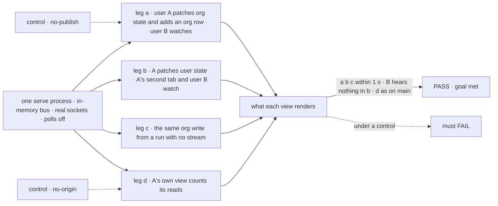
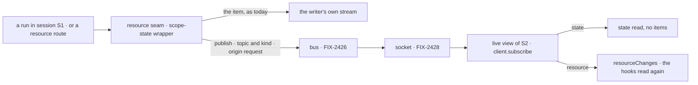

# FIX-1506 · A resource or scope-state change can't reach a session other than the one that wrote it

**Spec** · [Decisions](DECISIONS.md)

## Six people, before and after

| Someone who… | Today | After |
|---|---|---|
| **watches a roster or a board from another session** | Never sees a seat hired or a row added by someone else, until a remount or Retry | With `live`, sees it within a second on a long-lived host, through the panel or hook already on the page |
| **shows user or org state another session changes** (an org setting, a plan, a preference saved in another tab) | Stale until the view reads again for some other reason | With `live`, the view reads its state again, without its item history, within a second |
| **made the change, in their own tab** | Sees it at once on their own stream | The same, with no extra read ([D2](DECISIONS.md#d2)) |
| **changes org state from a run no browser follows** (a worker, a schedule) | Nobody hears it, not even a view of that session | Every live view that may read the scope hears it |
| **deploys to Vercel or Next with `live`** | User and org changes never arrive | They arrive within one poll: the host has no push, so the view reads on a timer ([epic ER-5](../../epics/FIX-2367/DECISIONS.md#who-owns-what)) |
| **leaves `live` off** | Today's behaviour | Today's behaviour: no socket, no timer ([D1](DECISIONS.md#d1)) |

The epic ([FIX-2367](../../epics/FIX-2367/SPEC.md)) gives this issue the publishers for resource
and scope-state changes, and the hooks that read again on them. The bus
([FIX-2426](../FIX-2426/SPEC.md)) carries a notice; the socket
([FIX-2428](../FIX-2428/SPEC.md)) brings it to the browser; the read the view already makes
says what changed (epic [D2](../../epics/FIX-2367/DECISIONS.md#d2)).

## The goal, and how we'll know it's met

**When one session changes user or org state, or a resource a client can read, every other
live view that may read it shows the change within a second on a long-lived host, with no
poll and no remount, and the view that made the change reads it no more often than today.**

| Is it the right goal? | |
|---|---|
| **The real need** | The issue: *"Two sessions rendering the same org-scoped collection converge on the same rows without either one forcing a remount."* The epic widens it to plain state: *"a change to user or org state … reaches every client that is watching it and may see it"*, closure leg a patching both ([FIX-2367](../../epics/FIX-2367/SPEC.md#the-goal-and-how-well-know-its-met)) |
| **Smaller, and rejected** | Org collections only, the issue's literal case. A plain `ctx.org` patch writes no resource, so the epic's leg a would fail. Or the publish alone: a notice no hook reads |
| **Bigger, and not this issue's** | Across processes (FIX-2427), the wire and its access check (FIX-2428), board writes made outside a run (FIX-2429), push on serverless (FIX-380), a block in another session reacting (`reactTo` stays in-session) |
| **Not done if** | A write from a run with no stream reaches no one · a `ctx.org` patch with no resource write never arrives · a state notice makes the view re-read its item history · the writer's own view reads twice · a view without `live` opens a socket or a timer · a hook re-reads for a change to a different collection · a user's change reaches another user · an org `client.derived` value over a collection stays stale |



The check reads what each view renders and how many reads it makes, not whether `publish` ran.

| How we verify | |
|---|---|
| **Goal check** | `goals/realtime/scope-changes-reach-other-sessions/` · model `n/a` (handler actions write) · run by the implementer at completion · verdict in the implementation PR. Needs FIX-2426 and FIX-2428 merged |
| **Signal** | (a) B's `useClientData` org value, an org `client.derived` count over the collection, and B's `useResourceCollectionList` rows show both of A's changes within 1 s. (b) A's second tab shows the user change within 1 s; B's view makes no read. (c) As (a), from a run started with no stream. (d) A's own view makes the same number of reads per change as on `main` |
| **Input** | A two-scope handler flow on `serve()`, two users in one org, three sessions. A different valid input: a change to a second collection must not re-read B's first |
| **Anti-game** | Assert on rendered hook results and counted reads, not on `publish` calls or frames sent. Real WebSocket clients on a bound port |
| **Control that must fail** | `GOAL_CONTROL=no-publish` (the publish beside each emit cut out): legs a, b and c FAIL. `GOAL_CONTROL=no-origin` (the writer's skip off): leg d FAILS. Today's `main`: legs a, b and c FAIL |

## What changes

![What changes. Engine: the resource change seam and the scope-state wrapper each publish a notice for their scope beside the item they already emit, with or without a stream, and the client's resource routes publish the session's topic. React: a live session view subscribes to its session, user and org topics, reads state without items on a state notice and passes a resource notice to the resource hooks; Roster and BoardColumns gain live. The bus, the socket and client.subscribe come from other issues; the notice gains the request that made it](figures/what-changes.svg)

Two engine seams publish; one React view listens. Nothing new for an app to call.

```diff
 // a screen two people watch: the same hooks, one flag
-const session = useSession({ flowKind, sessionId });
+const session = useSession({ flowKind, sessionId, live: true });
 const { org } = useClientData(session, { org: ["plan"] });   // reads again on a notice
 const seats = useResourceCollectionList(session, "seats");  // reads again on a notice

 // the workforce panels, as BoardList already does
-<Roster client={fsd} sessionId={sessionId} />
+<Roster client={fsd} sessionId={sessionId} live />
```

**Docs:** update `resources/client-access.md` (*Live updates*: other sessions, with `live` on
the view), `fundamentals/state-and-scopes.md` (the `state_change` paragraph: user and org state
reach other live views), `client/react.md` and `api/react.md` (`useSession`'s `live`; `live` on
`Roster` and `BoardColumns`), `workforce/ui.md` (the panels' `live`), and a section in the
realtime guide FIX-2428 creates (`guides/realtime.md`). Update the react README. No new page.



## What stays as it is

- **Same-session `resource_change` and `state_change` items**, and how the writer's view merges them.
- **Every read route.** A notice triggers one; it never replaces one, and never carries rows.
- **`reactTo`**, bound in-session at the moment of the write.
- **`BoardList`'s live mode** on the session stream, and task-board notices, FIX-2429's.
- **Views without `live`**, on every host.

## What's already here, and the debt

| Already here | What this does with it |
|---|---|
| **The job, "tell a screen a scope changed".** Searched `mechanisms.yaml` (no row; FIX-2426 adds the bus, FIX-2428 `push-delivery`), and `onResourceChanged`, `state_change`, `resourceChanges`, `subscribe`, `live` in `packages/`. Closest: the bus and `client.subscribe` | **Builds on.** This is a publisher and a listener on the epic's one channel, not a sixth way |
| `makeResourceChangeHandler` (`createExecutionContext.ts`): every resource change in a run, after commit; absent when the run has no emitter and no `reactTo` | **Extends.** Publishes beside the emit, and exists whenever a bus does |
| `wrapStateOpsWithEmit` via `emitWrap`: session, user and org state writes, after the persist; silent when the response can't emit | **Extends.** Publishes beside the `state_change`, emitter or not |
| The client's resource routes (`resource-routes.ts`), session-scope writes from a browser, outside any run | **Extends.** Publishes the session topic |
| `useSession({ live })`, `session.resourceChanges`, the resource hooks' invalidation | **Extends.** One invalidation path, a second source ([epic seam](../../epics/FIX-2367/DECISIONS.md#coordination-seams)) |
| `usePanelRows` and `BoardList`'s `live` (`components/panels/reads.ts`) | **Extends** with a notice driver for `Roster` and `BoardColumns` |
| The state read without items (`GET …/state`, `include_items` off), which [FIX-2410](https://linear.app/fixpoint-labs/issue/FIX-2410) exposes as `refresh({ items: false })` | **Builds on.** FIX-2410 owns it (epic); this reuses it |
| FIX-1235 Watch (canceled with Relay) | **Not revived** (epic): Watch told a session; this tells a screen |
| Epic [D2](../../epics/FIX-2367/DECISIONS.md#d2), [ER-1, ER-2, ER-3, ER-5](../../epics/FIX-2367/DECISIONS.md#who-owns-what); FIX-2426's topic shape | **Kept.** FIX-2426 now carries this issue's seams (#4477): `origin`, a request id, never rows ([D2](DECISIONS.md#d2)); narrowed notices reach the scope's subscriber; the session stream filters by kind |

| Adds | Existing piece considered | Why it doesn't fit / how composed |
|---|---|---|
| A publish at the two run seams | FIX-2426's wrap in `resolveStores` | Those stores are keyed by a cell that mixes user, org and flow; the run seams know whose scope changed ([why](DECISIONS.md#decided-not-asked)) |
| The live view's subscription | A new hook per scope; `useSubscription` | Composed: `live` already means "hear writers other than me" (ER-5, one way per scope) |
| The panels' notice driver | `liveBoardDriver` over the session stream | Another driver over the same `coalescedReads` |
| `origin` on the notice | Skipping notices while the writer streams | That window would miss a second writer ([D2](DECISIONS.md#d2)) |

| The debt | |
|---|---|
| **Removes** | The need for the remount workaround the issue names; no host in this repository uses it, so no code goes |
| **Adds** | Two publish points beside two emits, by design: each writer emits for itself and publishes for others. A timed state read on serverless live views (ER-5) |
| **Leaves** | First-access record seeds, harness-manager's kept-turn upgrade and test fixtures publish nothing, documented. Lineage-shared session resources reach only the writing session's topic ([recorded](DECISIONS.md#decided-not-asked)) |

**Net: up**, by two publishers and a listener inside the epic's channel; nothing in our code goes.

## Sign off

**[The goal](#the-goal-and-how-well-know-its-met):** user and org state as well as resources,
from any run, with the writer reading no more. If wrong: org collections live, org settings stale.

**[The debt](#whats-already-here-and-the-debt): up**, two publishers and a listener; ends the
need for a remount. If wrong: a second publish point a later writer forgets.

1. **[D1](DECISIONS.md#d1) · `live` is the one switch: a live view also hears its user and org
   scopes.** If wrong: serverless live views pay a timed state read they never asked for.
   **The one to weigh.**
2. **[D2](DECISIONS.md#d2) · A notice names the request that made it, and the writer's view
   skips its own.** If wrong: one field on the epic's shared notice, for a read per write.

**Open: none.**

Feature · engine, react · medium: two publish points, one view's subscription, a panel driver · epic FIX-2367
