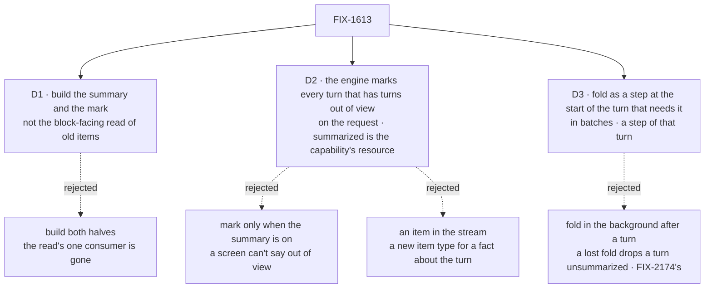

# FIX-1613 · Decisions

[Spec](SPEC.md) · **Decisions**

What was considered, what was chosen, why, and what each choice locks in. Three decisions are the
sign-off surface. The shape (a capability and a fold step) is Jake's, made in the thread.
Everything else here is context for them.

## The tree

Solid edges are what you're signing. Dashed edges lost, and the label says why.

## Decided by Jake · a capability and a fold step, not an engine option

Jake, in the thread on 2026-10-28, on the first draft's `historyWindow.summarize`: *"Why
wouldn't we use a capability to install what we need, and install summary as context and choose
the history as part of the capability install?"*

| | |
|---|---|
| **Instead of** | An option on `session.historyWindow` that the engine runs at the start of each turn, with the summary on the session record and spliced into `history()` as a message |
| **Because** | Summary policy stays out of the engine (his FIX-2268 rule: opinions are blocks a flow composes, not built-in behaviour). A capability's session resource is one per conversation however many generators install it, which was the first draft's reason against a capability, and it doesn't hold |
| **Locks in** | Core's `historySummary` returns `{ capability, fold }`. The capability carries the resource, the context and the history narrowing; the fold is a step the flow adds before the generator. Core and engine open five generic surfaces for it ([SPEC](SPEC.md#the-blocks-and-how-a-turn-runs-them)) |

**The price:** a flow that installs the capability and forgets the step gets no summary. The
capability's context throws a configuration error on the first turn a turn has left the window
with no fold ever run, so it can't fail quietly.

## D1 · Build the summary and the divider's mark; the block-facing read of a session's old items is not built

| | |
|---|---|
| **Instead of** | Both halves: the original ask (a bounded, newest-first read of a session's items of one component, past the window, for any block) beside the summary Jake's comment added |
| **Because** | The read had one consumer, FIX-1610's channel route record, and channels went with FIX-1786; Workforce's coordinator lines read their last 10 inside the window. The summary doesn't need it either: it folds turns while they are still in the turn's load. The one exception, a parked turn that left the window, is read by id from the fold's pending list, not by searching back. Tenet 2: no surface without a caller |
| **Locks in** | The issue's title and Linear text move to the summary and the mark. A block that later needs old items files a new issue against a real caller; nothing here blocks it |

It comes down to a caller: the read's only one was removed, so it would ship unused.

**What would change my mind:** a caller today that needs a session's items past the window.
FIX-2173 (fork, Backlog) comes closest: its direction lets a `history` function bring in a
*parent* session's items up to the fork point. That is another session's items, cut at a point,
not this issue's newest-first read by component, so its spec designs that read against its own
caller. FIX-2174's manual compact reads through the engine.

## D2 · The engine records the mark on every turn that has turns out of view, as `historyStart` on the turn's request; whether they are summarized is the capability's resource

| | |
|---|---|
| **Instead of** | (a) A mark only when the summary is on. (b) An item emitted into the turn's stream |
| **Because** | A screen has to say *out of view* honestly on any flow, and FIX-2154's probe may run with the summary off. The engine is the only place that knows the window: interrupted and parked turns take slots, so a screen's count would be wrong. A field on the request needs no new item type and is written once, with the turn |
| **Locks in** | `historyStart: { requestId }` on request records and on `SessionRequestSummary`, public from the first release. Absent means every earlier turn is in the window. *Summarized* comes from the public `historySummary` resource (`throughRequestId`, `complete`), because the engine no longer knows about the summary. A screen reads the latest request and, when the flow has one, the resource |

It comes down to honesty off the summary: without the mark, a screen can't say a turn was dropped.

## D3 · The fold runs as a step at the start of the turn that needs it, in batches

| | |
|---|---|
| **Instead of** | Folding after a turn finishes, in the background |
| **Because** | A fold that runs before the turn's generator never lets a turn leave unsummarized while the summarizer works. As a step of the turn, its trace and its tokens are that turn's, where a person looking at cost finds them (BP-035). Batching (the oldest quarter of the window at once) makes it one turn in roughly every dozen |
| **Locks in** | On a flow that opts in, the turn that folds waits for one summary call. FIX-2174 moves the fold to the background through the same capability; until then the pause is the price |

It comes down to a lost fold: in the background, a killed fold drops a turn with no summary.

## Decided, not asked

- **`summarize` takes a block**, the author's `summarizer(...)`, so the model, the granularity and
  the objectives are the author's. The fold calls it with the summary so far and the turns to fold,
  and reads `summary` from its output. No default model.
- **It lives in core,** next to `summarizer`, which it is built on, as core already ships a
  capability (`createToolCacheCapability`). Not the memory package: its tiers keep facts across
  sessions, and the goal's flow runs with no memory.
- **One writer of the summary.** The fold's write step is the only writer of the
  `historySummary` resource; it writes through the resource's version check, and the high-water
  mark only moves forward. Two turns of one conversation at once: the loser keeps the view it loaded and
  does not fold again. That is the convergence point for "a turn is folded once".
  To avoid two summary calls for one fold, a turn re-reads the high-water mark from the session
  record just before it calls the summarizer, and skips the fold if another turn already moved it.
- **When to fold, early.** The fold fires when the oldest unfolded turn reaches the oldest
  quarter of the window, and takes up to a quarter of the window. The turns read word for word
  float between three quarters of the window and all of it. A failed fold has about a quarter of
  the window in turns to succeed before anything leaves; it reads only turns already loaded.
- **The fold takes settled turns in order and stops at the first unsettled one** (running, or
  parked on a gate). The high-water mark never passes a turn that hasn't settled, so a turn that
  settles late is never behind it. If an unsettled turn is about to leave the window, the fold
  moves past it and keeps its id in a pending list on `historySummary`. Each later turn reads
  those ids directly (a get by id, bounded by the list, not a deep read) and folds any that has
  settled, in its own place in the summary. While one is pending the resource reads
  `complete: false`. A pending turn that retention deletes unsettled is dropped from the list.
- **A session switched on late** starts its summary with what the window holds. What fell out
  before stays out of view, and the mark says so.
- **A failed summary call** is logged, the turn goes on with the summary it had and every turn
  past it, and the next turn tries again. Only a run of failures as long as a quarter of the
  window drops a turn, and then the resource reads `complete: false`.
- **Order in the turn.** The fold is the flow's own step, so it runs after `request.onStarted`
  and before the generator that installs the capability. Workforce's `resolveTurnWorker` hook sees
  the history it always did.
- **Where the summary goes.** A context section of the generator that installs the capability,
  not a message in the history: any provider takes it, and it never sits among the turns. The
  history read starts after the mark (`afterRequestId`), so a turn is never there twice;
  `capability.presets({ history: false })` keeps the whole window for a block that wants it.
- **The summarizer's items** are not shown in the conversation and are not history: the
  `summarizer` default (no `itemVisibility`) already does this.
- **Retention** can delete turns the summary covers. The summary lives in the session resource and
  outlives them, which is the point.
- **Token budgets.** The summary is context, so it sits outside `history({ limit: { tokens } })`;
  it stays under its own cap (the goal holds it under 4,000 characters).
- **Workforce adds `beforeAnswer`**, the mirror of `afterAnswer`, and installs nothing itself:
  the lab passes the capability in `uses` and the fold as `beforeAnswer`. Layer rule: nothing
  about workers in core or engine, nothing about summaries in workforce.

## Considered and dropped

| Alternative | Why not |
|---|---|
| Raise `historyWindow` | Every turn pays for the whole conversation, and it still ends. An invent-kill on this issue since 2026-09-27 |
| Memory alone (the lab's probe) | Keeps facts, not the thread (FIX-1612); a pass on memory is not evidence it replaces the summary (FIX-2154) |
| Fold one settled turn at the boundary, the turn before it would leave | Simpler rules, but a failed call loses that turn on the next one (the flaw the analysis caught), and it is a summary call on every turn once the window fills |
| Summarize every dropped turn on every turn, no batches | One summary call per turn after the window fills; batches cost the same tokens and a twelfth of the pauses |
| An option on `session.historyWindow` the engine runs (the first draft) | Summary policy in the engine; Jake chose a capability and a step ([Decided by Jake](#decided-by-jake)) |
| The fold inside the capability, with no step | A capability installs resources, context and tools; it has no place to run a block before the generator, and adding one is a second way to run a step |
| A `historySummary` option on the workforce agent flow | One option for one feature; `beforeAnswer` takes any pre-answer step |
| Store the summary in session state | State is the app's schema and is projected to the client by the app's rules |
| A per-worker setting in `WORKER.md` | Session config is per flow. A worker that needs it runs on a flow that turns it on; per-worker can come with FIX-2174 |

## Analysis

2026-10-28 · watermark 2026-10-23 (Jake's extension) · **Right approach; two mechanism flaws folded.**

1. **Reuse** — `reuse-review`, rechecked by hand for the capability shape: the capability builds on
   `summarizer`, resources, context and presets, and follows memory's digest split; `historyStart`
   is new, argued by D2; `beforeAnswer` mirrors `afterAnswer`.
   Named orchestration's `flowPolicy.compact` stub. See [Builds on / Adds](SPEC.md#whats-already-here-and-the-debt).
2. **Prior art** — a running summary plus a recent buffer, folded before loss (LangChain's
   summary buffer, Letta's recursive summary, harness compaction near the limit). Supports folding early.
3. **Other shapes** — a capability or a user-space tap; dropped, recorded in *Considered and dropped*.
4. **New factors** — FIX-2174's high-water-mark comment supports the record field; FIX-2173's
   direction touches D1's *what would change my mind*, now answered there.
5. **Necessity** — right-sized; memory doesn't stand in for the thread (FIX-1612).
6. **Ergonomics** — a narrow history gets no summary, named in the docs line;
   `defineAgentWorkerFlow({ historyWindow })` is a second spelling of a pass-through, accepted.
7. **Concerns** — a failed fold lost turns for good (**folded**: fold a quarter early); a turn
   settling after the mark moved was skipped (**folded**: the mark never passes an unsettled turn).
   Token budgets and the summary's tokens (**recorded** for the implementer, *Decided, not asked*).
   The +1 row is new, not kept (**folded** into the spec's wording). The debt's Adds row was short
   by three items (**folded**).

## How it got here

- **Draft** — framed as FIX-2154 G1 on FIX-1613's issue: an opt-in summary on core's
  `historyWindow` built on `summarizer`, a mark on every turn's request, and the original
  block-facing read dropped for want of a caller.
- **Analysis** — the fold now starts a quarter of the window early and never passes an unsettled
  turn, because a failed or late fold lost turns for good.
- **Review round 1, Codex** — a parked turn the fold moves past is kept by id and folded when
  it settles, because moving the mark past it lost it for good.

- **Review round 1, Cursor** — concurrent turns re-read the high-water mark before the summary
  call; folding one turn at the boundary added to *Considered and dropped*.
- **Jake, examples, then the shape** — asked for the blocks and how the session and the agent
  flow install them; on the examples, chose a capability (resource, context, history narrowing)
  and a fold step over the engine option. The engine keeps only `historyStart`; workforce gets
  `beforeAnswer`.

## Notes from review

- "Avoid hydrating full items on the +1 probe when only `historyStart` is needed (split query / `withItems: false` tail row). Big perf win on long sessions with summary off." — cursor ([thread](https://github.com/fixpoint-labs/flow-state-dev/pull/4063#discussion_r4403725867))
- "Both snippets use `granularity: \"detailed\"`. For lab latency and the 4k summary signal, `brief` (or documenting workforce defaults) may be a simpler default unless step 4 truly needs detailed." — cursor ([thread](https://github.com/fixpoint-labs/flow-state-dev/pull/4063#discussion_r4403725859))

These are inputs, not instructions. Adopt, adapt, or discard.

**Open: none.**
