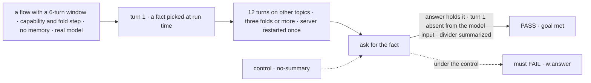
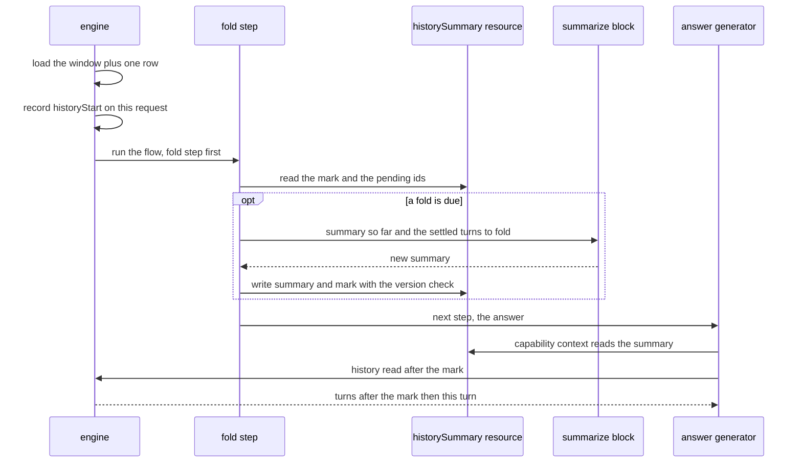

# FIX-1613 · A long conversation keeps what it said before its history window

**Spec** · [Decisions](DECISIONS.md)

## Five people, before and after

| Someone who… | Today | After |
|---|---|---|
| **talks to one worker for weeks in the Grok Bot-style lab** | Turn 51 drops turn 1 from what the model reads, with no trace. Ask about turn 1 and the worker has no idea, unless memory happened to keep that fact | The lab's flow installs the history-summary capability and its fold step. Turns about to leave the window are folded into one running summary the model reads in its context, so turn 1 is still there in short form |
| **looks at that conversation on a screen** | Sees one unbroken list. Nothing says the model stopped reading the top of it | Sees a divider where the turns read word for word begin, labelled *earlier turns summarized* when the summary reaches it, *earlier turns out of view* otherwise |
| **runs a flow that never opts in** (the stock agent flow, every app today) | 50 turns, older ones dropped | The same model input, byte for byte. Once a session passes its window, each turn reads one more row and records the divider's mark, so any screen can say *out of view* honestly |
| **hits a summary call that fails** | n/a | The turn runs anyway, on the summary it had and every turn past it, all still in the window. The fold starts a quarter of the window early, so it is tried again on the next turns before anything leaves |
| **leaves a turn waiting on an approval while the conversation goes on** | The parked turn shows once it settles, if it is still inside the window | The same: the fold waits for a turn that hasn't settled, and one still parked when it leaves the window is kept by id and folded once it settles. Never skipped |

A session that lives for weeks is now normal (workstreams, coordinators, the lab's workers), and
Jake set the direction in [FIX-1775](https://linear.app/fixpoint-labs/issue/FIX-1775): how a
session keeps its history is configurable per flow, and a summary step is on the table for
long-lived sessions, never as a default. Memory keeps facts, not the thread, and neither
stands in for the other ([FIX-1612](https://linear.app/fixpoint-labs/issue/FIX-1612)).

## The goal, and how we'll know it's met

**On a flow that opts in, a conversation that runs past its history window still answers from
what was said before the window, and a screen shows where the turns the model reads word for
word begin.**

| Is it the right goal? | |
|---|---|
| **The real need** | FIX-2154 step 4: "the script sends 60 more turns (past the 50-turn window), then asks lead for a fact you gave on turn 1 … both answers are right, and the divider marks where the turns lead reads word for word begin, labelled *summarized* only when G1's summary is on" ([FIX-2154 G1](../FIX-2154/SPEC.md#package-gaps), Jake's [comment](https://linear.app/fixpoint-labs/issue/FIX-1613) extending this issue) |
| **Smaller, and rejected** | "Record the divider's mark": it draws the line and leaves the model blind past it. "Let a block fetch old items when it needs them, plus memory" (this issue's first ask): nothing decides when to fetch, memory keeps facts and drops the thread, and the read has no caller ([D1](DECISIONS.md#d1)). "Raise `historyWindow`": every turn pays for the whole conversation, and it still ends |
| **Bigger, and not this issue's** | [FIX-2174](https://linear.app/fixpoint-labs/issue/FIX-2174) compaction: a fold in the background, near the model's token limit, on demand with instructions, and compact-and-retry on overflow. It extends this capability rather than adding a second summary. A per-worker switch in `WORKER.md` waits for it too; here a worker opts in by running on a flow that does |
| **Not done if** | The summary is stored but never reaches the model · the fact passes only because it is still inside the window · the fact survives the first fold and is lost by a later one · a restart loses the summary · the mark is in the trace but the request list a screen reads doesn't carry it · the divider says *summarized* after a failed fold · a flow without the capability sends a different model input · a failed summary fails the turn · the summary grows with every fold · the capability installed without its fold step runs quietly with no summary |



The check reads the answer, the model input from the turn's trace, and the mark from what a
screen reads.

| How we verify | |
|---|---|
| **Goal check** | `goals/history-window/remembers-turns-past-the-window/` · `pnpm tsx goals/history-window/remembers-turns-past-the-window/run.mts` · the goals' default real model · run by the implementer at completion · verdict in the implementation PR. The flow is the goal's own, built in `run.mts` with `historySummary({ summarize: summarizer(...) })`, on the SQLite store, with no memory capability. FIX-2154's step 4 is the downstream check, run by that lab's wiring |
| **Signal** | `w:answer` the last answer holds the fact, 3 of 3 runs. `w:out-of-window` turn 1's user message is absent from the answer generator's model input on the last turn (read from the turn's trace). `w:mark` the last request in `client.sessions.requests` carries `historyStart`, and the session's `historySummary` resource reads `complete: true` through a request at or after turn 1's. `w:folds` at least three folds ran, one across a server restart, and the stored summary stays under 4,000 characters |
| **Input** | Fact words picked at run time, filler topics shuffled. `GOAL_WINDOW=50 GOAL_TURNS=60` must pass too |
| **Anti-game** | Never assert on the summary's wording or a mocked summarizer: both pass while the answer generator never sees it. No memory on the flow; the fact is never in the system prompt the flow writes |
| **Control that must fail** | `GOAL_CONTROL=no-summary` (capability and fold step removed) fails `w:answer`. The same script on `main` fails `w:mark` (no mark). The PR shows both FAILs before the PASS. Model-free, in CI: no capability sends a scripted model the same input as before; a summarizer that throws leaves the turn completed and the resource `complete: false`; the capability without its fold step fails the first turn whose window has dropped a turn, naming the missing step; `capability.presets({ history: false })` reads the whole window |

## What changes


The bottom row is the opt-in: folds happen in batches, so the turns read word for word float
between the window and a quarter of it less. The middle row is every flow, opted in or not.

**A flow opts in with one capability and one step.** Core ships `historySummary(...)`, next to
`summarizer`. It returns the capability a generator installs through `uses` and the fold block
the flow runs before that generator, the same shape as memory's `system()` (a capability, plus
`captureFromItems` the flow adds as a step):

```diff
 import { generator, historySummary, sequencer, summarizer } from "@flow-state-dev/core";

+const earlier = historySummary({
+  summarize: summarizer({ name: "earlier-turns", granularity: "detailed" }),
+});

 const chat = sequencer({ name: "chat", inputSchema })
+  .tap(earlier.fold)                  // folds turns about to leave the window
   .step(generator({
     name: "answer",
     history: true,
+    uses: [earlier.capability],       // the summary as context; history after it
     ...
   }));
```

**And the screen, reading the latest turn's mark and the summary's reach:**

```diff
 const requests = await client.sessions.requests(sessionId);
+const start = requests.at(-1)?.historyStart;   // absent: every earlier turn is in the window
+// a flow with the capability exposes its `historySummary` resource:
+//   { throughRequestId, complete } — the divider goes after throughRequestId, "earlier turns summarized"
+// otherwise the divider goes before start.requestId, "earlier turns out of view"
```

**Docs:** update `apps/docs/docs/advanced/generator-context.md` → *Conversation history
windowing* with a *Summarizing turns past the window* section, and rewrite its closing
paragraph, which today says compaction belongs to higher-level patterns. Update the `core`
README (`historySummary`, the capability `history` preset key, `ctx.session.window`), the
`client` README (`historyStart` on a request), and the `workforce` README (`beforeAnswer`). No
new page.

## The blocks, and how a turn runs them

**What core adds.** One factory, `historySummary`, built from pieces that exist: a session
resource, a capability, and a sequencer of two handlers around the author's `summarize` block.
Names and the exact sequencer shape are the implementer's; this is the direction:

```ts
// core/src/utility/history-summary.ts
export type HistorySummaryInput = {
  /** The running summary so far; null on the first fold. */
  summary: string | null;
  /** The turns being folded, oldest first, as the model would have read them. */
  turns: LLMMessage[];
};

export function historySummary(options: {
  /** Any block with this input and `{ summary }` out. `summarizer(...)` fits as is. */
  summarize: BlockDefinition<HistorySummaryInput, { summary: string }>;
}) {
  // Session-scoped, persisted, public: one summary per conversation, however many
  // generators install the capability. Read by screens for the divider.
  const resource = defineResource({
    name: "historySummary",
    scope: "session",
    stateSchema: z.object({
      summary: z.string().nullable().default(null),
      throughRequestId: z.string().nullable().default(null), // the high-water mark
      pending: z.array(z.string()).default([]),             // parked turns kept by id
      complete: z.boolean().default(true),                  // false: a turn left unsummarized
      folds: z.number().int().default(0),
    }),
  });

  const capability = defineCapability({
    name: "historySummary",
    resources: { historySummary: resource },
    presets: {
      default: ["context", "history"],
      // The summary as one context section. Throws a configuration error if a turn
      // has left the window and no fold has ever run: the fold step is missing.
      context: { context: [historySummaryContext] },
      // Every history read of the block starts after the mark (new preset key).
      history: { history: (ctx) => ({ afterRequestId: markOf(ctx) }) },
    },
  });

  const fold = sequencer({ name: "history-summary-fold", inputSchema: z.unknown() })
    .step(foldDue)          // handler: reads ctx.session.window and the resource;
                            // returns the settled turns to fold, or null
    .stepIf((due) => due !== null, options.summarize, {
      connectInput: (due) => ({ summary: due.summary, turns: due.turns }),
    })
    .step(foldWrite)        // handler: version-checked write of summary, mark, pending
    .rescue([{ block: foldFailed }]); // a failed summary is logged; the turn goes on

  return { capability, fold, resource };
}
```

An author who wants their own wording passes any block with that input and output:

```ts
const earlier = historySummary({
  summarize: generator({
    name: "earlier-turns",
    model: "openai/gpt-6-luna",
    outputSchema: z.object({ summary: z.string() }),
    prompt: "Fold the new turns into the running summary. Keep names, dates, facts the user gave, and open requests. Under 300 words.",
    user: ({ summary, turns }) => `Summary so far:\n${summary ?? "(none)"}\n\nNew turns:\n${formatTurns(turns)}`,
  }),
});
```

**What core and engine open up for it,** all generic, none of it about summaries:

| Surface | What it is | Why the capability needs it |
|---|---|---|
| `history` in a capability preset | A query a capability adds to every `ctx.session.items.history()` read of a block that installs it. The block's explicit query keys win | Jake's "choose the history as part of the capability install". Workforce's answer generator reads history through `routedTaskHistory`, a function slot, so it has to reach the read itself, not the generator's `history` option |
| `afterRequestId` on `ItemQuery` | History from the turn after a given request | The narrowing: the summary stands for the turns up to the mark |
| `ctx.session.window` | Read-only: the window size, the first request in it, and each loaded turn's id and whether it has settled | The fold has to know which turns are about to leave and which have settled. Only the engine knows the window |
| A by-id history read of one turn | `ctx.session.items.history({ requestIds: [id] })` reaching a turn past the window | Folding a parked turn that left the window once it settles. Bounded by the pending list, not a deep read |
| `historyStart: { requestId }` on the request record and its summary | The first turn the window holds | The divider's *out of view* on every flow ([D2](DECISIONS.md#d2)) |

**How the workforce agent flow installs it.** The capability goes in through the `uses` the
agent flow already forwards to its answer generators. The fold needs a step before the answer,
so the agent flow gets `beforeAnswer`, the mirror of its existing `afterAnswer`:

```diff
 // workforce/src/agent-worker-flow.ts
-const answered = sequencer({ name: "agent-run", inputSchema, flowConfigSchema: settings })
+const prepared = sequencer({ name: "agent-run", inputSchema, flowConfigSchema: settings })
   .tapIf(..., matcherWithoutClassifier)
   .tapIf(..., matcherWithClassifier)
-  .tap(appendWorkerDefaults)
-  .branch({ plain: [...], withActivateTool: [...] });
+  .tap(appendWorkerDefaults);
+// Appended only when the app passed one, like afterAnswer, so a call without it
+// builds the same sequence. `.tap`: a pre-answer step can't change the input.
+const answered = (options.beforeAnswer ? prepared.tap(options.beforeAnswer) : prepared)
+  .branch({ plain: [...], withActivateTool: [...] });
```

```ts
// the Grok Bot-style lab's host (FIX-2154), per worker flow
const earlier = historySummary({
  summarize: summarizer({
    name: "earlier-turns",
    granularity: "detailed",
    objectives: ["names, dates and facts the user gave", "requests still open"],
  }),
});

const lead = defineAgentWorkerFlow({
  installation,
  uses: [memory, earlier.capability],
  beforeAnswer: earlier.fold,
  afterAnswer: memory.captureFromItems,
});
```

**One turn, in order:**



The fold and the `summarize` block are steps of the turn, so the devtool shows them in that
turn's trace and their tokens count to that turn. The summarizer's items are neither shown in the
conversation nor history (`summarizer`'s default). Workforce's `resolveTurnWorker` and
`routedTaskHistory` don't change: the summary arrives as context, and the narrowing arrives
inside the history read they already make.

**What the answer generator's model receives on turn 61:**

```text
system  <the worker's prompt>
        <earlier-conversation>
        The user is Dana, launching on 12 March. They asked lead to outline a post;
        researcher was asked for the date…
        </earlier-conversation>
user    <turn 13's message>
assistant <turn 13's answer>
…
user    <turn 61's message>
```

The system prompt changes on a fold, about one turn in twelve, so a provider's prompt cache
misses on that turn and holds between folds.

## What stays as it is

- **The default.** No capability, no fold, the same 50 turns, the same model input.
- **The window as the store-read cap.** A turn loads `turns` past turns, plus one more row, new,
  to know whether anything fell out; history drops it before the model sees it.
- **Stored items.** A fold rewrites nothing. The full conversation stays in the store and in the
  item stream; only what the model reads changes.
- **Memory.** The memory package's tiers are untouched, and neither replaces the other.
- **One conversation, one summary.** A worker's other conversations never see it.

## What's already here, and the debt

| Already here | What this does with it |
|---|---|
| `summarizer` (`core/src/utility/summarizer.ts`), used by no package today | **Builds on**: the author passes one as `summarize` |
| Capabilities: `resources`, `context` and presets (`core/src/capability/`) | **Builds on** for the resource and the context; **extends** presets with a `history` key |
| Memory's digest tier and `system()`: a capability declares the resource, and a sequencer the flow adds regenerates it (`digestRegenerate`, `captureFromItems`) | **Follows** the same split: read side in the capability, write side a step |
| Resource version-checked writes (`engine/src/stores/resource-cas.ts`) | **Builds on**: the one writer of the summary, two turns at once converge |
| `session.historyWindow` and `loadLLMHistory` / `ctx.session.items.history()` | **Extends**: `afterRequestId`, a by-id read, a read-only `ctx.session.window`, and one more row read per turn for the mark |
| Workforce's `afterAnswer` step and `uses` forwarding | **Builds on** `uses`; **adds** `beforeAnswer` as its mirror |
| Whatever already keeps a long conversation's earlier context | **None does this job for a conversation.** The memory tiers keep facts across sessions (digest is per user); Workforce's coordinator lines keep the last 10 lines inside the window; per-call `history({ limit })` only narrows. Searched `summar`, `compact`, `rolling`, `earlier turns`, `high-water` across `packages/`. Orchestration's `flowPolicy.compact({ recentN, summarizer })` is a stub for the same job over a task ledger; it can take the same kind of block when it is built |
| FIX-1613's original ask: a block-facing, bounded, newest-first read of a session's items past the window | **Not built** ([D1](DECISIONS.md#d1)). Its one consumer went with channels (FIX-1786). The by-id read above is a turn the fold already holds the id of, not a search back through the session |
| FIX-2154 G1 ([SPEC](../FIX-2154/SPEC.md#package-gaps)) and its adapter's `summarizedUpTo(sessionId)` | **Delivers** G1. The adapter reads the `historySummary` resource, and `historyStart` when there is none |
| `generator-context.md`'s line that summarizing belongs to higher-level patterns, and FIX-1775's "not a default" | **Amends** the first (an opt-in capability in core); **keeps** the second |

| Builds on / Adds | Existing piece considered | Why that doesn't fit, or how this is composed |
|---|---|---|
| `historySummary` (capability, fold, resource) | An engine option on `historyWindow` that runs the block itself (this spec's first draft) | Puts summary policy in the engine. Jake's direction: a capability installs what a block needs, and the flow adds the step ([Decided by Jake](DECISIONS.md#decided-by-jake)) |
| `history` preset key on capabilities | The generator's own `history` option | A capability can't set it, and workforce's answer generator reads history through a function. The key reaches the read itself |
| `ctx.session.window` | Counting turns in `history()` | Interrupted and parked turns take window slots and settledness isn't on an item |
| `historyStart` on the request record and its summary | An item in the stream; a client-side count | An item changes the item taxonomy for a fact about the turn; a client count can't see the slots ([D2](DECISIONS.md#d2)) |
| `beforeAnswer` on `defineAgentWorkerFlow` | A `historySummary` option on the agent flow | One more workforce option for one feature; `beforeAnswer` takes any pre-answer step |

| The debt | |
|---|---|
| **Removes** | Nothing. |
| **Adds** | A fold that pauses the turn that runs it ([D3](DECISIONS.md#d3)); FIX-2174 moves it to the background through the same capability. Five generic L1 surfaces (the table above), each optional and `== null`-guarded (BP-030). A `beforeAnswer` step in workforce. One more row read and one request-record field written per turn, on every flow, for the mark |
| **Leaves** | The newest-first store read (D1), filed again when a consumer appears. A session that installs the capability after it is long starts its summary at the window; what fell out earlier stays *out of view*. Per-worker opt-in: a worker gets it by running on a flow that installs it. Orchestration's `flowPolicy.compact` stays a stub |

**Net: up, slightly.** One capability and its step in core, five small generic surfaces under
it, one workforce option; no second way to do the job.

## Sign off

**[The goal](#the-goal-and-how-well-know-its-met), at that size:** an opted-in conversation
remembers past its window, and every screen can mark where verbatim history begins. If wrong:
the lab's step 4 passes on a divider while the worker forgets turn 1.

**[The debt](#whats-already-here-and-the-debt), up slightly:** one capability and five generic
surfaces. If wrong: FIX-2174 adds a second summary path beside this one instead of extending it.

**The shape is Jake's call, made in the thread:** a capability and a fold step, not an engine
option ([Decided by Jake](DECISIONS.md#decided-by-jake)).

1. **[D1](DECISIONS.md#d1) · Build the summary and the divider's mark; the block-facing read of
   old items is not built.** If wrong: a consumer that needs old items waits for a new issue.
2. **[D2](DECISIONS.md#d2) · The engine records `historyStart` on every turn that has turns out
   of view; whether they are summarized is the capability's resource.** If wrong: a public field
   on every request list that only summary flows needed.
3. **[D3](DECISIONS.md#d3) · The fold runs as a step at the start of the turn that needs it, in
   batches.** If wrong: a few seconds' pause on one turn in every dozen, until FIX-2174.

**Open: none.** D1 is the one to weigh: it narrows the issue Jake filed.

Feature · `core`, `engine`, `client`, `workforce` + docs · medium (one capability and its fold,
five generic surfaces, one workforce option, one goal) · 1 PR · blocks FIX-2154 step 4 and
FIX-2156 · epic FIX-2152 (via FIX-2154)
