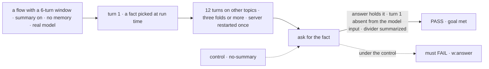
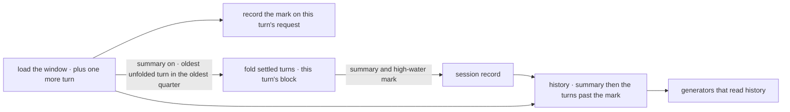

# FIX-1613 · A long conversation keeps what it said before its history window

**Spec** · [Decisions](DECISIONS.md)

## Five people, before and after

| Someone who… | Today | After |
|---|---|---|
| **talks to one worker for weeks in the Grok Bot-style lab** | Turn 51 drops turn 1 from what the model reads, with no trace. Ask about turn 1 and the worker has no idea, unless memory happened to keep that fact | The lab's flow turns the summary on. Turns that leave the window are folded into one running summary the model reads before the turns it reads word for word, so turn 1 is still there in short form |
| **looks at that conversation on a screen** | Sees one unbroken list. Nothing says the model stopped reading the top of it | Sees a divider where the turns read word for word begin, labelled *earlier turns summarized* when the summary reaches it, *earlier turns out of view* otherwise |
| **runs a flow that never opts in** (the stock agent flow, every app today) | 50 turns, older ones dropped | The same model input, byte for byte. The divider's mark is still recorded, so any screen can say *out of view* honestly |
| **writes a generator with a narrow history** (`history: { limit: { turns: 8 } }`) | Sees its last 8 turns | The same. The summary rides only with a history that reaches back to the divider |
| **hits a summary call that fails** | n/a | The turn runs anyway, on the summary it had and every turn past it, all still in the window. The fold starts a quarter of the window early, so it is tried again on the next turns before anything leaves |
| **leaves a turn waiting on an approval while the conversation goes on** | The parked turn shows once it settles, if it is still inside the window | The same: the fold waits for a turn that hasn't settled, and one still parked when it leaves the window is kept by id and folded once it settles. Never skipped |

A session that lives for weeks is now normal (workstreams, coordinators, the lab's workers), and
Jake set the direction in [FIX-1775](https://linear.app/fixpoint-labs/issue/FIX-1775): how a
session keeps its history is configurable per flow, and a summary step is on the table for
long-lived sessions, never as a default. Memory keeps facts, not the thread, and neither
stands in for the other ([FIX-1612](https://linear.app/fixpoint-labs/issue/FIX-1612)).

## The goal, and how we'll know it's met

**On a flow that opts in, a conversation that runs past its history window still answers from
what was said before the window, and a screen shows where the turns the model reads word for
word begin.**

| Is it the right goal? | |
|---|---|
| **The real need** | FIX-2154 step 4: "the script sends 60 more turns (past the 50-turn window), then asks lead for a fact you gave on turn 1 … both answers are right, and the divider marks where the turns lead reads word for word begin, labelled *summarized* only when G1's summary is on" ([FIX-2154 G1](../FIX-2154/SPEC.md#package-gaps), Jake's [comment](https://linear.app/fixpoint-labs/issue/FIX-1613) extending this issue) |
| **Smaller, and rejected** | "Record the divider's mark": it draws the line and leaves the model blind past it. "Let a block fetch old items when it needs them, plus memory" (this issue's first ask): nothing decides when to fetch, memory keeps facts and drops the thread, and the read has no caller ([D1](DECISIONS.md#d1)). "Raise `historyWindow`": every turn pays for the whole conversation, and it still ends |
| **Bigger, and not this issue's** | [FIX-2174](https://linear.app/fixpoint-labs/issue/FIX-2174) compaction: a fold in the background, near the model's token limit, on demand with instructions, and compact-and-retry on overflow. It extends this option rather than adding a second one. A per-worker switch in `WORKER.md` waits for it too; here a worker opts in by running on a flow that does |
| **Not done if** | The summary is stored but never reaches the model · the fact passes only because it is still inside the window · the fact survives the first fold and is lost by a later one · the summary lives only in memory of the process and a restart loses it · the mark is in the trace but the request list a screen reads doesn't carry it · the divider says *summarized* after a failed fold · a flow with the option off sends a different model input · a failed summary fails the turn · the summary grows with every fold |



The check reads the answer, the model input from the turn's trace, and the mark from the request
list a screen reads.

| How we verify | |
|---|---|
| **Goal check** | `goals/history-window/remembers-turns-past-the-window/` · `pnpm tsx goals/history-window/remembers-turns-past-the-window/run.mts` · the goals' default real model · run by the implementer at completion · verdict in the implementation PR. The flow is the goal's own, built in `run.mts` with `summarizer`, on the SQLite store, with no memory capability. FIX-2154's step 4 is the downstream check, run by that lab's wiring |
| **Signal** | `w:answer` the last answer holds the fact, 3 of 3 runs. `w:out-of-window` turn 1's user message is absent from the answer generator's model input on the last turn (read from the turn's trace). `w:mark` the last request in `client.sessions.requests` carries `historyStart` with `summarized: true`, naming the oldest request whose messages that input holds. `w:folds` at least three folds ran, one across a server restart, and the stored summary stays under 4,000 characters |
| **Input** | Fact words picked at run time, filler topics shuffled. `GOAL_WINDOW=50 GOAL_TURNS=60` must pass too |
| **Anti-game** | Never assert on the summary's wording or a mocked summarizer: both pass while the answer generator never sees it. No memory on the flow; the fact is never in the system prompt |
| **Control that must fail** | `GOAL_CONTROL=no-summary` (the option removed) fails `w:answer`, and its mark reads `summarized: false`. The same script on `main` fails `w:mark` (no mark). The PR shows both FAILs before the PASS. Model-free, in CI: option off sends a scripted model the same input as before (fails if the summary leaks); a summarizer that throws leaves the turn completed and the mark `summarized: false`; a narrow `history({ limit })` gets no summary |

## What changes


The bottom row is the opt-in: folds happen in batches, so the turns read word for word float
between the window and a quarter of it less. The middle row is every flow, opted in or not.

**Opting in, in a flow and in the workforce agent flow:**

```diff
 import { defineFlow, summarizer } from "@flow-state-dev/core";

 defineFlow({
   kind: "assistant",
   session: {
-    historyWindow: { turns: 50 },
+    historyWindow: {
+      turns: 50,
+      // Turns about to leave the window are folded into one running summary.
+      summarize: summarizer({ name: "earlier-turns", granularity: "detailed" }),
+    },
   },
   ...
 });

 defineAgentWorkerFlow({
   installation,
+  historyWindow: { turns: 50, summarize: summarizer({ name: "earlier-turns", granularity: "detailed" }) },
 });
```

**And the screen, reading the latest turn's mark:**

```diff
 const requests = await client.sessions.requests(sessionId);
+const start = requests.at(-1)?.historyStart;   // absent: every earlier turn is read word for word
+// draw the divider before start.requestId:
+//   start.summarized ? "earlier turns summarized" : "earlier turns out of view"
```

**Docs:** update `apps/docs/docs/advanced/generator-context.md` → *Conversation history
windowing* with a *Summarizing turns past the window* section, and rewrite its closing paragraph,
which today says compaction belongs to higher-level patterns, and name the narrow-history case. Update the `core` README (the option),
the `client` README (`historyStart` on a request), and the `workforce` README (the agent flow's
`historyWindow`). No new page.

## How a turn reads its history



The fold runs before the action, as a block of that turn, so its trace and tokens are the turn's.
The model sees the summary only through the history read every generator already uses.

## What stays as it is

- **The default.** No `summarize`, no fold, the same 50 turns, the same model input.
- **The window as the store-read cap.** A turn loads `turns` past turns, plus one
  more row, new, to know whether anything fell out; the option-off path drops it before history.
- **Stored items.** A fold rewrites nothing. The full conversation stays in the store and in the
  item stream; only what the model reads changes.
- **Memory.** The memory package's tiers are untouched, and neither replaces the other.
- **One conversation, one summary.** A worker's other conversations never see it.

## What's already here, and the debt

| Already here | What this does with it |
|---|---|
| `session.historyWindow` (`core/src/types/flow.ts`), applied in `createExecutionContext.ts` | **Extends**: one optional field, `summarize`. The window stays the cap |
| `summarizer` (`core/src/utility/summarizer.ts`), used by no package today | **Builds on**: the author passes one; core calls it with the summary so far and the turns to fold |
| `loadLLMHistory` and `ctx.session.items.history()`, which generator `history` and Workforce's `routedTaskHistory` read | **Extends**: a summary message before the turns past the mark, when the read reaches the mark |
| Request lifecycle hooks (`request.onStarted` blocks the engine runs) | **Builds on** the precedent: the engine runs an author's block inside a turn, traced and counted |
| Whatever already keeps a long conversation's earlier context | **None does this job for a conversation.** The memory tiers keep facts across sessions (digest is per user); Workforce's coordinator lines keep the last 10 lines inside the window; per-call `history({ limit })` only narrows. Searched `summar`, `compact`, `rolling`, `earlier turns`, `high-water` across `packages/`. Orchestration's `flowPolicy.compact({ recentN, summarizer })` is a stub for the same job over a task ledger (it keeps the recent N until a summarizer ships); it can take the same kind of block when it is built. This is the first way for a session |
| FIX-1613's original ask: a block-facing, bounded, newest-first read of a session's items past the window, for FIX-1610's channel route record | **Not built** ([D1](DECISIONS.md#d1)). Its one consumer went with channels (FIX-1786); the fold never needs to read past the window |
| FIX-2154 G1 ([SPEC](../FIX-2154/SPEC.md#package-gaps)) and its adapter's `summarizedUpTo(sessionId)` | **Delivers** G1. The adapter reads the latest request's `historyStart` |
| `generator-context.md`'s line that summarizing belongs to higher-level patterns, and FIX-1775's "not a default" | **Amends** the first (an opt-in option in core, Jake's FIX-1775 direction); **keeps** the second |

| Builds on / Adds | Existing piece considered | Why that doesn't fit, or how this is composed |
|---|---|---|
| `historyWindow.summarize` | A summary in user space: a tap that summarizes, a state field for the high-water mark, a custom `history` function | It can't see what the window drops, has no place for the mark the engine owns, and every app would rebuild it (FIX-2174's comment found exactly this). Composed from `summarizer` and the history read |
| `historySummary` on the session record (text and high-water mark) | Session state; an item in the log | State is the app's schema and its client projection. An item would put the summary in the conversation a person reads. The record already carries engine-written fields (`latestRequestId`) |
| `historyStart` on the request record and its summary | An item in the stream; a client-side count of the window | An item changes the item taxonomy for a fact about the turn; a client count can't see interrupted or parked turns, which take window slots ([D2](DECISIONS.md#d2)) |
| `historyWindow` on `defineAgentWorkerFlow` | Workforce summarizing on its own | A pass-through to core's option. No second summary path in workforce |

| The debt | |
|---|---|
| **Removes** | Nothing. |
| **Adds** | A summary step that pauses the turn that folds ([D3](DECISIONS.md#d3)); FIX-2174 moves it to the background through the same option. Two record fields, both optional and `== null`-guarded (BP-030). A new place the engine runs an author's block from flow config (beside the request hooks). A summary message in `history()` on opted-in flows. One more row read and one request-record field written per turn, on every flow, for the mark |
| **Leaves** | The block-facing store read (D1): no issue, filed again when a consumer appears. A session switched on after it is long starts its summary at the window, and what fell out earlier stays *out of view*. Per-worker opt-in: a worker gets it by running on a flow that turns it on. Orchestration's `flowPolicy.compact` stays a stub |

**Net: up, slightly.** One option, two record fields and a fold step; no second way to do the job.

## Sign off

**[The goal](#the-goal-and-how-well-know-its-met), at that size:** an opted-in conversation
remembers past its window, and every screen can mark where verbatim history begins. If wrong:
the lab's step 4 passes on a divider while the worker forgets turn 1.

**[The debt](#whats-already-here-and-the-debt), up slightly:** one option, two record fields. If
wrong: FIX-2174 adds a second summary path beside this one instead of extending it.

1. **[D1](DECISIONS.md#d1) · Build the summary and the divider's mark; the block-facing read of
   old items is not built.** If wrong: a consumer that needs old items waits for a new issue.
2. **[D2](DECISIONS.md#d2) · The mark is recorded on every turn that has turns out of view,
   summary on or off, as `historyStart` on the turn's request.** If wrong: a public field on
   every request list that only summary flows needed.
3. **[D3](DECISIONS.md#d3) · The fold runs at the start of the turn that needs it, in batches,
   as a block of that turn.** If wrong: a few seconds' pause on one turn in every dozen, until
   FIX-2174.

**Open: none.** D1 is the one to weigh: it narrows the issue Jake filed.

Feature · `core`, `engine`, `client`, `workforce` + docs · medium (one option, two record fields,
one fold step, one history read, one goal) · 1 PR · blocks FIX-2154 step 4 and FIX-2156 · epic
FIX-2152 (via FIX-2154)
