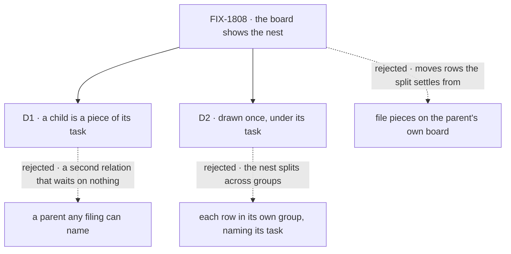

# FIX-1808 · Decisions

[Spec](SPEC.md) · **Decisions**

Two decisions are the sign-off surface. Everything else here is context for them.

## The tree

Solid edges are what you're signing. Dashed edges lost, and the label says why.

## D1 · A child is a piece: work its task handed out and waits on

| | |
|---|---|
| **Instead of** | A "part of" link any filing can set, from any session, onto any row, with no wait behind it |
| **Because** | The split already makes durable child rows, parks the task until they end, cancels them with it and replays them after a crash (FIX-1802 S4; [split.ts#L322](https://github.com/fixpoint-labs/flow-state-dev/blob/9c201d9fe7aa5c74a1ad3091889779275f7be19f/packages/workforce/src/conversation-board/split.ts#L322), [#L240](https://github.com/fixpoint-labs/flow-state-dev/blob/9c201d9fe7aa5c74a1ad3091889779275f7be19f/packages/workforce/src/conversation-board/split.ts#L240), [#L310](https://github.com/fixpoint-labs/flow-state-dev/blob/9c201d9fe7aa5c74a1ad3091889779275f7be19f/packages/workforce/src/conversation-board/split.ts#L310), [#L206](https://github.com/fixpoint-labs/flow-state-dev/blob/9c201d9fe7aa5c74a1ad3091889779275f7be19f/packages/workforce/src/conversation-board/split.ts#L206)). A second relation would draw the same nest with none of that behind it: a task could finish while its "children" still run, and the board would show a nest the system doesn't keep. One relation is also one answer for FIX-1807 (tenet 2) |
| **Locks in** | Every child row is filed from its task's own session. FIX-1807 and FIX-1809 file review and fix steps as pieces of the coding task, through that task's session, and the task waits on them. The public field `parent` means "a piece of", and an app that reads it can rely on that |

It comes down to whether the task waits: a nest the system doesn't keep is one the board shouldn't draw.

**What would change my mind:** FIX-1809's setup step needing to lay out review rows from outside the coding task's session, with no way to file through it. Then a filer-named parent is needed, and it shares the `parent` field, so the board drawing stays.

## D2 · A child is drawn once, under its task, in its task's group

| | |
|---|---|
| **Instead of** | Each row in the group its own state or worker puts it in, with a line naming its task |
| **Because** | The nest is what the person asked to see. Placed by its own state, a running piece of a waiting task lands in another group, and the nest is never on screen at once. The row still shows its own state and worker, so nothing about it is hidden |
| **Locks in** | On Tasks grouped by state or worker, a piece's group is its top task's. A person scanning RUNNING sees running tasks, not running pieces of waiting ones; the rail and the project Board have no groups and nest the same way |

It comes down to seeing the nest at once: split by group, a task and its pieces are never together.

**What would change my mind:** people using Tasks mostly to see what is running right now. Then RUNNING also lists running pieces, each naming its task. It is a drawing rule; no data changes.

## Decided, not asked

- **The link is written at filing, from server state only.** The piece's task and that task's board come from the task session's own state ([board.ts#L353-L354](https://github.com/fixpoint-labs/flow-state-dev/blob/9c201d9fe7aa5c74a1ad3091889779275f7be19f/packages/workforce/src/conversation-board/board.ts#L353-L354)), never from a filing's input or a patch (BP-031; [ledger.ts#L145](https://github.com/fixpoint-labs/flow-state-dev/blob/9c201d9fe7aa5c74a1ad3091889779275f7be19f/packages/workforce/src/conversation-board/ledger.ts#L145)). The one writer is the board's filing path ([board.ts#L396-L430](https://github.com/fixpoint-labs/flow-state-dev/blob/9c201d9fe7aa5c74a1ad3091889779275f7be19f/packages/workforce/src/conversation-board/board.ts#L396-L430), reached by [#L571](https://github.com/fixpoint-labs/flow-state-dev/blob/9c201d9fe7aa5c74a1ad3091889779275f7be19f/packages/workforce/src/conversation-board/board.ts#L571)), which every piece goes through, the turn's tools and the app's `addTask` alike: that is the convergence point.
- **Workforce publishes it; orchestration's task row gains no field.** Only the split makes children. A framework-wide parent field is a promise nobody else needs yet. Metadata stays server-only ([ledger.ts#L68-L87](https://github.com/fixpoint-labs/flow-state-dev/blob/9c201d9fe7aa5c74a1ad3091889779275f7be19f/packages/workforce/src/conversation-board/ledger.ts#L68-L87); BP-015): one field is published, not the metadata.
- **Pieces filed before this change still nest** (BP-030). Each already carries its task's id; its task's board is found as the one whose task's run names the piece's session ([task-entry.ts#L674-L680](https://github.com/fixpoint-labs/flow-state-dev/blob/9c201d9fe7aa5c74a1ad3091889779275f7be19f/packages/orchestration/src/task-board/task-entry.ts#L674-L680)). The one mapper reads the old shape when `parent` is absent, and the goal's `legacy` signal proves it on a piece stored in today's shape.
- **The tree is built in the browser from the ledger read the Lab already makes** ([reads.ts#L595](https://github.com/fixpoint-labs/flow-state-dev/blob/9c201d9fe7aa5c74a1ad3091889779275f7be19f/packages/shift-manager/src/lib/reads.ts#L595)). One flat read shape for the rail, a project's Board and Tasks, one tree builder memoized per read. No server reads another session's board.
- **No poll is added for pieces; live is the rail's.** The rail's existing poll ([TasksPanel.tsx#L30-L35](https://github.com/fixpoint-labs/flow-state-dev/blob/9c201d9fe7aa5c74a1ad3091889779275f7be19f/packages/shift-manager/src/components/TasksPanel.tsx#L30-L35)) moves onto the ledger rows and counts an open piece as open; today it reads `listTasks` and stops once its task parks. Tasks follows the Lab snapshot (`readAt`, [reads.ts#L909](https://github.com/fixpoint-labs/flow-state-dev/blob/9c201d9fe7aa5c74a1ad3091889779275f7be19f/packages/shift-manager/src/lib/reads.ts#L909)), which has no timer ([lab-data.tsx#L4-L8](https://github.com/fixpoint-labs/flow-state-dev/blob/9c201d9fe7aa5c74a1ad3091889779275f7be19f/packages/shift-manager/src/lib/lab-data.tsx#L4-L8)), so it shows pieces on its next refresh, as it does every row; making Tasks live is not this issue's.
- **The roster-worker leg belongs to FIX-1997's goal, not this one.** The nest reads the link, not who the piece is assigned to, so a non-delegate piece proves nothing new here; D1's flip condition is about who files, not who works. Deferring it keeps this gate from waiting on another epic.
- **Depth follows the chain.** A piece of a piece nests again, as deep as the split's depth limit allows ([chain.ts#L38](https://github.com/fixpoint-labs/flow-state-dev/blob/9c201d9fe7aa5c74a1ad3091889779275f7be19f/packages/workforce/src/conversation-board/chain.ts#L38)).
- **Finished pieces stay under a task that is still shown.** The issue asks for the nest "after rounds complete". A finished task drops off Tasks with its pieces, as finished rows do today; the rail's finished group keeps both.
- **A retried piece sits beside the one it retried** ([board-entries.ts#L44](https://github.com/fixpoint-labs/flow-state-dev/blob/9c201d9fe7aa5c74a1ad3091889779275f7be19f/packages/workforce/src/conversation-board/board-entries.ts#L44)), in filing order. Both are history.
- **A piece whose task isn't in the read** (a failed page, a conversation not listed) draws on its own, naming its task, so no row disappears.

## Considered and dropped

| Alternative | Why not |
|---|---|
| File pieces on the parent's own board, so "same board" is literal | The split settles from the task session's own board, and FIX-1997 is changing that code now. Moving the rows breaks the rule that a session reads only its own board, for a picture the drawing already gives |
| A parent any filing can name, with no wait behind it | D1. A second relation beside the split |
| Infer the nest in the browser from the task's run session, with no new field | Works for a task session running one task. A session runs a task and its follow-ups ([board.ts#L346-L348](https://github.com/fixpoint-labs/flow-state-dev/blob/9c201d9fe7aa5c74a1ad3091889779275f7be19f/packages/workforce/src/conversation-board/board.ts#L346-L348)), so pieces of one would nest under both. An app reading the boards couldn't nest either |
| Have a worker's `listTasks` return the pieces under its tasks | The model would see a second level of work it doesn't own, and every caller of the tool would change for a drawing |
| Flat rows labelled "part of <task>" | The smaller goal, rejected in [SPEC.md](SPEC.md#the-goal-and-how-well-know-its-met) |

## How it got here

- **Draft** — framed as making the split's pieces visible where the person already looks; no new child concept; one published link and a tree in the board views; designed on FIX-2006's shared rail read and FIX-1997's roster-wide pieces.

**Open: none.**
