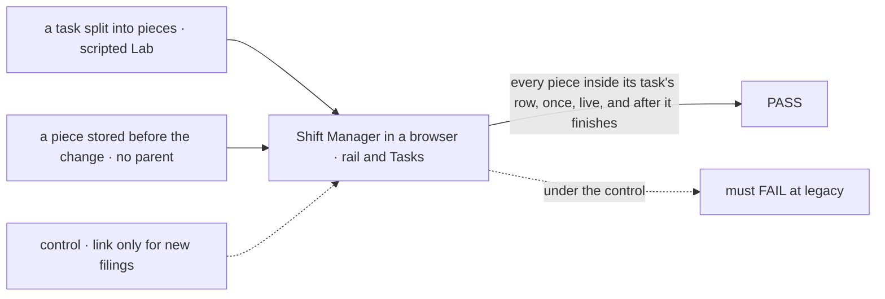
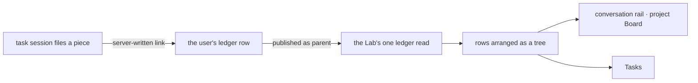

# FIX-1808 · Shift Manager board shows durable parent and child tasks

**Spec** · [Decisions](DECISIONS.md)

| Someone who… | Today | After |
|---|---|---|
| **watches a conversation's tasks in the right rail** | Sees the task it filed, marked parked ([split.ts#L360](https://github.com/fixpoint-labs/flow-state-dev/blob/9c201d9fe7aa5c74a1ad3091889779275f7be19f/packages/workforce/src/conversation-board/split.ts#L360)), and nothing of the work that task handed out: the rail lists its own board only ([TasksPanel.tsx#L70](https://github.com/fixpoint-labs/flow-state-dev/blob/9c201d9fe7aa5c74a1ad3091889779275f7be19f/packages/shift-manager/src/components/TasksPanel.tsx#L70), [board.ts#L549-L551](https://github.com/fixpoint-labs/flow-state-dev/blob/9c201d9fe7aa5c74a1ad3091889779275f7be19f/packages/workforce/src/conversation-board/board.ts#L549-L551)) | Sees that task with each piece it handed out nested under it, each with its own worker and live status |
| **opens Tasks, grouped by state** | Sees the pieces as unrelated rows in another stream, named for the worker that split the task ([derive.ts#L33-L39](https://github.com/fixpoint-labs/flow-state-dev/blob/9c201d9fe7aa5c74a1ad3091889779275f7be19f/packages/shift-manager/src/lib/derive.ts#L33-L39), [board.ts#L352](https://github.com/fixpoint-labs/flow-state-dev/blob/9c201d9fe7aa5c74a1ad3091889779275f7be19f/packages/workforce/src/conversation-board/board.ts#L352)). Nothing says which task they belong to | Sees each piece once, under the task it belongs to, in that task's group ([D2](DECISIONS.md#d2)) |
| **looks back after the pieces finished** | Finished pieces drop off Tasks with every other finished row ([derive.ts#L43-L45](https://github.com/fixpoint-labs/flow-state-dev/blob/9c201d9fe7aa5c74a1ad3091889779275f7be19f/packages/shift-manager/src/lib/derive.ts#L43-L45)); the rail never had them | Finished pieces stay under their task for as long as the task is on the board, so the rounds read in order |
| **builds review rounds (FIX-1807)** | Has no board shape for "a review step under the coding task" | Files each review or fix step as a piece of the coding task, and it shows nested with no second board ([D1](DECISIONS.md#d1)) |
| **reads a user's boards from their own app** | Gets flat rows; the link from a piece to its task stays in server-only metadata ([ledger.ts#L68-L87](https://github.com/fixpoint-labs/flow-state-dev/blob/9c201d9fe7aa5c74a1ad3091889779275f7be19f/packages/workforce/src/conversation-board/ledger.ts#L68-L87)). No `parent` field exists today | Gets a `parent` field on each piece, naming the task it is part of |

## The goal, and how we'll know it's met

**A person watching a task on the board sees every task it handed out nested under it, from the moment each is filed until after it finishes, on the board they were already looking at.**

| Is it the right goal? | |
|---|---|
| **The real need** | *"Needed so review rounds (and other handoffs) are visible where the work lives… The person should see a child row nested under its parent on the same board"* (Jake, FIX-1808). FIX-1807 needs it before review rounds can be rows |
| **Smaller, and rejected** | Label each piece "part of <task>" and leave it flat. The person still assembles the nest by eye, and finished rounds still vanish |
| **Bigger, and not this issue's** | Review rounds as pieces, and who files them (FIX-1807, FIX-1809). A parent relation any filing can claim without waiting on it ([considered and dropped](DECISIONS.md#considered-and-dropped)) |
| **Not done if** | The nest shows on Tasks but not in the rail · a piece shows twice, nested and flat · a finished piece leaves its task · it nests only after a reload · a piece of a piece lands flat · a retried piece loses its place · a piece filed before this change, which has no `parent` yet, lands flat · the nest is guessed from titles or run sessions, not read from a link the server wrote |



The check reads the page's structure against the store, never its words; with the link published only for new filings, the stored piece lands flat and the check must fail.

| How we verify | |
|---|---|
| **Goal check** | `goals/shift-manager/it-nests-a-tasks-pieces-under-it/` · no model (scripted workers) · real browser · run by the implementer at completion · verdict in the implementation PR |
| **Signal** | `nested`: every row the store holds as a piece is drawn inside its task's row in the rail and on Tasks, and nowhere else. `live`: in the rail, a piece filed or settled shows within one poll of the rail's existing read, no reload. Tasks has no timed read today, for any row; it shows pieces on the next Lab refresh, and the goal reads it after one. `kept`: once every piece and the task have finished, the rail's finished group draws the task with its pieces under it. `legacy`: a piece stored in the shape `main` writes today, with its task's id in its server-side metadata and no `parent`, is drawn inside its task's row in the rail and on Tasks |
| **Input** | The goal-local Lab of `goals/coordinators/files-tasks-down-the-owners-chain/`, extended with one scripted split: a conversation files a task whose worker splits it into two pieces. A different split (three pieces) must pass too. Depth and a retried piece are the implementer's tests; a piece to a roster worker is FIX-1997's goal ([decided, not asked](DECISIONS.md#decided-not-asked)). For `legacy`, the store is seeded before boot with one split task and one piece in the shape `main` writes today: the piece carries only its task's id in metadata, never `parent` |
| **Anti-game** | No assertion on the page's text or on Shift Manager's state. The oracle is the store, read by the script; nesting is DOM containment, read through stable hooks every task row carries (its task id, as `data-task-id`, which rail and Tasks rows already carry: [TasksPanel.tsx#L165](https://github.com/fixpoint-labs/flow-state-dev/blob/9c201d9fe7aa5c74a1ad3091889779275f7be19f/packages/shift-manager/src/components/TasksPanel.tsx#L165), [Tasks.tsx#L170](https://github.com/fixpoint-labs/flow-state-dev/blob/9c201d9fe7aa5c74a1ad3091889779275f7be19f/packages/shift-manager/src/surfaces/Tasks.tsx#L170)). No fixture writes a row, except the one old-shape piece `legacy` seeds before boot, written in exactly the shape `main`'s filing path stores, with no `parent` |
| **Control that must fail** | `GOAL_CONTROL=unlinked`: the ledger publishes no `parent`. Must FAIL **`nested`**. `GOAL_CONTROL=filing-only`: `parent` is published only for pieces filed after the change, with no fallback for stored ones. Must FAIL **`legacy`** while `nested` passes. Today's `main` FAILs `nested` and `legacy` (pieces absent from the rail, flat on Tasks) |

## What changes


Same split, before and after. The indent is the whole change: the pieces already exist as durable rows, and now they sit under the task they belong to.

**What a browser reads, per piece:**

```diff
  { id: "t-review-1", title: "Review round 1", status: "in_progress", assignee: "eng.reviewer", … }
+ parent: { board: "<the parent's board>", id: "t-coding" }
```

One mapper, in the ledger's client projection, (a per-item `data` projection, [resource.ts#L134](https://github.com/fixpoint-labs/flow-state-dev/blob/9c201d9fe7aa5c74a1ad3091889779275f7be19f/packages/core/src/types/resource.ts#L134)) projects `parent` from the piece's server-side mark ([board.ts#L424-L430](https://github.com/fixpoint-labs/flow-state-dev/blob/9c201d9fe7aa5c74a1ad3091889779275f7be19f/packages/workforce/src/conversation-board/board.ts#L424-L430)); it is the one place the old shape is read (BP-030). `parent.id` is the task id the mark already holds. `parent.board` is **not** derivable from the piece's own partition, which is its task session's board, one below the parent's; it is written beside the mark at filing, from the task session's own state, which names the parent's board and task ([board.ts#L353-L354](https://github.com/fixpoint-labs/flow-state-dev/blob/9c201d9fe7aa5c74a1ad3091889779275f7be19f/packages/workforce/src/conversation-board/board.ts#L353-L354)). For a piece stored before that, the mapper publishes the id alone, and the board is the one whose task's run names the piece's session ([task-entry.ts#L674-L680](https://github.com/fixpoint-labs/flow-state-dev/blob/9c201d9fe7aa5c74a1ad3091889779275f7be19f/packages/orchestration/src/task-board/task-entry.ts#L674-L680)). A run link is cleared at the next claim until that attempt's gate writes it again ([task-entry.ts#L662](https://github.com/fixpoint-labs/flow-state-dev/blob/9c201d9fe7aa5c74a1ad3091889779275f7be19f/packages/orchestration/src/task-board/task-entry.ts#L662)); in that window the piece draws on its own, naming its task.

**Docs:** update Workforce's *Delegating work* (the `parent` field under *Showing a user's boards in your app*; one line under *Splitting a task* on how pieces show) and the Shift Manager overview (the Tasks row, the project row's Board, and the board paragraph). No new page.

## How the nest reaches the board



The rail, a project's Board and Tasks all take the same flat ledger rows, `parent` set on pieces, and one tree builder, memoized per read, arranges them. No per-task fetch and no rail-only enrichment. Tasks already takes the Lab's one ledger read ([reads.ts#L595](https://github.com/fixpoint-labs/flow-state-dev/blob/9c201d9fe7aa5c74a1ad3091889779275f7be19f/packages/shift-manager/src/lib/reads.ts#L595)); the rail today reads `listTasks` on its own board ([conversation-tasks.ts#L16](https://github.com/fixpoint-labs/flow-state-dev/blob/9c201d9fe7aa5c74a1ad3091889779275f7be19f/packages/shift-manager/src/lib/conversation-tasks.ts#L16)), so it moves onto the same ledger rows. No poll is added: the rail's existing poll ([TasksPanel.tsx#L30-L35](https://github.com/fixpoint-labs/flow-state-dev/blob/9c201d9fe7aa5c74a1ad3091889779275f7be19f/packages/shift-manager/src/components/TasksPanel.tsx#L30-L35)) keeps reading while any row it shows, a piece included, is open; today it stops once its task parks. The Lab snapshot has no timer ([lab-data.tsx#L4-L8](https://github.com/fixpoint-labs/flow-state-dev/blob/9c201d9fe7aa5c74a1ad3091889779275f7be19f/packages/shift-manager/src/lib/lab-data.tsx#L4-L8)), so Tasks shows pieces on its next refresh, as it shows every row. No session reads another's board.

## What stays as it is

- **The split.** Pieces are filed, parked on, woken on, settled, replayed and cancelled exactly as FIX-1802 S4 and FIX-1997 leave them.
- **Where a piece lives.** On its task session's own board. The nest is drawn, not moved.
- **What a model sees.** A worker's `listTasks` still lists its own board only ([board.ts#L549-L571](https://github.com/fixpoint-labs/flow-state-dev/blob/9c201d9fe7aa5c74a1ad3091889779275f7be19f/packages/workforce/src/conversation-board/board.ts#L549-L571)).
- **The feed.** FIX-2006's one card per filed task is unchanged; the card does not list pieces.
- **The task page.** It doesn't list its pieces or name its parent in this cut.

## What's already here, and the debt

| Already here | What this does with it |
|---|---|
| The split's pieces: durable ledger rows, each marked with the task it is a piece of ([FIX-1802 S4](../FIX-1802/PLAN.md#surfaces); [board-entries.ts#L36](https://github.com/fixpoint-labs/flow-state-dev/blob/9c201d9fe7aa5c74a1ad3091889779275f7be19f/packages/workforce/src/conversation-board/board-entries.ts#L36), [board.ts#L430](https://github.com/fixpoint-labs/flow-state-dev/blob/9c201d9fe7aa5c74a1ad3091889779275f7be19f/packages/workforce/src/conversation-board/board.ts#L430)) | **Builds on.** That mark is the child relation; this publishes it. Its rule that a session reads only its own board is **kept** |
| Park on a task ([D1](../park-on-task/DECISIONS.md#d1), [D2](../park-on-task/DECISIONS.md#d2), built by FIX-1997) | **Builds on.** Pieces reach any task-taking worker, which is what lets a reviewer's step be a piece |
| The ledger's browser fields ([FIX-1794](../FIX-1794/PLAN.md#surfaces); [ledger.ts#L68-L87](https://github.com/fixpoint-labs/flow-state-dev/blob/9c201d9fe7aa5c74a1ad3091889779275f7be19f/packages/workforce/src/conversation-board/ledger.ts#L68-L87), [ledger.ts#L108](https://github.com/fixpoint-labs/flow-state-dev/blob/9c201d9fe7aa5c74a1ad3091889779275f7be19f/packages/workforce/src/conversation-board/ledger.ts#L108)) | **Extends** by one field |
| The conversation rail ([FIX-1794 S11](../FIX-1794/PLAN.md#surfaces); [TasksPanel.tsx#L70](https://github.com/fixpoint-labs/flow-state-dev/blob/9c201d9fe7aa5c74a1ad3091889779275f7be19f/packages/shift-manager/src/components/TasksPanel.tsx#L70)) and its live read, shared with the feed's cards by FIX-2006 (#3413, not on `main`) | **Extends.** The read moves from `listTasks` onto the ledger rows, which carry the pieces under each task |
| A project's Board: one rail panel per workstream session ([Project.tsx#L587](https://github.com/fixpoint-labs/flow-state-dev/blob/9c201d9fe7aa5c74a1ad3091889779275f7be19f/packages/shift-manager/src/surfaces/Project.tsx#L587)) | **Extends**, with the rail: the same panel, so the same tree, and the goal's rail leg covers it |
| Tasks, the all-boards table, over every listed session's rows, task sessions included ([reads.ts#L850](https://github.com/fixpoint-labs/flow-state-dev/blob/9c201d9fe7aa5c74a1ad3091889779275f7be19f/packages/shift-manager/src/lib/reads.ts#L850), [reads.ts#L619](https://github.com/fixpoint-labs/flow-state-dev/blob/9c201d9fe7aa5c74a1ad3091889779275f7be19f/packages/shift-manager/src/lib/reads.ts#L619)) | **Extends.** Rows with a parent draw under it |
| Anything else that nests tasks | **Leaves alone.** Orchestration's `TaskPlan` nests a spawned task by emit time ([FIX-658](https://github.com/fixpoint-labs/flow-state-dev/pull/353)): a chat view, not a board. Searched `parent`, `pieceOf`, `child`, `subtask`, `nest` across `packages/`: no other board relation |

| The debt | |
|---|---|
| **Removes** | Nothing |
| **Adds** | One public field on Workforce's task rows, and a tree in Shift Manager's board views. Permanent by design |
| **Leaves** | The task page names neither parent nor pieces; not filed |

**Net: up, slightly.** One field and one tree, no second relation.

### Lands after, and what moves if they shift

Designed on the intended end state of in-flight work in the same code, not on today's `main`. Code links above are to `main` at `9c201d9fe`.

| Work | What this takes from it | If it shifts |
|---|---|---|
| **FIX-2006** (#3413, in review) | The rail and the feed cards share one live read | If it merges changed, the nest rides whatever read the rail ends on. If it stalls, the nest extends the rail's read as it is on `main` |
| **FIX-1997** (in development), under epic **FIX-1996** | Pieces to any task-taking worker; the parent link and the split's machinery kept | If pieces stay delegate-only, the nest is unchanged, but FIX-1807's reviewer steps must go to delegates. If the split stops marking pieces, [D1](DECISIONS.md#d1) reopens |

## Sign off

**[The goal](#the-goal-and-how-well-know-its-met), at that size:** every piece nested under its task in the rail and on Tasks, live in the rail, kept after it finishes, pieces stored before the change included. If wrong: FIX-1807 builds review rounds on a board that still hides them.

**[The debt](#whats-already-here-and-the-debt), net up slightly:** one public field and one tree. If wrong: a second "part of" field later, kept in step with this one.

1. **[D1](DECISIONS.md#d1) · A child is a piece: work its task handed out and waits on.** If wrong: FIX-1807 needs a second relation, and the board draws both.
2. **[D2](DECISIONS.md#d2) · A child is drawn once, under its task, in its task's group.** If wrong: someone scanning Tasks for what is running misses running pieces of waiting tasks.

**Open: none.** D1 is the one to weigh.

Feature · `workforce` + `shift-manager` · small · project Workforce: Shift Manager · lands after FIX-2006, FIX-1997
