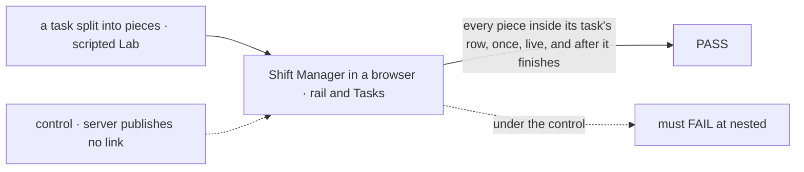
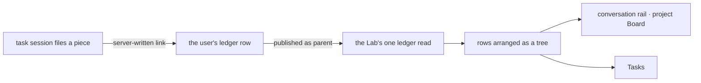

# FIX-1808 · Shift Manager board shows durable parent and child tasks

**Spec** · [Decisions](DECISIONS.md)

| Someone who… | Today | After |
|---|---|---|
| **watches a conversation's tasks in the right rail** | Sees the task it filed, marked parked, and nothing of the work that task handed out | Sees that task with each piece it handed out nested under it, each with its own worker and live status |
| **opens Tasks, grouped by state** | Sees the pieces as unrelated rows in another stream, named for the worker that split the task. Nothing says which task they belong to | Sees each piece once, under the task it belongs to, in that task's group ([D2](DECISIONS.md#d2)) |
| **looks back after the pieces finished** | Finished pieces drop off Tasks with every other finished row; the rail never had them | Finished pieces stay under their task for as long as the task is on the board, so the rounds read in order |
| **builds review rounds (FIX-1807)** | Has no board shape for "a review step under the coding task" | Files each review or fix step as a piece of the coding task, and it shows nested with no second board ([D1](DECISIONS.md#d1)) |
| **reads a user's boards from their own app** | Gets flat rows; the link from a piece to its task stays on the server | Gets a `parent` field on each piece, naming the task it is part of |

## The goal, and how we'll know it's met

**A person watching a task on the board sees every task it handed out nested under it, from the moment each is filed until after it finishes, on the board they were already looking at.**

| Is it the right goal? | |
|---|---|
| **The real need** | *"Needed so review rounds (and other handoffs) are visible where the work lives… The person should see a child row nested under its parent on the same board"* (Jake, FIX-1808). FIX-1807 needs it before review rounds can be rows |
| **Smaller, and rejected** | Label each piece "part of <task>" and leave it flat. The person still assembles the nest by eye, and finished rounds still vanish |
| **Bigger, and not this issue's** | Review rounds as pieces, and who files them (FIX-1807, FIX-1809). A parent relation any filing can claim without waiting on it ([considered and dropped](DECISIONS.md#considered-and-dropped)) |
| **Not done if** | The nest shows on Tasks but not in the rail · a piece shows twice, nested and flat · a finished piece leaves its task · it nests only after a reload · a piece of a piece lands flat · a retried piece loses its place · the nest is guessed from titles or run sessions, not read from a link the server wrote |



The check reads the page's structure against the store, never its words; with the link withheld it must fail.

| How we verify | |
|---|---|
| **Goal check** | `goals/shift-manager/it-nests-a-tasks-pieces-under-it/` · no model (scripted workers) · real browser · run by the implementer at completion · verdict in the implementation PR |
| **Signal** | `nested`: every row the store holds as a piece is drawn inside its task's row in the rail and on Tasks, and nowhere else. `live`: a piece filed or settled shows within one poll, no reload. `kept`: once every piece and the task have finished, the rail's finished group draws the task with its pieces under it. `deep`: a piece of a piece nests two levels down |
| **Input** | The goal-local Lab of `goals/coordinators/files-tasks-down-the-owners-chain/`, extended: a conversation files a task whose worker splits it into two pieces, one of which splits again. A different split (more pieces, a failed-then-retried piece) must pass too. Once FIX-1997 lands, one piece goes to a roster worker that isn't a delegate |
| **Anti-game** | No assertion on the page's text or on Shift Manager's state. The oracle is the store, read by the script; nesting is DOM containment. No fixture writes a row |
| **Control that must fail** | `GOAL_CONTROL=unlinked`: the ledger publishes no `parent`. Must FAIL **`nested`**. Today's `main` FAILs `nested` too (pieces absent from the rail, flat on Tasks) |

## What changes


Same split, before and after. The indent is the whole change: the pieces already exist as durable rows, and now they sit under the task they belong to.

**What a browser reads, per piece:**

```diff
  { id: "t-review-1", title: "Review round 1", status: "in_progress", assignee: "eng.reviewer", … }
+ parent: { board: "<the parent's board>", id: "t-coding" }
```

**Docs:** update Workforce's *Delegating work* (the `parent` field under *Showing a user's boards in your app*; one line under *Splitting a task* on how pieces show) and the Shift Manager overview (the Tasks row and the board paragraph). No new page.

## How the nest reaches the board



The link is written where the piece is filed, from server state only, and read from the ledger read the Lab already makes; no session reads another's board.

## What stays as it is

- **The split.** Pieces are filed, parked on, woken on, settled, replayed and cancelled exactly as FIX-1802 S4 and FIX-1997 leave them.
- **Where a piece lives.** On its task session's own board. The nest is drawn, not moved.
- **What a model sees.** A worker's `listTasks` still lists its own board only.
- **The feed.** FIX-2006's one card per filed task is unchanged; the card does not list pieces.
- **The task page.** It doesn't list its pieces or name its parent in this cut.

## What's already here, and the debt

| Already here | What this does with it |
|---|---|
| The split's pieces: durable ledger rows, each marked with the task it is a piece of ([FIX-1802 S4](../FIX-1802/PLAN.md#surfaces)) | **Builds on.** That mark is the child relation; this publishes it. Its rule that a session reads only its own board is **kept** |
| Park on a task ([D1](../park-on-task/DECISIONS.md#d1), [D2](../park-on-task/DECISIONS.md#d2), built by FIX-1997) | **Builds on.** Pieces reach any task-taking worker, which is what lets a reviewer's step be a piece |
| The ledger's browser fields ([FIX-1794](../FIX-1794/PLAN.md#surfaces)) | **Extends** by one field |
| The conversation rail ([FIX-1794 S11](../FIX-1794/PLAN.md#surfaces)) and its live read, shared with the feed's cards by FIX-2006 (#3413) | **Extends.** The one read gains the pieces under each task |
| Tasks, the all-boards table | **Extends.** Rows with a parent draw under it |
| Anything else that nests tasks | **Leaves alone.** Orchestration's `TaskPlan` nests a spawned task by emit time ([FIX-658](https://github.com/fixpoint-labs/flow-state-dev/pull/353)): a chat view, not a board. Searched `parent`, `pieceOf`, `child`, `subtask`, `nest` across `packages/`: no other board relation |

| The debt | |
|---|---|
| **Removes** | Nothing |
| **Adds** | One public field on Workforce's task rows, and a tree in Shift Manager's board views. Permanent by design |
| **Leaves** | The task page names neither parent nor pieces; not filed |

**Net: up, slightly.** One field and one tree, no second relation.

### Lands after, and what moves if they shift

Designed on the intended end state of in-flight work in the same code, not on today's `main`.

| Work | What this takes from it | If it shifts |
|---|---|---|
| **FIX-2006** (#3413, in review) | The rail and the feed cards share one live read | If it merges changed, the nest rides whatever read the rail ends on. If it stalls, the nest extends the rail's read as it is on `main` |
| **FIX-1997** (in development), under epic **FIX-1996** | Pieces to any task-taking worker; the parent link and the split's machinery kept | If pieces stay delegate-only, the nest is unchanged, but FIX-1807's reviewer steps must go to delegates. If the split stops marking pieces, [D1](DECISIONS.md#d1) reopens |

## Sign off

**[The goal](#the-goal-and-how-well-know-its-met), at that size:** every piece nested under its task, live and after it finishes, in the rail and on Tasks. If wrong: FIX-1807 builds review rounds on a board that still hides them.

**[The debt](#whats-already-here-and-the-debt), net up slightly:** one public field and one tree. If wrong: a second "part of" field later, kept in step with this one.

1. **[D1](DECISIONS.md#d1) · A child is a piece: work its task handed out and waits on.** If wrong: FIX-1807 needs a second relation, and the board draws both.
2. **[D2](DECISIONS.md#d2) · A child is drawn once, under its task, in its task's group.** If wrong: someone scanning Tasks for what is running misses running pieces of waiting tasks.

**Open: none.** D1 is the one to weigh.

Feature · `workforce` + `shift-manager` · small · project Workforce: Shift Manager · lands after FIX-2006, FIX-1997
