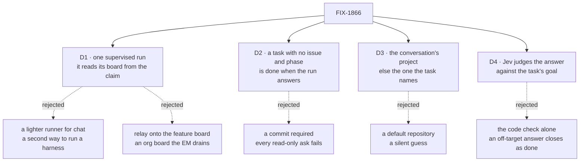

# FIX-1866 · Decisions

[Spec](SPEC.md) · **Decisions** · [Rules](BUSINESS-RULES.md) · [Plan](PLAN.md) · [Docs](DOCS.md)

What was considered, what was chosen, why, and what each choice locks in. Four decisions are
the sign-off surface; D4 is already Jake's.

## The tree

Solid edges are what you're signing. Dashed edges lost, and the label says why.

## D1 · A conversation's task runs as the same supervised coding run as the feature board's rows; the run reads its board from the task's claim

| | |
|---|---|
| **Instead of** | A lighter coding turn for chat tasks: take a checkout, run the harness, return its last message |
| **Because** | The supervised run is what makes a coding task safe to hand off: its own checkout under a lease, an attempt fence, a verdict before the row settles, questions to a person, and messages into a running run. A lighter runner drops all of that, and is a second way to run a harness that every later fix has to reach twice (tenet 1). It also has to be built anyway: [FIX-1792](../FIX-1792/PLAN.md) P3 moves the coder's feature work onto the EM's workstream board, which is a conversation board too, and FIX-1797's leg b5 needs it |
| **Locks in** | The run no longer belongs to one board. Every run record, checkout and branch is keyed by the board and conversation it came from, so a run started before the change is found under its old key only. The harness manager still knows no Workforce: the host hands it the boards it may read |

It comes down to what a chat task keeps: the lighter runner loses the lease, fence and questions.

**What would change my mind:** FIX-1792 deciding the coder's feature work stays on an org board.
Then only chat needs the new path, and a lighter runner might earn its place.

## D2 · A task that names no issue and phase is done when the run ends with an answer; a commit is reported, not required

| | |
|---|---|
| **Instead of** | The feature board's rule: done only when the branch carries a commit its base doesn't |
| **Because** | Most of what a person asks a coder in chat is a question about the code. Under the commit rule, "take a look at our repo" fails both attempts and ends errored after a paid run. A run still has to *say* something: a run that stopped at its limit, or ended with no answer, fails |
| **Locks in** | What done means for a task that isn't feature work. The coder tells the two apart by the task, not by the board it came from: a task naming an issue and a phase is feature work and still needs a commit, wherever it was filed, so the EM's tasks keep the commit rule when FIX-1792 P3 moves them onto its board, by naming both. A chat task that asked for a change and made none reads as completed; the line's `commits: 0` is the only sign |

It comes down to a read-only ask: under the commit rule it fails every attempt, after a paid run.

**What would change my mind:** chat tasks turning out to be mostly change requests. Then the task
should say what it expects, and a change task should need a commit.

## D3 · The repository is the conversation's project, or else the one the task names; with neither, the task fails saying so

| | |
|---|---|
| **Instead of** | A default repository the host configures (in DevTeam, Storefront's) |
| **Because** | Jake's Shift Coordinator conversation belongs to no project. A default would quietly run his ask in Storefront in an org with three projects, and code in the wrong repository is worse than a refusal. DevTeam's coder does exactly that today: its run source falls back to the feature board's workstream, which is Storefront's. The coordinator knows the projects and can ask the person which one. The task's project is input, read off the claimed row, which the project lookup has refused to do until now; that is safe only because the run checks the person is a member, from the run's own identity (BP-031) |
| **Locks in** | A task for the coder from a conversation with no project carries `input.project`, the project's address (`{ visibility, id }`, since a private and a shared project can share an id), and coordinators that file for coders learn to name one. A conversation's own project always wins: a task naming a different one is refused, not followed |

It comes down to an org with several projects: a default codes, silently, in the wrong one.

## D4 · Before a conversation's task closes, Jev judges the answer against the task's goal

Decided by Jake on 2026-10-10, on a decision card in the project thread.

| | |
|---|---|
| **Instead of** | D2's code check alone: an answer that isn't empty (a commit, for feature work) closes the task |
| **Because** | The code check proves the run said something, not that it did what was asked. An off-target answer, or "I changed nothing" on a change request, closes as done, and the person finds out by reading. Jev already judges fit for the coordinator, with a confidence it reports |
| **How** | After the phase's own check passes, the manager runs a judge, an evaluator block the host passes in, on the task's goal, the answer, and the run's commits (count and subjects). It returns one of three, with a confidence and a reason: **done** closes the task; **not done** fails the attempt with Jev's reason as the next attempt's feedback, so the second miss ends `errored` with that reason on the line; **ask** parks the row through the conversation's `row.ask` with Jev's question, and the person's answer reaches the next prompt (BR-16's path). A *not done* or *ask* under the confidence floor counts as done |
| **Which tasks** | Any task with a goal, which is every conversation task, feature work filed there included. Feature-board rows carry only an issue and a phase, no goal, so they keep today's check (BR-22) |
| **Locks in** | A judge slot on the harness manager, generic (no Workforce, no model named): the host passes the block. One Jev call per judged task. When the judge itself fails (the gateway is down), the task closes on the code check and the output says `judged: false`, so an outage never fails work that passed its own check |

It comes down to an off-target answer: under the code check alone it reads as done.

**What would change my mind:** Jev's *not done* turning out wrong often enough that retries cost
more than reading the answer does. Then raise the confidence floor, or make the verdict a note on
the line instead of a retry.

## Decided, not asked

- **The coder keeps one `work` door.** It takes both the feature board and conversations' boards,
  and sends each claim to the run for its board. The pinned entry name stays, so a list's
  fallback and the hand-over keep finding it.
- **The answer is bounded.** The output carries the run's last message, cut at 8,000 characters,
  plus the branch and commit count; the conversation's line shows its first 500 characters, as
  every task line does. The rest is in the row and the task session (BP-042).
- **No pull request and no push.** The branch stays where the run's checkout keeps it; publishing
  it is a follow-up.
- **The conversation's project reaches the run like its workstream does**: the hand-over copies
  it onto the task session, server-written, at birth.
- **The lease question.** A conversation row *does* carry a lease (`leaseUntil`, 120 s), so the
  claim in the brief is refuted (below). What is true is that nothing sweeps: a row whose run
  never started waits for the next touch of the board, then is retried, and ends errored after
  three abandonments. This issue guards its own paths: every refusal the coder makes (no
  project, not a member, a remote the host refuses) happens after the claim. Today the manager
  settles a refused run as *cancelled*, which on a conversation board sends no line; on a board
  read from the claim it fails the row for good instead, so the conversation hears why. The
  feature board keeps the cancel. A sweeper for the general case is orchestration's, filed as a
  follow-up.
- **A question from the run goes through the conversation.** On a board read from the claim, the
  run's question, or the judge's (D4), parks the row the way the conversation board parks any task, and the person's
  answer comes back as the task's answer, which the manager puts in the next prompt. The
  manager's own inbox stays the feature board's channel.

## Considered and dropped

| Alternative | Why it lost |
|---|---|
| **Relay the chat task onto the feature board** and wait for its row | The feature board is an org board the EM drains; the run would act for whoever drains it, not the person who asked (epic ER-9), and FIX-1792 removes that board's role |
| **Have the coder split the task** (FIX-1802) onto its own board | Its pieces would need a worker that can read a conversation board, which is this issue |
| **Choosing the phase by the board** the task came from | FIX-1792 P3 moves the EM's feature tasks onto a conversation board, where they would quietly stop needing a commit |
| **A second `work` entry name** for chat | The hand-over and a list's fallback both address the pinned `work` entry |
| **The user's only project with a repository** as the default | Right in DevTeam today, wrong the day a second one is added, with no error to say so |

## Open / settled

- **Settled · "a conversation row has no lease, so a refusal before the claim gate leaves it in
  progress forever."** REFUTED as stated. Rows carry `leaseUntil` (orchestration
  `tasks/schema/task.ts`), any touch of the board wakes a startable row (workforce
  `conversation-board/board.ts`, "nothing sweeps for it"), and three abandonments settle it
  errored with a notice (`tasks/collection/internal.ts`, `DEFAULT_MAX_ABANDONMENTS`). The true
  part, recovery only on a touch, is the follow-up above.

**Open: none.** D4 was asked and answered: Jake chose the Jev check on 2026-10-10.

## How it got here

- **Draft** — framed as one door and one supervised run for both kinds of coder work, with the
  run reading its board from the claim; done means an answer for tasks that aren't feature
  work, told apart by the task rather than the board; the project comes from the conversation
  or the task; three PRs. Before publishing, validation moved the phase choice from the board to
  the task, and added the refused-run and question paths a conversation board needs.
- **Review round 1** (Cursor, Codex) — folded: the task names its project by visibility and id,
  since a private and a shared project can share an id (BR-9a); a task naming only one of issue
  and phase is refused rather than answered (BR-13b); the claim premise moves ahead of P1 as a
  spike, and P1 builds in two milestones; the message door's shape and the shared resolver are
  named in the plan; changesets are `patch`. No decision changed.
- **Jake's question** (2026-10-10, project thread): "is done deterministic, or could the worker
  or Jev decide?" The spec's done was the code check alone. Jake chose a Jev judge on a decision
  card; it became D4, with BR-24 to BR-28, S13, S14, leg d2 and the `no-judge` control.
