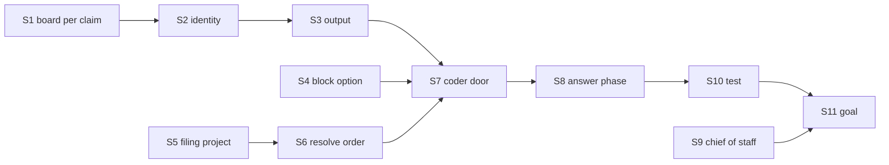

# FIX-1866 · Plan

[Spec](SPEC.md) · [Decisions](DECISIONS.md) · [Rules](BUSINESS-RULES.md) · **Plan** · [Docs](DOCS.md)

Written for the implementing agent. IDs cross-reference [BUSINESS-RULES.md](BUSINESS-RULES.md)
(BR-n) and [DECISIONS.md](DECISIONS.md). `tdd`. Three PRs, a GitHub stack. Starts after
FIX-1842's PR (#3038, the `workerTaskEntry` export) merges.

## Surfaces

| ID | Package · role | Change | Rules |
|---|---|---|---|
| S1 | `harness-manager` · where a run's board is read (D1) | Beside today's fixed `boardCollectionId` + `boardCollection`, the manager accepts boards resolved per run: the host supplies a resolver typed as orchestration's `taskLedgers` resolver (`(ledgerId, ctx, partition)`), and the manager reads `ledgerId` and `partition` from the claim the gate stamped (`currentWorkerClaim()`), recorded on its own state at the run's start. Every read and transition goes through that ref: the attempt fence (today `collectionRef(ctx, id)` in `run-record.ts`), the park, the refused-run cancel (its ticket carries the partition), the message door's row reads, the org run-owner check. No Workforce import. **Two paths change on such a board:** a refused run (`HarnessRunRefused`) fails the row for good instead of cancelling it, so the conversation hears it; and a question parks the row through the board's own ask (`row.ask`), and the re-queued attempt's `task.answer` goes into the prompt where answered inbox rows go today. The fixed board keeps cancel and the inbox | BR-7 BR-8 BR-11 BR-12 BR-16 BR-17 BR-18 BR-21 |
| S2 | `harness-manager` · run identity | The epic segment becomes the ledger id plus a safe digest of the partition, so two conversations never share `branchFor` / `placeFor` / `runTopic`; a fixed board with no partition derives exactly today's segment. A row with no `{ issue, phase }` payload uses its task id as `issue` and the manager's phase; the canonical-id check applies only to payload rows. `findRunRowBySession` keys the same way | BR-12 BR-13 BR-22 |
| S3 | `harness-manager` · output | Success returns `{ issue, phase, sessionId, answer, branch, commits }`: the harness's final message (cut at 8,000), the run's branch (`null` files-only), commits made. Additive for feature rows | BR-14 |
| S4 | `workforce` · `workerTaskEntry` takes a task-shaped block | Today it takes a `turn` (`{ message }` in). Add `block`, which takes the `TaskWorkerInput`; exactly one of the two. Notices, `userMessage`, the split check and the marking stay as they are. The resolver also answers the `mailboxLists` ids, as today. Export `conversationLedgers`, a resolver for S1 that finds a conversation's board at the claim's partition, at the running user's scope, by the same rule `workerTaskEntry`'s gate uses | BR-1 BR-12 BR-20 BR-21 |
| S5 | `workforce` · the project reaches the task session | The hand-over copies the filer's `projectId` (a project conversation, or a task session that has one) onto the task session as a readonly, server-written filing-project key, beside `FILING_WORKSTREAM_STATE_KEY` | BR-5 |
| S6 | `workforce` · `projectWorkspace` resolves in order | Filing workstream (today) → filing project (S5) → the task's `input.project`, read off the claimed row through the claim (`RunSource` stays `(ctx)`; this reverses the source's "reads nothing from the row" rule, safe only because membership is checked) and checked for membership against the run's principal → the `board` claim, only for a source built with one (today's DevTeam path) → refuse `no-project` with a message saying the task can name one. A named project that differs from the conversation's is refused (BR-9). Every refusal is the existing `WorkspaceRefusedError`, raised inside the run, after the claim | BR-4–BR-11 |
| S7 | `shift-manager` · DevTeam coder flow | `work` becomes `workerTaskEntry({ name, block: <by task>, mailboxLists: [feature ledger id] })`, so the entry is marked and takes both. The block routes on the task (D2), never the board: a task naming `issue` and `phase` → the implement-phase manager; any other → the answer-phase manager (S8). Both read their board per claim (S1) over the feature ledger and conversations' boards; the feature ledger, unpartitioned, keeps today's identity. The answer manager gets its own workspace host whose source is `projectWorkspace()` with no `board`, so it never falls back to Storefront (D3); `defineCoderWorkerFlow` takes the second workspace. `ledgerDoor` goes. The message door covers both managers. Keep the startup failure for a harness that isn't detached, which `allowSessionState: true` no longer gives for free | BR-1 BR-13a BR-22 BR-23 |
| S8 | `shift-manager` · the answer phase | Prompt: the task, the worker's `WORKER.md`, its brief and skills, then "answer in your last message; commit only if the task asks for a change". Done: not stopped at the limit and a non-empty final message (D2) | BR-14 BR-15 |
| S9 | `shift-manager` · the chief of staff | Its `WORKER.md` says a coder task names `input.project` when the conversation has none, and to ask the person when it can't tell which. It reads project ids where it already can | BR-3 BR-6 |
| S10 | `shift-manager` · integration test | Coordinator → `addTask` → `eng.coder` → a `completed` line; the failure case → `errored` with a notice; no-project → `errored` after one attempt | acceptance |
| S11 | `goals/devforce-lab/it-answers-a-conversations-task/` | The goal check and its two controls, per [SPEC.md](SPEC.md#the-goal-and-how-well-know-its-met). The stub harness reads the marker file in its working folder and puts it in its final message | VG |
| S12 | Docs | [DOCS.md](DOCS.md); `harness-manager` and `workforce` READMEs; `minor` changesets for both | — |

**Removed:** `ledgerDoor` in DevTeam's `board.mts` (S7), and the coder's "takes no task" case in
`devteam-chief-of-staff-tasks.test.ts` (FIX-1842), which flips to the S10 test.

## Sequence · the PR plan

| PR | Delivers | Depends on |
|---|---|---|
| P1 · harness-manager reads its board from the claim | S1 (with its refusal and question paths), S2, S3, their README part | — |
| P2 · workforce: task-shaped entry block, the filing project | S4, S5, S6, their docs | #3038 |
| P3 · DevTeam coder takes both | S7–S11, the coordinators page | P1, P2 |

P1 and P2 are independent and can be built in parallel; P3 stacks on both.

## Checks

| ID | After | Passes when |
|---|---|---|
| C1 (D1) | S1 | A manager on a partitioned test ledger runs a row from conversation A and one from B; each settles its own row, the fence reads each partition, a stale attempt in B is fenced. Second path: a fixed-board manager's run records, branch and checkout path are byte-identical to `main`'s |
| C2 | S2 | Two partitions, one task id: distinct branch, checkout and topic. A payload row with a non-canonical id is still refused |
| C3 (D2) | S7, S8 | A stub run that answers and commits nothing completes with `commits: 0`; one stopped at the limit fails; one with an empty answer fails. A conversation task naming `issue` and `phase` that makes no commit fails (BR-13a) |
| C4 (D3) | S1, S6 | Each BR-4–BR-11 row, including the member check reading the run's principal, never `input`; each refusal ends `errored` with one notice on a conversation board and `cancelled` on the feature board |
| C5 | S4 | A `block` entry sends one notice per ending; `turn` entries unchanged; both options together is refused at build |
| C6 | S10 | The integration test, plus Bob reaching Alice's coder task (BR-19), the filing refusals (BR-1–BR-3), a question answered from the conversation reaching the next prompt (BR-16), a message into a running chat run (BR-17), the second attempt in the same session and checkout (BR-18), and a feature row and a chat task at once (BR-23) |
| C7 | S11 | The goal check passes; `GOAL_CONTROL=feature-door-only` FAILS leg a on *one line under eng.coder*; `GOAL_CONTROL=no-filing-project` FAILS leg b on *carrying the marker*. Shown FAIL before PASS |
| C8 | P3 | The six `goals/devforce-lab/` checks green (BR-22), and each of their controls still FAILS, `it-keeps-its-rows-on-the-mailboxes-board`'s `kind-ledger` included: if `mailboxLists` re-declares the control's ledger and masks it, `workerTaskEntry` takes the ledger declaration instead of the id |

## Pinned names

| Name | Why |
|---|---|
| `work` | The pinned task entry; the hand-over and a list's fallback address it |
| `input.project` | What the coordinator writes and the docs show; `projectWorkspace` reads it |
| `answer`, `branch`, `commits` | The output fields apps and the coordinator read |

## Guardrails

| Rule | Because |
|---|---|
| The harness manager imports nothing from Workforce; the host passes the resolver | Layer boundaries (Jake, 2026-09-24): Workforce plugs policy into generic hooks |
| Ledger and partition come from the gate's claim, never the task's input | BP-031: the claim is server-stamped; input is the caller's |
| The project's membership check reads the run's principal | BP-031; the task names a project, it never grants one |
| Every coder-side refusal raises inside the run, after the claim | A pre-claim refusal leaves a row in progress until the next touch (DECISIONS → the lease question) |
| A fixed board's derived identity stays exactly today's | BP-030: run records and branches already on disk must still be found |
| Docs say "worker", never "seat" | Jake, 2026-10-04 |

## Docs

[DOCS.md](DOCS.md) drafts the reader-facing prose. P1 and P2 reconcile and publish their parts;
P3 publishes the coordinators-page part against the shipped refusal wording.

## Sketch and POC

No sketch and no POC: the change extends the manager's own shape, and the premises it rests on
are checked first at implement time (below). No factual-base checker either: the spec counts
nothing but the six DevForce lab checks, which its README lists by name.

## At implement time

- Re-read FIX-1792's state: if P3 there has started moving the coder off the feature board, agree
  with that thread who owns `coder.mts`.
- Confirm `currentWorkerClaim()` is readable in the manager's first step under `workerTaskEntry`'s
  gate, with `allowSessionState: true` and a detached harness. If not, the gate's ticket on state
  is the other source; stop and raise it if neither works.
- Confirm a project coordinator conversation can add `eng.coder` with `addDelegate` (leg b). If
  it can't, leg b runs from a workstream conversation and BR-5 stays a CI check.
- FIX-1797's spec gains this check as a required leg; that amendment is the epic thread's.

## Follow-ups

- A timer that recovers any conversation row whose run never started, instead of waiting for a
  touch (orchestration). To be filed.
- Publishing a chat task's branch and opening a pull request from it. To be filed.
