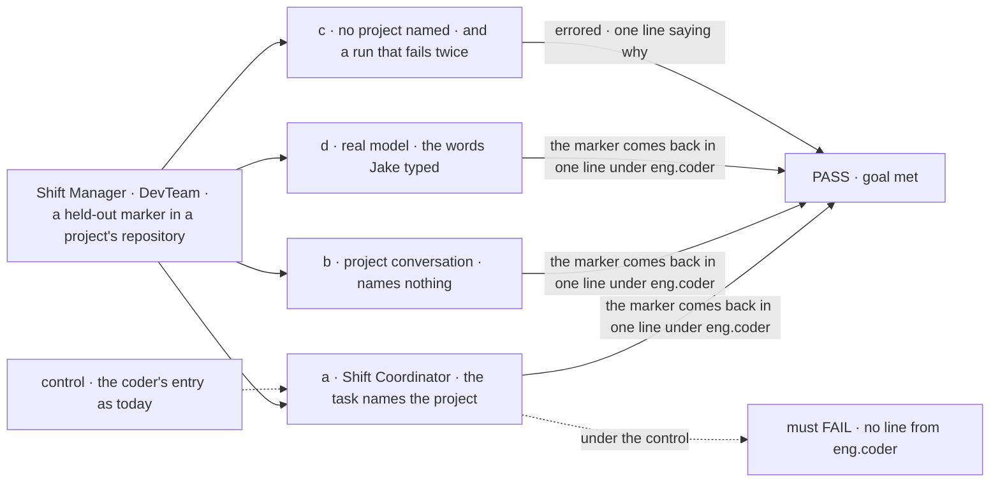
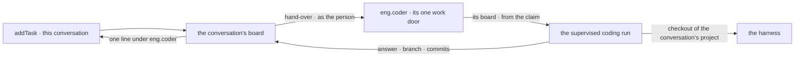

# FIX-1866 · The coder takes a conversation's task as a coding run

**Spec** · [Decisions](DECISIONS.md) · [Rules](BUSINESS-RULES.md) · [Plan](PLAN.md) · [Docs](DOCS.md)

## Five people, before and after

| Someone who… | Today | After |
|---|---|---|
| **tells their Shift Coordinator "the coder should take a look at our repo"** | The chat hung. Since [FIX-1842](https://linear.app/fixpoint-labs/issue/FIX-1842), the coordinator is told the coder takes no task, so the ask still never reaches it | The coordinator files a task for `eng.coder`. The coder works it in its own checkout of the project's repository, and its answer lands in the conversation under its name |
| **asks from a conversation that belongs to a project** (a project or workstream conversation) | n/a | The coder works in that project's repository, or on its files when it has none. Nobody names the project |
| **asks from a conversation with no project** (the Shift Coordinator) | n/a | The task names the project, and the coder checks the person may use it. With no project named, the task fails at once and the conversation is told to name one |
| **asks for something the coder can't finish, or asks back** | n/a | A failure ends the task failed, with one line in the conversation saying why. A question from the coder lands as a line, and the person's answer goes back into the same run |
| **files features for the coder** | The EM's board hands rows to the coder, which must commit | The same, unchanged. A task that names an issue and a phase still needs a commit, wherever it was filed |

Part of epic [FIX-1786](../../epics/FIX-1786/SPEC.md). It builds on [FIX-1794](../FIX-1794/SPEC.md)'s
conversation boards and on `workerTaskEntry`, exported by FIX-1842. [FIX-1797](https://linear.app/fixpoint-labs/issue/FIX-1797)'s
closure run needs it twice: for this ask, and for its leg b5, where the EM files the coder's tasks.

## The goal, and how we'll know it's met

**A person asks their coordinator to have the coder look at a project's repository, and the
coder's answer about that repository comes back in the same conversation under the coder's
name. When the coder can't do the work, the conversation hears that it failed and why.**

| Is it the right goal? | |
|---|---|
| **The real need** | Jake, live: "the coder should take a look at our repo" hung the Shift Coordinator. The [issue](https://linear.app/fixpoint-labs/issue/FIX-1866): the coder takes a conversation's task as a coding run in the project's repository, and the answer comes back under its name; feature work unchanged |
| **Smaller, and rejected** | "`addTask` for the coder is accepted." True as soon as the coder's entry is marked, and the task could still run nowhere, or in the wrong repository, or end with only three ids in the chat |
| **Bigger, and not this issue's** | Publishing a chat task's branch or opening a pull request from it; the line names the branch and commit count only ([follow-up](PLAN.md#follow-ups)) · moving the coder's feature work onto the EM's workstream board ([FIX-1792](../FIX-1792/PLAN.md) P3) · a timer that recovers any task whose run never started ([follow-up](PLAN.md#follow-ups)) |
| **Not done if** | The answer could have been written without reading the repository · the run worked in the project's own repository instead of a checkout of its own, or in Storefront when another project was meant · a project the person isn't a member of was accepted · a read-only ask fails because it made no commit · a failure ends with the task still in progress, or cancelled with no line · the line landed in another conversation, or twice after a retry · the coordinator's turn waited for the run · any of the six `goals/devforce-lab/` checks went red |



The check plants a marker in the project's repository at run time and reads the conversation.
Only a run that worked in that repository can say it. Under the control the coder can't take
the task, and leg a must fail.

| How we verify | |
|---|---|
| **Goal check** | `goals/devforce-lab/it-answers-a-conversations-task/`, run with `run.mts` beside its `goal.md` like the other DevForce lab checks · stub harness in every leg; a scripted coordinator in legs a to c, `openai/gpt-5.4-mini` as the coordinator in leg d (`OPENAI_API_KEY`) · DevTeam over HTTP · run by the implementer at completion · verdict in the last implementation PR · a required leg of FIX-1797's closure run |
| **Signal** | Each clock starts at the filing. **a**: the coordinator's turn returns within 10 s; one `completed` line under `eng.coder` in the Shift Coordinator conversation within 60 s, its worker read off the row's assignee, carrying the marker; the run's working folder, read off its run record, is a checkout distinct from the project's repository, and the repository's branches are unchanged. **b**: the same from a project conversation on the second project, which names no project; and on Sandbox (no repository), with a marker in its project files. **c**: a task naming no project, and one naming a project the person isn't a member of, each give one `errored` line naming why, after one attempt; a run whose stub throws a random error string twice gives one `errored` line carrying that string. Every row reads `errored`, none `in_progress` or `cancelled`, 5 s later. **d**: on the standard install, where Storefront is the only project with a repository, "the coder should take a look at our repo" gives a filed task for `eng.coder` naming Storefront, and a line carrying the marker |
| **Input** | DevTeam's standard install (`openLab` as `fsdev.config.mts` opens it), plus, for legs a to c, a second project with its own bare repository, made by the check. Each marker is a random string committed to the project's repository (or written to Sandbox's project files) after the server starts; the stub reads a named file in its working folder and puts it in its last message. A different marker, or a third project, must pass too |
| **Anti-game** | No drain, row, notice or session written by the check. The marker never appears in the task, the prompt, the brief or the coordinator's context. Read the conversation's lines, not the row's output alone. A crash or a timeout is not a FAIL for a control |
| **Control that must fail** | `GOAL_CONTROL=feature-door-only` (the coder's `work` entry as today): leg a FAILS on *one line under eng.coder*. `GOAL_CONTROL=no-filing-project` (the hand-over drops the project): leg b FAILS on *carrying the marker*. Today's `main`: legs a, b and d FAIL. Each FAIL shown before the PASS |

## What changes


On the left the coder has one door, and it opens only for the feature board. On the right the
same door opens for a conversation's board, and both kinds of work go through one supervised run.

**What the coordinator files**, from a conversation with no project of its own:

```diff
  addTask({
    goal: "Take a look at our repo and tell me what the checkout flow does",
    assignee: "eng.coder",
+   input: { project: "storefront" },
  })
```

From a project or workstream conversation it names nothing; the project comes from the
conversation. And the line the conversation gets back:

```diff
+ eng.coder · Task "Take a look at our repo…" completed by eng.coder:
+   {"answer":"The checkout flow lives in src/checkout/…","branch":"…","commits":0}
```

## How a task reaches the coder



The run reads its board from the task's claim, so the same supervised run serves the feature
board and any conversation. A task naming an issue and a phase is feature work and needs a
commit; any other task needs an answer. The project comes from the conversation, or from the
task when the conversation has none.

## What stays as it is

- The feature board, the EM, and the coder's feature runs: same door, same phase, a commit still
  required. The six DevForce lab checks stay green.
- The harness slot, the checkout lease, questions to a person, and the message door into a
  running run.
- Conversation boards, notices, and the delegate check ([FIX-1791](../FIX-1791/SPEC.md)): the
  coder is read off the roster as data, and "on this person's roster" is still its own check.

## Sign off

**[The goal](#the-goal-and-how-well-know-its-met), at that size:** the coder's answer about the
right repository, in the conversation, with failures heard. If wrong: the chat gets an answer
that could be made up, or a task that never ends.

1. **[D1](DECISIONS.md#d1) · A conversation's task runs as the same supervised coding run as
   the feature board's rows; the run reads its board from the task's claim.** If wrong: the
   largest change to the run since it shipped, made for a path a lighter runner could have
   served. **The one to weigh.**
2. **[D2](DECISIONS.md#d2) · A task that names no issue and phase is done when the run ends with
   an answer; a commit is reported, not required.** If wrong: a coding task that changed nothing reads as
   done, and only `commits: 0` in the line says so.
3. **[D3](DECISIONS.md#d3) · The repository is the conversation's project, or else the one the
   task names; with neither, the task fails saying so.** If wrong: the coordinator has to name
   a project the person thinks is obvious.

**Open: none.** Reasoning and what lost: [DECISIONS.md](DECISIONS.md). The cases:
[BUSINESS-RULES.md](BUSINESS-RULES.md).

Feature · `harness-manager`, `workforce`, `shift-manager` · large · 3 PRs · epic [FIX-1786](../../epics/FIX-1786/SPEC.md)
