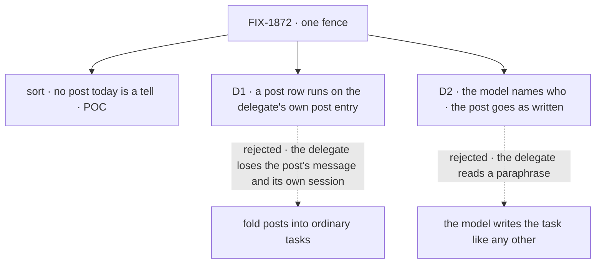

# FIX-1872 · Decisions

[Spec](SPEC.md) · **Decisions** · [Rules](BUSINESS-RULES.md) · [Plan](PLAN.md) · [Docs](DOCS.md) · [Evolution](EVOLUTION.md)

What was chosen, what lost, and what each choice locks in. Two decisions are the sign-off surface.
The direction itself, a post that needs an answer is a task and the claim ticket is the only fence,
is the epic's [D2](../../epics/FIX-1870/DECISIONS.md#d2), decided by the product owner and not
reopened here.

## The tree

Solid edges are what you're signing. Dashed edges lost, and the label says why.

## D1 · A post row is worked on the delegate's own post entry, not folded into ordinary tasks

| | |
|---|---|
| **Instead of** | Posts become ordinary task rows, worked on the `work` entry every task-taking worker has, with a post kind on the row so the coordinator's pick still reads `takes`. `delegatedPostEntry` retires and apps stop declaring it |
| **Because** | Who may be handed a post is decided by the coordinator's pick, which reads `takes` when it files, and the board's delegate check runs again at hand-over (BR-7), so that holds either way. What the separate entry keeps is what the delegate answers and where. A post is shown as `<from>, through <coordinator>: <post>` with the conversation's recent lines (BR-6), and it runs in the delegate's own long-lived session for this conversation, with its history, which the next post reuses (BR-1, BR-20). The `work` entry runs a task in a session keyed by the task and the worker, so a folded post would start cold every time and read as a task. Keeping the entry changes only the fence, which is all epic D2 asked (tenet 2: realign what exists) |
| **Locks in** | Delegate flows keep declaring `delegatedPostEntry(turn)`, the same helper and argument, moved from `internal` to `task` entries: a task dispatch reaches only `task` entries, and that is where `defineFlow` puts the claim gate, with its lease renewal. Each app with its own delegate flow edits that line, and FIX-1887's rename map carries it as a declaration move. The board's hand-over picks one of two addresses per row (post entry in the delegate's session, or `work` in a task session), both behind the one claim gate. That bends the board's "one session to one task and one worker" rule for post rows only, and BR-17 fences it |

![D1, where a post's row is worked. Chosen: on the delegate's own post entry. Instead of: on the ordinary task entry, retiring the post entry. It comes down to the first row, what the delegate answers and where: chosen, the post as written in its own session for this conversation, with its history; instead, a task in a fresh task session, so each post starts cold. Second row, the price: chosen keeps two entries and moves one declaration line per app; instead has one entry. Third row, a tie: the answer is fenced once by the claim ticket either way. Locks in delegatedPostEntry kept, declared under task. Flips if the product accepts delegates answering each post fresh](figures/d1-post-entry.svg)

It comes down to what the delegate answers, and where: folding hands it a cold task instead of
the person's post in its own running conversation.

**What would change my mind:** the product accepting that a delegate answers each post fresh, in a
session of its own, with no memory of earlier posts. Then folding is the simpler shape, and the
post entry retires.

## D2 · On a post, the coordinator's model names who; the post goes as written

| | |
|---|---|
| **Instead of** | Under judgment, the model writes the task with `dispatchTask` like any other task: its own goal and title, which the delegate reads |
| **Because** | A delegate today reads `<who wrote it>, through <coordinator>: <the post>`, with the conversation's recent lines, and answers that. A paraphrase changes what it answers, and the FIX-1791 check grades a held-out word arriving intact. The post's identity also has to come from the server, so a second hand-off of the same post to the same delegate in one round is skipped rather than filed twice (BR-2) |
| **Locks in** | On a coordinator turn that is routing a post, `dispatchTask` takes the post being routed as its task, filled from the server; the model chooses `assignee` and, for a workstream, `target`, and nothing else. The call tells the two forms apart by `goal`: with no `goal` on a routing turn it hands on the post being routed; with a `goal` it files an ordinary task in the coordinator's own words, a separate row and a separate answer. Off a routing turn, a call with no `goal` is refused as FIX-1875 refuses it. This sits on FIX-1875's run-time "`goal` or `taskId`, exactly one" check, so its schema must reserve it (raised on #3140) |

![D2, what the delegate reads when the judgment turn hands on a post. Chosen: the post as the person wrote it, with who wrote it and the recent lines. Instead of: the task the model writes, as for any dispatched task. It comes down to the first row, what the delegate answers: chosen, the person's own words, as today; instead, the model's paraphrase, which can drop a detail. Second row, the price: chosen gives dispatchTask a post form on a coordinator turn, a shape only coordinators see; instead, one shape everywhere. Third row, a tie: the routing record names who either way. Locks in the model names who and target, nothing else, on a post. Flips if the product wants coordinators to brief delegates in their own words](figures/d2-post-as-written.svg)

It comes down to what the delegate answers: a paraphrase can drop the detail the person asked about.

**What would change my mind:** the product wanting a coordinator to brief its delegates in its
own words. Then a post becomes an ordinary task the model writes, and the person's message is
only context.

## Decided, not asked

- **No post today is a tell.** Every way onto the post entry expects an answer back
  ([POC](poc/inventory/README.md), F1 to F3). So nothing becomes a plain message, and no tell
  path is built. The one plain message that remains is the round-deadline wake (BR-12), which
  carries no answer and decides nothing.
- **The row is worked in the session the post goes to today:** the delegate's own session for
  this conversation, or for a workstream the session its entry names. Existing sessions are
  reused, with their history. Never a task session (FIX-1794's review round 2 rule).
- **A post row's ending is the coordinator's, not the generic task notice's:** it lands the
  delegate's reply as its line, feeds the round, and wakes no turn. A failed or cancelled post row
  writes no line, as a failed post writes none today (BR-9).
- **A post row's identity is server-derived** from the post, round and delegate record, so a
  replayed routing and a second hand-off file nothing new. Top-level row fields, never `metadata`
  (BP-031).
- **The post entry is a `task` entry.** A `task` dispatch resolves only `flow.task.actions` and
  never falls through to `internal` (`core/src/flow/resolve-entry.ts`), so the move is required,
  not conditional. A flow still declaring it under `internal` is refused when the coordinator is
  built (BR-18).
- **The lease is renewed through the delegate's turn** by the claim gate `defineFlow` puts on
  every `task` entry (`orchestration/src/task-board/task-entry.ts`), from claim to the write that
  settles the row, as for any task. A turn longer than the lease still lands one line (BR-23).
- **A round closes by reading the board.** Each post row carries its round, server-written at the
  top level; close lists the conversation's rows for that round and checks every one has ended.
  The coordinator keeps only the round's deadline and whether it is open (BR-13). No list of
  deliveries lives in its state.
- **Post rows are ordinary rows on the board**, listed and cancellable like any. Hiding them
  would be the special kind of task epic ER-9 rules out.
- **Row cost is accepted** (epic D2). It is bounded and measured, not avoided (BR-22).
- **A delivery in flight at the upgrade loses its answer.** The entry it would answer on is gone;
  its round closes at its deadline (BR-19). Keeping the old entry for a drain period would ship
  two fences (epic ER-10).
- **`target` is accepted on a post only.** An ordinary task to a workstream is still refused
  (BR-15), so lifting FIX-1794's refusal stays inside coordinator posts, as the epic asked.

## Which methods already do this job

The job: hand work to another worker and hear its one answer. Searched by `wait`, `answer`,
`handOff`, `deliver`, `notice`, `onTaskSettled` and `dispatcher(` across `packages/`.

| Entry | What it does |
|---|---|
| The coordinator's `handOff` + delivery ledger (FIX-1791) | Delivers a post, answer fenced by a token. **Retired here** |
| The board's task tools and `onTaskSettled` (FIX-1794) | Files a row, hears its ending once. **The closest; posts move onto it** |
| `dispatchTask` (FIX-1875) | Starts a row now, can wait. **The path posts are sent through** |
| `dispatcher()` with `session: { from: true }` (FIX-1312) | Flow-code transport, no fence. Kept for the deadline wake |

Two entries did the job the same way; this issue folds the first into the second.

## Considered and dropped

| Alternative | Why not |
|---|---|
| Keep the post entry as an internal entry and pass the claim ticket in the post | The ticket would travel through another flow's input and back, and only a `task` entry's claim gate renews the lease while the delegate works. A fence carried in a payload is the token again |
| Keep a list of the round's rows in the coordinator's state, as bookkeeping | It never refuses anything, but it is a per-delivery record beside the board, the ledger shrunk. Close reads the board by the row's round instead (BR-13), one filtered read per close (BP-033) |
| A distinct tool for the post form, or routing turns that can only post | A second tool name is the two-shapes problem epic D2 removed. Post-only routing turns would take away the ordinary task a coordinator files today. `goal` already marks an ordinary task |
| A tell path for some posts | No post is a tell (the sort) |
| Hide post rows from the board | A task shown differently, which epic ER-9 defers |

## Settled

- **No coordinator post today is a tell** — **CONFIRMED** by
  [`poc/inventory/`](poc/inventory/README.md) on `da8f63fd7`: two dispatchers onto the post entry,
  two routes into them, and the entry sends back only an answer or a report of none. Its negative
  control fails as it should.

## How it got here

- **Draft** — framed as epic D2 made concrete: posts sorted (none is a tell), every post a row
  through `dispatchTask`, worked on the delegate's own post entry in its existing session, with the
  ledger, its two entries and `handOff` gone in one PR.
- **Review round 1** — D1's reason restated: the coordinator's pick already decides who gets a
  post, so the entry is kept for the post's message and the delegate's own session. Rounds close
  by reading the board, not a list in coordinator state, because that list was the ledger shrunk.
  D2 names how `dispatchTask` tells a post from a task (`goal`) and uses `assignee`, FIX-1786 D7's
  name. The post entry's move to `task` is now certain, from the code.

**Open: none.**
