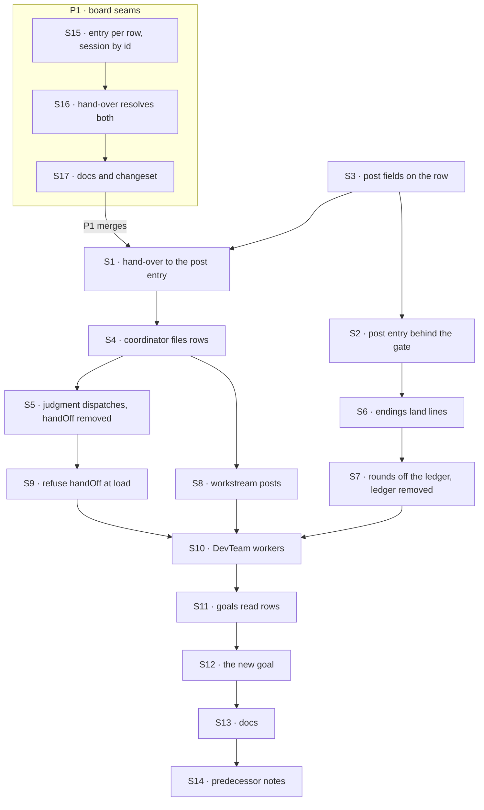

# FIX-1872 · Plan

[Spec](SPEC.md) · [Decisions](DECISIONS.md) · [Rules](BUSINESS-RULES.md) · **Plan** · [Docs](DOCS.md) · [Evolution](EVOLUTION.md)

Written for the implementing agent. IDs cross-reference [BUSINESS-RULES.md](BUSINESS-RULES.md)
(BR-n) and [DECISIONS.md](DECISIONS.md) (D-n); epic rules are ER-n. `tdd`. **Two PRs** (D3).
**P1** adds two task-board seams in `core` and `orchestration` (S15 to S17); it changes no
Workforce behaviour, adds no fence and removes nothing, and has no gate. **P2** is S1 to S14 on
those seams, and is the single-fence change: the ledger, its two entries and `handOff` go in the
same change as the row path (epic ER-10), so no build carries two fences. **Gate (P2):** starts
only after P1 merges, and after FIX-1875 merges with `dispatchTask`'s shape
reserving the post form (`post: true` on a routing turn, FIX-1875 D2 and BR-26; here BR-5), not just `target`. If it merged
without that, stop and return a blocker; don't add the post form here silently.

## Surfaces

### P1 · board seams (`core`, `orchestration`)

Today a board dispatcher names one fixed entry (`packages/core/src/types/dispatch.ts`, the `task`
address's `action`), offers only keyed sessions (`TaskSessionPolicy`: `per-task`, `per-worker`, a
key function), and the hand-over always sends `{ key }` (`hand-off.ts`). The dispatch layer below
already delivers `{ id }` into an existing session. Mirror the per-row lookups the hand-over
already makes, `resolveTaskFlowKind` and `resolveTaskState`.

| ID | Package · role | Change | Rules |
|---|---|---|---|
| S15 | `core` · `packages/core/src/types/dispatch.ts`, the `task` address | `action` is a string or a function of the row, `(task, ctx) => string`. `TaskSessionPolicy` gains `{ id: (task, ctx) => string }`, an existing session, never created. P2 needs a keyed session and an id session on one board, so the per-row choice must reach both; the smaller shape is yours | D3 |
| S16 | `orchestration` · `packages/orchestration/src/task-board/blocks/hand-off.ts` | Resolve the entry per row beside `resolveTaskFlowKind`, before the claim is released; a name the target flow doesn't declare is refused by the seam's existing `no-entry`, claim held. Pass an `id` session through to the existing `{ id }` delivery, refused by name when the session isn't there or isn't this principal's. A string `action` and every keyed policy behave as today | D3 |
| S17 | `core` · `orchestration` · docs and release note | Document both options in `packages/orchestration/README.md` and `apps/docs/docs/orchestration/task-board.md` (and `packages/core/README.md` where it lists session policies). One `.changeset/*.md`, `minor`, for `@flow-state-dev/core` and `@flow-state-dev/orchestration` | — |

### P2 · the single fence (`workforce`, DevTeam, goals, docs)

| ID | Package · role | Change | Rules |
|---|---|---|---|
| S1 | `workforce` · the conversation board's hand-over (`packages/workforce/src/conversation-board/board.ts`) | One rule for a post row: it goes to the delegate's post entry, in the session written on the row (S3); every other row keeps going to `work` in a task session. On S15–S16: the entry is chosen per row, and a post row's session is `delegate:<key>`, or by id for a workstream; a follow-up's key is still derived as today. The delegate check accepts a post-only delegate for a post row, and still refuses it for a task. The claim gate is the same one. A session that isn't the row's refuses it | BR-1 BR-16 BR-17 BR-20 · D1 |
| S2 | `workforce` · the post entry (`delegatedPostEntry`, `delegatedPostOnFinished`) | Behind the claim gate: read the post off the row, run the turn as today, settle the row with the reply; an empty reply, a failure or a cancel fails it. At the deadline, send the conversation the wake (S6) instead of a miss. Declared under `task.actions`, so `defineFlow` puts the claim gate and its lease renewal on it; refuse it under `internal` | BR-6 BR-9 BR-11 BR-12 BR-23 · D1 |
| S3 | `workforce` · the row's post fields | Top-level, server-written fields for a post (post id, round, delegate record, session, from, coordinator, recent lines, deadline), set only by the post path. The session is resolved when the post is filed: today's per-delegate key for this conversation, or for a workstream the session its `target` resolves to. Row id derived from post, round and delegate record. The round is filterable, for S7 | BR-2 BR-4 BR-13 |
| S4 | `workforce` · the coordinator's delivery | Every pick (fixed policies, route-on rounds, judgment) files a post row through FIX-1875's dispatch path. The routing record reads filing outcomes. **Remove** the open/dispatch/settle sequencer, both post dispatchers and the router | BR-1 BR-3 BR-7 |
| S5 | `workforce` · the coordinator's judgment tools | **Remove** `handOff`. On a turn routing a post, `dispatchTask` with `post: true` takes the post from request state; the model sends `assignee` and `target` only. With a `goal` it is the ordinary call. Carry `handOff`'s refusal wording (the delegates that take posts) and its measured sentence "a new message is a new post, even when it repeats an earlier ask" onto that call | BR-5 BR-7 · D2 |
| S6 | `workforce` · the coordinator's ending entry | A post row's ending (via `onTaskSettled`) lands the reply as the delegate's line, keeps it in its round, releases the hold, closes rounds and sends answers on; a failed one only ends its part. A small internal wake entry closes overdue rounds. **Remove** `DELEGATE_ANSWER_ACTION` and `DELEGATE_MISSED_ACTION` | BR-8 BR-9 BR-10 BR-12 BR-19 |
| S7 | `workforce` · rounds | The coordinator keeps each round's deadline and open flag only. Close reads the board's rows for that round (one filtered read) and checks every one has ended. **Remove** `delivery-ledger.ts`, its test and the session state key; tolerate a saved value | BR-13 BR-14 BR-18 |
| S8 | `workforce` · workstream records | Lift "a workstream takes posts, not tasks" for post rows only; ordinary tasks keep the refusal. Target resolution stays where it is today, when the post is filed, with the same check; the resolved session is written on the row (S3). None yet files no row and records `failed` | BR-15 BR-16 BR-17 |
| S9 | `workforce` · worker loading | A coordinator worker file naming `handOff` is refused at load, naming `dispatchTask`. The refusal message and its test carry FIX-1875's marker `retired-name-refusal`. The published sentence in `chief-of-staff.md` can't carry a marker; FIX-1876 keeps it with a keep-list entry (its WR-25, #3155) | BR-18 |
| S10 | `shift-manager` · DevTeam's chief of staff and project coordinator `WORKER.md` | `handOff` → `dispatchTask` in their instructions; the EM's post entry moves to `task` entries (S2), and so does the `ask-lab` test fixture's (`asker.mts`) | — |
| S11 | `goals/` · the checks that read the ledger, and every lab that declares the post entry | **Ledger reads → row reads** in `hands-each-post-to-its-delegates` (`devteam.mts`, `leg-e.mts`, `goal.md`), `a-shared-project-has-one-owner-per-workstream` and `two-users-share-a-project-and-nothing-else`, listed in the PR as fence lines; tool names renamed. These row reads are the proof that posts are rows (ER-6). **Declaration moves:** every lab that declares the post entry moves it from `internal` to `task` entries (S2), or BR-18 refuses it at build; V9 names the reruns. Each move is a named entry in the epic's closure map (#3153). Three moves keep a control invariant: `files-and-splits-down-the-chain`'s raw `poster` block becomes `delegatedPostEntry`, since a raw block never settles its row; `a-routed-post-gets-one-answer`'s `no-context` control keeps its line-stripping wrapper and still fails at **context** only; kitchen-sink's `no-landing` control (`apps/kitchen-sink/lib/landing-control.ts`) still fails at its own legs only | ER-6 ER-11 BR-18 |
| S12 | `goals/coordinators/one-fence-answers-each-post-once/` | **New** goal check, per `SPEC.md`: leg b (the fence: replayed endings, a double hand-off, a stale settle after cancel) and leg d (the deadline wake). Both controls run against leg b | — |
| S13 | Docs | Publish [DOCS.md](DOCS.md) | — |
| S14 | `specs/` · predecessors on `main` | Dated amendment notes: FIX-1816 D3 and its change log (two answer-once checks become one, by epic FIX-1870 D2, carried out here), and a superseded note on FIX-1791's ledger rules (BR-20 to BR-22, BR-27). In the implementation PR, so `main` says superseded when the behaviour changes | — |

## Sequence



The ledger is removed only once rounds and endings no longer read it (S7 after S6), and inside
the same PR.

## Checks

| ID | Runs after | Passes when |
|---|---|---|
| V10 | S15 S16 | Red first. A board whose entry is a function sends each row to the entry it returns; a name the target flow doesn't declare is refused `no-entry` with the claim held; a string entry behaves as today |
| V11 | S15 S16 | Red first. An `id` session delivers into that existing session; a missing one, or one that isn't this principal's, is refused by name, never created, claim held; `per-task`, `per-worker` and a key function behave as today |
| V1 | S1 S3 | A post row runs in the session written on it, the delegate's existing session for the conversation, never a task session; a session that isn't the row's refuses it; a non-post row still runs in a task session; a session made before the change is reused (BR-1 BR-17 BR-20) |
| V2 | S2 | The turn sees today's message and lines (BR-6); an empty reply, a failure and a cancel each fail the row (BR-9); a second settle is refused (BR-11); a delegate turn longer than the lease still lands one line, and the row is not handed out again (BR-23) |
| V3 | S4 S5 | Every policy and every round files one row per pick; a repeat is `skipped` (BR-2); records match today's for the same scripted run (BR-3); the model's extra task fields are refused (BR-5) |
| V4 | S6 | A completed post row lands one line and wakes no turn; an ending replayed five times lands one (BR-8 BR-10); a failed one lands none (BR-9) |
| V5 | S7 | Today's `coordinator-rounds` and `coordinator-followup-context` cases pass with ledger reads replaced; close reads the board by round, and the coordinator's state holds no row list; a saved ledger is ignored then dropped (BR-13 BR-14 BR-18) |
| V6 | S8 | A workstream post's row carries the entry's session and runs there; none yet files no row and records `failed`; an ordinary task to it is refused (BR-15 to BR-17) |
| V7 | S9 | A file naming `handOff` fails to load with the `dispatchTask` hint; no tool list on any flow carries `handOff` (BR-18) |
| V9 | S11 | The FIX-1791, FIX-1794 and FIX-1610 checks and the two project goals pass; FIX-1610's `no-context` control fails at **context** only; FIX-1875's leg e of `files-and-splits-down-the-chain`, the pentest lab and the kitchen-sink `no-landing` control rerun with their verdicts unchanged; each diff passes the epic's rename-map script, with its fence lines listed and its declaration moves matched by the map's named entries (#3153) |
| VG | S12 | [The goal](SPEC.md#the-goal-and-how-well-know-its-met) PASSES after `GOAL_CONTROL=no-ending-dedupe` FAILED `b:one-line` and the `main` run FAILED `b:no-ledger` |

## Pinned names

| Where | Name | Why pinned |
|---|---|---|
| `dispatchTask` | `target` | Epic ER-1 and ER-5 name it |
| `dispatchTask` | `post: true` marks the post form; `assignee` for the recipient, on a post too | FIX-1875 D2 (one of `goal`, `taskId`, `post`) and FIX-1786 D7 (no alias); one tool, one field name |
| Goal check | `goals/coordinators/one-fence-answers-each-post-once/`, `GOAL_CONTROL=no-ending-dedupe` | `SPEC.md` and the closure cite them |
| Routing record | `delivered`, `skipped`, `failed`, and every reason string | People and checks read them; unchanged |
| Exports | `delegatedPostEntry`, `delegatedPostOnFinished`, `delegatedPostHistory`, `DELEGATED_POST_ENTRY` | Apps declare them (D1) |

Everything else is yours to name, including the post form of `dispatchTask`'s task and the row's
post fields.

## Guardrails

| Rule | Because |
|---|---|
| The claim ticket is the only thing that decides an answer counts. No token, no "answered" flag, no per-delivery record in the coordinator's state | Two fences disagree at the edges, which is the whole issue (epic ER-10, tenet 5) |
| Every post goes through the one dispatch path, from all five places a post starts: judgment, best fit, round robin, everyone, and route-on rounds | An invariant held at one entry and missed at another is the review class that costs most (tenet 5) |
| Nothing in the coordinator's view changes but the fence | The reruns are the proof, and a check that had to change is the finding (epic ER-11) |
| A post row's session is today's delegate session, never one keyed by the task | `findWorkerSession({ worker, filingSessionId })` must keep finding it (FIX-1794 review round 2) |
| Post fields are top-level and server-written | `metadata` is model-writable through `updateTask` (BP-031) |
| Old sessions and old worker files are tolerated or refused loudly, never misread | Saved coordinator state and DevTeam-shaped files exist in the field (BP-030) |
| Test the second paths: a replayed ending, a cancel mid-turn, a late answer, a concurrent second hand-off (BP-035) | Each is a way one fence could have become two |

## Docs

P1 documents its two options itself (S17). P2: reconcile and publish [DOCS.md](DOCS.md) after V9 passes. It updates `coordinators.md`,
`chief-of-staff.md` and the Workforce README; FIX-1876 owns the glossary and the shared
vocabulary pass.

## Release note

P1: one `.changeset/*.md`, `minor`, for `@flow-state-dev/core` and `@flow-state-dev/orchestration`:
a task board's dispatcher can choose its entry per row and can run a row in an existing session by
id (S17).

P2: one `.changeset/*.md`, `minor` for `@flow-state-dev/workforce` (BP-022), telling an app three
things: a worker file naming `handOff` is refused at load and should name `dispatchTask` (BR-18);
a delegate flow declares `delegatedPostEntry` under `task` entries (D1); and an answer for a post
delivered before the upgrade is dropped, its round closing at its deadline, so a long `rounds: N`
conversation can lose one round once (BR-19). The last is expected upgrade behaviour, not a bug.

## Sketch · pseudocode, illustrative, react to the shape

```
routing a post (any policy, any round):
    for each pick:
        file a row through the dispatch path:
            id      ← derived from (post, round, delegate record)   ← a repeat files nothing
            post    ← the post as written, from, lines, deadline    ← server-written
            target  ← the record's, if any
            session ← this conversation's for the delegate, or the one target resolves to now
                      (none yet → nothing filed, record failed)
        record: delivered | skipped | failed

the board hands a post row over:
    session ← the one written on the row; any other refuses it
    entry   ← the delegate's post entry, behind the claim gate

the coordinator hears an ending:
    post row completed → line under the delegate, keep in round, maybe close, maybe route on
    post row failed    → mark ended in its round, maybe close
    a deadline wake    → close overdue rounds
```

**POC:** [`poc/inventory/`](poc/inventory/README.md). It counted every way onto the post entry
and what it sends back: no post is a tell. It also lists the 49 files that name a retired
surface, which S10 and S11 come from. The premise held; nothing changed.

## At implement time

- Read FIX-1875's merged spec and code first: the dispatch path's name, how it starts a row, and
  that its shape reserves the post form (the gate above).
- Rerun the POC before starting; a sibling may have added a caller.

## Follow-ups

- FIX-1876 renames the internal ask names and the remaining "hand-off" wording for delivering
  work, including any this PR leaves in comments.
- FIX-1887's rename map must carry the delegate-entry declaration move (S2). Its sweep, not this
  PR, owns "no file names a retired surface"; the retained POC is not updated here (BP-037).

## Notes from review

Recorded verbatim for the implementer from review round 1 on #3142. None changes the approach.

- **Second look, note 1 (answered in the spec):** "Open question the plan defers: whether the engine's task dispatch can reach `internal.actions`. [...] A one-hour check against the engine before the implementing agent starts would remove the largest unknown in S2." *Answered from the code: a `task` dispatch resolves only `task.actions` (`core/src/flow/resolve-entry.ts`), so S2 moves the entry.*
- **Second look, note 2:** "Row growth: BR-22 measures time, but 1,000 rows per ten posts on one board also lands in every board listing and in the devtool. Consider stating a retention or collapse expectation for ended post rows, even if the answer is "none, accepted"." *Answered in the restraint pass: none, accepted (epic D2); the round limit bounds it, and BR-22's bench was cut.*
- **Second look, note 3:** "BR-19 drops in-flight answers at upgrade. That is fine for a deadline-bound round, but a long `rounds: 3` conversation could lose a whole round once. One line in the release note would cover it."
- **Second look, note 4:** "Architecture: this is a good opportunity because it removes a duplicate (ledger vs. claim ticket). Do not widen it. `delivery-ledger.ts` is 193 lines, but `coordinator-flow.ts` is 1,735, and S4 deletes the open/dispatch/settle sequencer and two dispatchers from it. Make sure the PR doesn't leave the flow file's remaining structure half-migrated. If the deleted pieces leave the file with an obvious split (policy picking vs. round/ending handling), note it as a follow-up rather than doing it here."
- **Architect, optional 1:** "Add a restart-during-an-open-round case under the BP-035 guardrail, since the deadline timer at `delegated-post.ts:280` lives in memory."
- **Architect, optional 2:** "#3141's `handOff` sweep will need an allowlist entry for this PR's load-time refusal message (BR-18)."
- **Cursor, `SPEC.md` Signal:** "Consider shortening to one line per leg + “proved by BR-n / goal check” and keeping the full criterion text only in `BUSINESS-RULES.md` or `PLAN.md` §Checks — less drift when a leg tweaks."
- **Cursor, `PLAN.md` Surfaces:** "Before the S1–S13 table, a 3-bucket fold — (1) file post rows on the single dispatch path, (2) board hand-over → `delegatedPostEntry` + claim gate, (3) endings → delegate lines + rounds without ledger — would help implementers hold the whole PR in working memory."
- **Cursor, `poc/inventory/check.mjs`:** "F4’s static `CLASSIFIED` map is ~half the script and will need a full rewrite at after-state (PLAN VI). FIX-1792’s inventory uses `--after` on the same checker; alternatively externalize this table to a manifest file F4 loads. F1–F3 are the high-signal “no tell” proof — consider not coupling them to F4’s maintenance burden long term." *Moot: VI was cut; the retained POC isn't updated after the fact (BP-037), and FIX-1887's sweep owns "no retired surface".*
- **Cursor, `DECISIONS.md` upgrade loss:** "“Delivery in flight at upgrade loses its answer” is a sharp edge — intentional per ER-10 (no drain period). Worth calling out in DOCS or BR-19 as *expected* upgrade behavior so support doesn’t treat it as a bug."
- **Cursor, `PLAN.md` V8:** "V8 (BR-22 SQLite bench) is separate from VI (`check.mjs` inventory). One explicit cross-reference would avoid implementers assuming the POC script proves perf." *Moot: V8 and VI were cut in the restraint pass.*

Amended 2026-10-12 after #3142 merged, from the epic FIX-1870 cross-spec review (#3154): S11 and
V9 cover every lab that declares the post entry under `internal` (C1), admitted by the epic's
closure map (#3153); S9 marks the `handOff` refusal and its test with `retired-name-refusal`, and
`chief-of-staff.md` is kept by FIX-1876's keep-list (C3); S10 adds the `ask-lab` fixture; a
release note is planned. No decision changed.

Amended 2026-10-12 after #3142 merged (D3): the build found the board can't choose an entry per row
or reach an existing session by id, which S1 assumed while scoped to Workforce. The product owner
chose prerequisite seams: P1 (S15 to S17, V10, V11) lands first; P2 is S1 to S14 unchanged in
intent, with S1 naming the seams it uses. No rule changed.
