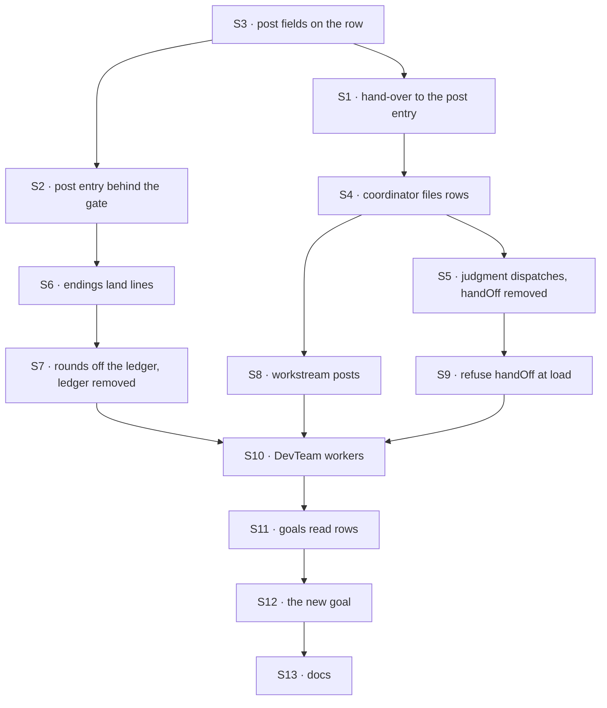

# FIX-1872 · Plan

[Spec](SPEC.md) · [Decisions](DECISIONS.md) · [Rules](BUSINESS-RULES.md) · **Plan** · [Docs](DOCS.md) · [Evolution](EVOLUTION.md)

Written for the implementing agent. IDs cross-reference [BUSINESS-RULES.md](BUSINESS-RULES.md)
(BR-n) and [DECISIONS.md](DECISIONS.md) (D-n); epic rules are ER-n. `tdd`. **One PR**: the
ledger, its two entries and `handOff` go in the same change as the row path (epic ER-10), so no
build carries two fences. Starts after FIX-1875 merges; it consumes `dispatchTask`.

## Surfaces

| ID | Package · role | Change | Rules |
|---|---|---|---|
| S1 | `workforce` · the conversation board's hand-over | A post row goes to the delegate's post entry, in its session for this conversation (today's per-delegate key) or the session its `target` resolves to; every other row keeps going to `work` in a task session. The claim gate is the same one | BR-1 BR-16 BR-17 BR-20 · D1 |
| S2 | `workforce` · the post entry (`delegatedPostEntry`, `delegatedPostOnFinished`) | Behind the claim gate: read the post off the row, run the turn as today, settle the row with the reply; an empty reply, a failure or a cancel fails it. At the deadline, send the conversation the wake (S6) instead of a miss. Declared where the engine's task dispatch reaches it | BR-6 BR-9 BR-11 BR-12 · D1 |
| S3 | `workforce` · the row's post fields | Top-level, server-written fields for a post (post id, round, delegate record, from, coordinator, recent lines, deadline), set only by the post path. Row id derived from post, round and delegate record | BR-2 BR-4 |
| S4 | `workforce` · the coordinator's delivery | Every pick (fixed policies, route-on rounds, judgment) files a post row through FIX-1875's dispatch path. The routing record reads filing outcomes. **Remove** the open/dispatch/settle sequencer, both post dispatchers and the router | BR-1 BR-3 BR-7 |
| S5 | `workforce` · the coordinator's judgment tools | **Remove** `handOff`. On a turn routing a post, `dispatchTask` takes the post from request state; the model sends `to` and `target` only. Carry `handOff`'s refusal wording (the delegates that take posts) and its measured sentence "a new message is a new post, even when it repeats an earlier ask" onto that call | BR-5 BR-7 · D2 |
| S6 | `workforce` · the coordinator's ending entry | A post row's ending (via `onTaskSettled`) lands the reply as the delegate's line, keeps it in its round, releases the hold, closes rounds and sends answers on; a failed one only ends its part. A small internal wake entry closes overdue rounds. **Remove** `DELEGATE_ANSWER_ACTION` and `DELEGATE_MISSED_ACTION` | BR-8 BR-9 BR-10 BR-12 BR-19 |
| S7 | `workforce` · rounds | The open round notes its rows and which ended; close reads that, not a ledger. **Remove** `delivery-ledger.ts`, its test and the session state key; tolerate a saved value | BR-13 BR-14 BR-18 |
| S8 | `workforce` · workstream records | Lift "a workstream takes posts, not tasks" for post rows only; ordinary tasks keep the refusal. Target resolution moves from the coordinator's delivery to the hand-over, same check | BR-15 BR-16 BR-17 |
| S9 | `workforce` · worker loading | A coordinator worker file naming `handOff` is refused at load, naming `dispatchTask` | BR-18 |
| S10 | `shift-manager` · DevTeam's chief of staff and project coordinator `WORKER.md` | `handOff` → `dispatchTask` in their instructions; the EM's post entry moves if S2 moved it | — |
| S11 | `goals/` · the checks that read the ledger | `hands-each-post-to-its-delegates` (`devteam.mts`, `leg-e.mts`, `goal.md`), `a-shared-project-has-one-owner-per-workstream`, `two-users-share-a-project-and-nothing-else`: ledger reads become row reads, listed in the PR as fence lines; tool names renamed | ER-11 |
| S12 | `goals/coordinators/one-fence-answers-each-post-once/` | **New** goal check, per `SPEC.md` | — |
| S13 | Docs | Publish [DOCS.md](DOCS.md) | — |

## Sequence



The ledger is removed only once rounds and endings no longer read it (S7 after S6), and inside
the same PR.

## Checks

| ID | Runs after | Passes when |
|---|---|---|
| V1 | S1 S3 | A post row runs in the delegate's existing session for the conversation, never a task session; a non-post row still runs in a task session; a session made before the change is reused (BR-1 BR-17 BR-20) |
| V2 | S2 | The turn sees today's message and lines (BR-6); an empty reply, a failure and a cancel each fail the row (BR-9); a second settle is refused (BR-11) |
| V3 | S4 S5 | Every policy and every round files one row per pick; a repeat is `skipped` (BR-2); records match today's for the same scripted run (BR-3); the model's extra task fields are refused (BR-5) |
| V4 | S6 | A completed post row lands one line and wakes no turn; an ending replayed five times lands one (BR-8 BR-10); a failed one lands none (BR-9) |
| V5 | S7 | Today's `coordinator-rounds` and `coordinator-followup-context` cases pass with ledger reads replaced; a saved ledger is ignored then dropped (BR-13 BR-14 BR-18) |
| V6 | S8 | A workstream post runs in the entry's session; none yet fails the row; an ordinary task to it is refused (BR-15 to BR-17) |
| V7 | S9 | A file naming `handOff` fails to load with the `dispatchTask` hint; no tool list on any flow carries `handOff` (BR-18) |
| V8 | S4 | BR-22's bench: tenth post within 2× the first and under 2 s on SQLite; growth printed in the PR |
| V9 | S11 | The FIX-1791, FIX-1794 and FIX-1610 checks and the two project goals pass; each diff passes the epic's rename-map script with its fence lines listed |
| VG | S12 | [The goal](SPEC.md#the-goal-and-how-well-know-its-met) PASSES after `GOAL_CONTROL=no-ending-dedupe` FAILED `b:one-line` and the `main` run FAILED `a:no-ledger` |
| VI | all | `node specs/issues/FIX-1872/poc/inventory/check.mjs` updated to the after-state: no file names a retired surface outside `other` and `history` |

## Pinned names

| Where | Name | Why pinned |
|---|---|---|
| `dispatchTask` | `target` | Epic ER-1 and ER-5 name it |
| Goal check | `goals/coordinators/one-fence-answers-each-post-once/`, `GOAL_CONTROL=no-ending-dedupe` | `SPEC.md` and the closure cite them |
| Routing record | `delivered`, `skipped`, `failed`, and every reason string | People and checks read them; unchanged |
| Exports | `delegatedPostEntry`, `delegatedPostOnFinished`, `delegatedPostHistory`, `DELEGATED_POST_ENTRY` | Apps declare them (D1) |

Everything else is yours to name, including the post form of `dispatchTask`'s task and the row's
post fields.

## Guardrails

| Rule | Because |
|---|---|
| The claim ticket is the only thing that decides an answer counts. No token, no "answered" flag, no per-delivery record in the coordinator's state | Two fences disagree at the edges, which is the whole issue (epic ER-10, tenet 5) |
| Every post goes through the one dispatch path, from all five places a post starts: judgment, best fit, round robin, everyone, and route-on rounds | An invariant held at one entry and missed at another is the review class that costs most (tenet 5) |
| Nothing in the coordinator's view changes but the fence | The reruns are the proof, and a check that had to change is the finding (epic ER-11) |
| A post row's session is today's delegate session, never one keyed by the task | `findWorkerSession({ worker, filingSessionId })` must keep finding it (FIX-1794 review round 2) |
| Post fields are top-level and server-written | `metadata` is model-writable through `updateTask` (BP-031) |
| Old sessions and old worker files are tolerated or refused loudly, never misread | Saved coordinator state and DevTeam-shaped files exist in the field (BP-030) |
| Test the second paths: a replayed ending, a cancel mid-turn, a late answer, a concurrent second hand-off (BP-035) | Each is a way one fence could have become two |

## Docs

Reconcile and publish [DOCS.md](DOCS.md) after V9 passes. It updates `coordinators.md`,
`chief-of-staff.md` and the Workforce README; FIX-1876 owns the glossary and the shared
vocabulary pass.

## Sketch · pseudocode, illustrative, react to the shape

```
routing a post (any policy, any round):
    for each pick:
        file a row through the dispatch path:
            id      ← derived from (post, round, delegate record)   ← a repeat files nothing
            post    ← the post as written, from, lines, deadline    ← server-written
            target  ← the record's, if any
        record: delivered | skipped | failed

the board hands a post row over:
    session ← this conversation's session for the delegate, or the one target resolves to
    entry   ← the delegate's post entry, behind the claim gate

the coordinator hears an ending:
    post row completed → line under the delegate, keep in round, maybe close, maybe route on
    post row failed    → mark ended in its round, maybe close
    a deadline wake    → close overdue rounds
```

**POC:** [`poc/inventory/`](poc/inventory/README.md). It counted every way onto the post entry
and what it sends back: no post is a tell. It also lists the 49 files that name a retired
surface, which S10 and S11 come from. The premise held; nothing changed.

## At implement time

- Read FIX-1875's merged spec and code first: the dispatch path's name, how it starts a row, and
  whether its task argument can take a post form. If it can't, the post form is this issue's to
  add (D2), not a reason to let the model write the post.
- Check whether the engine's task dispatch can reach an entry under `internal.actions`. If it
  can, S2's entry stays where apps declare it today and the `SPEC.md` diff's second block drops.
- Rerun the POC before starting; a sibling may have added a caller.

## Follow-ups

- FIX-1876 renames the internal ask names and the remaining "hand-off" wording for delivering
  work, including any this PR leaves in comments.
- FIX-1887's rename map must carry the delegate-entry declaration move, if S2 makes one.
