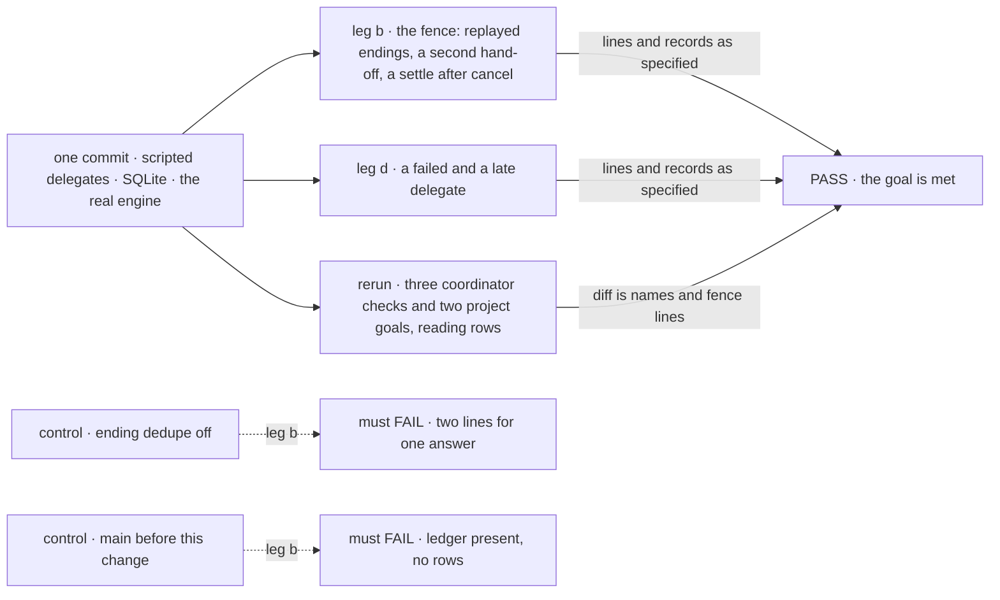
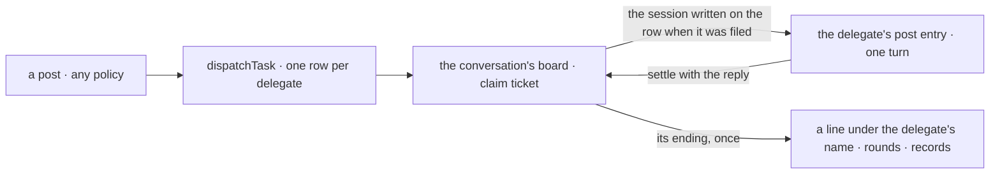

# FIX-1872 · The board claim ticket is the only answer-once fence; the coordinator delivery ledger goes

**Spec** · [Decisions](DECISIONS.md) · [Rules](BUSINESS-RULES.md) · [Plan](PLAN.md) · [Docs](DOCS.md) · [Evolution](EVOLUTION.md)

## Six people, before and after

| Someone who… | Today | After |
|---|---|---|
| **talks to a coordinator** | Each delegate's answer lands once, as its own line, by the policy and rounds set | The same lines, the same rounds, the same routing records |
| **looks at the conversation's task board** | Sees the tasks the coordinator filed; a post to a delegate leaves no row | Also sees one row per delegate per post, tracked to an ending like any task. Cancelling one ends that delegate's part, with no line |
| **writes a coordinator's instructions** | Tells it to call `handOff` with a delegate | Tells it to call `dispatchTask` with that delegate. The delegate still gets the post as the person wrote it |
| **runs a project coordinator** | `handOff` with a workstream reaches the lead's existing session | The row names the workstream and is worked in that same session. A workstream still takes no ordinary task |
| **builds a delegate flow** | Declares `delegatedPostEntry(turn)` | Keeps it. Only that delegate's posts reach it; a worker that takes tasks but not posts still gets none |
| **maintains the framework** | Keeps two answer-once fences in step: the delivery ledger's token and the board's claim ticket | Keeps one. The ledger, its two answer entries and `handOff` are gone |

Child 2 of epic [FIX-1870](../../epics/FIX-1870/SPEC.md): its
[D2](../../epics/FIX-1870/DECISIONS.md#d2), owned here under
[ER-5 and ER-6](../../epics/FIX-1870/BUSINESS-RULES.md#what-a-team-gets-and-what-it-doesnt).
The sort D2 asked for first is done: no coordinator post today is a tell
([POC](poc/inventory/README.md)), so every post becomes a task and nothing becomes a plain message.

## The goal, and how we'll know it's met

**A coordinator's post is tracked like any task, one row per delegate, answered once, while the
person sees exactly the lines, rounds and routing records they see today.**

| Is it the right goal? | |
|---|---|
| **The real need** | [The issue](https://linear.app/fixpoint-labs/issue/FIX-1872): "every delivery is a row and the board claim ticket fences it. The delivery ledger and its `delegateAnswer` / `delegateMissed` entries are removed. One answer per delegate per post, and the routing record, keep working." The epic: one fence, so maintainers stop keeping two in agreement |
| **Smaller, and rejected** | "The ledger file is deleted." Met by moving its tokens onto the round record, which is the ledger renamed. Or "posts are rows" while answers still come back on the token entry: two fences again |
| **Bigger, and not this issue's** | Renaming the internal ask and hand-off names ([FIX-1876](https://linear.app/fixpoint-labs/issue/FIX-1876)) · the closure's surface sweep ([FIX-1887](https://linear.app/fixpoint-labs/issue/FIX-1887)) · a question kind of task (epic ER-9) |
| **Not done if** | A coordinator session still holds a delivery ledger · an answer lands by any path but its row's ending · a workstream post runs in a new session · a post-only delegate stops getting posts · a coordinator check changed beyond names, its fence lines and the declaration moves the epic's map names (#3153) · `handOff` is still on a tool list · a replayed ending lands two lines · the goal check never ran, or a control passed |



The new check covers only what no existing check does: the fence's edges and the deadline. The
reruns are the proof of lines, rounds, routing and workstreams (epic ER-6), and their ledger reads,
now row reads, are the rows assertion. Turning off the board's one-time ending must show a doubled
line, or the fence was never tested.

| How we verify | |
|---|---|
| **Goal check** | `goals/coordinators/one-fence-answers-each-post-once/` · scripted, no model · run by the implementer at completion · verdict in the implementation PR. With it, reruns of the FIX-1791, FIX-1794 and FIX-1610 checks and the two project goals that read the ledger ([PLAN V9](PLAN.md#checks)) |
| **Signal** | **b**: each post is one row per delegate on the conversation's board, and the conversation's record holds no ledger; five board touches while the endings are owed still land one line per answer; the turn handing one delegate the same post twice gets one row and a `skipped` record; a post's task cancelled while its delegate (held 3 s) is still working lands no line when that delegate finishes, because the stale settle is refused. **d**: a failed delegate writes no line and its round closes at once; a late one's round closes at the deadline, and its answer lands once and goes no further |
| **Input** | Every word held out at run time; delegate ids and their order picked at run time. Another order must pass too |
| **Anti-game** | No row, ending or session written by the check. Grades read the store file read-only and the lines through the install's routes. The reruns' diffs pass the epic's rename-map script, with ledger reads replaced by row reads and listed, and the post entry's `internal` → `task` move matched by the map's named entry (#3153) |
| **Control that must fail** | `GOAL_CONTROL=no-ending-dedupe` must FAIL `b:one-line`. `GOAL_COMMIT` at `main` before this change must FAIL `b:no-ledger` and `b:rows` |

## What changes


Same post, same delegate session, same line. What moved is where "answered once" is decided: on
the row, by the board, not in the coordinator's state.

**What a coordinator's instructions say, and what a delegate flow declares:**

```diff
  When they ask for work a delegate does,
- call `handOff` with that delegate's id.
+ call `dispatchTask` with `post: true` and that delegate as `assignee`.
  Its answer lands in this conversation under its name, so don't answer for it.
```

```diff
  defineFlow({
    kind: "research",
-   internal: { actions: { [DELEGATED_POST_ENTRY]: delegatedPostEntry(door) } },
+   task: { actions: { [DELEGATED_POST_ENTRY]: delegatedPostEntry(door) } }, // a task dispatch reaches only `task` entries
  })
```

## How a post travels now



The board is the only thing that decides an answer counts. The coordinator only reads endings.

## What stays as it is

- What a delegate does with a post, what it is shown, and its own session per conversation.
- The four policies, rounds, the deadline, best fit's hold, the routing record and its outcomes.
- `addTask`, `assignTask` and ordinary tasks; a workstream still refuses them.
- `dispatcher()` and reply-to-sender ([epic ER-12](../../epics/FIX-1870/BUSINESS-RULES.md#what-no-child-may-do)).

## Sign off

**[The goal](#the-goal-and-how-well-know-its-met), at that size:** one fence, proven on what the
person sees. If wrong: two fences survive under new names, or a person's lines quietly change.

1. **[D1](DECISIONS.md#d1) · A post row is worked on the delegate's own post entry, not folded
   into ordinary tasks.** If wrong: we keep a second kind of entry nobody needs, and apps declare
   it for nothing.
2. **[D2](DECISIONS.md#d2) · On a post, the coordinator's model names who; the post goes as
   written.** A routing turn's `dispatchTask` with `post: true` hands on the post; with a `goal`
   it files an ordinary task. If wrong: delegates never get the coordinator's framing of the work.

**Gate on a sibling:** this builds only once FIX-1875 merges with `dispatchTask`'s shape reserving
the post form (`post: true` on a routing turn, FIX-1875 D2 and BR-26), not just `target`.

**Open: none.** D1 is the one to weigh. Reasoning: [DECISIONS.md](DECISIONS.md). Cases:
[BUSINESS-RULES.md](BUSINESS-RULES.md).

Feature · `workforce` + DevTeam's workers + docs · large · 1 PR (epic ER-10) · epic FIX-1870
