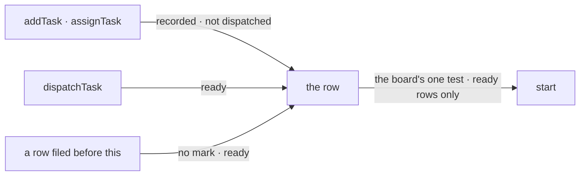

# FIX-1875 · Business rules

[Spec](SPEC.md) · [Decisions](DECISIONS.md) · **Rules** · [Plan](PLAN.md) · [Docs](DOCS.md) · [Evolution](EVOLUTION.md)

The cases, written as rules. Each says what a person or the system does and what happens. The
*proved by* column is the check the plan runs. "The board" means a conversation's board unless a
row says otherwise. Epic rules this issue owns are ER-1 to ER-4; every row below serves one.

## Recording work

| # | When | Then | Proved by |
|---|---|---|---|
| BR-1 | `addTask` (tool or action) records a row with an assignee | The row is pending and not dispatched. No run, no task session, however often the board is touched | CI · goal `rec:not-started` |
| BR-2 | `addTask` records a row with no assignee, in a conversation with one delegate | It is given that delegate, as today, and is still not dispatched | CI |
| BR-3 | `assignTask` names a new owner for a recorded row | The owner changes; the row stays recorded | CI |
| BR-4 | `assignTask` moves a row that was already dispatched and not yet claimed | It moves and starts, as today: the dispatch already happened | CI |
| BR-5 | A row filed before this change has an assignee and no mark | It starts as it does today (BP-030) | CI, a row written in the old shape |
| BR-6 | Flow code writes the board directly | Today's behaviour: an assigned row starts | Existing suite |
| BR-7 | `addTask` runs on a board a drain runs (`taskBoard()`, a pattern) | Exactly as today. No mark, no `dispatchTask` in the tool list | Existing suite |

## Dispatching work

| # | When | Then | Proved by |
|---|---|---|---|
| BR-8 | `dispatchTask({ goal, … })` | A row is filed ready and the board starts it now. The call returns its id at once | CI · goal `disp:new-runs` |
| BR-9 | `dispatchTask({ taskId })` names a recorded row | The mark clears and the row starts. With `assignee`, the owner is set in the same write | CI · goal `disp:ref-runs` |
| BR-10 | `dispatchTask({ taskId })` names a row that is claimed, running, ended, or already dispatched | Refused, naming its state. Nothing changes | CI |
| BR-11 | `dispatchTask({ taskId })` names a row not on the caller's own board | `task_not_found`. Nothing changes | CI · goal `lineage:refused` |
| BR-12 | More than one of `goal`, `taskId` and `post`, or none | Refused before anything is written | CI |
| BR-13 | `taskId` with a field that only a new row takes (`deps`, `input`, `followUpOf`, …) | Refused before anything is written. To change a recorded row, `updateTask` first | CI |
| BR-14 | Every check `addTask` runs (assignee on the roster, follow-up rules, chain depth and breadth, caps) | `dispatchTask` runs the same checks, in the same order, with the same errors | CI, one test per check |
| BR-15 | The same `dispatchTask` call replays after a crash or a resume | One row, one start. For `taskId` too: the ready write records the call that made it, so a replay finds its own write and answers as the first call did, not with BR-10's refusal | CI, a crash between the ready write and the step's record · the FIX-1820 rerun |
| BR-24 | `dispatchTask` with no `assignee`, where the conversation has no single delegate to default to (or a `taskId` row that has no owner) | Refused, `assignee_required`, nothing written. It never reports a start the board can't make | CI |
| BR-25 | `assignTask` and a `dispatchTask({ taskId })` race on the same recorded row | Both writes are conditional, so they apply one after the other: the later write's owner stands, and the row starts once | CI, the two writes interleaved both ways |
| BR-26 | `post: true`, on a coordinator turn that is routing a post | The routed post is the task, filled from the server; only `assignee` and `target` are taken. `post: true` is the only discriminator; the call carries no `goal` (with one, BR-12 refuses it). Off such a turn, `post` isn't in the schema. FIX-1872 builds it; this issue keeps the schema open to it | FIX-1872's checks |

## Waiting for the result

| # | When | Then | Proved by |
|---|---|---|---|
| BR-16 | `dispatchTask({ …, wait: true })` | Today's ask, unchanged: one row per call, one wait per step, the turn parks, the row's output is the result, or an error naming how it ended (`wait_*`) | The FIX-1816 rerun · existing ask suite, renamed |
| BR-17 | `wait` on a recorded row (`taskId`) that is pending, unclaimed and not waited on | It is marked waited-on and dispatched in one write, then the turn parks as in BR-16 | CI |
| BR-18 | `wait` where the host or board can't hold one, or from a task turn | `wait` and `timeoutMs` aren't in the schema; a direct caller that sends them anyway gets `wait_unavailable`, nothing written. The refusal reads the call's input before the schema would strip an unknown field | CI, a direct call with `wait: true` |
| BR-19 | `timeoutMs` without `wait`, or outside 30 seconds to an hour | Refused, nothing written, never clamped | CI |
| BR-20 | The `dispatchTask_<board>` action | Never waits; it has no `wait` field | CI |

## The old surface

| # | When | Then | Proved by |
|---|---|---|---|
| BR-21 | `addTask` gets `waitForResponse` or `timeoutMs` | Refused by name, the message points at `dispatchTask`, nothing filed. Read before the schema would strip it, as in BR-18 | CI (V6) · the epic closure's sweep |
| BR-22 | Code imports a retired name | It fails to compile. The changeset gives each new name | Typecheck · the sweep's `--assert` |
| BR-23 | The model reads `addTask`'s description | It says `addTask` records and doesn't start, and points at `dispatchTask` | CI on the description · the FIX-1816 rerun |
| BR-27 | `addTask` (tool or action) records a row on a board that dispatches | Its result carries `status: "recorded"` and a one-line note that the task starts on `dispatchTask`. A model that skipped the description, or a script that logs the result, sees it | CI on the result |

Every path into a row ends at one test for "can start". A second test anywhere (a claim's
eligibility, the drain's exit, `addTask`'s own wake, the `setAssignee` and `unpark` wakes) that
doesn't read the mark starts a recorded row.

## Failure taxonomy

Every refusal is a soft `{ ok: false, error }` the model can act on, written before anything is
stored. A failed wake leaves a ready row ready, for the next touch, as today. Nothing retries
inside the tool. A wait that ends without an answer is today's `wait_*` set, unchanged.

## Acceptance criteria this issue owns

[The goal](SPEC.md#the-goal-and-how-well-know-its-met): its check passes on the FIX-1817 lab
after `GOAL_CONTROL=add-starts` and today's `main` fail it; the three regression checks pass with
diffs the rename map explains; and the sweep's `--assert` exits 0.
