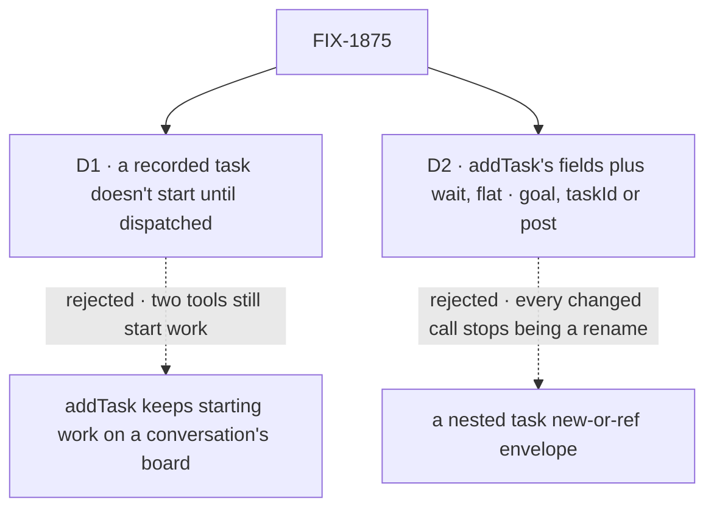

# FIX-1875 · Decisions

[Spec](SPEC.md) · **Decisions** · [Rules](BUSINESS-RULES.md) · [Plan](PLAN.md) · [Docs](DOCS.md) · [Evolution](EVOLUTION.md)

What was considered, what was chosen, why, and what each choice locks in. Two decisions are the
sign-off surface. The epic already decided the tool exists, that waiting moves onto it, and that
the board tools only record ([FIX-1870 D1](../../epics/FIX-1870/DECISIONS.md#d1), ER-1 to ER-4);
these two are what that costs on the real code.

## The tree

Solid edges are what you're signing. Dashed edges lost, and the label says why.

## D1 · On a conversation's board, `addTask` and `assignTask` stop starting work; a recorded task doesn't start until `dispatchTask`

| | |
|---|---|
| **Instead of** | Keeping today's start: on a conversation's board, a row with an assignee starts at once, so `dispatchTask` without `wait` is a second name for `addTask` with an assignee |
| **Because** | A conversation's board starts every row that is pending and assigned, on any touch ([`board.ts`](../../../packages/workforce/src/conversation-board/board.ts), the guarded `addTask` and the resolver's wake). So "the board decides when it runs" is false there unless a row can be recorded *without* being ready. Without that, two tools start work, and the model still has to pick: the problem the epic exists to remove (tenet 2: one primitive per job). Every other board is drained by its owner and already only records |
| **Locks in** | A recorded row carries a persisted mark, *not dispatched* (`undispatched`, never "waiting": FIX-1876 keeps *wait* for a turn parked on a task), written only by the task tools and actions on a board that dispatches. A row without the mark (every row filed before this) still starts as today. Code that writes the board directly is untouched. `addTask`'s result says `status: "recorded"`, so the change is visible on the first call, not only in the changeset. Every caller that relied on `addTask` or `assignTask` starting work moves to `dispatchTask` in this issue: the [sweep](PLAN.md#the-sketch-and-the-poc) lists 14 goal checks (26 files, plus 3 shared lab helpers), 3 worker files, 2 published pages and the workforce README. An app that sends `addTask_tasks` to start work must switch, and the changeset says so |

![D1: what addTask does on a conversation's board. Chosen: record only, and dispatchTask starts. Instead of: addTask keeps starting work. It comes down to the first row: with start-on-assign kept, two tools start work and the model still picks. Second row, the price: 14 goal checks, three worker files and an app's addTask_tasks calls move to dispatchTask, where keeping it costs nothing. Third row, a tie: what a started task does is the same either way. Locks in a persisted not-dispatched mark that old rows don't carry. Flips if a regression check can't stay a rename](figures/d1-recorded-waits.svg)

It comes down to the tool choice: keep start-on-assign and the model still picks between two tools.

**What would change my mind:** one of the three regression checks can't pass with a rename-only
diff once `addTask` stops starting work. That is the epic's kill line, and it goes back to the
epic (ER-14).

## D2 · `dispatchTask` takes `addTask`'s fields plus `wait` and `timeoutMs`, flat, with `taskId` for a recorded row and `post: true` for a routed post

| | |
|---|---|
| **Instead of** | The issue's sketch: `dispatchTask({ task: { new } \| { ref }, to, wait: true \| { timeoutMs } })`. For FIX-1872's post form, also instead of a second tool, or a routing turn that can only post |
| **Because** | The epic's proof is that the three regression checks change only by a rename map ([ER-11](../../epics/FIX-1870/BUSINESS-RULES.md#what-no-child-may-do)). With a flat shape, `addTask_tasks` → `dispatchTask_tasks` and `waitForResponse` → `wait` are the whole map. A nested envelope rewrites every call, so no changed line is a rename, and a reviewer can't tell a reshaped call from a changed assertion. A flat object is also what a model fills most reliably, and what OpenAI strict mode accepts without a union (BP-016) |
| **Locks in** | A public tool and action shape. Exactly one of three says what starts, checked when the call runs, not by the schema: `goal` (a new row, in the caller's words), `taskId` (a recorded row), or `post: true` (the post a coordinator turn is routing, filled from the server). The model tells the forms apart by which one it sets, the same rule for all three. `post: true` is the single discriminator for the post form, never a missing `goal`: the routed post is the task, so a post-form call carries no `goal`, and `goal` with `post` is refused (BR-12). That reserves the post form for FIX-1872 without overloading `goal`'s absence, which `taskId` already uses. `post` and `target` are in the schema only on a coordinator turn that is routing a post; with `post`, only `assignee` and `target` are taken. The recipient is `assignee` in every form, with its default (the conversation's only delegate), so FIX-1872's `to` reads as `assignee`. FIX-1872 builds the post form; this issue leaves the schema open to it. A second tool was rejected because two starting tools is what the epic removes; a post-only routing turn because FIX-1872 D2 keeps a coordinator able to file an ordinary task on that turn |

![D2: the shape of dispatchTask's input. Chosen: addTask's fields plus wait, flat. Instead of: a nested task envelope with new or ref. It comes down to the first row: with the flat shape the regression checks change only by a rename map, while the envelope rewrites every call. Second row, the price: goal, taskId or post is a run-time rule, not a schema rule. Third row, a tie: both can carry FIX-1872's post form, with post and target. Locks in a public shape. Flips if a second kind of reference needs fields of its own](figures/d2-flat-shape.svg)

It comes down to the proof: a flat shape keeps the regression diffs a rename map; the envelope
rewrites every call.

## Decided, not asked

- **`dispatchTask` is offered only on a board that can start work now** (a conversation's board
  today). A drained board has nothing to start a row with, so the tool would lie there.
- **`wait` is offered exactly where `waitForResponse` was:** a board that resumes waits, on a host
  that can hold and bound one. Elsewhere the fields are absent from the schema, as today.
- **The action form never waits**, as the `addTask_<board>` action never did.
- **`waitForResponse` and `timeoutMs` on `addTask` are refused by name**, with a message naming
  `dispatchTask`, never stripped by the schema (BP-030). A silent strip would file the task and
  return at once to a model that thinks it waited.
- **Waiting on a recorded row is allowed** when the row is pending, unclaimed and not already
  waited on. The mark and the wait are written in one write.
- **A recorded row is reachable only on the caller's own board.** The board resolver already
  reads the running session's own partition, so a row elsewhere is `task_not_found` (ER-4 holds by
  construction; the goal check's `lineage:refused` proves it).
- **The public ask names go with no alias** ([pinned map](PLAN.md#pinned-names)): the closure
  fails while a retired name is exported, and the packages are pre-1.0. **Where the line falls
  with FIX-1876:** this issue renames every exported name a caller of the waiting surface imports
  (the map, `canHoldAsk` and the `Ask*Error`s included). The host seam's names (`resumeAsk`,
  `hasAskSweeper`, `parkOnAsk`, `resumesAsks`, `row.ask`) are not imported by callers and stay for
  FIX-1876, which starts after this merges and keeps what this renamed (its WR-22). Where both
  maps name a symbol they agree (`AskEndedError` → `WaitEndedError`).
- **`assignTask` on a recorded row keeps it recorded.** `answerTask` still re-queues a row that
  was already started, as today: that row was dispatched once.
- **`dispatchTask` refuses a row with no owner.** With no `assignee` and no single delegate to
  default to, it answers `assignee_required` and writes nothing, so it never reports a start the
  board can't make (BR-24).
- **`onTimeout: "continue"` is not built** (the epic dropped it: new behaviour no rerun proves).
- **The coordinator's `handOff` is left alone.** FIX-1872 retires it with the ledger
  ([EM call](https://linear.app/fixpoint-labs/issue/FIX-1875), 2026-10-12).
- **The issue's open questions** — rows per delegate on the everyone policy, and whether `to` may
  be a coordinator — are FIX-1872's ([epic D2](../../epics/FIX-1870/DECISIONS.md#d2)) and the
  roster's: `assignee` is checked against the board's roster, unchanged.

## Which methods already do this job

The job: *start work on another worker now, optionally waiting for it.* Searched `packages/` for
`addTask`, `assignTask`, `handOff`, `createHandOff`, `dispatcher`, `waitForResponse`, `park`,
`resume`, `wake`:

| Entry | Does the job how | After this issue |
|---|---|---|
| `addTask` with an assignee, on a conversation's board | Records, and the board's wake starts it | Records only (D1) |
| `assignTask`, on a conversation's board | Moves, and the wake starts it | Records only (D1) |
| `addTask({ waitForResponse })` / `addTaskAndWait` | Records, starts, parks the turn | **Closest entry.** Becomes `dispatchTask({ wait })`; differs only by a flag, so it is that parameter (D2) |
| The coordinator's `handOff` tool | Delivers a post through the delivery ledger | FIX-1872 |
| `createHandOff` (a `taskBoard()` worker) | A drain hands a claimed row to another session | Unchanged: the drain's own start, not a model tool |
| `dispatcher()` | Flow-code transport, no row | Unchanged ([ER-12](../../epics/FIX-1870/BUSINESS-RULES.md#what-no-child-may-do)) |

## Considered and dropped

| Alternative | Why not |
|---|---|
| A new conversation-board scheduler that starts recorded rows later by itself | Nothing needs it. "Later" today means a person or a worker deciding, which is a dispatch |
| Mark ready rows instead of waiting ones | Every row filed before this lacks the mark and would stop starting on upgrade. Marking the waiting ones leaves old rows as they are (BP-030) |
| Hold rows in `addTask` at the ledger, not in the tools | Flow code that writes the ledger directly (DevTeam's EM row filing) would stop starting work, a change ER-2 doesn't ask for |
| A wrapper tool over `addTask` | The implementer note from the epic review: build dispatch into the task tools and the board, so there is one filing path |
| Alias the old names for a release | The closure's sweep fails while one is exported; pre-1.0 patch notes carry the map instead |
| Use the existing `blocked` status for a recorded row, so no new field | `blocked` means a row can't proceed: its reason is stored in `error`, it emits a `blocked` change event, and it returns to pending only through `unblock`. A recorded row is healthy and ready to go on request, so an app reading `blocked` would show it as stuck |
| Drop `taskId`: "record for later" is an unassigned `addTask`, and `dispatchTask({ goal })` is the only start | Once `assignTask` stops starting work, a recorded row has no way to start except by id; the only other move files a duplicate and orphans the original. The DevTool's row actions also work on an existing row (`works-a-task-from-its-row`) |

## How it got here

- **Draft** — framed as the epic's substance: one starting tool, and board tools that only
  record. Found that a conversation's board starts any assigned row, so ER-2 needs a persisted
  waiting-for-dispatch mark (D1), and that the regression proof needs a flat input shape (D2).
  Built as two PRs: the tool and the callers' move, then the switch-off.
- **Review round 1** — the mark is `undispatched`, not `awaitingDispatch`, because FIX-1876
  makes *wait* mean only a parked turn and a stored name is costly to change later. D2 gained
  the post form, because FIX-1872 gives `dispatchTask` a second meaning on routing turns and the
  two specs drew it differently. Every start test now reads the mark in P1, before anything writes
  it in P2, because a rolling deploy would otherwise run P1 processes that start a P2 recorded row.

**Open: none.**
