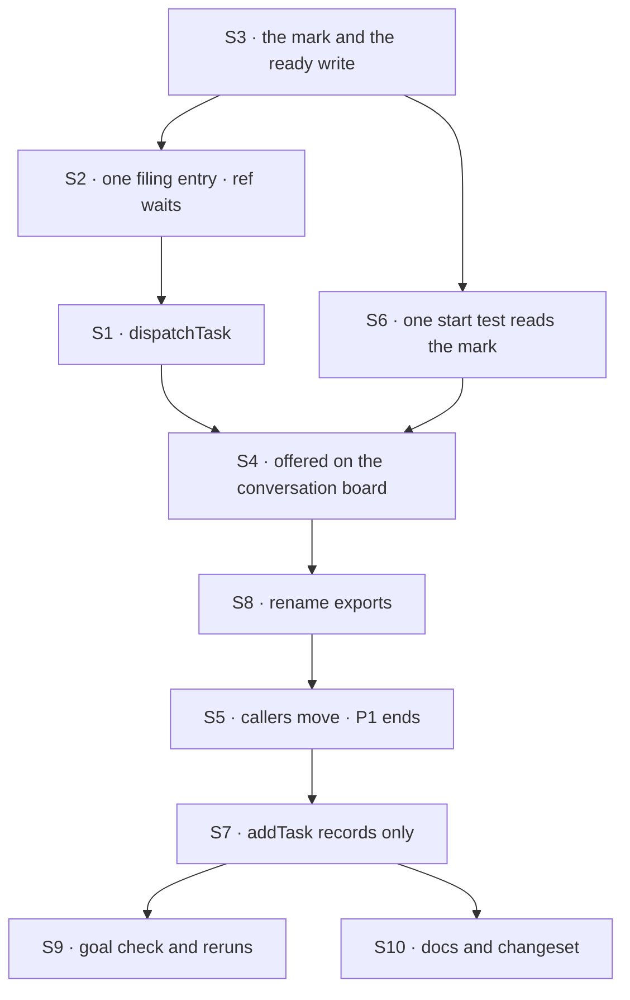

# FIX-1875 · Plan

[Spec](SPEC.md) · [Decisions](DECISIONS.md) · [Rules](BUSINESS-RULES.md) · **Plan** · [Docs](DOCS.md) · [Evolution](EVOLUTION.md)

Written for the implementing agent. IDs cross-reference [BUSINESS-RULES.md](BUSINESS-RULES.md)
(BR-n), [DECISIONS.md](DECISIONS.md) (D-n) and the epic's rules (ER-n). `tdd`. Two PRs: **P1**
adds `dispatchTask`, teaches every start test to read the mark, renames the exported names and
moves every caller onto `dispatchTask`, while nothing writes the mark yet, so it changes no
behaviour; **P2** makes `addTask` and `assignTask` write the mark and refuses `waitForResponse`.
Readers ship before writers, so in a rolling deploy no process that ignores the mark is still
running when a recorded row exists. P2's diff is the behaviour switch and its docs.

| The mark in… | Who writes it | Who reads it | Can production see `dispatchTask({ taskId })` start a row? |
|---|---|---|---|
| P1 | Nothing outside tests | Every start test (S6) | Only for a row a test seeded; no app path records one yet |
| P2 | `addTask` and `assignTask` on a board that dispatches (S7) | The same | Yes: it is the way a recorded row starts |

## Surfaces

| ID | PR | Package · role | Change | Rules |
|---|---|---|---|---|
| S1 | P1 | `orchestration` · the task tools (`task-tools-capability.ts`) | Add `dispatchTask`: `addTask`'s fields, plus `taskId`, `wait`, `timeoutMs` (D2). It runs `addTask`'s checks through the same code, not a copy, then files the row ready, or readies a recorded one. Offered only when the board passes a way to start a row now (a new `TaskToolsOptions` member); `wait` and `timeoutMs` only where `waitForResponse` is offered today. Refuses with no owner it can resolve. Reads `wait` from the call's input before the schema parses it. Schema left open for FIX-1872's `post` and `target` | ER-1 · BR-8 to BR-15, BR-18 to BR-20, BR-24, BR-26 |
| S2 | P1 | `orchestration` · the wait (`wait-for-response.ts`) | Split into *file or ready the row* and *park on it* (epic review note 2), so `addTask` and `dispatchTask` share one entry. Accept a recorded row: mark it waited-on and ready in one write. Keep the text the FIX-1816 controls patch (see Guardrails) | BR-16, BR-17 |
| S3 | P1 | `orchestration` · task schema and collection | A persisted *not dispatched* mark (`undispatched`): an optional boolean, present only when true, absent meaning ready. One conditional write that readies a recorded row, optionally setting its assignee and its wait, and recording the call that made it (a per-call token, as the wait's gate nonce does today), so a replay recognises its own write. The mark is never caller-patchable (`updateTask`, `patchMetadata`) | ER-2 · BR-5, BR-9, BR-10, BR-15, BR-17, BR-25 |
| S4 | P1 | `workforce` · the conversation board (`board.ts`) | Pass the start hook to `taskToolsForTurn`, so `dispatchTask` and its `dispatchTask_tasks` action exist on this board | BR-8, BR-9, BR-11 |
| S5 | P1 | Callers | Every caller in the sweep's STARTS list that means "start now" moves to `dispatchTask` / `dispatchTask_tasks`: 3 worker files, the goal checks, the three regression checks (rename map only), tests. Model guidance in the coordinator and agent worker flows. Review each hit; a call that only records stays | ER-11 |
| S6 | P1 | `workforce` · the board's one test for "can start" | A refactor deliverable: extract one `isStartable(task)` (assigned, and not `undispatched`) and have all four start touchpoints call it: the claim's eligibility, `hasStartable` (and through it the drain's exit and the `setAssignee` and `unpark` wakes), and the guarded `addTask`'s wake, which today wakes on any assignee | ER-2 · BR-1, BR-5, BR-6 |
| S7 | P2 | `orchestration` · `addTask` and `assignTask` | On a board that dispatches, `addTask` writes the mark and `assignTask` keeps it. `addTask`'s result says `status: "recorded"`. Descriptions say they record and point at `dispatchTask`. `waitForResponse` and `timeoutMs` refused by name, in the tool and the action, read before the schema; `addTask`'s wait branch and its description **removed** | ER-2 · BR-1 to BR-4, BR-21, BR-23, BR-27 |
| S8 | P1 | `orchestration`, `core` · exports | **Rename** the exported names per the [map](#pinned-names), no alias. A rename only: no behaviour moves with it | BR-22 |
| S9 | P2 | Goal check | `goals/dispatching-work/a-recorded-task-waits-for-dispatch/` on the FIX-1817 lab, with `GOAL_CONTROL=add-starts` | the goal |
| S10 | P2 | Docs | [DOCS.md](DOCS.md), all of it: `dispatchTask`, "records, doesn't start", the README renames and the `waitForResponse` removals. One changeset for `orchestration`, `workforce`, `core`, in P2 only. P1 publishes nothing user-facing: its behaviour is unchanged, so a P1 page saying `addTask` doesn't start work would be false, and a P1 changeset could release a state where two tools start work | ER-17 |

## Sequence



| Sub-PR | Delivers | depends_on |
|---|---|---|
| P1 | S1 to S6, S8. No docs, no changeset | — |
| P2 | S7, S9, S10 (every doc and the changeset) | P1 |

## Checks

| ID | Runs after | Passes when |
|---|---|---|
| V1 | S3 | The mark round-trips; a row without it is ready (BR-5); the ready write refuses a claimed, running, ended or already-ready row (BR-10) and is not reachable by `updateTask` or `patchMetadata` |
| V2 | S1 | BR-8, BR-12 to BR-14, BR-24: one test per `addTask` check, asserting `dispatchTask` refuses identically; a direct `wait: true` where waiting is off gets `wait_unavailable` (BR-18) |
| V3 | S2 | The existing ask suite, renamed, green; BR-17 on a recorded row; BR-15 under a replay, including a crash between the ready write and the step's record |
| V4 | S4, S6 | BR-9, BR-11 on a real conversation board: another session's row is `task_not_found`; a seeded `undispatched` row is never claimed or woken by any of the four touchpoints |
| V5 | S7 | BR-1 to BR-4, BR-25: a recorded row survives 20 board touches without a run; BR-6 and BR-7 unchanged (existing suites) |
| V6 | S7 | BR-21 in the tool and the action; BR-23 on the description; BR-27 on the result |
| V7 | S8, then S7 | `pnpm typecheck`; `node specs/issues/FIX-1875/poc/surface-sweep/sweep.mjs --assert` exits 0 after P2 (P1 leaves `waitForResponse` live) |
| VR | S9 | The three regression checks PASS, and leg e of `goals/workers/files-and-splits-down-the-chain/` (a real model that must pick `dispatchTask`). `git diff <spec-merge>..HEAD -- <the three dirs>`: every changed line is explained by the [rename map](#pinned-names) |
| VG | S9 | [The goal](SPEC.md#the-goal-and-how-well-know-its-met) check PASSES, after `GOAL_CONTROL=add-starts` FAILED `rec:not-started` and today's `main` FAILED `disp:new-runs` |

**Second path (BP-035):** a row filed before the change (BR-5) · a replay after a crash (BR-15) ·
a reassign racing a dispatch (both conditional writes apply in turn; the later owner stands and the
row starts once, BR-25) · a cancel on a recorded row ends it with no run · a notice for a row that
never ran is never owed · a P1 process during the P2 rollout (it reads the mark, so it doesn't
start a recorded row).

## Pinned names

| Where | Name | Why pinned |
|---|---|---|
| Tool / action | `dispatchTask` / `dispatchTask_<suffix>` | Public; a model and a script type it |
| Fields | `wait`, `timeoutMs`, `taskId` (with `addTask`'s own); `post: true` reserved for FIX-1872 as the post form's one discriminator, with no `goal` | Public (D2) |
| Result | `status: "recorded"` on `addTask` where the board dispatches | Public (BR-27) |
| Error | `assignee_required` | Public (BR-24) |
| Persisted | `undispatched` on a task row | Stored; absent means ready (BP-030). Not `awaitingDispatch`: FIX-1876 keeps *wait* for a parked turn. Not `held`: `heldTask()` already means "the row this request holds" |

**The rename map** (D2; the regression diffs and the changeset use it):
`addTask_tasks` → `dispatchTask_tasks` · `addTask` → `dispatchTask` where it starts work ·
`waitForResponse` → `wait` · `addTaskAndWait` → `dispatchAndWait` · `AddTaskAndWaitOptions` →
`DispatchAndWaitOptions` · `WaitForResponseResult` → `DispatchAndWaitResult` · `canHoldAsk` →
`canHoldWait` · `AskEndedError` → `WaitEndedError` · `AskStoppedError` → `WaitStoppedError` ·
`DEFAULT_ASK_TIMEOUT_MS`, `MIN_…`, `MAX_…` → `…_WAIT_TIMEOUT_MS`. These are the exported names a
caller imports; the internal seam's names are FIX-1876's ([where the line
falls](DECISIONS.md#decided-not-asked)).

## Guardrails

| Rule | Because |
|---|---|
| One predicate decides "can start", and every start path reads it (tenet 5) | The board tests it in four places today, two of them inlining `assignee !== undefined` separately (S6). One that skips the mark starts a recorded row, and only a touch in the wrong order shows it |
| Mark readers ship before mark writers (P1 before P2) | A process that ignores the mark would start a row a newer process recorded |
| A refusal by name reads the call's input before the schema parses it | Ordinary object parsing strips an unknown field, so `waitForResponse`, or `wait` where it isn't offered, would be dropped silently and the call would go ahead (BR-18, BR-21) |
| `dispatchTask` and `addTask` share one filing entry | A copied check drifts, and BR-14 says they refuse identically |
| A regression check changes only by the rename map (ER-11) | The kill line. A check that had to change otherwise is the finding: stop and return it to the epic |
| Keep the text the regression controls patch (`fsd.ask.file`, `fsd.ask.plan`, the waker) reachable, or move the anchors in the same commit and show each control still FAILS | `goals/lib/module-patch.mjs` refuses a patch that never reached the code, so a moved line silently disables a control |
| Mark absent means ready; old fields refused by name (BP-030) | Rows from before the change must keep running, and a stripped `waitForResponse` files a task the model thinks it waited on |
| Don't touch the coordinator's `handOff` or the delivery ledger (ER-10) | FIX-1872 retires both together, so no build ships two fences |
| No question kind of task, no name for one (ER-9) | Deferred by the owner |

## Docs

Reconcile [DOCS.md](DOCS.md) against shipped behaviour and publish all of it, with the one
changeset, in P2. P1 publishes nothing user-facing: until P2, `addTask` still starts work, so
P1's half of the story would be false, and two changeset rounds could release a state where two
tools start work. P1's export renames are recorded in P2's changeset. No new page.

## The sketch and the POC

```
dispatchTask(input):
    exactly one of goal / taskId / post                   (BR-12; post is FIX-1872's)
    owner ← assignee, or the only delegate, or refuse     (BR-24)
    if goal:  init ← addTask's own checks on input        (one entry, BR-14)
              row  ← file init, ready
    if taskId: row ← the ready write on that row, with this call's token
                                                           (refused unless recorded, BR-10)
    if wait:  park on row, as the ask does today          (BR-16)
    else:     wake through the setAssignee path; return row id
addTask on a board that dispatches:  file init with the mark; result says recorded
isStartable(task):  pending · assigned · not undispatched  (the one predicate)
```

**POC:** [`poc/surface-sweep/sweep.mjs`](poc/surface-sweep/sweep.mjs) re-derives the factual
base: every tracked file that carries a retired name, and every file that relies on `addTask` or
`assignTask` starting work (the actions, scripted model calls such as `toolName: "addTask"`, and
`` `addTask` `` in a worker file), each in exactly one bucket. On `main` (2026-10-12): 38 files
carry a retired name; 67 rely on the start (29 goal-check files: 26 across 14 checks plus 3 shared lab helpers; 4 in two
regression checks, 3 worker files, 2 published pages, 1 README, 3 package sources, 25 tests).
Prose that names the tool without backticks outside a worker file is not caught; read those by
eye. A line that refuses a retired name on purpose (BR-21's handler and its test) carries the
marker `retired-name-refusal` and doesn't count as live. `--assert` exits 1 on `main`, as the
control must; `--control` plants an unclassified hit and exits 2. It is a review list, not a
verdict: a STARTS hit that only records stays as it is.

## At implement time

- Re-run the sweep on fresh `main`: a goal check added since 2026-10-12 may file through
  `addTask_tasks`.
- The DevTool's row actions are built from tools that take a `taskId`. Check that a recorded row
  in the DevTool offers `dispatchTask`, and that `works-a-task-from-its-row` still passes.
- FIX-1872's spec may be approved by then: its `target` field lands on this tool's schema.
- Compare [Evolution](EVOLUTION.md)'s predecessor claims with the code before relying on them.

## Notes from review

Routed to this issue from the epic and project-spec reviews (Linear, 2026-10-12). Inputs, not
instructions.

- "ER-2 isn't true until addTask stops starting work immediately … list strip start-now from
  addTask/assignTask where ER-2 applies as a deliverable." — epic review #3109 (now D1, S6, S7)
- "Split `wait-for-response.ts` (501 lines) into two small functions: one starts the row, the
  other parks on it." — epic review #3109 (S2)
- "First list how each delivery path behaves on timeout, restart, double delivery and park." —
  project-spec review #3102 (answered for the coordinator by epic D2; FIX-1872's)
- "Build dispatch into `task-tools-capability.ts` and the board instead of adding a wrapper." —
  project-spec review #3102 (S1)
- "`dispatchTask`'s input schema must leave room for an optional `target` … Don't close the
  schema with `.strict()`." — #3110 fold (S1)

From this PR's review, round 1 (#3140):

- "`dispatchTask` on a conversation board needs `wake` after the ready-write. Reuse the
  `setAssignee` wrapper path (wake gated on the shared predicate) rather than adding a fifth
  wake site." — second look
- "Make sure the ready-write and the wake are the same step the replay test (BR-15) exercises,
  or a crash between them leaves a ready row with no wake until the next touch. Today's resolver
  sweep covers that, so it is probably fine, but name it in V3." — second look
- "Consider wiring `--assert` into CI at P2 so a new `addTask_tasks`-to-start caller fails the
  build after the switch, not just at implement time." — second look
- "The *docs/API* for `taskId` could be labeled P2-primary to avoid implying app-visible
  behavior mid-rollout." — Cursor (the P1/P2 table above answers the behaviour; the docs now publish only in P2)
- "Goal `rec:waits`: prefer store-grade assertions + light touches so the harness doesn't
  multiply full `list()` work on a growing board." — Cursor (now `rec:not-started`)

## Follow-ups

- `resumesAsks`, `resumeOwedAsks`, `parkOnAsk`, `row.ask`, `RequestHost.resumeAsk` and
  `hasAskSweeper` keep the ask word until FIX-1876, which owns them.
