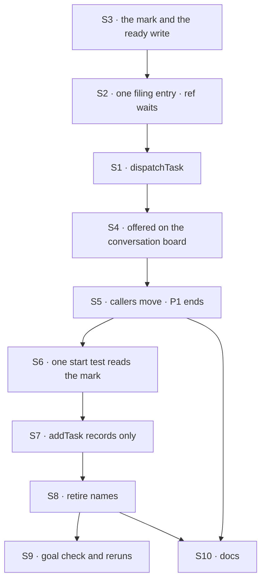

# FIX-1875 · Plan

[Spec](SPEC.md) · [Decisions](DECISIONS.md) · [Rules](BUSINESS-RULES.md) · **Plan** · [Docs](DOCS.md) · [Evolution](EVOLUTION.md)

Written for the implementing agent. IDs cross-reference [BUSINESS-RULES.md](BUSINESS-RULES.md)
(BR-n), [DECISIONS.md](DECISIONS.md) (D-n) and the epic's rules (ER-n). `tdd`. Two PRs: **P1**
adds `dispatchTask` and moves every caller onto it while `addTask` still starts work, so it
changes no behaviour; **P2** switches `addTask` and `assignTask` to record only and retires the
old names. The seam is the switch-off, so P2's diff is the behaviour change and little else.

## Surfaces

| ID | PR | Package · role | Change | Rules |
|---|---|---|---|---|
| S1 | P1 | `orchestration` · the task tools (`task-tools-capability.ts`) | Add `dispatchTask`: `addTask`'s fields, plus `taskId`, `wait`, `timeoutMs` (D2). It runs `addTask`'s checks through the same code, not a copy, then files the row ready, or readies a recorded one. Offered only when the board passes a way to start a row now (a new `TaskToolsOptions` member); `wait` and `timeoutMs` only where `waitForResponse` is offered today. Schema left open for FIX-1872's `target` | ER-1 · BR-8 to BR-15, BR-18 to BR-20 |
| S2 | P1 | `orchestration` · the wait (`wait-for-response.ts`) | Split into *file or ready the row* and *park on it* (epic review note 2), so `addTask` and `dispatchTask` share one entry. Accept a recorded row: mark it waited-on and ready in one write. Keep the text the FIX-1816 controls patch (see Guardrails) | BR-16, BR-17 |
| S3 | P1 | `orchestration` · task schema and collection | A persisted, nullable *waiting for dispatch* mark (`awaitingDispatch`), absent meaning ready. One conditional write that readies a recorded row, optionally setting its assignee and its wait. The mark is never caller-patchable (`updateTask`, `patchMetadata`) | ER-2 · BR-5, BR-9, BR-10, BR-17 |
| S4 | P1 | `workforce` · the conversation board (`board.ts`) | Pass the start hook to `taskToolsForTurn`, so `dispatchTask` and its `dispatchTask_tasks` action exist on this board | BR-8, BR-9, BR-11 |
| S5 | P1 | Callers | Every caller in the sweep's STARTS list that means "start now" moves to `dispatchTask` / `dispatchTask_tasks`: 3 worker files, the goal checks, the three regression checks (rename map only), tests. Model guidance in the coordinator and agent worker flows. Review each hit; a call that only records stays | ER-11 |
| S6 | P2 | `workforce` · the board's one test for "can start" | The claim's eligibility, the drain's exit and `hasStartable` all read the mark, through one predicate. The guarded `addTask` wakes only a ready row | ER-2 · BR-1, BR-5, BR-6 |
| S7 | P2 | `orchestration` · `addTask` and `assignTask` | On a board that dispatches, `addTask` writes the mark and `assignTask` keeps it. Descriptions say they record and point at `dispatchTask`. `waitForResponse` and `timeoutMs` refused by name, in the tool and the action | ER-2 · BR-1 to BR-4, BR-21, BR-23 |
| S8 | P2 | `orchestration`, `core` · exports | **Remove** the retired names; add the new ones ([map](#pinned-names)). `addTask`'s wait branch and its description **removed** | BR-22 |
| S9 | P2 | Goal check | `goals/dispatching-work/a-recorded-task-waits-for-dispatch/` on the FIX-1817 lab, with `GOAL_CONTROL=add-starts` | the goal |
| S10 | P1 + P2 | Docs | [DOCS.md](DOCS.md): P1 publishes `dispatchTask`; P2 publishes "records, doesn't start" and retires the `waitForResponse` text. One changeset per PR for `orchestration`, `workforce`, `core` | ER-17 |

## Sequence



| Sub-PR | Delivers | depends_on |
|---|---|---|
| P1 | S1 to S5, S10's `dispatchTask` docs | — |
| P2 | S6 to S9, S10's switch-off docs | P1 |

## Checks

| ID | Runs after | Passes when |
|---|---|---|
| V1 | S3 | The mark round-trips; a row without it is ready (BR-5); the ready write refuses a claimed, running, ended or already-ready row (BR-10) and is not reachable by `updateTask` or `patchMetadata` |
| V2 | S1 | BR-8, BR-12 to BR-14: one test per `addTask` check, asserting `dispatchTask` refuses identically |
| V3 | S2 | The existing ask suite, renamed, green; BR-17 on a recorded row; BR-15 under a replay |
| V4 | S4 | BR-9, BR-11 on a real conversation board: another session's row is `task_not_found` |
| V5 | S6, S7 | BR-1 to BR-4: a recorded row survives 20 board touches without a run; BR-6 and BR-7 unchanged (existing suites) |
| V6 | S7 | BR-21 in the tool and the action; BR-23 on the description |
| V7 | S8 | `pnpm typecheck`; `node specs/issues/FIX-1875/poc/surface-sweep/sweep.mjs --assert` exits 0 |
| VR | S9 | The three regression checks PASS, and leg e of `goals/workers/files-and-splits-down-the-chain/` (a real model that must pick `dispatchTask`). `git diff <spec-merge>..HEAD -- <the three dirs>`: every changed line is explained by the [rename map](#pinned-names) |
| VG | S9 | [The goal](SPEC.md#the-goal-and-how-well-know-its-met) check PASSES, after `GOAL_CONTROL=add-starts` FAILED `rec:waits` and today's `main` FAILED `disp:new-runs` |

**Second path (BP-035):** a row filed before the change (BR-5) · a replay after a crash (BR-15) ·
a reassign racing a dispatch (the ready write is conditional; the loser is refused) · a cancel on
a row waiting for dispatch ends it with no run · a notice for a row that never ran is never owed.

## Pinned names

| Where | Name | Why pinned |
|---|---|---|
| Tool / action | `dispatchTask` / `dispatchTask_<suffix>` | Public; a model and a script type it |
| Fields | `wait`, `timeoutMs`, `taskId` (with `addTask`'s own) | Public (D2) |
| Persisted | `awaitingDispatch` on a task row | Stored; absent means ready (BP-030). Not `held`: `heldTask()` already means "the row this request holds" |

**The rename map** (D2; the regression diffs and the changeset use it):
`addTask_tasks` → `dispatchTask_tasks` · `addTask` → `dispatchTask` where it starts work ·
`waitForResponse` → `wait` · `addTaskAndWait` → `dispatchAndWait` · `AddTaskAndWaitOptions` →
`DispatchAndWaitOptions` · `WaitForResponseResult` → `DispatchAndWaitResult` · `canHoldAsk` →
`canHoldWait` · `AskEndedError` → `WaitEndedError` · `AskStoppedError` → `WaitStoppedError` ·
`DEFAULT_ASK_TIMEOUT_MS`, `MIN_…`, `MAX_…` → `…_WAIT_TIMEOUT_MS`.

## Guardrails

| Rule | Because |
|---|---|
| One predicate decides "can start", and every start path reads it (tenet 5) | The board has two today, the claim's eligibility and `hasStartable`. One that skips the mark starts a recorded row, and only a touch in the wrong order shows it |
| `dispatchTask` and `addTask` share one filing entry | A copied check drifts, and BR-14 says they refuse identically |
| A regression check changes only by the rename map (ER-11) | The kill line. A check that had to change otherwise is the finding: stop and return it to the epic |
| Keep the text the regression controls patch (`fsd.ask.file`, `fsd.ask.plan`, the waker) reachable, or move the anchors in the same commit and show each control still FAILS | `goals/lib/module-patch.mjs` refuses a patch that never reached the code, so a moved line silently disables a control |
| Mark absent means ready; old fields refused by name (BP-030) | Rows from before the change must keep running, and a stripped `waitForResponse` files a task the model thinks it waited on |
| Don't touch the coordinator's `handOff` or the delivery ledger (ER-10) | FIX-1872 retires both together, so no build ships two fences |
| No question kind of task, no name for one (ER-9) | Deferred by the owner |

## Docs

Reconcile [DOCS.md](DOCS.md) against shipped behaviour and publish it with each PR: P1 the
`dispatchTask` section and the README entry; P2 the "records, doesn't start" lines and the
removal of every `waitForResponse` row. No new page.

## The sketch and the POC

```
dispatchTask(input):
    exactly one of goal / taskId                          (BR-12)
    if goal:  init ← addTask's own checks on input        (one entry, BR-14)
              row  ← file init, ready
    if taskId: row ← the ready write on that row          (refused unless waiting, BR-10)
    if wait:  park on row, as the ask does today          (BR-16)
    else:     the board wakes ready rows; return row id
addTask on a board that dispatches:  file init with the mark
the board's start test:  pending · assigned · no mark      (the one predicate)
```

**POC:** [`poc/surface-sweep/sweep.mjs`](poc/surface-sweep/sweep.mjs) re-derives the factual
base: every tracked file that carries a retired name, and every file that relies on `addTask` or
`assignTask` starting work, each in exactly one bucket. On `main` (2026-10-12): 38 files carry a
retired name; 55 rely on the start (25 goal-check files across 12 checks, 4 in two regression
checks, 3 worker files, 2 published pages, 1 README, 3 package sources, 17 tests). `--assert`
exits 1 on `main`, as the control must; `--control` plants an unclassified hit and exits 2. It
is a review list, not a verdict: a STARTS hit that only records stays as it is.

## At implement time

- Re-run the sweep on fresh `main`: a goal check added since 2026-10-12 may file through
  `addTask_tasks`.
- The DevTool's row actions are built from tools that take a `taskId`. Check that a recorded row
  in the DevTool offers `dispatchTask`, and that `works-a-task-from-its-row` still passes.
- FIX-1872's spec may be approved by then: its `target` field lands on this tool's schema.
- Compare [Evolution](EVOLUTION.md)'s predecessor claims with the code before relying on them.

## Notes from review

Routed to this issue from the epic and project-spec reviews (Linear, 2026-10-12). Inputs, not
instructions.

- "ER-2 isn't true until addTask stops starting work immediately … list strip start-now from
  addTask/assignTask where ER-2 applies as a deliverable." — epic review #3109 (now D1, S6, S7)
- "Split `wait-for-response.ts` (501 lines) into two small functions: one starts the row, the
  other parks on it." — epic review #3109 (S2)
- "First list how each delivery path behaves on timeout, restart, double delivery and park." —
  project-spec review #3102 (answered for the coordinator by epic D2; FIX-1872's)
- "Build dispatch into `task-tools-capability.ts` and the board instead of adding a wrapper." —
  project-spec review #3102 (S1)
- "`dispatchTask`'s input schema must leave room for an optional `target` … Don't close the
  schema with `.strict()`." — #3110 fold (S1)

## Follow-ups

- `resumesAsks`, `resumeOwedAsks`, `parkOnAsk`, `row.ask`, `RequestHost.resumeAsk` and
  `hasAskSweeper` keep the ask word until FIX-1876, which owns them.
