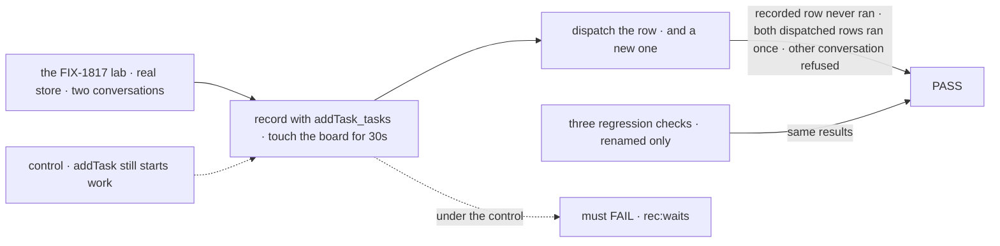
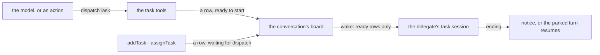

# FIX-1875 · dispatchTask: one tool that starts a task on another worker now, and can wait for it

**Spec** · [Decisions](DECISIONS.md) · [Rules](BUSINESS-RULES.md) · [Plan](PLAN.md) · [Docs](DOCS.md) · [Evolution](EVOLUTION.md)

## Five people, before and after

| Someone who… | Today | After |
|---|---|---|
| **builds a worker that needs a colleague's answer before it goes on** | Gives the model `addTask` and trusts it to set `waitForResponse: true` | The model calls `dispatchTask` with `wait: true`. Same park, same resume, same limits, same errors |
| **builds a worker that hands work over and carries on** | `addTask` with an assignee files the task and, on a conversation's board, starts it at once | `dispatchTask` files it and starts it. The ending arrives as a notice, as today |
| **wants work written down but not started yet** | Can't, on a conversation's board: naming an assignee starts the work | `addTask` and `assignTask` record the task and its owner. It waits until something dispatches it |
| **files work from an app or a script** through the `addTask_tasks` action | The task starts by itself | Sends `dispatchTask_tasks` to start it. `addTask_tasks` now only records it |
| **still sends `waitForResponse` or imports `addTaskAndWait`** | Works | Refused by name, with a message that points at `dispatchTask`; the import fails to compile and the changeset gives the new name |

**Why it matters.** A worker author has to know that one board tool turns into a delivery tool
when a flag is set, and on one kind of board, starts work when an assignee is named. That is the
four-way choice the [epic](../../epics/FIX-1870/SPEC.md) exists to remove. This issue is the
substance of it: the tool, and the board tools going back to being a ledger.

## The goal, and how we'll know it's met

**A worker that needs another worker to do something has one tool that starts the work now and
can wait for the result, and recording a task never starts it.**

| Is it the right goal? | |
|---|---|
| **The real need** | "A worker that needs another worker to do something has one tool that starts the work now and can wait for the result" ([epic goal](../../epics/FIX-1870/SPEC.md#the-goal-and-how-well-know-its-met)), with `addTask` and `assignTask` only recording work ([ER-2](../../epics/FIX-1870/BUSINESS-RULES.md#what-a-team-gets-and-what-it-doesnt)) |
| **Smaller, and rejected** | "`dispatchTask` ships beside `addTask`." Hittable while `addTask` still starts work on a conversation's board, so a model still picks between two tools that both start work, and the vocabulary is still wrong |
| **Bigger, and not this issue's** | One answer-once fence for coordinator posts (FIX-1872) · the internal ask names and the shared docs narrative (FIX-1876) · the epic's closure run (FIX-1887) |
| **Not done if** | A regression check changed by more than the rename map · a task recorded by `addTask` starts without a dispatch · `waitForResponse` is silently dropped instead of refused · a retired name is still exported · a goal check that filed through `addTask_tasks` now silently never runs its task |



The check reads the store: whether a recorded row ever got a run, and whether a dispatched one
ran once. The reruns prove nothing else moved.

| How we verify | |
|---|---|
| **Goal check** | `goals/dispatching-work/a-recorded-task-waits-for-dispatch/` · the FIX-1817 lab and its model · run by the implementer at completion · verdict in the implementation PR. Plus reruns of `goals/hand-offs/ask-survives-a-restart/`, `goals/coordinators/task-session-stays-open/` and `goals/hand-offs/survives-a-restart-and-runs-once/`, and leg e of `goals/workers/files-and-splits-down-the-chain/`, where a real model hands work over without waiting and must now pick `dispatchTask` |
| **Signal** | `rec:waits` a row `addTask_tasks` recorded for a delegate has no run after 30 s of board touches · `disp:ref-runs` `dispatchTask_tasks` on that row runs it once, with one completed notice · `disp:new-runs` a new row dispatched the same way runs once · `lineage:refused` the same dispatch from Alice's other conversation answers `task_not_found` and the row is unchanged · `old:refused` `addTask_tasks` with `waitForResponse` is refused, naming `dispatchTask`, and files nothing. The three reruns and leg e PASS |
| **Input** | Held-out goal words and a delegate picked at run time. Another delegate, or a row recorded unassigned and given its assignee by the dispatch, must pass too |
| **Anti-game** | Don't assert on the tool's return value or a unit stub: grade the store. The rerun diffs are checked against the rename map in [PLAN.md](PLAN.md#pinned-names); no assertion loosened, no leg dropped |
| **Control that must fail** | `GOAL_CONTROL=add-starts` (the task tools don't mark a recorded row as waiting for dispatch) must FAIL `rec:waits`. Today's `main` must FAIL `disp:new-runs` and `rec:waits` |

## What changes


Read across a row: the left column starts work from three tools, the right from one. The band
at the foot is the same in both columns, which is the promise.

**A worker file, as a person edits it:**

```diff
- File each feature as a task for the coder with `addTask`. `addTask` returns at once and the
- task starts by itself, so say you've handed it over.
+ Hand each feature to the coder with `dispatchTask`. It returns at once and the coder starts
+ now, so say you've handed it over. Use `addTask` only to write a task down for later.
```

**A model's call, and a script's:**

```diff
- addTask({ goal: "Which region is the outage in?", assignee: "ops", waitForResponse: true, timeoutMs: 120000 })
+ dispatchTask({ goal: "Which region is the outage in?", assignee: "ops", wait: true, timeoutMs: 120000 })

- await act("coordinator", conversation, "addTask_tasks", { goal, assignee: "desk.ops" })
+ await act("coordinator", conversation, "dispatchTask_tasks", { goal, assignee: "desk.ops" })

+ // a task recorded earlier, started now
+ dispatchTask({ taskId: "task_8f2" })
```

## How a dispatch reaches the delegate



The tools decide whether a row is ready; the board's one test for "can start" reads that. Waiting
is today's ask mechanism, unchanged, under a new name.

## What stays as it is

- **What a waited-on or dispatched task does**, every limit included: no question park, the
  waiting turn owns the row, a timeout cancels it, 30 seconds to an hour, one wait per step, no
  wait from a task turn, host check. [ER-3](../../epics/FIX-1870/BUSINESS-RULES.md#what-a-team-gets-and-what-it-doesnt).
- **Boards a drain runs** (`taskBoard()`, the patterns): `addTask` records and the drain decides,
  as today. No `dispatchTask` there.
- **Flow code that writes the board directly** (`ref.addTask(...)`) keeps today's start.
- **The coordinator's `handOff` tool and its delivery ledger.** FIX-1872 retires them.
- **Internal ask names** (`row.ask`, `parkOnAsk`, `resumeOwedAsks`, `resumeAsk`, `resumesAsks`). FIX-1876.

## Sign off

**[The goal](#the-goal-and-how-well-know-its-met), at that size:** one tool that starts work,
and board tools that never do. If wrong: either we ship a second starting tool and the model
still picks, or we break app code that relied on `addTask_tasks` starting work for no gain.

1. **[D1](DECISIONS.md#d1) · On a conversation's board, `addTask` and `assignTask` stop starting
   work; a recorded task waits for `dispatchTask`.** About 17 goal checks, three worker files
   and an app's `addTask_tasks` calls move to `dispatchTask` with it. If wrong: an app that
   upgrades without reading the changeset files tasks that never run, and nothing errors.
2. **[D2](DECISIONS.md#d2) · `dispatchTask` takes `addTask`'s fields plus `wait` and
   `timeoutMs`, flat, and `taskId` for a recorded row.** If wrong: the model mixes `goal` and
   `taskId`, which is refused at run time rather than by the schema.

**Open: none.** D1 is the one to weigh. Reasoning and what lost: [DECISIONS.md](DECISIONS.md).
The cases: [BUSINESS-RULES.md](BUSINESS-RULES.md).

Feature · `orchestration` + `workforce` + `core` · large (≈60 files, most of them renames) · 2 PRs · epic [FIX-1870](../../epics/FIX-1870/SPEC.md)
