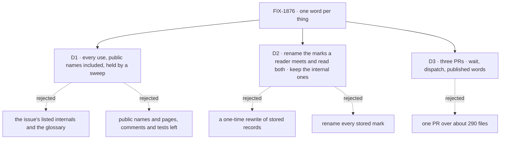

# FIX-1876 · Decisions

[Spec](SPEC.md) · **Decisions** · [Rules](BUSINESS-RULES.md) · [Plan](PLAN.md) · [Docs](DOCS.md) · [Evolution](EVOLUTION.md)

The vocabulary itself is not decided here. The product owner fixed it in the epic's
[D3](../../epics/FIX-1870/DECISIONS.md#d3) on 2026-10-11: *ask* is a question to a person,
*hand-off* is passing your own work on mid-work, new work is *dispatched*, and a caller *waits*.
These cards decide how far the rename reaches, what happens to records written under the old
names, and how the change is cut.

## The tree

## D1 · Rename every use that carries the old meaning, and hold it with a sweep

| | |
|---|---|
| **Instead of** | The issue's list: `row.ask`, `parkOnAsk`, `askGateId`, `resumeOwedAsks`, `isAskGate`, the `fsd.ask.*` keys, `createHandOff`, `handedOffTaskPredicate`, `assertHandOff*Supported`, and the glossary · or public names and published pages only, with code comments and tests left as they are |
| **Because** | The listed names are the tip. The sweep ([`poc/vocabulary-sweep/`](../../../goals/vocabulary/one-word-per-thing/goal.md)) found 2,156 open lines in 289 files on 2026-10-12: 995 in the wait family (identifiers such as `AskEndedError`, `resumeAsk` and `hasAskSweeper`, the stored marks, and phrases like "an asked row"), 1,156 in the dispatch family (968 "hand-off" phrases, 330 identifiers), and 7 stale `post-to-mailbox` mentions. Some wait-family lines will turn out to be questions to a person and be kept; the count is before that classification. The board's dispatcher assignee, a shipped feature, is called "hand-off" in its section title, its `"handed-off"` ending and its block's output. A reader of the API reference, a stack trace or a test name meets the old word as often as a reader of the glossary. D3's reason, "a word that names two things makes a reader look for two mechanisms", applies to all of them ([tenet 1](../../../docs/philosophy.md#1-coherence-over-local-cleverness), [tenet 6](../../../docs/philosophy.md#6-readability-is-an-output)). And only a rule that covers every file can be checked; "public names, but not comments" has no test a machine can run, so it drifts back ([tenet 7](../../../docs/philosophy.md#7-prove-the-goal-not-the-mock)) |
| **Locks in** | The sweep's rules are the definition of done. After this, *hand-off* names nothing in code; the word waits for mid-work hand-off. Exported names are renamed with no deprecated alias, as FIX-1875 does for `waitForResponse` (pre-1.0, a `minor` changeset). The `isTaskDispatcher` named in the issue stays: it already says dispatch |

**What would change my mind:** the owner judging comments and tests not worth the churn. Then the
sweep's rules narrow to names and published pages, and the count roughly halves;
nothing else in the plan changes.

![D1: how far the rename reaches. Chosen: every use, public names, comments and tests included, held by a sweep. Instead of: the issue's listed internals and the glossary. It comes down to the first row: what a reader meets. The listed set leaves AskEndedError, resumeAsk, the handed-off ending and about 970 hand-off phrases in place. Second row, the price: about 2,150 lines in 289 files and a breaking rename of exported names, against about 130 lines. Third row: only the full rule can be checked by a machine. Locks in the sweep as the definition of done and hand-off reserved for mid-work. Flips if comments and tests are judged not worth it](figures/d1-every-use.svg)

It comes down to what a reader meets: the listed set leaves the old word in the API and the board.

## D2 · Rename the stored marks a reader meets, read both; keep the internal ones as they are

| | |
|---|---|
| **Instead of** | A one-time migration that rewrites stored records to the new names, which is what the issue's "with a migration for rows already marked" first suggests · or renaming every stored mark and reading both names for each |
| **Because** | Six kinds of record outlive a deploy under the old names. A row's `ask` field and a suspension's reason `"ask"` are shown in the DevTool and traces, where *ask* reads as a question to a person; the `"handed-off"` ending is a public value apps match on ([WR-17](BUSINESS-RULES.md#public-names)). The other three are internal wire values nobody reads as a word: the `fsd.ask.*` run-once keys, the `ask:` gate-id prefix, and a notice's `asked` flag (Workforce's notice schema is strict, so a renamed flag would refuse a notice owed across the upgrade). D1's reason is what a reader meets; a wire value nobody reads stays as it is ([BP-030](../../../docs/contributing/best-practices.md)), which deletes three legacy readers. A wait parked across the upgrade must still find the three that are renamed, or the colleague's answer is lost. There is no migration runner across the memory, SQLite and Postgres stores and resource-backed collections, and a rewrite would race a turn that is resuming, so the new code reads both names |
| **Locks in** | The row field, the gate reason and the board's ending: every reader accepts the old value and the new one, every writer writes only the new one, and each legacy reader carries a `retired-name-refusal` comment on its line (the one marker for a deliberate old name, shared with FIX-1875), so the sweep counts it and a reviewer sees it. The security reading goes with it: an old `"ask"` gate is still a wait gate, so the public resume route still refuses it ([WR-10](BUSINESS-RULES.md#records-written-before-the-upgrade)). The run-once keys, the gate-id prefix and the notice flag keep their spelling, each one the sweep flags a keep-list entry naming it a wire value; the identifiers that carry them are renamed |

**What would change my mind:** a store migration runner shipping before this builds. Then rewrite
once and drop the readers. Or the owner wanting no old spelling left in the store at all: then
the three internal marks are renamed and read both ways too, at the cost of three more legacy
readers.

![D2: what happens to records written under the old names. Chosen: rename the marks a reader meets, read both names, write only the new, and keep the process-internal marks as they are. Instead of: a one-time rewrite of stored records. It comes down to the first row: a wait parked across the upgrade. Reading both resumes it; a rewrite races the resuming turn and has no runner across four store kinds. Second row, the price: legacy readers for the row field, the gate reason and the ending stay in the code, each marked, against none after the rewrite. Third row, a tie: new records look the same. Locks in every reader of a renamed mark accepting both, the internal marks kept as wire values, and an old ask gate still refused from outside. Flips if a store migration runner ships first](figures/d2-read-old-marks.svg)

It comes down to a wait parked across the upgrade: a rewrite races it and has no runner. Only the
marks a reader meets are worth that price.

## D3 · Three PRs in a chain: wait, dispatch, then the published words

| | |
|---|---|
| **Instead of** | One PR over about 290 files |
| **Because** | The two families touch different packages and different stored marks. The wait family is `core`, `engine`, `orchestration` and `workforce`, with both of the renamed stored marks. The dispatch family is the task board, its ending and its pages. Each PR passes the sweep for its own family (`--only ask`, `--only handoff`), so a reviewer reads one rename map at a time. The third publishes the shared narrative and the glossary once both names exist, and runs the sweep at full scope |
| **Locks in** | P1 wait, then P2 dispatch, then P3 published words, merged in that order. P1 and P2 each fix any published page their renames break, so no merge leaves a page naming a symbol that is gone |

**What would change my mind:** FIX-1875 and FIX-1872 renaming most of the wait family
themselves. Then P1 and P2 fold into one.

![D3: how the change is cut. Chosen: three PRs in a chain, wait, then dispatch, then the published words. Instead of: one PR over about 290 files. It comes down to the first row: what a reviewer can read. Each PR carries one rename map and passes its own part of the sweep. Second row, the price: three reviews and two waits between merges. Third row, a tie: the same end state. Locks in the order and each PR fixing the pages its renames break. Flips if the two upstream issues rename most of the wait family](figures/d3-three-prs.svg)

It comes down to what a reviewer can read: one rename map per PR.

## Decided, not asked

- **The new names follow the error codes already shipped.** The codes a model reads are
  `wait_timed_out`, `wait_task_failed` and `wait_task_cancelled`, so the gate is a *wait gate*.
  A dispatched row's ending is `"dispatched"`. Pinned in [PLAN.md](PLAN.md#pinned-names).
- **Whatever FIX-1875 or FIX-1872 already renamed, they own, unless the new name breaks the one-word
  rule.** If either renames a name on the list, its choice stands and the sweep stops finding it.
  The exception would be *wait* or *dispatch* used in another meaning; P1 renames such a name
  ([WR-22](BUSINESS-RULES.md#the-sweep)). None is known: FIX-1875's row mark shipped as
  `undispatched`.
- **`undispatched` and the `"dispatched"` ending are not opposites.** FIX-1875's mark is a task on a
  conversation's board recorded and not yet started; the ending is a drain-run board's drain finishing
  with every outstanding task in a dispatch run. No page or doc comment pairs them. FIX-1875 owns the
  mark ([its decisions](../FIX-1875/DECISIONS.md)).
- **The board's `onIdle: "wait"` keeps its name.** It means the board stays alive when idle and
  leaves the exit to `shouldExit`. That is a different sense of *wait* (the board waits for work,
  nobody is parked on a row), and renaming the option is a behavioural API change this issue
  doesn't take on. The glossary's *Wait* row says so
  ([WR-23](BUSINESS-RULES.md#which-word-a-use-gets)).
- **The old docs anchor keeps working.** `#assignees-that-hand-off` stays as an explicit anchor
  on the renamed section, so links from outside the site still land.
- **Retained specs, changelogs and goal directories keep their words.** They record history and
  the closure's addresses. FIX-1815's "Hand-off (Layer 1)" definition is superseded through
  [EVOLUTION.md](EVOLUTION.md), not edited.
- **The regression checks change by names only.** FIX-1816's check reads a row's `ask` field. P1
  changes that one read to `wait` and lists it in the rename map, which is what
  [ER-11](../../epics/FIX-1870/BUSINESS-RULES.md#what-no-child-may-do) allows.
- **Pending changesets that announce `post-to-mailbox` are amended.** The tool was removed before
  they released, so the next release notes must not announce it. Verdict rows in goal logs that
  mention it are history and are kept.

## Which methods already do this job

The job is naming, not a mechanism: this issue adds no method, tool or entry. The one fold it
applies is the epic's, one word per mechanism. Searches: the six sweep rules over every tracked
file. Closest entry: none.

## Considered and dropped

- **Deprecated aliases for the exported names.** One release of `parkOnAsk` beside `parkOnWait`.
  Dropped: nothing outside the framework calls them in this repository, the project is pre-1.0,
  and FIX-1875 removes `waitForResponse` with no alias. An alias is also an open sweep hit.
- **Running the sweep on demand only.** D1's reason for the full reach is that only a rule a
  machine runs holds; a goal nobody runs drifts back just the same. The repository already runs
  `scripts/check-retired-terms.mjs` and its `--control` in CI's Process guards, so the sweep joins
  it there at P3 ([PLAN.md → S14](PLAN.md#surfaces)). Its false-positive cost is the keep list P1
  to P3 build anyway.

## Open

None.

## Settled

- **The size of the job.** The issue lists about fifteen names; the sweep counts 2,156 open lines
  in 289 files on `main` at `da8f63fd7`. Re-derive with `node goals/vocabulary/one-word-per-thing/sweep.mjs` (the sweep's home since P3) on that commit's tree.

## How it got here

- **Draft (2026-10-12)** — the vocabulary is the epic's D3; the spec decides reach (every use,
  held by a sweep, after the sweep showed the issue's list missed the board's whole
  dispatcher feature and most of the wait gate's exported names), records
  written before the upgrade (read both names), and the cut (three PRs).
- **Review round 1 (2026-10-12)** — D2 now keeps the three process-internal stored marks (the
  run-once keys, the gate-id prefix, the notice flag) as they are and renames only the ones a
  reader meets, because a review showed the cheaper option had not been weighed and a strict
  Workforce schema made the renamed notice flag a lost-wait risk. The sweep runs in CI from P3,
  because an on-demand check contradicts D1's own reason for the full reach.
- **Cross-spec alignment (2026-10-12, after merge)** — a follow-up PR from `main`, from the epic's
  cross-spec review against FIX-1875 and FIX-1872. Wording and plan only, no decision moved: the
  sweep honours one marker for a deliberate old name, FIX-1875's `retired-name-refusal`, in place
  of `legacy-name:`, and exempts FIX-1872's `handOff` refusal ([WR-25](BUSINESS-RULES.md#the-sweep));
  the glossary's *Dispatch a task* row splits the two kinds of board, and *Assignees that dispatch*
  says how it relates to `dispatchTask` and links FIX-1875's section; the stale `awaitingDispatch`
  reference is gone (FIX-1875 shipped `undispatched`).
