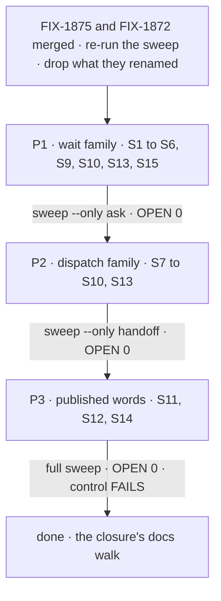

# FIX-1876 · Plan

[Spec](SPEC.md) · [Decisions](DECISIONS.md) · [Rules](BUSINESS-RULES.md) · **Plan** · [Docs](DOCS.md) · [Evolution](EVOLUTION.md)

Written for the implementing agent. Discipline: rename, read both names where a record outlives a
deploy, sweep. **No behaviour changes** ([ER-8](../../epics/FIX-1870/BUSINESS-RULES.md#what-no-child-may-do)).
Starts when FIX-1875 and FIX-1872 have both merged. Rule IDs are [BUSINESS-RULES.md](BUSINESS-RULES.md)'s.

## Surfaces

| ID | PR | Where | Change |
|---|---|---|---|
| S1 | P1 | `packages/core/src/types/ask-gate.ts` → `wait-gate.ts`, its exports from `core` and `core/types` | The wait gate family, per [the map](#pinned-names). `isWaitGate` accepts `"wait"` and, marked, `"ask"` (WR-9) |
| S2 | P1 | `packages/core/src/types/request-host.ts` | `resumeAsk` → `resumeWait`, its input and result types |
| S3 | P1 | `packages/engine/src/durability/` (`resume-ask-gate.ts`, `ask-deadlines.ts`, `durability-sweeper.ts`, `stop-suspended.ts`), `context/ask-resume-operation.ts`, `context/create-request-host.ts`, `execution/runAction.ts`, `routes/resume-routes.ts` | Renames only. Every test of a gate's kind goes through `isWaitGate` (G1). The route keeps refusing old gates (WR-10) |
| S4 | P1 | `packages/orchestration/src/tasks/helpers/wait-for-response.ts`, `tasks/schema/task.ts`, `tasks/schema/task-init.ts`, `tasks/notice/task-notice.ts`, `skills/task-tools-capability.ts`, `src/index.ts` | `row.ask` → `row.wait`, read through one reader that accepts both (WR-8). `fsd.ask.*` → `fsd.wait.*`, looked up new-then-old (WR-11). Gate ids minted `wait:` (WR-12). The notice's flag renamed, old flag read (WR-13). `resumeOwedAsks` → `resumeOwedWaits` |
| S5 | P1 | `packages/workforce/src/conversation-board/` (`board.ts`, `task-settled.ts`) | Callers of S4's renames |
| S6 | P1 | `goals/hand-offs/ask-survives-a-restart/run.mts` | The one read of a row's `ask` becomes `wait`, listed in the rename map (WR-19). Nothing else in a regression check changes |
| S7 | P2 | `packages/orchestration/src/task-board/hand-off.ts` → `dispatch-assignee.ts`, `blocks/hand-off.ts` → `blocks/dispatch-row.ts`, `index.ts`, `task-entry.ts`, `park-exit.ts`, `quiescence.ts`, `blocks/board-meta.ts` | The dispatch family, per the map. The board's ending writes `"dispatched"`; its type and every reader accept `"handed-off"` too, marked (WR-14) |
| S8 | P2 | `packages/claude-code`, `packages/harness-manager`, `apps/kitchen-sink` | Callers and comments that name the S7 symbols |
| S9 | P1, P2 | Each package's tests under `test/`, and `packages/integration-tests` | Renamed with the code they test, file names included (`ask-*.test.ts`, `*hand-off*.test.ts`). Assertions unchanged |
| S10 | P1, P2 | Published pages and READMEs that name a symbol the PR renames | Fixed in the same PR, so no merge leaves a page naming a symbol that is gone |
| S11 | P3 | `apps/docs/docs/glossary.md`, `orchestration/task-board.md`, `server/background-work.md`, `guides/background-work.md`, `guides/keeping-a-flow-running.md`, `docs/architecture/dispatched-work.md`, the package READMEs | [DOCS.md](DOCS.md)'s text, then every remaining phrase use the sweep lists |
| S12 | P3 | `.changeset/post-to-mailbox-tool.md`, `routed-mailboxes.md`, `mailboxes-everywhere.md` | Amended so they don't announce a removed tool (WR-7) |
| S13 | P1, P2 | `.changeset/` | One `minor` fragment per PR for `core`, `engine`, `orchestration`: each renamed export as `old → new`, and for P2 the ending's new value first (WR-16, WR-17) |
| S14 | P3 | `goals/vocabulary/one-word-per-thing/` | The sweep and its rules, moved from this spec's `poc/`, with a `goal.md`. On demand, not a CI gate |
| S15 | P1 | `packages/integration-tests/src/scenarios/` | Leg 2: a wait parked under the old marks on SQLite resumes on the new build (the goal's second leg) |

**Removed:** the files renamed above under their old names; no export alias (D1). **Kept on
purpose:** `isTaskDispatcher`, `dispatcher()`, `TaskDispatcher` (already dispatch);
`abortHandoff` and the engine's request-record hand-over unless rewording is cheap (WR-5); every
person ask (WR-3).

## Sequence

One PR at a time, each merged before the next opens, because P2's pages and P3's narrative name
what the earlier PR renamed.

## Pinned names

The rename map. The closure's script reads this table ([ER-11](../../epics/FIX-1870/BUSINESS-RULES.md#what-no-child-may-do)).
A name FIX-1875 or FIX-1872 already renamed keeps their choice (WR-22).

| Old | New | Stored? |
|---|---|---|
| `ASK_GATE_REASON = "ask"` | `WAIT_GATE_REASON = "wait"` | Yes: read both (WR-9) |
| `isAskGate` · `AskGateBinding` · `AskOutcome` · `AskEndingErrorCode` | `isWaitGate` · `WaitGateBinding` · `WaitOutcome` · `WaitEndingErrorCode` | — |
| `AskEndedError` · `AskStoppedError` | `WaitEndedError` · `WaitStoppedError` | — |
| `parkOnAsk` · `ParkOnAskInput` · `parseAskOutcome` | `parkOnWait` · `ParkOnWaitInput` · `parseWaitOutcome` | — |
| `RequestHost.resumeAsk` · `ResumeAskInput` · `ResumeAskResult` | `resumeWait` · `ResumeWaitInput` · `ResumeWaitResult` | — |
| `resumeAskGate` · `AskResumeOperation` · `createAskResumeOperation` · `hasAskSweeper` and the engine's other `*Ask*` internals | the same with `Wait` | — |
| `resumeOwedAsks` · `askGateId` | `resumeOwedWaits` · `waitGateId` | — |
| `Task.ask` | `Task.wait` | Yes: read both (WR-8) |
| `fsd.ask.step:` · `fsd.ask.plan:` · `fsd.ask.file:` | `fsd.wait.step:` · `fsd.wait.plan:` · `fsd.wait.file:` | Yes: look up new, then old (WR-11) |
| gate id `ask:<board>:<task>#…` | `wait:<board>:<task>#…` | Found by stored id; no reader (WR-12) |
| `TaskNotice.asked` | `TaskNotice.waitedOn` | Yes: read both (WR-13) |
| `createHandOff` · `HandOffOptions` | `createRowDispatch` · `RowDispatchOptions` | — |
| `HandOffAssignee` · `handedOffTaskPredicate` | `DispatchingAssignee` · `dispatchedTaskPredicate` | — |
| `assertHandOffBoardSupported` · `assertHandOffBlockSupported` | `assertDispatchBoardSupported` · `assertDispatchEntrySupported` | — |
| board handle field `handedOff` | `dispatchers` | — |
| board ending `"handed-off"` | `"dispatched"` | Yes, in item logs: read both (WR-14) |
| dispatch block output `handedOff: true` | `dispatched: true` | Yes, in item logs: read both (WR-14) |
| docs section *Assignees that hand off* | *Assignees that dispatch*, with `#assignees-that-hand-off` kept as an anchor (WR-18) | — |

## Checks

| Check | Proves | Fails when |
|---|---|---|
| C1 · the sweep, per family then full | WR-1 to WR-7, WR-15, WR-20 to WR-22 · D1 | An open line, a file with no rule, or an unmarked old name |
| C2 · `--control` | The sweep can fail | It passes with a planted `parkOnAsk` |
| C3 · Leg 2, the upgrade scenario on SQLite | WR-8 to WR-12 · D2 | The turn doesn't resume with the answer, the board holds two rows, or the public route resumes the old gate |
| C4 · Leg 2 with the legacy readers stubbed out | C3 depends on them | It passes |
| C5 · unit checks with an old record, one per reader: the sweeper and resume path with an `"ask"` suspension, the notice with the old flag, a board reader with a `"handed-off"` log | WR-9, WR-13, WR-14 | A reader drops the old name |
| C6 · `pnpm typecheck` and `pnpm test` | WR-16 and no behaviour change | Anything fails; no assertion is edited beyond names |
| C7 · the docs build (`onBrokenAnchors: "throw"`) | WR-18 | The old anchor or a renamed link is broken |
| C8 · the epic's regression checks on the P1 commit | WR-19 | FIX-1816's check fails after its one-line rename |

## Guardrails

- **G1 · One reader per stored mark.** The wait gate's kind is tested only through `isWaitGate`; a
  row's wait only through one accessor; the run-once keys only through one lookup. *Because* a
  legacy read added at one call site and missed at another is the failure the sweep can't see:
  the sweeper and the public route both test a gate's kind, and missing the route is a security
  regression (WR-10). Find every caller with the sweep, not by memory ([tenet 5](../../../docs/philosophy.md#5-fix-at-the-owning-layer)).
- **G2 · Names only.** *Because* the epic's proof is that nothing changed but names; an edit to an
  assertion, a branch or a default is a finding, not a fix (ER-8, ER-11).
- **G3 · Mark every legacy reader with `legacy-name:` and the rule it serves.** *Because* the sweep
  counts them, and a later cleanup finds them by the marker.
- **G4 · A writer never writes an old name.** *Because* reading both is only safe if new records are
  unambiguous (WR-15).

## Docs

[DOCS.md](DOCS.md) is the draft: the glossary rows, the task board's renamed section, the waiting
paragraph in `background-work.md`, the guides' sentences and the architecture doc's terms. P1 and
P2 fix any page that names a symbol they rename (S10); P3 publishes the rest.

## POC

[`poc/vocabulary-sweep/`](poc/vocabulary-sweep/sweep.mjs): the inventory checker. **Showed:** on
`main` at `da8f63fd7` it scans 3,749 of 4,100 tracked files, excludes 351 by named rules, leaves
none unruled, and finds 2,156 open lines in 289 files; the planted control fails as it should.
Premise it settled: the issue's list is a small part of the job ([DECISIONS → Settled](DECISIONS.md#settled)).

## At implement time

- **Re-run the sweep first** on the merged FIX-1875 and FIX-1872 commit. Their renames drop out; the
  coordinator's `handOff` tool should already be gone.
- **Finish the keep list** before renaming: classify every person ask (Shift Manager, the harness
  inbox, approvals, the chief of staff) and every unrelated "hand off" (WR-3, WR-5), each with its
  reason. Then everything left is a rename.
- **Check the old anchor** renders as a target in Docusaurus; if an inline `<a id>` doesn't
  register with the broken-anchor check, use the heading's explicit id syntax instead.
- **Pick the reader shape for `Task.wait`**: a schema that accepts `ask` on read and writes
  `wait`, or an accessor. Either satisfies G1.

## Follow-ups

- **Keep the words out for good:** run the sweep in CI. Not filed yet; the coordinator files it at
  epic wrap if the closure passes, through `issue-manager`.
- **Drop the legacy readers** once no deployment can hold a pre-upgrade wait (D2). Owner: whoever
  ships a store migration runner.

## Notes from review

None yet.
