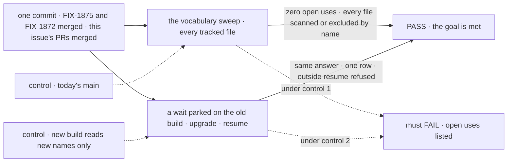

# FIX-1876 · Docs and vocabulary: dispatching a task, waiting, and what hand-off means

**Spec** · [Decisions](DECISIONS.md) · [Rules](BUSINESS-RULES.md) · [Plan](PLAN.md) · [Docs](DOCS.md) · [Evolution](EVOLUTION.md)

## Five people, before and after

| Someone who… | Today | After this |
|---|---|---|
| **reads the docs to give another worker work** | The task board page teaches "Assignees that hand off" and "Asking, and waiting for the answer". The glossary's *Hand-off* is any work that leaves the request | One word per thing. A board or a worker **dispatches** a task; a caller **waits** on one. *Hand-off* is only passing your own work on mid-work. *Ask* is only a question to a person |
| **reads a stack trace, a type, or a board's ending** | `parkOnAsk`, `AskEndedError` and `isAskGate` from `@flow-state-dev/core`; a drain that ends `"handed-off"` | `parkOnWait`, `WaitEndedError`, `isWaitGate`; a drain that ends `"dispatched"` |
| **runs a server with a wait parked across the upgrade** | — | The parked turn resumes with its answer after the upgrade. Its gate still can't be resumed from outside the conversation that waits on it |
| **maintains the framework** | About 2,150 lines in about 290 files use *ask* or *hand-off* for giving work, and nothing stops a new one | One sweep lists every use, and CI runs it. Code, package READMEs and published pages have none, apart from a named keep list and marked deliberate old names (legacy readers and refusals) |
| **uses Shift Manager's Inbox or an approval** | *Ask* means a question to a person | Unchanged. It is now the word's only meaning |

## The goal, and how we'll know it's met

**Once FIX-1875 and FIX-1872 have merged, the framework's code, package READMEs and published
docs use *ask* only for a question to a person, *hand-off* only for passing your own work on
mid-work, and *dispatch* and *wait* for giving another worker work, and nothing a running
deployment holds is lost to the rename.**

| Is it the right goal? | |
|---|---|
| **The real need** | The issue's outcome: "Published docs and code describe one way a worker gives another worker work". The epic's [D3](../../epics/FIX-1870/DECISIONS.md#d3) and [ER-7](../../epics/FIX-1870/BUSINESS-RULES.md#what-a-team-gets-and-what-it-doesnt), and [ER-17](../../epics/FIX-1870/BUSINESS-RULES.md#the-closure): "the published docs and the package READMEs teach one path" |
| **Smaller, and rejected** | "Rename the issue's listed internals and fix the glossary." About fifteen names and a few pages. It leaves the exported core names, the board's `"handed-off"` ending and its *Assignees that hand off* section, and about 970 uses of "hand-off" for dispatching. A reader still meets two words for one thing ([D1](DECISIONS.md#d1)) |
| **Bigger, and not this issue's** | Mid-work hand-off as a feature · renaming goal directories or retained specs (history) · renaming the board's `onIdle: "wait"` (a different sense, kept) · mailbox, seat and room terms ([FIX-1796](https://linear.app/fixpoint-labs/issue/FIX-1796)) · `dispatchTask` itself (FIX-1875) and the coordinator's `handOff` tool (FIX-1872) |
| **Not done if** | The sweep reports an open use · a legacy reader or a refusal isn't marked · a wait parked before the upgrade doesn't resume after it · an old gate becomes resumable from outside · an item log written before the upgrade stops reading as a dispatch · a regression check changed by more than the rename map · an old docs link to *Assignees that hand off* lands nowhere |

The sweep proves the words are gone; the upgrade leg proves the rename lost nothing. Each
control removes exactly what its leg depends on.

| How we verify | |
|---|---|
| **Goal check** | Leg 1: the sweep, [`poc/vocabulary-sweep/sweep.mjs`](../../../goals/vocabulary/one-word-per-thing/goal.md), moved to `goals/vocabulary/one-word-per-thing/` with a `goal.md`. Leg 2: an integration scenario that parks a wait with the old marks written by hand into a durable store (SQLite), starts the new build on that store, and resumes it |
| **Signal** | Leg 1: `OPEN 0` and `0 with no rule`. Leg 2: the turn ends with the colleague's answer, the board holds one row, and the public resume route answers not-found for the old gate |
| **Input** | Leg 1: every git-tracked file under `packages`, `apps`, `docs/architecture`, `.changeset`, `goals`. Leg 2: a row with `ask`, a suspension with reason `"ask"`, the `fsd.ask.*` run-once entries and an owed notice with `asked: true`, exactly as today's build writes them |
| **Anti-game** | No keep-list entry without a reason. No file excluded except by a named rule. A line that names a retired name on purpose (a legacy reader, or a refusal of the old name) carries `retired-name-refusal` on that line, the one marker FIX-1875's sweep also uses. Leg 2 writes the old marks, never the new ones |
| **Control that must fail** | Leg 1 on today's `main` FAILS: 2,156 open lines in 289 files (run 2026-10-12, before the keep list is finished). `--control` plants one `parkOnAsk` and must FAIL on it (it does). Leg 2 with the legacy readers removed FAILS: the turn never resumes |

## What changes

![Today and after, for three families. Ask, the word for a waited-on task: parkOnAsk, the "ask" gate, row.ask become parkOnWait, the "wait" gate and row.wait, with the old marks still read and the internal fsd.ask keys kept. Hand-off, the word for a dispatched row: createHandOff, the "handed-off" ending and Assignees that hand off become the dispatch names and the "dispatched" ending, with old logs still read. Published words: the glossary and the task board pages say dispatch and wait. Kept: ask as a question to a person, isTaskDispatcher, dispatcher(), the goal directories and retained specs](figures/what-changes.svg)

Each family moves to the word D3 chose; the grey row is what keeps its name on purpose.

## What stays as it is

- **What anything does.** Names only ([ER-8](../../epics/FIX-1870/BUSINESS-RULES.md#what-no-child-may-do)). The `wait_*` error codes a model reads already use the new word.
- **Ask as a question to a person**: approvals, Shift Manager's Ask and Inbox, the harness question inbox.
- **`dispatcher()` and `isTaskDispatcher`**, which already say dispatch.
- **Goal directories and retained specs**, such as `goals/hand-offs/`. They are history and the closure's addresses.

## Sign off

**[The goal](#the-goal-and-how-well-know-its-met), at that size:** every use, public names
included, held by a sweep. If wrong: a large rename for a word nobody misreads, or a small one
that leaves the old meaning in the API reference.

1. **[D1](DECISIONS.md#d1) · Rename every use that carries the old meaning, public names, code
   comments and tests included, and hold it with the sweep.** If wrong: about 2,150 changed
   lines and a breaking rename of exported names, for words few readers meet.
2. **[D2](DECISIONS.md#d2) · Rename the stored marks a reader meets and read both; keep the
   internal ones as they are.** A wait parked before the upgrade resumes after it. If wrong:
   legacy readers for three marks stay in the code with no date to leave, or three internal
   marks keep the old spelling.
3. **[D3](DECISIONS.md#d3) · Three PRs in a chain: wait, then dispatch, then the published
   words.** If wrong: three reviews where one would do, or one review nobody can read.

**Open: 0.** D1 is the one to weigh. Reasoning and what lost: [DECISIONS.md](DECISIONS.md). The
cases: [BUSINESS-RULES.md](BUSINESS-RULES.md).

Improvement · names and docs only · large by count, mechanical · three PRs · epic
[FIX-1870](../../epics/FIX-1870/SPEC.md), child 3 · blocked by FIX-1875 and FIX-1872 · blocks
FIX-1887 · Linear [FIX-1876](https://linear.app/fixpoint-labs/issue/FIX-1876)
