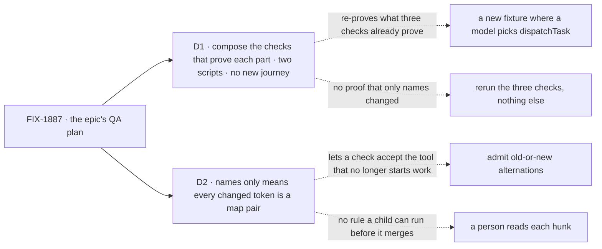

# FIX-1887 · Decisions

[Spec](SPEC.md) · **Decisions** · [Rules](BUSINESS-RULES.md) · [Plan](PLAN.md) · [Docs](DOCS.md)

Two calls shape this closure: what it runs, and what counts as "only names". Everything else is
the closure rule applied, or FIX-1820's closure repeated.

Solid edges are what you sign. Dashed edges are what lost, and why.

## D1 · The closure composes the checks that already prove each part, adds two scripts, and walks no new journey

| | |
|---|---|
| **Instead of** | A new end-to-end fixture in which a real model, on one install, waits on a colleague and hands work over with `dispatchTask`. Or the three reruns alone |
| **Because** | FIX-1820's closure runner already runs FIX-1816's, FIX-1817's and its own check on one commit, with a real model, a real server killed mid-wait, and each control. FIX-1875's leg e of `files-and-splits-down-the-chain` already makes a real model choose `dispatchTask` without being told. Each of the epic's five teams maps to a check that walks its *after* ([PLAN → Part 2](PLAN.md#part-2--one-journey-per-team)). What none of them shows is the epic's own claim, that only names changed and the old surface is gone: that is the two scripts. A new fixture re-proves the first and still misses the second |
| **Locks in** | The closure runs about a dozen checks it does not own, so a run takes roughly an hour and a few dollars of model calls, and a rename in any of them breaks the runner loudly. The scripts ship in this spec now, so the children can run them before they merge |

![D1: what does the closure run? Chosen: the checks that already prove each part, plus two scripts, no new journey. Instead of: a new fixture where a real model waits and hands over with dispatchTask, or the three reruns alone. It comes down to the first row, the epic's claim that only names changed: only the two scripts show it; a new fixture and the reruns alone pass on a check that was widened. Second row, the five teams: every team is walked by an existing check in the chosen option and the fixture; the reruns alone miss the docs reader and the maintainer. Third row, the price: about a dozen checks it does not own and an hour a run; a new fixture to write; the cheapest. Locks in the scripts shipping now. Flips if a team has no check that walks it](figures/d1-compose.svg)

It comes down to the epic's own claim: only the scripts show that nothing changed but names.

## D2 · A diff counts as names only when every changed token is a map pair; a check that accepts both the old and the new name is not

| | |
|---|---|
| **Instead of** | Admitting an alternation (`name === "addTask" \|\| name === "dispatchTask"`) as a rename, because both halves are names. Or a person reading each hunk and judging it |
| **Because** | After FIX-1875, `addTask` records a task and does not start it. A check that counts an `addTask` call as a hand-off then passes when the model picks the tool that never starts the work, which is the behaviour change the epic's kill line exists to catch ([ER-11](../../epics/FIX-1870/BUSINESS-RULES.md#what-no-child-may-do)). The rule has to be one a child can run on its own diff before it merges, so the closure doesn't find in a week what the child could have fixed today. Tokens, not lines: a re-wrapped line still compares, and an article that changes with its noun (*an `addTask_tasks`* → *a `dispatchTask_tasks`*) is admitted |
| **Locks in** | The script is the judge for the six checks. A coordinator check may also change listed fence lines (a ledger read becoming a row read) and FIX-1872's two named shape entries ([#3153](https://github.com/fixpoint-labs/flow-state-dev/pull/3153)); nothing else. On FIX-1875's open first PR today, the script fails six hunks in FIX-1794's check, each widened to accept both names ([PLAN → The POC](PLAN.md#the-poc)) |

![D2: what counts as names only? Chosen: every changed token is a map pair. Instead of: admitting old-or-new alternations, or a person reading each hunk. It comes down to the first row, a check that accepts the old tool: the chosen rule fails it; alternations pass it, though addTask no longer starts work; a person may or may not catch it. Second row, a rule a child can run before merging: the script and alternations both; a person reading hunks does not. Third row, the price: six hunks on FIX-1875's open PR fail today and must be narrowed; none; a reviewer's hour per run. Locks in the script as the judge of the six checks. Flips if the epic owner decides a compatibility line during the rollout is acceptable](figures/d2-strict-map.svg)

It comes down to a check that accepts the old tool: only the strict rule fails it.

**What would change my mind:** the owner deciding that FIX-1875's two-PR rollout needs checks that
accept both names until P2 lands. Then the alternation is admitted only at P1, and the script
fails it again at the closure commit, where only `dispatchTask` starts work.

## Decided, not asked

- **The scripts are built now, in this spec, not at the closure run.** FIX-1872's V9, FIX-1876's
  WR-19 and FIX-1875's VR each check "the epic's rename-map script", and none of them owned it.
  They are retained under [`poc/`](poc/) and move to the goal directory in the closure PR.
- **The sweep reads one commit through `git grep`, so its control runs from the same checkout.**
  It runs at both commits. Exported symbols and tool names are read from source, where each is
  declared by name; building the packages to list them again would recheck what FIX-1875 V6 and
  FIX-1872 BR-18 already refuse at run time. `timeoutMs` on `addTask` is caught when both are
  named on one line; one left in `addTask`'s schema is V6's to refuse.
- **"Workers that use only `dispatchTask`" is proven by absence plus refusal, not by grading tool
  calls in each store.** At the commit, `waitForResponse` is refused by name (FIX-1875 BR-21,
  its V6), `handOff` is refused at load (FIX-1872 BR-18) and the sweep finds neither live. A
  composed check that passes cannot have used either.
- **The docs are walked by mapping each promise to a check, as FIX-1820 did.** Each code sample
  in the pages the set published must be a call a composed check makes, by name and shape. One
  that differs, or a promise nothing reaches, is a finding against the child that published it.
- **FIX-1820's runner is composed whole.** It also reruns FIX-1791's and FIX-1794's checks and
  `routes-a-follow-up-by-its-conversation`, so those run once, not twice.
- **The rename-map base is `f1ae352`**, #3109's merge, "since this spec merged". No commit since
  touched the six checks (`git log f1ae352..9825241` over them is empty).
- **`post-to-mailbox` is already gone.** Its sweep rule passes on today's `main`; it stays in
  the sweep so it cannot come back.

## Considered and dropped

| Option | Why it lost |
|---|---|
| A browser leg | No child adds a screen. The DevTool's row actions are FIX-1875's at-implement-time check |
| Grading every store for the tool each model called | Absence plus refusal proves it without reading a dozen stores (above) |
| A line-level diff rule | A re-wrapped line fails it, and `addTask` → `dispatchTask` makes lines longer |
| Admitting fence lines by pattern | A pattern that admits one ledger read admits others; listing each with its reason is what the report prints |

## How it got here

- **Draft** (2026-10-12) — the closure as FIX-1820's: one runner over the checks that prove each
  part. Built both scripts the children's plans already cite, and ran them: the sweep fails
  today's `main` at 163 live lines, and the rename-map script passes the three regression checks
  on FIX-1875's first PR and fails six widened hunks in FIX-1794's check (D2).
- **Restraint** (2026-10-12) — cut the sweep's runtime half (building and importing the packages
  to list their tools and exports): the static rules already read those names, and FIX-1875 V6 and
  FIX-1872 BR-18 refuse them at run time. Added a rule for `timeoutMs` on `addTask` and widened the
  `handOff` rule to exports and worker `tools:` lines; 165 live lines on the same `main`.
