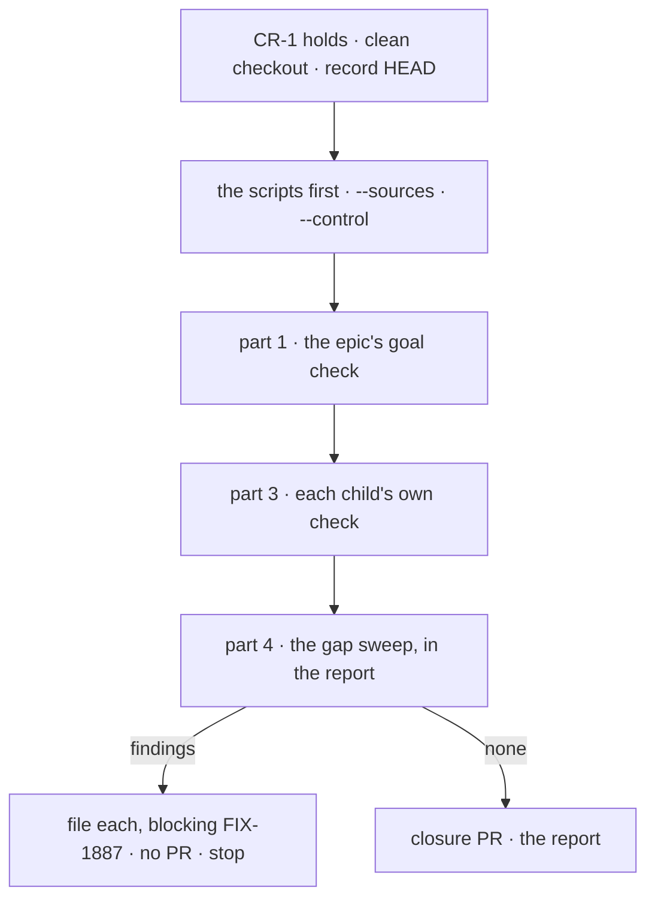

# FIX-1887 · Plan

[Spec](SPEC.md) · [Decisions](DECISIONS.md) · [Rules](BUSINESS-RULES.md) · **Plan** · [Docs](DOCS.md)

Written for the closure worker. Discipline: run, then file; no product code. One PR, opened only
after a run that files nothing (CR-23). It starts when [CR-1](BUSINESS-RULES.md#when-a-run-may-start)
holds. Names below are read off the merged FIX-1875, FIX-1872 and FIX-1876 specs; where the
shipped code or a child's `goal.md` says otherwise, those win and the report says so.

## Surfaces

| ID | Where | Change |
|---|---|---|
| S1 | `goals/dispatching-work/runs-on-dispatch-task-alone/goal.md` | From [SPEC's goal](SPEC.md#the-goal-and-how-well-know-its-met), in the `goals/README.md` format, on-demand posture (CR-5) |
| S2 | `…/run.mts` | The thin runner, shaped like FIX-1820's: refuses a dirty tree, records `HEAD`, re-checks it before each part, runs each check as its own process with its own `GOAL_CONTROL`, grades a control on its exact red set, prints each verdict with the SHA, stops at the first check that can't start |
| S3 | `…/rename-map.mjs`, `…/fence-lines.json` | [`poc/rename-map/check.mjs`](poc/rename-map/check.mjs) moved in, unchanged in rule. The fence file lists each ledger read FIX-1872 turned into a row read: path, the removed text, its replacement, the reason |
| S4 | `…/surface-sweep.mjs` | [`poc/surface-sweep/sweep.mjs`](poc/surface-sweep/sweep.mjs) moved in, unchanged in rule. It reads source only; the runtime refusals are the children's checks, cited in the report (CR-17) |
| S5 | The closure PR | Only after a clean run: S1 to S4, with the report as its body |

Removed: nothing. No composed check, Lab, fixture or `goal.md` is edited (D1, CR-6).

## Sequence



The scripts run first because they need no model: a red one stops the run before an hour of
model calls. Checks run one after another: real model, shared keys, readable output.

## Part 1 · the epic's goal check

| ID | Runs | Passes when |
|---|---|---|
| P1.r | FIX-1820's runner, `goals/hand-offs/survives-a-restart-and-runs-once/run.mts` | Its own verdict: FIX-1816's and FIX-1817's checks plain and under their controls, FIX-1794's check, FIX-1791's two checks, J4 and `fresh-store`, each as its `goal.md` documents |
| P1.k | `goals/workforce-mailboxes/a-routed-post-gets-one-answer/run.mts` (FIX-1610), then under each control its `goal.md` lists | Plain PASS; each control red at its documented legs only (`no-context` at **context** only, as FIX-1872's V9 also requires) |
| P1.c | The controls of FIX-1791's and FIX-1794's checks that P1.r runs plain | Each red at its documented tags only (`unpartitioned`, `no-follow-up`, and `hands-each-post-to-its-delegates`'s `controls/patches.mts`) |
| P1.m | `rename-map.mjs --sources`, `--control`, then the diff `f1ae352..HEAD` with `--rerun-base <control commit>` | `--sources` exits 0; `--control` exits 2 (every plant caught); the diff exits 0 with each fence line printed, FIX-1872 V9's reruns included |
| P1.s | `surface-sweep.mjs --assert` at `HEAD`, then `--assert --at <control commit>`, then `--control` | 0 live lines at `HEAD`; exit 1 at the control commit; `--control` exits 2 |

**The control commit** is the first parent of the merge commit of FIX-1875's first PR (#3168
today). The runner finds it from `git log --first-parent --merges` and prints it.

## Part 2 · one journey per team

The epic's teams table. No team needs a new journey ([D1](DECISIONS.md#d1)); each row names the
check that walks its *after* on the commit. A row with no check that ran is a finding.

| A team that… | After this epic | Walked by |
|---|---|---|
| builds a worker that needs a colleague's result | `dispatchTask({ wait: true })`, same park, resume and limits | P1.r: FIX-1816's check, through a restart |
| builds a worker that hands work over and moves on | `dispatchTask` without `wait`; the ending as a notice; `addTask` only records | P3.a: FIX-1875's check (a recorded row never starts; a dispatched one runs once) and leg e, where a real model picks `dispatchTask` |
| runs a coordinator | A post per delegate is a row, fenced by the claim ticket; lines, rounds and routing unchanged | P1.r's FIX-1791 and FIX-1794 checks, P1.k, P3.b |
| reads the docs | One meaning per word | P3.c's sweep, and part 4's promise map |
| maintains the framework | One fence | P1.s (no ledger) and P3.b's `no-ending-dedupe` (the fence can fail) |

## Part 3 · each child's own check

Each runs unchanged, plain and under its controls. P1 already walks the regression and
coordinator reruns the children name, so they are not repeated.

| ID | Child | Runs | Passes when |
|---|---|---|---|
| P3.a | FIX-1875 | `goals/dispatching-work/a-recorded-task-waits-for-dispatch/`, then `GOAL_CONTROL=add-starts`; leg e of `goals/workers/files-and-splits-down-the-chain/` | `rec:not-started`, `disp:ref-runs`, `disp:new-runs`, `lineage:refused` hold; `add-starts` FAILS `rec:not-started`; leg e PASS |
| P3.b | FIX-1872 | `goals/coordinators/one-fence-answers-each-post-once/`, then `GOAL_CONTROL=no-ending-dedupe`; the two project goals (`goals/projects/a-shared-project-has-one-owner-per-workstream/`, `goals/workforce-privacy/two-users-share-a-project-and-nothing-else/`); the pentest lab; kitchen-sink's `no-landing` control | Legs **b** and **d** hold; `no-ending-dedupe` FAILS `b:one-line`; each rerun's verdict as in FIX-1872's V9 |
| P3.c | FIX-1876 | `goals/vocabulary/one-word-per-thing/`, then `--control`; its leg 2 scenario in `packages/integration-tests` | `OPEN 0` and `0 with no rule`; `--control` FAILS on the planted `parkOnAsk`; leg 2 resumes a wait parked under the old marks |

## Part 4 · gap sweep, in the report

No code. One line per row, naming the check or package test that covers it and its result on
this commit. A row nothing covers is a finding against the child that owns it.

**The coordination seams** ([epic PLAN](../../epics/FIX-1870/PLAN.md#coordination-seams-to-watch)):

| Seam | Covered by |
|---|---|
| The coordinator's delivery: `handOff` and the ledger gone together, no build with two fences | P1.s at `HEAD`; the report names the commit where the ledger left and shows `handOff` left in the same one |
| `task-tools-capability.ts` and `wait-for-response.ts`: public surface, then internals renamed | P1.m (the regression checks read only names), P3.c, and the controls of P1.r that patch the wait's text still reaching it (FIX-1875's guardrail) |
| The shared pages | Each page below, mapped |

**The published promises.** The pages [the epic's DOCS.md](../../epics/FIX-1870/DOCS.md#ownership)
assigns, read as merged:

| Page · section | Owner | Each promise is covered by |
|---|---|---|
| `orchestration/task-board.md` · Giving another worker work | FIX-1875 | Recording never starts (P3.a); dispatch starts now and the ending arrives as a notice (P3.a); `wait` parks and resumes with the output across a restart (P1.r); the limits and the error codes (FIX-1875's V2, V6 and FIX-1816's timeout and stop tests, named) |
| `server/background-work.md` · Waiting for the answer | FIX-1875 | P1.r, and the same named tests |
| `workforce/coordinators.md` · posts as tasks, one per delegate | FIX-1872 | P1.r's FIX-1791 check, P1.k, P3.b |
| `workforce/chief-of-staff.md` · `dispatchTask` replaces `handOff` | FIX-1872 | P1.s (no `handOff` on the surface), P3.b |
| `glossary.md` · *Dispatch a task*, *Hand-off* | FIX-1876 | P3.c |
| `packages/orchestration/README.md`, `packages/workforce/README.md` | FIX-1875, FIX-1872 | P1.s, and each code sample matched below |

Each code sample in those sections is a call a composed check makes, by name and shape. One
that differs is a finding against its owner.

**Not done if.** One sentence per row of SPEC's list, citing the evidence already in the
report: the one SHA, the script's hunk count and fence list, the control commit's FAIL, each
control's red set, and Linear showing no open finding.

## Pinned names

| Name | Why |
|---|---|
| `goals/dispatching-work/runs-on-dispatch-task-alone/` | The epic's closure check, beside FIX-1875's, named for the goal |
| `map:`, `sweep:` | The two signals the report and the children cite |
| `fence-lines.json` and its `{ path, removed, added, why }` entries | FIX-1872's implementer adds its fence lines there, and the report prints them |
| `retired-name-refusal` | The one marker all three children use for a deliberate old name |

## Guardrails

| Rule | Because |
|---|---|
| No edit to any composed check | D1: their proof is earned. A red one is a finding against its owner, and a regression check that must change is the kill line (CR-20) |
| The map is read off the children's tables, never edited to fit a diff | A map that grows to fit the diff proves nothing. A real missing entry is a change to the child's table first, through that child's spec amendment |
| Nothing written to a store by the runner | Each composed check's own anti-game holds only if the runner doesn't touch its store |
| One commit for every part | Checks on different commits prove nothing about the set |
| Say *dispatch*, *wait* and *hand-off* in the report as D3 defines them | The epic's vocabulary, which this run is checking |

## Docs

None to publish. [DOCS.md](DOCS.md) says why; part 4 follows the pages the children published.

<a name="the-poc"></a>
## The POC

Both scripts are built and retained under [`poc/`](poc/). They are the factual base this plan
rests on, and the children's plans already cite them.

```bash
node specs/issues/FIX-1887/poc/rename-map/check.mjs --sources      # exit 0: the map agrees with both tables
node specs/issues/FIX-1887/poc/rename-map/check.mjs --control      # exit 2: every plant caught
node specs/issues/FIX-1887/poc/rename-map/check.mjs --head origin/fix/fix-1875-p1
node specs/issues/FIX-1887/poc/surface-sweep/sweep.mjs --assert    # exit 1 on today's main, as the control must
node specs/issues/FIX-1887/poc/surface-sweep/sweep.mjs --control   # exit 2: every rule catches its plant
```

**Showed (2026-10-12, `main` at `9825241`).** The sweep fails today's `main` at 165 live lines in
six of its seven rules; `post-to-mailbox` already passes. `--sources` agrees with both tables, and a name
planted in FIX-1876's table fails it (exit 3). `--control` catches a loosened timeout, a dropped
leg, a widened assertion, a shape entry in a regression check and a fence line beside a loosened
timeout or in the wrong path, and passes a pure and a
re-wrapped rename. On FIX-1875's open first PR (#3168, head `46773de`), every hunk in the three
regression checks is a name (one by article agreement in `goal.md`), and **six hunks in FIX-1794's
`files-tasks-down-the-owners-chain` fail**: each widens a filter to accept `addTask` or
`dispatchTask`, and one accepts `wait` or `waitForResponse`. Judged as FIX-1872 V9's reruns from
the PR's merge base, leg e of `files-and-splits-down-the-chain` fails three more hunks of the same
kind. That is D2's case, found before the
closure ran.

## At implement time

- Re-read each child's merged `goal.md` for its controls and red sets; the runner hard-codes them,
  as FIX-1820's does.
- Read FIX-1872's merged diff to the coordinator checks and write `fence-lines.json` from it, one
  entry per ledger read, each with its reason. A fence line that changes an outcome line is a
  finding, not an entry.
- Find FIX-1875's V2 and V6 tests, FIX-1872's BR-18 test (its V7) and FIX-1816's timeout and stop
  tests, and name them in the report.
- Re-run `--sources`: a child's amended table since this spec is read, not assumed.

## Follow-ups

- None filed. The nine widened hunks above are for FIX-1875's PR review; if they merge as they
  are, the closure files them (CR-18).

## Notes from review

Recorded for the closure worker; none changes the approach.

- **The sweep and FIX-1876's sweep both name retired words** (#3178 review). FIX-1876's
  `one-word-per-thing` owns the vocabulary across the tree and runs here as P3.c; this sweep keeps
  only the names the epic's signal lists, at one commit with a control commit. Whether this sweep
  should read FIX-1876's `rules.mjs` instead is left to the coordinator; the overlap costs a
  duplicate hit, never a missed one.
- **A script for the docs promise map** (part 4): kept a read. Each sample is checked by name and
  shape against a composed check's call; if that read misses in practice, the script is the fix.
- **The sweep's scope** stays what a person reads or imports. Tests, `docs/architecture/**` and
  `*.spec.*` are FIX-1876's sweep's to read.
- **Part 2's teams table** stays: it is the epic's own table, and each row points at a check part 1
  or 3 already runs, so it adds no run.
- **One `git grep` per rule** is fast enough on demand; merge them only if a run is slow.
- **`handedOff` has two map pairs** (`dispatchers`, `dispatched`), as FIX-1876's table has; both
  are names, so the pair set admits either.
- **The control commit** is FIX-1875's P1 merge's first parent: P1 is its first PR.
