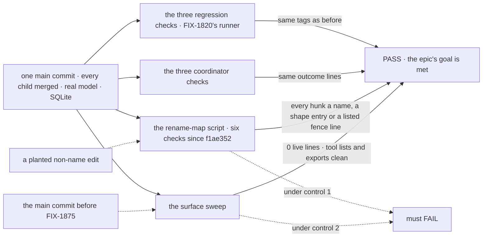

# FIX-1887 · Closure: hand-offs run on dispatchTask alone, and nothing changes but names

**Spec** · [Decisions](DECISIONS.md) · [Rules](BUSINESS-RULES.md) · [Plan](PLAN.md) · [Docs](DOCS.md)

## Four people, before and after

| Someone who… | Today | After this closes |
|---|---|---|
| **decides whether the epic is done** | Three children, each with its own check, merging one after another. Nothing has run them all on one commit | One report on one `main` commit: the three regression checks and three coordinator checks with their controls, each child's own check, the surface sweep and its failing control, and each finding with its retest |
| **builds a worker that waits for, or hands over, work** | Is told by the epic that nothing changed but names. Nobody has checked that against the diff | A script reads the diff to the six checks since the epic spec merged and fails on any line a name doesn't explain. The checks still pass |
| **reads the docs or a package README** | Five pages and two READMEs change across three PRs | No retired name on the public surface at the commit, and each promise those pages make maps to a check that ran on it, or is a finding |
| **writes a child's PR in this epic** | Each child's plan points at "the epic's rename-map script", and no such script exists | The script and the sweep are in this spec now, so a child checks its own diff with the judge the closure uses |

## The goal, and how we'll know it's met

**On one `main` commit, with every other child of FIX-1870 merged, the hand-off checks pass as
they did before with workers that can use only `dispatchTask`, their diff since the epic began is
names only, and the retired tools and the delivery ledger are gone from the public surface.**

| Is it the right goal? | |
|---|---|
| **The real need** | The [epic's goal](../../epics/FIX-1870/SPEC.md#the-goal-and-how-well-know-its-met) on the assembled set ([ER-15 to ER-17](../../epics/FIX-1870/BUSINESS-RULES.md#the-closure)): "one tool that starts the work now and can wait for the result", proven by checks that "get the same result they got before", and the [closure rule](../../../docs/contributing/orchestration.md#the-closure-issue-every-epic-ends-in-qa) |
| **Smaller, and rejected** | "Rerun the three regression checks on one commit." It shows they pass, not that only names changed: a check widened to accept the old tool and the new one still passes. The rename-map script is what makes "nothing changed but names" a claim. The [POC](PLAN.md#the-poc) shows such a widening on a child's open PR today |
| **Bigger, and not this issue's** | Fixing anything (a finding becomes a child of FIX-1870) · a new journey a user does not need · FIX-1876's own vocabulary sweep (it runs here as a child's check, item 3) |
| **Not done if** | Checks ran on different commits · a regression check's diff has a line the map doesn't explain · a coordinator check's diff has an unlisted fence line · the sweep passes on the control commit · a retired name is live on the surface · a child's check or control was skipped · a finding is open or was fixed in the closure PR |

The reruns prove nothing changed for a person; the script proves nothing changed in the checks
but names; the sweep proves the old ways are gone. Each control breaks exactly what its leg reads.

| How we verify | |
|---|---|
| **Goal check** | `goals/dispatching-work/runs-on-dispatch-task-alone/`: a thin runner over the commit. It runs FIX-1820's closure runner (FIX-1816, FIX-1817 and FIX-1820 with their controls, plus FIX-1791's and FIX-1794's checks), FIX-1610's check, every child's own check, the rename-map script and the sweep. On demand, not a CI gate. Committed by the closure PR, whose body is the report |
| **Signal** | Each composed check's own tags, plain PASS, each control red at exactly its documented tags. `map:` every hunk in the six checks since `f1ae352` explained. `sweep:` 0 live lines at `HEAD` across seven rules, exported symbols and tool names included |
| **Input** | Real workers on `openai/gpt-5.4-mini`, SQLite, each check's held-out words. The six checks as they stood when the epic spec merged (`f1ae352`) |
| **Anti-game** | No edit to any composed check by this issue. No assertion on a child's unit tests. The map is read off the children's pinned tables, and `--sources` fails if they disagree. A fence line is admitted only in a coordinator check, only when listed with its path and reason, alone: the rest of its hunk is still judged. The report prints each one |
| **Control that must fail** | The sweep at the `main` commit before FIX-1875's first PR merged must FAIL (165 live lines on `9825241`, 2026-10-12). The script's `--control` must catch a loosened timeout, a dropped leg and an assertion widened to the old name (it does). Each composed check's own controls must FAIL as documented |

## What changes

![Today: three children merge one after another, each green on its own commit, and the epic's rename-map script and sweep do not exist. After: one main commit and one runner. Part 1 is the epic's goal check: FIX-1820's runner over the three regression checks and two coordinator checks, FIX-1610's check, the rename-map script over six checks and the surface sweep with its control commit. Part 2 maps each of the epic's five teams to the check that walks it. Part 3 reruns each child's own check. Part 4 is the gap sweep in the report. A finding becomes a child of FIX-1870, blocks this issue, and sends the whole plan round again](figures/what-changes.svg)

Everything right of the commit line runs together; the two scripts are the only new code, and
both exist now.

## What stays as it is

- **No product work.** A gap becomes a child of FIX-1870 that blocks this issue.
- **Every composed check** runs as it is on `main`, with its own controls. A red one is a finding
  against its owner, never a rewrite here.
- **FIX-1820's runner** is composed, not copied.

## Sign off

**[The goal](#the-goal-and-how-well-know-its-met), at that size:** the same checks pass, their
diff is names, and the old surface is gone, all on one commit. If wrong: the epic wraps on a
rename that hid a behaviour change, or waits on a proof nobody needed.

1. **[D1](DECISIONS.md#d1) · The closure composes the checks that already prove each part and
   adds two scripts, no new journey.** If wrong: one of the epic's five teams has no check that
   walks its *after* at the commit, and it ships unproved.
2. **[D2](DECISIONS.md#d2) · A diff counts as names only when every changed token is a map
   pair; a check widened to accept both the old and the new name is not.** If wrong: the closure
   files findings on harmless compatibility lines, a round each.

**Open: none.** D2 is the one to weigh: it already fails six lines on FIX-1875's open first PR.
Reasoning and what lost: [DECISIONS.md](DECISIONS.md). The cases:
[BUSINESS-RULES.md](BUSINESS-RULES.md).

Improvement · closure (QA) · `goals/` only · medium, repeats per finding · one PR after a clean
run · epic [FIX-1870](../../epics/FIX-1870/SPEC.md), closure · required · runs after FIX-1875,
FIX-1872 and FIX-1876 merge · Linear [FIX-1887](https://linear.app/fixpoint-labs/issue/FIX-1887)
